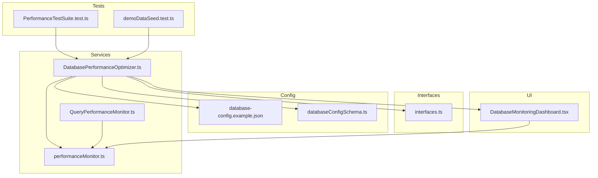
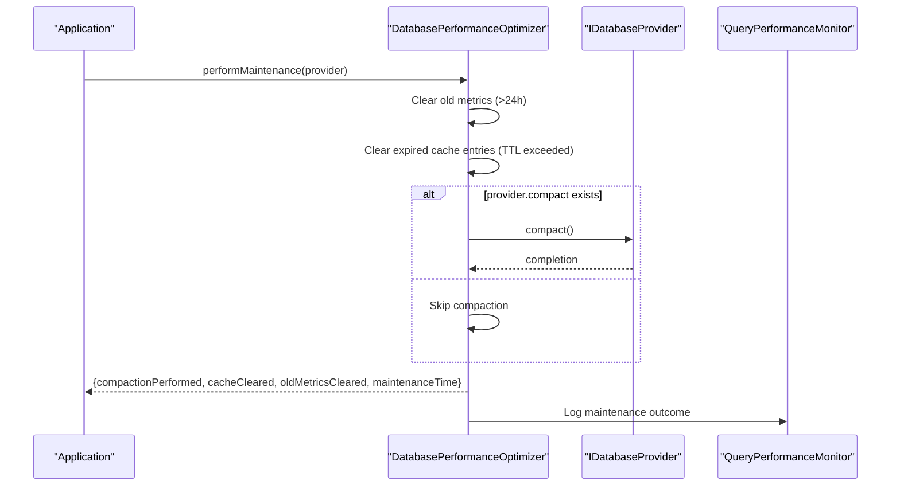
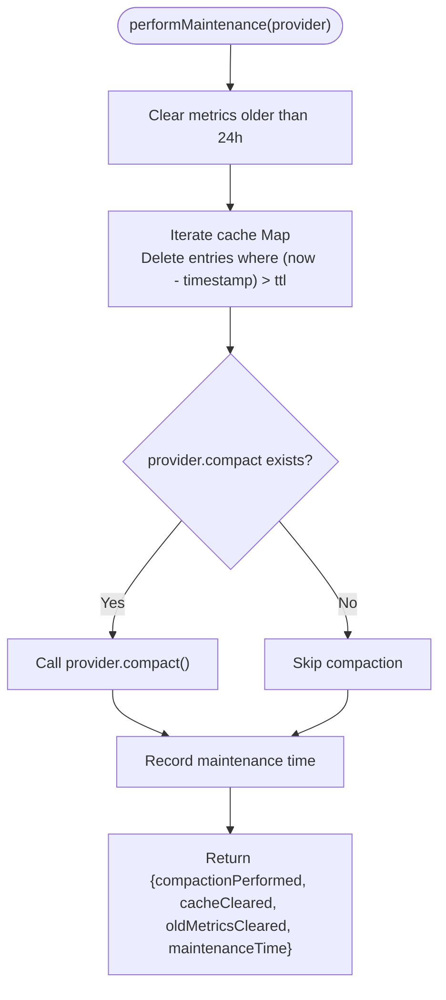
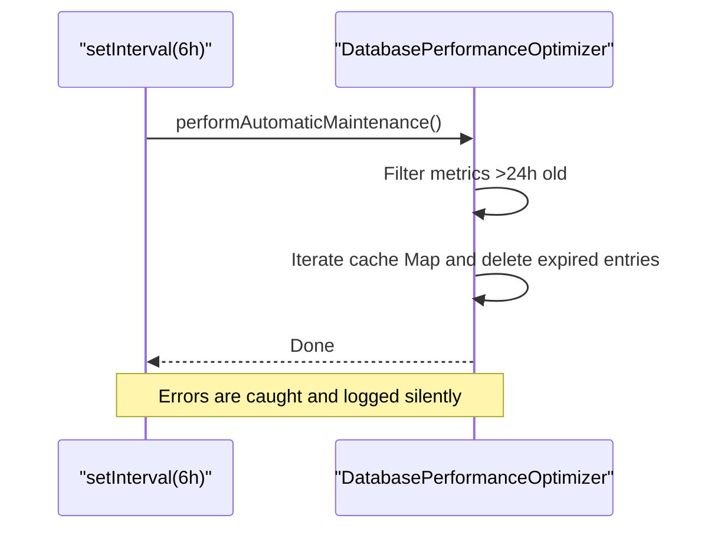
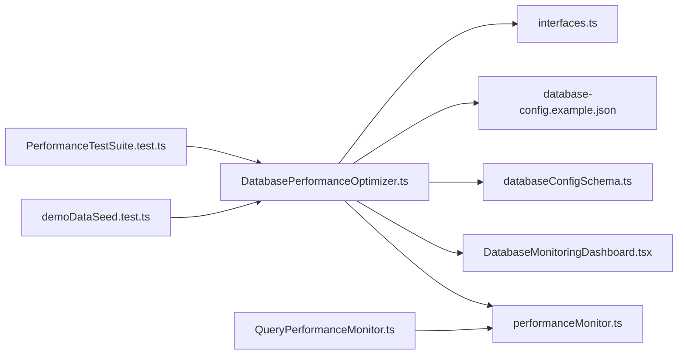

# Database Maintenance

<cite>
**Referenced Files in This Document**
- [DatabasePerformanceOptimizer.ts](file://src/services/database/DatabasePerformanceOptimizer.ts)
- [interfaces.ts](file://src/services/database/interfaces.ts)
- [database-config.example.json](file://public/database-config.example.json)
- [databaseConfigSchema.ts](file://src/config/databaseConfigSchema.ts)
- [DatabaseMonitoringDashboard.tsx](file://src/components/DatabaseMonitoringDashboard.tsx)
- [QueryPerformanceMonitor.ts](file://src/services/database/performance/QueryPerformanceMonitor.ts)
- [performanceMonitor.ts](file://src/services/performance/performanceMonitor.ts)
- [performanceAnalysis.ts](file://src/utils/performanceAnalysis.ts)
- [PerformanceTestSuite.test.ts](file://src/services/database/__tests__/PerformanceTestSuite.test.ts)
- [demoDataSeed.test.ts](file://src/services/database/__tests__/demoDataSeed.test.ts)
</cite>

## Table of Contents
1. [Introduction](#introduction)
2. [Project Structure](#project-structure)
3. [Core Components](#core-components)
4. [Architecture Overview](#architecture-overview)
5. [Detailed Component Analysis](#detailed-component-analysis)
6. [Dependency Analysis](#dependency-analysis)
7. [Performance Considerations](#performance-considerations)
8. [Troubleshooting Guide](#troubleshooting-guide)
9. [Conclusion](#conclusion)
10. [Appendices](#appendices)

## Introduction
This document describes SchoolPilot3's automated database maintenance system, focusing on the performMaintenance function and related maintenance procedures. It covers compaction, cache clearing, metric cleanup, automatic scheduling, configuration, monitoring, error handling, and best practices for production deployments. The system ensures long-term database health by periodically cleaning expired cache entries, pruning old performance metrics, and invoking provider-level compaction when available.

## Project Structure
The maintenance system spans several modules:
- Database performance optimizer service orchestrating maintenance
- Database provider interfaces enabling compaction
- Configuration schema and example for tuning maintenance-related settings
- Monitoring dashboards and performance utilities for observability
- Tests validating performance and maintenance behavior

**Diagram sources**
- [DatabasePerformanceOptimizer.ts:1-684](file://src/services/database/DatabasePerformanceOptimizer.ts#L1-L684)
- [interfaces.ts:178-218](file://src/services/database/interfaces.ts#L178-L218)
- [database-config.example.json:1-49](file://public/database-config.example.json#L1-L49)
- [databaseConfigSchema.ts:55-201](file://src/config/databaseConfigSchema.ts#L55-L201)
- [DatabaseMonitoringDashboard.tsx:1-493](file://src/components/DatabaseMonitoringDashboard.tsx#L1-L493)
- [QueryPerformanceMonitor.ts:494-635](file://src/services/database/performance/QueryPerformanceMonitor.ts#L494-L635)
- [performanceMonitor.ts:267-316](file://src/services/performance/performanceMonitor.ts#L267-L316)
- [PerformanceTestSuite.test.ts:715-789](file://src/services/database/__tests__/PerformanceTestSuite.test.ts#L715-L789)
- [demoDataSeed.test.ts:40-60](file://src/services/database/__tests__/demoDataSeed.test.ts#L40-L60)

**Section sources**
- [DatabasePerformanceOptimizer.ts:1-684](file://src/services/database/DatabasePerformanceOptimizer.ts#L1-L684)
- [interfaces.ts:178-218](file://src/services/database/interfaces.ts#L178-L218)
- [database-config.example.json:1-49](file://public/database-config.example.json#L1-L49)
- [databaseConfigSchema.ts:55-201](file://src/config/databaseConfigSchema.ts#L55-L201)
- [DatabaseMonitoringDashboard.tsx:1-493](file://src/components/DatabaseMonitoringDashboard.tsx#L1-L493)

## Core Components
- DatabasePerformanceOptimizer: Central maintenance orchestrator performing compaction, cache clearing, and metric cleanup. It also starts an automatic maintenance scheduler and exposes manual maintenance triggers via performMaintenance.
- IDatabaseProvider and ICollection: Define provider capabilities including compact() for space optimization.
- Configuration: database-config.example.json and databaseConfigSchema.ts define performance and monitoring settings impacting maintenance behavior.
- Monitoring: DatabaseMonitoringDashboard.tsx and QueryPerformanceMonitor.ts provide operational visibility into performance and cache health.
- Utilities: performanceMonitor.ts and performanceAnalysis.ts support broader performance measurement and insight generation.

**Section sources**
- [DatabasePerformanceOptimizer.ts:503-555](file://src/services/database/DatabasePerformanceOptimizer.ts#L503-L555)
- [DatabasePerformanceOptimizer.ts:558-592](file://src/services/database/DatabasePerformanceOptimizer.ts#L558-L592)
- [interfaces.ts:178-218](file://src/services/database/interfaces.ts#L178-L218)
- [database-config.example.json:5-11](file://public/database-config.example.json#L5-L11)
- [databaseConfigSchema.ts:72-100](file://src/config/databaseConfigSchema.ts#L72-L100)
- [DatabaseMonitoringDashboard.tsx:192-249](file://src/components/DatabaseMonitoringDashboard.tsx#L192-L249)
- [QueryPerformanceMonitor.ts:494-635](file://src/services/database/performance/QueryPerformanceMonitor.ts#L494-L635)
- [performanceMonitor.ts:267-316](file://src/services/performance/performanceMonitor.ts#L267-L316)
- [performanceAnalysis.ts:284-327](file://src/utils/performanceAnalysis.ts#L284-L327)

## Architecture Overview
The maintenance system integrates with the database provider abstraction to perform compaction when supported. It maintains internal caches and metrics, periodically cleans them, and logs outcomes. Monitoring components surface health signals and performance trends.

**Diagram sources**
- [DatabasePerformanceOptimizer.ts:503-555](file://src/services/database/DatabasePerformanceOptimizer.ts#L503-L555)
- [DatabasePerformanceOptimizer.ts:536-540](file://src/services/database/DatabasePerformanceOptimizer.ts#L536-L540)
- [interfaces.ts:178-218](file://src/services/database/interfaces.ts#L178-L218)
- [QueryPerformanceMonitor.ts:494-635](file://src/services/database/performance/QueryPerformanceMonitor.ts#L494-L635)

## Detailed Component Analysis

### DatabasePerformanceOptimizer: Maintenance Procedures
- Compaction: If the provider supports compact(), the optimizer invokes it during maintenance to reclaim space.
- Cache clearing: Removes expired cache entries based on TTL checks; also clears the entire cache when requested.
- Metric cleanup: Retains recent metrics only (prunes entries older than 24 hours).
- Automatic scheduler: Runs every 6 hours to perform lightweight maintenance (clear old metrics and expired cache entries).
- Manual trigger: performMaintenance(provider) performs the full maintenance routine and returns structured results.

**Diagram sources**
- [DatabasePerformanceOptimizer.ts:503-555](file://src/services/database/DatabasePerformanceOptimizer.ts#L503-L555)
- [DatabasePerformanceOptimizer.ts:523-540](file://src/services/database/DatabasePerformanceOptimizer.ts#L523-L540)

**Section sources**
- [DatabasePerformanceOptimizer.ts:503-555](file://src/services/database/DatabasePerformanceOptimizer.ts#L503-L555)
- [DatabasePerformanceOptimizer.ts:558-592](file://src/services/database/DatabasePerformanceOptimizer.ts#L558-L592)
- [DatabasePerformanceOptimizer.ts:654-664](file://src/services/database/DatabasePerformanceOptimizer.ts#L654-L664)

### Automatic Maintenance Scheduler
- Frequency: Every 6 hours.
- Scope: Clears old metrics and expired cache entries.
- Error handling: Logs failures but does not rethrow to keep the scheduler resilient.

**Diagram sources**
- [DatabasePerformanceOptimizer.ts:558-592](file://src/services/database/DatabasePerformanceOptimizer.ts#L558-L592)

**Section sources**
- [DatabasePerformanceOptimizer.ts:558-592](file://src/services/database/DatabasePerformanceOptimizer.ts#L558-L592)

### Manual Maintenance Triggers
- Method: performMaintenance(provider)
- Purpose: Full maintenance cycle including compaction when supported.
- Returns: Structured results indicating what was cleaned/compacted and total maintenance time.

**Section sources**
- [DatabasePerformanceOptimizer.ts:503-555](file://src/services/database/DatabasePerformanceOptimizer.ts#L503-L555)

### Database Compaction for Space Optimization
- Implemented via provider.compact() when available.
- Called during performMaintenance(provider) after cache and metrics cleanup.
- Providers implementing compact() are compatible with this maintenance step.

**Section sources**
- [DatabasePerformanceOptimizer.ts:536-540](file://src/services/database/DatabasePerformanceOptimizer.ts#L536-L540)
- [interfaces.ts:178-218](file://src/services/database/interfaces.ts#L178-L218)

### Cache Invalidation for Stale Data Removal
- Expired entries: Automatically pruned during maintenance and cleanup cycles.
- TTL-based eviction: Entries older than configured TTL are removed.
- Manual cache clear: Available via clearCache() for targeted invalidation.

**Section sources**
- [DatabasePerformanceOptimizer.ts:523-540](file://src/services/database/DatabasePerformanceOptimizer.ts#L523-L540)
- [DatabasePerformanceOptimizer.ts:580-586](file://src/services/database/DatabasePerformanceOptimizer.ts#L580-L586)
- [DatabasePerformanceOptimizer.ts:604-631](file://src/services/database/DatabasePerformanceOptimizer.ts#L604-L631)
- [DatabasePerformanceOptimizer.ts:437-440](file://src/services/database/DatabasePerformanceOptimizer.ts#L437-L440)

### Metric Rotation for Performance Data Management
- Retention policy: Metrics older than 24 hours are pruned.
- Memory footprint: Estimated memory usage helps assess impact.
- Reporting: getPerformanceReport() aggregates metrics for dashboards and monitoring.

**Section sources**
- [DatabasePerformanceOptimizer.ts:517-521](file://src/services/database/DatabasePerformanceOptimizer.ts#L517-L521)
- [DatabasePerformanceOptimizer.ts:636-649](file://src/services/database/DatabasePerformanceOptimizer.ts#L636-L649)
- [DatabasePerformanceOptimizer.ts:401-432](file://src/services/database/DatabasePerformanceOptimizer.ts#L401-L432)

### Maintenance Operation Monitoring
- Logging: Maintenance start, completion, and errors are logged.
- Metrics: Maintenance time recorded for performance tracking.
- Dashboard: DatabaseMonitoringDashboard.tsx surfaces performance and memory health.
- Trends: QueryPerformanceMonitor.ts tracks trends and alerts.

**Section sources**
- [DatabasePerformanceOptimizer.ts:542-544](file://src/services/database/DatabasePerformanceOptimizer.ts#L542-L544)
- [DatabasePerformanceOptimizer.ts:551-554](file://src/services/database/DatabasePerformanceOptimizer.ts#L551-L554)
- [DatabaseMonitoringDashboard.tsx:192-249](file://src/components/DatabaseMonitoringDashboard.tsx#L192-L249)
- [QueryPerformanceMonitor.ts:494-635](file://src/services/database/performance/QueryPerformanceMonitor.ts#L494-L635)

### Error Handling
- Maintenance failures: Logged with error context; thrown to surface issues to callers.
- Automatic maintenance: Caught and logged silently to avoid interrupting the scheduler.
- Configuration validation: databaseConfigSchema.ts validates and auto-fixes maintenance-related settings.

**Section sources**
- [DatabasePerformanceOptimizer.ts:551-554](file://src/services/database/DatabasePerformanceOptimizer.ts#L551-L554)
- [DatabasePerformanceOptimizer.ts:589-591](file://src/services/database/DatabasePerformanceOptimizer.ts#L589-L591)
- [databaseConfigSchema.ts:317-360](file://src/config/databaseConfigSchema.ts#L317-L360)

### Maintenance Scheduling Customization
- Automatic interval: 6 hours fixed in code.
- Configuration: database-config.example.json and databaseConfigSchema.ts define performance and monitoring settings; maintenance intervals are not configurable via config in the analyzed code.

**Section sources**
- [DatabasePerformanceOptimizer.ts:560-567](file://src/services/database/DatabasePerformanceOptimizer.ts#L560-L567)
- [database-config.example.json:5-11](file://public/database-config.example.json#L5-L11)
- [databaseConfigSchema.ts:72-100](file://src/config/databaseConfigSchema.ts#L72-L100)

## Dependency Analysis
The maintenance system depends on:
- Provider abstraction for compaction
- Configuration schema for validation and defaults
- Monitoring utilities for observability
- Testing utilities to validate performance and maintenance behavior

**Diagram sources**
- [DatabasePerformanceOptimizer.ts:1-684](file://src/services/database/DatabasePerformanceOptimizer.ts#L1-L684)
- [interfaces.ts:178-218](file://src/services/database/interfaces.ts#L178-L218)
- [database-config.example.json:1-49](file://public/database-config.example.json#L1-L49)
- [databaseConfigSchema.ts:55-201](file://src/config/databaseConfigSchema.ts#L55-L201)
- [DatabaseMonitoringDashboard.tsx:1-493](file://src/components/DatabaseMonitoringDashboard.tsx#L1-L493)
- [QueryPerformanceMonitor.ts:494-635](file://src/services/database/performance/QueryPerformanceMonitor.ts#L494-L635)
- [performanceMonitor.ts:267-316](file://src/services/performance/performanceMonitor.ts#L267-L316)
- [PerformanceTestSuite.test.ts:715-789](file://src/services/database/__tests__/PerformanceTestSuite.test.ts#L715-L789)
- [demoDataSeed.test.ts:40-60](file://src/services/database/__tests__/demoDataSeed.test.ts#L40-L60)

**Section sources**
- [DatabasePerformanceOptimizer.ts:1-684](file://src/services/database/DatabasePerformanceOptimizer.ts#L1-L684)
- [interfaces.ts:178-218](file://src/services/database/interfaces.ts#L178-L218)
- [databaseConfigSchema.ts:55-201](file://src/config/databaseConfigSchema.ts#L55-L201)

## Performance Considerations
- Maintenance cadence: 6-hour automatic runs balance overhead with effectiveness.
- Cache TTL: Default TTL is 5 minutes; adjust based on workload characteristics.
- Metric retention: 24-hour retention keeps historical trends while limiting memory growth.
- Provider compaction: Only effective when provider implements compact().
- Monitoring overhead: Logging and metrics collection add minimal overhead; tune log levels via configuration.

[No sources needed since this section provides general guidance]

## Troubleshooting Guide
- Maintenance not running: Verify automatic scheduler initialization and lack of uncaught exceptions.
- Compaction not occurring: Confirm provider supports compact() method.
- Cache not clearing: Check TTL thresholds and cache size limits.
- Performance degradation: Use DatabaseMonitoringDashboard.tsx and QueryPerformanceMonitor.ts to identify bottlenecks; consider index recommendations generated by the optimizer.

**Section sources**
- [DatabasePerformanceOptimizer.ts:558-592](file://src/services/database/DatabasePerformanceOptimizer.ts#L558-L592)
- [DatabasePerformanceOptimizer.ts:536-540](file://src/services/database/DatabasePerformanceOptimizer.ts#L536-L540)
- [DatabasePerformanceOptimizer.ts:604-631](file://src/services/database/DatabasePerformanceOptimizer.ts#L604-L631)
- [DatabaseMonitoringDashboard.tsx:192-249](file://src/components/DatabaseMonitoringDashboard.tsx#L192-L249)
- [QueryPerformanceMonitor.ts:494-635](file://src/services/database/performance/QueryPerformanceMonitor.ts#L494-L635)

## Conclusion
SchoolPilot3’s maintenance system automates critical database hygiene through periodic cleanup of stale cache entries and metrics, and provider-driven compaction when available. The system is observable via dashboards and monitors, configurable through centralized settings, and designed to minimize disruption with conservative defaults suitable for production.

[No sources needed since this section summarizes without analyzing specific files]

## Appendices

### Maintenance Execution Examples
- Automatic maintenance logs: See maintenance start and completion messages in the optimizer logs.
- Manual maintenance results: Returned structure includes compactionPerformed, cacheCleared, oldMetricsCleared, and maintenanceTime.

**Section sources**
- [DatabasePerformanceOptimizer.ts:542-544](file://src/services/database/DatabasePerformanceOptimizer.ts#L542-L544)
- [DatabasePerformanceOptimizer.ts:545-550](file://src/services/database/DatabasePerformanceOptimizer.ts#L545-L550)

### Performance Improvements and Impact Assessment
- Performance regression detection: Tests compare baseline and current metrics to flag significant degradations.
- Insight generation: Utilities analyze trends and produce actionable insights for maintenance decisions.

**Section sources**
- [PerformanceTestSuite.test.ts:715-789](file://src/services/database/__tests__/PerformanceTestSuite.test.ts#L715-L789)
- [performanceAnalysis.ts:284-327](file://src/utils/performanceAnalysis.ts#L284-L327)

### Best Practices and Production Guidance
- Scheduling: Use the existing 6-hour interval; avoid overlapping with peak hours.
- Configuration: Validate and auto-fix settings using the configuration schema.
- Monitoring: Regularly review DatabaseMonitoringDashboard.tsx and QueryPerformanceMonitor.ts alerts.
- Downtime considerations: Provider compaction may be resource-intensive; schedule maintenance windows for heavy workloads.

**Section sources**
- [DatabasePerformanceOptimizer.ts:558-592](file://src/services/database/DatabasePerformanceOptimizer.ts#L558-L592)
- [databaseConfigSchema.ts:317-360](file://src/config/databaseConfigSchema.ts#L317-L360)
- [DatabaseMonitoringDashboard.tsx:1-493](file://src/components/DatabaseMonitoringDashboard.tsx#L1-L493)
- [QueryPerformanceMonitor.ts:494-635](file://src/services/database/performance/QueryPerformanceMonitor.ts#L494-L635)