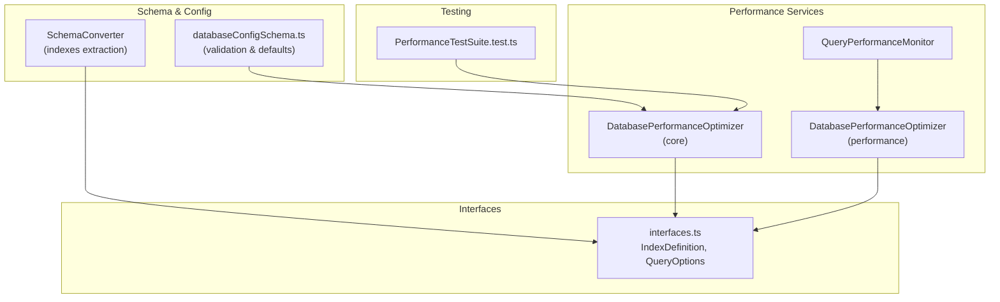
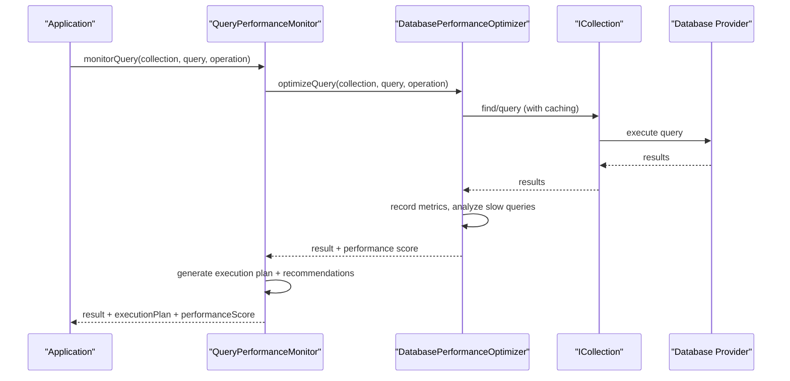
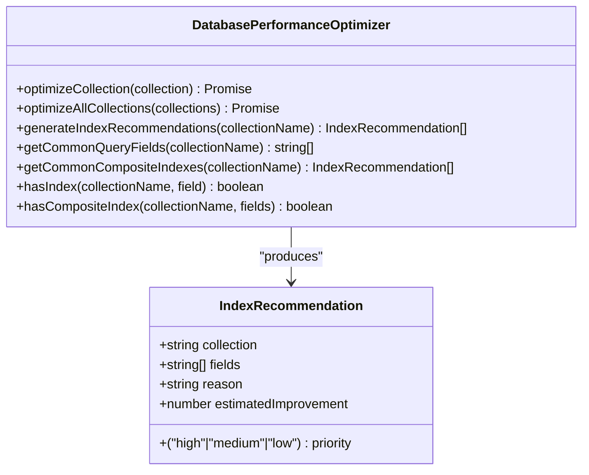
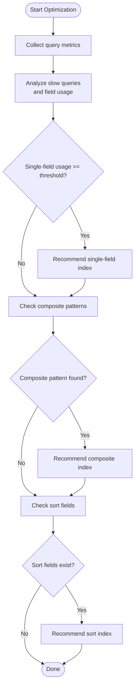
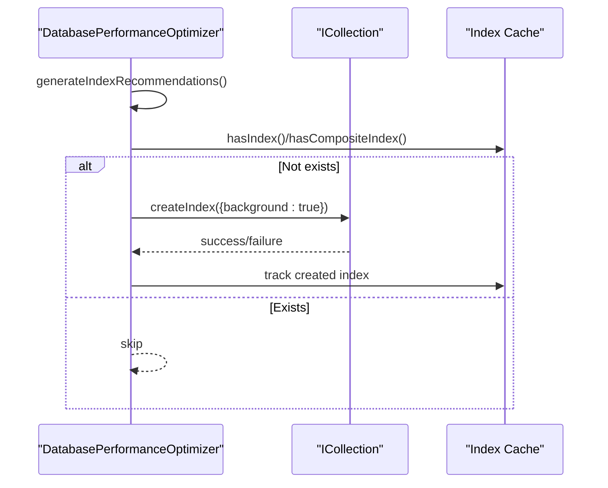
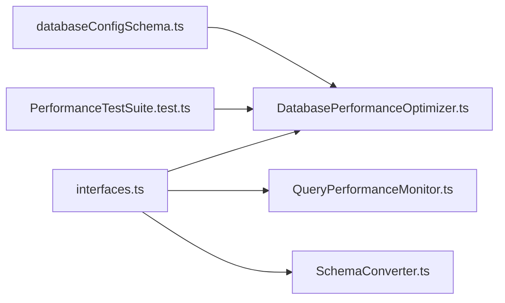

# Indexing Strategies

<cite>
**Referenced Files in This Document**
- [DatabasePerformanceOptimizer.ts](file://src/services/database/performance/DatabasePerformanceOptimizer.ts)
- [QueryPerformanceMonitor.ts](file://src/services/database/performance/QueryPerformanceMonitor.ts)
- [DatabasePerformanceOptimizer.ts](file://src/services/database/DatabasePerformanceOptimizer.ts)
- [interfaces.ts](file://src/services/database/interfaces.ts)
- [SchemaConverter.ts](file://src/services/database/SchemaConverter.ts)
- [databaseConfigSchema.ts](file://src/config/databaseConfigSchema.ts)
- [PerformanceTestSuite.test.ts](file://src/services/database/__tests__/PerformanceTestSuite.test.ts)
</cite>

## Table of Contents
1. [Introduction](#introduction)
2. [Project Structure](#project-structure)
3. [Core Components](#core-components)
4. [Architecture Overview](#architecture-overview)
5. [Detailed Component Analysis](#detailed-component-analysis)
6. [Dependency Analysis](#dependency-analysis)
7. [Performance Considerations](#performance-considerations)
8. [Troubleshooting Guide](#troubleshooting-guide)
9. [Conclusion](#conclusion)

## Introduction
This document explains SchoolPilot3's automated indexing strategies, focusing on the IndexRecommendation system, automatic index generation, collection-specific optimization, background indexing, and validation mechanisms. It covers how the system analyzes query patterns, identifies commonly accessed fields, recommends composite indexes, and applies performance improvements with configurable thresholds and priorities.

## Project Structure
The indexing and performance optimization features are implemented across several services and interfaces:
- Performance monitoring and optimization services
- Query execution planning and alerting
- Schema conversion and index extraction
- Configuration validation and defaults
- Testing and benchmarking

**Diagram sources**
- [DatabasePerformanceOptimizer.ts:48-684](file://src/services/database/performance/DatabasePerformanceOptimizer.ts#L48-L684)
- [QueryPerformanceMonitor.ts:37-635](file://src/services/database/performance/QueryPerformanceMonitor.ts#L37-L635)
- [DatabasePerformanceOptimizer.ts:48-598](file://src/services/database/DatabasePerformanceOptimizer.ts#L48-L598)
- [interfaces.ts:44-175](file://src/services/database/interfaces.ts#L44-L175)
- [SchemaConverter.ts:135-177](file://src/services/database/SchemaConverter.ts#L135-L177)
- [databaseConfigSchema.ts:415-466](file://src/config/databaseConfigSchema.ts#L415-L466)
- [PerformanceTestSuite.test.ts:57-200](file://src/services/database/__tests__/PerformanceTestSuite.test.ts#L57-L200)

**Section sources**
- [DatabasePerformanceOptimizer.ts:48-684](file://src/services/database/performance/DatabasePerformanceOptimizer.ts#L48-L684)
- [QueryPerformanceMonitor.ts:37-635](file://src/services/database/performance/QueryPerformanceMonitor.ts#L37-L635)
- [DatabasePerformanceOptimizer.ts:48-598](file://src/services/database/DatabasePerformanceOptimizer.ts#L48-L598)
- [interfaces.ts:44-175](file://src/services/database/interfaces.ts#L44-L175)
- [SchemaConverter.ts:135-177](file://src/services/database/SchemaConverter.ts#L135-L177)
- [databaseConfigSchema.ts:415-466](file://src/config/databaseConfigSchema.ts#L415-L466)
- [PerformanceTestSuite.test.ts:57-200](file://src/services/database/__tests__/PerformanceTestSuite.test.ts#L57-L200)

## Core Components
- IndexRecommendation system: Defines collection-targeted recommendations with field arrays, reasoning, estimated improvement percentages, and priority levels.
- Automatic index generation: Analyzes query patterns, identifies common fields, and suggests composite indexes for high-impact collections.
- Background indexing: Creates indexes during off-peak periods to minimize disruption.
- Validation and maintenance: Monitors performance, generates alerts, and performs maintenance tasks like cache clearing and metric pruning.

Key interfaces:
- IndexDefinition: Standardized index specification with name, fields, uniqueness, background creation, and optional filters.
- QueryOptions: Query selectors, sorts, limits, skips, and projections used for index suggestion and cost estimation.

**Section sources**
- [DatabasePerformanceOptimizer.ts:18-35](file://src/services/database/performance/DatabasePerformanceOptimizer.ts#L18-L35)
- [DatabasePerformanceOptimizer.ts:7-46](file://src/services/database/DatabasePerformanceOptimizer.ts#L7-L46)
- [interfaces.ts:44-78](file://src/services/database/interfaces.ts#L44-L78)

## Architecture Overview
The indexing architecture integrates performance monitoring, query planning, and automatic optimization:

**Diagram sources**
- [QueryPerformanceMonitor.ts:90-135](file://src/services/database/performance/QueryPerformanceMonitor.ts#L90-L135)
- [DatabasePerformanceOptimizer.ts:90-143](file://src/services/database/DatabasePerformanceOptimizer.ts#L90-L143)

## Detailed Component Analysis

### IndexRecommendation System
The system generates recommendations with:
- Collection targeting
- Field arrays (single and composite)
- Reasoning based on query usage patterns
- Estimated improvement percentages
- Priority levels (high, medium, low)

**Diagram sources**
- [DatabasePerformanceOptimizer.ts:18-35](file://src/services/database/performance/DatabasePerformanceOptimizer.ts#L18-L35)
- [DatabasePerformanceOptimizer.ts:195-336](file://src/services/database/performance/DatabasePerformanceOptimizer.ts#L195-L336)

**Section sources**
- [DatabasePerformanceOptimizer.ts:195-336](file://src/services/database/performance/DatabasePerformanceOptimizer.ts#L195-L336)

### Automatic Index Generation
Automatic index generation follows a multi-step process:
- Query pattern analysis: Identifies slow queries and counts field usage.
- Common field identification: Recommends single-field indexes for frequently queried fields.
- Composite index recommendations: Suggests compound indexes for common multi-field queries.
- Priority-based creation: Creates high-priority indexes first, with background creation support.

**Diagram sources**
- [DatabasePerformanceOptimizer.ts:419-470](file://src/services/database/DatabasePerformanceOptimizer.ts#L419-L470)

**Section sources**
- [DatabasePerformanceOptimizer.ts:419-470](file://src/services/database/DatabasePerformanceOptimizer.ts#L419-L470)

### Collection-Specific Optimization Strategies
Recommended indexes are tailored to each collection:

- Students: classId+status, academicYear+status
- Attendance: studentId+date (high), classId+date (medium)
- Fees: studentId+status (high), dueDate+status (medium)
- Grades: studentId+examId (high), classId+subjectId (medium)

These recommendations balance query frequency, selectivity, and performance impact.

**Section sources**
- [DatabasePerformanceOptimizer.ts:276-333](file://src/services/database/performance/DatabasePerformanceOptimizer.ts#L276-L333)

### Index Creation Workflow
The workflow ensures safe, background index creation:
- Generate index definitions from query patterns
- Validate against existing indexes
- Create indexes with background=true to avoid blocking
- Track created indexes in an index cache
- Update performance statistics and recommendations

**Diagram sources**
- [DatabasePerformanceOptimizer.ts:146-190](file://src/services/database/performance/DatabasePerformanceOptimizer.ts#L146-L190)
- [DatabasePerformanceOptimizer.ts:341-352](file://src/services/database/performance/DatabasePerformanceOptimizer.ts#L341-L352)

**Section sources**
- [DatabasePerformanceOptimizer.ts:146-190](file://src/services/database/performance/DatabasePerformanceOptimizer.ts#L146-L190)

### Background Indexing Capabilities
Indexes are created with background=true to:
- Minimize impact on concurrent operations
- Allow index creation while queries continue
- Improve overall system responsiveness

**Section sources**
- [DatabasePerformanceOptimizer.ts:429-442](file://src/services/database/DatabasePerformanceOptimizer.ts#L429-L442)

### Index Validation Mechanisms
Validation ensures correctness and prevents duplication:
- hasIndex(): Checks single-field indexes
- hasCompositeIndex(): Checks composite indexes
- Index cache: Tracks created indexes per collection
- Maintenance: Periodic cleanup of expired cache entries and old metrics

**Section sources**
- [DatabasePerformanceOptimizer.ts:341-352](file://src/services/database/performance/DatabasePerformanceOptimizer.ts#L341-L352)
- [DatabasePerformanceOptimizer.ts:503-555](file://src/services/database/performance/DatabasePerformanceOptimizer.ts#L503-L555)

### Examples of Recommended Indexes
Common query patterns and recommended indexes:
- Student lookup by studentId: single-field index
- Class enrollment filtering: classId+status composite
- Attendance reporting: studentId+date composite
- Fee status reporting: studentId+status composite
- Grade lookup: studentId+examId composite

Estimated improvement percentages are derived from usage frequency and query cost reduction.

**Section sources**
- [DatabasePerformanceOptimizer.ts:252-333](file://src/services/database/performance/DatabasePerformanceOptimizer.ts#L252-L333)

### Manual Override Options
Manual overrides are supported via:
- Configuration flags for enabling/disabling auto-indexing
- Threshold adjustments for slow query detection
- Cache size and TTL controls
- Provider-specific settings for compaction and maintenance

**Section sources**
- [databaseConfigSchema.ts:415-466](file://src/config/databaseConfigSchema.ts#L415-L466)
- [DatabasePerformanceOptimizer.ts:71-84](file://src/services/database/DatabasePerformanceOptimizer.ts#L71-L84)

### Performance Impact Calculations
Impact is calculated using:
- Query cost estimation based on selector complexity, sorting, limits, and skips
- Index usage bonuses reducing cost
- Performance score normalization (0–100)
- Recommendations for optimization (limits, pagination, field projection)

**Section sources**
- [QueryPerformanceMonitor.ts:239-282](file://src/services/database/performance/QueryPerformanceMonitor.ts#L239-L282)
- [QueryPerformanceMonitor.ts:557-587](file://src/services/database/performance/QueryPerformanceMonitor.ts#L557-L587)

### Index Maintenance and Cleanup
Maintenance tasks include:
- Automatic maintenance scheduler (runs every 6 hours)
- Cache cleanup of expired entries
- Metric pruning (older than 24 hours)
- Provider compaction when supported

**Section sources**
- [DatabasePerformanceOptimizer.ts:557-592](file://src/services/database/performance/DatabasePerformanceOptimizer.ts#L557-L592)
- [DatabasePerformanceOptimizer.ts:503-555](file://src/services/database/performance/DatabasePerformanceOptimizer.ts#L503-L555)

### Performance Monitoring of Newly Created Indexes
Monitoring tracks:
- Average query time per collection
- Slow query detection and alerts
- Cache hit rate and memory usage
- Trend analysis over time windows
- Active alerts for critical issues

**Section sources**
- [QueryPerformanceMonitor.ts:435-471](file://src/services/database/performance/QueryPerformanceMonitor.ts#L435-L471)
- [QueryPerformanceMonitor.ts:592-622](file://src/services/database/performance/QueryPerformanceMonitor.ts#L592-L622)

## Dependency Analysis
The indexing system depends on:
- Collection interfaces for index creation and query execution
- Configuration validation for performance tuning
- Schema converter for extracting indexes from RxDB schemas
- Testing framework for performance benchmarks and regression detection

**Diagram sources**
- [interfaces.ts:44-175](file://src/services/database/interfaces.ts#L44-L175)
- [DatabasePerformanceOptimizer.ts:48-598](file://src/services/database/DatabasePerformanceOptimizer.ts#L48-L598)
- [QueryPerformanceMonitor.ts:37-635](file://src/services/database/performance/QueryPerformanceMonitor.ts#L37-L635)
- [SchemaConverter.ts:135-177](file://src/services/database/SchemaConverter.ts#L135-L177)
- [databaseConfigSchema.ts:415-466](file://src/config/databaseConfigSchema.ts#L415-L466)
- [PerformanceTestSuite.test.ts:57-200](file://src/services/database/__tests__/PerformanceTestSuite.test.ts#L57-L200)

**Section sources**
- [interfaces.ts:44-175](file://src/services/database/interfaces.ts#L44-L175)
- [DatabasePerformanceOptimizer.ts:48-598](file://src/services/database/DatabasePerformanceOptimizer.ts#L48-L598)
- [QueryPerformanceMonitor.ts:37-635](file://src/services/database/performance/QueryPerformanceMonitor.ts#L37-L635)
- [SchemaConverter.ts:135-177](file://src/services/database/SchemaConverter.ts#L135-L177)
- [databaseConfigSchema.ts:415-466](file://src/config/databaseConfigSchema.ts#L415-L466)
- [PerformanceTestSuite.test.ts:57-200](file://src/services/database/__tests__/PerformanceTestSuite.test.ts#L57-L200)

## Performance Considerations
- Background index creation minimizes operational impact
- Cache sizing and TTL influence memory usage and hit rates
- Query cost estimation helps prioritize recommendations
- Regular maintenance keeps metrics and caches healthy
- Testing validates thresholds and regression detection

[No sources needed since this section provides general guidance]

## Troubleshooting Guide
Common issues and resolutions:
- Slow queries: Review recommendations and create suggested indexes
- Low cache hit rate: Adjust cache size/TTL or add field projections
- Memory usage spikes: Reduce cache size or trigger maintenance
- Index creation failures: Validate collection schema and permissions

**Section sources**
- [QueryPerformanceMonitor.ts:349-388](file://src/services/database/performance/QueryPerformanceMonitor.ts#L349-L388)
- [DatabasePerformanceOptimizer.ts:503-555](file://src/services/database/performance/DatabasePerformanceOptimizer.ts#L503-L555)

## Conclusion
SchoolPilot3's indexing strategies combine intelligent query pattern analysis, collection-specific recommendations, and background index creation to deliver measurable performance improvements. The system balances automation with configurability, ensuring maintainability and scalability across diverse workloads.