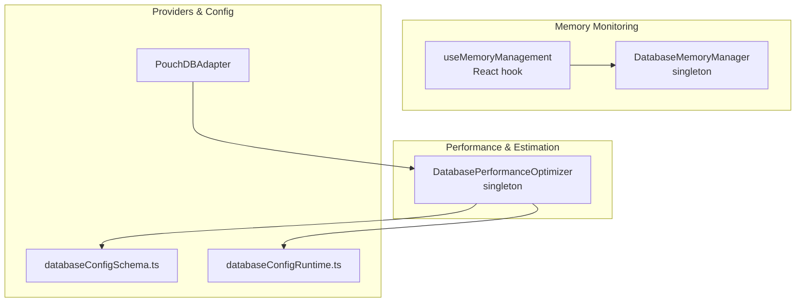
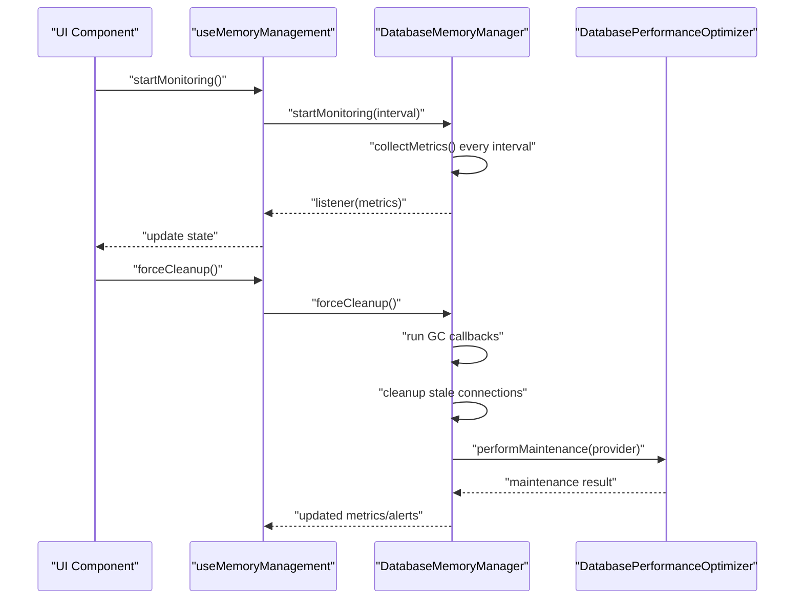
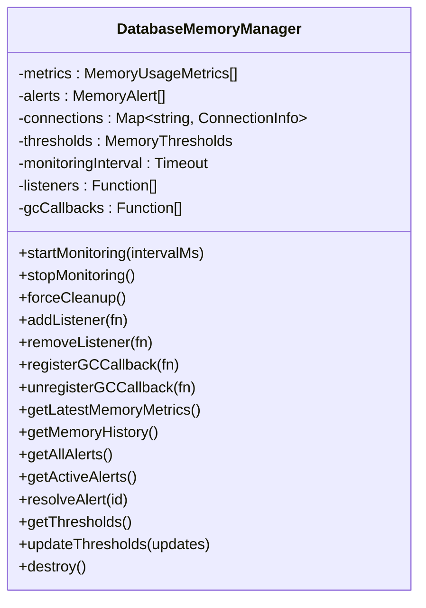
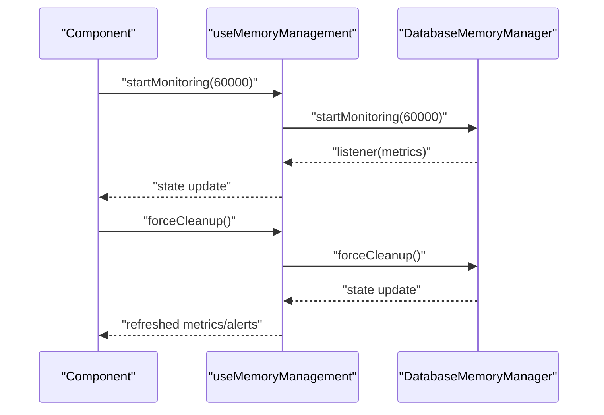
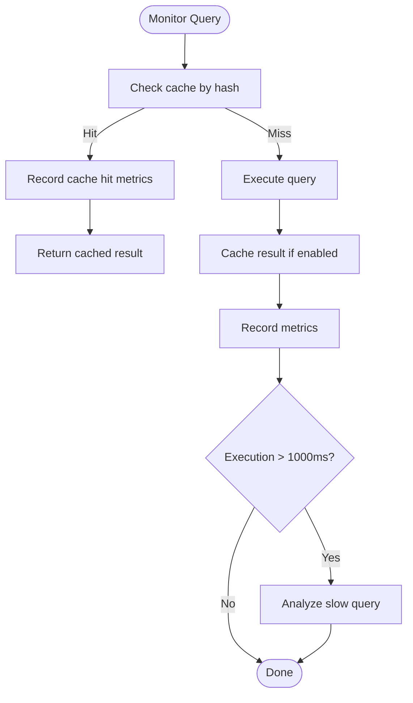
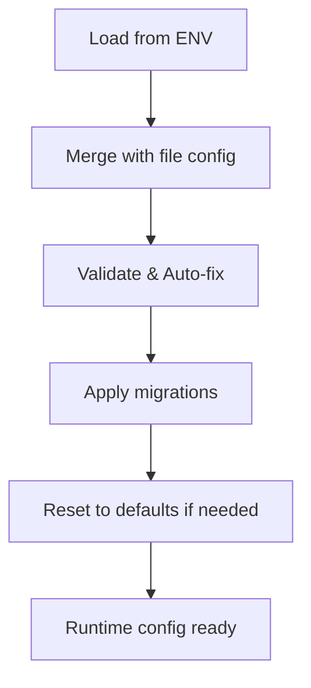
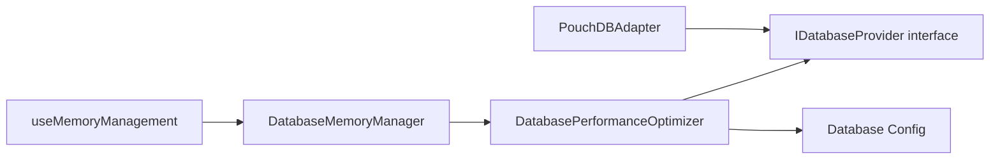

# Memory Management

<cite>
**Referenced Files in This Document**
- [MemoryManager.ts](file://src/services/database/MemoryManager.ts)
- [useMemoryManagement.ts](file://src/hooks/useMemoryManagement.ts)
- [DatabasePerformanceOptimizer.ts](file://src/services/database/DatabasePerformanceOptimizer.ts)
- [interfaces.ts](file://src/services/database/interfaces.ts)
- [PouchDBAdapter.ts](file://src/services/dataGeneration/adapters/PouchDBAdapter.ts)
- [databaseConfigSchema.ts](file://src/config/databaseConfigSchema.ts)
- [databaseConfigRuntime.ts](file://src/config/databaseConfigRuntime.ts)
- [memoryManager.ts](file://src/services/performance/memoryManager.ts)
</cite>

## Table of Contents
1. [Introduction](#introduction)
2. [Project Structure](#project-structure)
3. [Core Components](#core-components)
4. [Architecture Overview](#architecture-overview)
5. [Detailed Component Analysis](#detailed-component-analysis)
6. [Dependency Analysis](#dependency-analysis)
7. [Performance Considerations](#performance-considerations)
8. [Troubleshooting Guide](#troubleshooting-guide)
9. [Conclusion](#conclusion)

## Introduction
This document explains SchoolPilot3’s memory management systems with a focus on:
- Database memory optimization via the DatabaseMemoryManager
- Garbage collection policies and resource cleanup
- DatabasePerformanceOptimizer’s memory estimation and cache tracking
- Provider-specific memory strategies (PouchDB, SQLite)
- Memory pressure handling, automatic cleanup, leak prevention, and profiling
- Practical optimization examples, monitoring via estimateMemoryUsage(), and capacity planning

## Project Structure
SchoolPilot3 organizes memory management across three primary areas:
- Database memory monitoring and control: DatabaseMemoryManager (singleton) and React hook useMemoryManagement
- Database performance and memory footprint: DatabasePerformanceOptimizer (singleton) with query metrics and cache memory tracking
- Provider integrations and configuration: PouchDBAdapter and configuration validators/runtime helpers

**Diagram sources**
- [MemoryManager.ts:44-69](file://src/services/database/MemoryManager.ts#L44-L69)
- [useMemoryManagement.ts:1-122](file://src/hooks/useMemoryManagement.ts#L1-L122)
- [DatabasePerformanceOptimizer.ts:45-63](file://src/services/database/DatabasePerformanceOptimizer.ts#L45-L63)
- [PouchDBAdapter.ts:6-29](file://src/services/dataGeneration/adapters/PouchDBAdapter.ts#L6-L29)
- [databaseConfigSchema.ts:54-201](file://src/config/databaseConfigSchema.ts#L54-L201)
- [databaseConfigRuntime.ts:77-248](file://src/config/databaseConfigRuntime.ts#L77-L248)

**Section sources**
- [MemoryManager.ts:44-69](file://src/services/database/MemoryManager.ts#L44-L69)
- [useMemoryManagement.ts:1-122](file://src/hooks/useMemoryManagement.ts#L1-L122)
- [DatabasePerformanceOptimizer.ts:45-63](file://src/services/database/DatabasePerformanceOptimizer.ts#L45-L63)
- [PouchDBAdapter.ts:6-29](file://src/services/dataGeneration/adapters/PouchDBAdapter.ts#L6-L29)
- [databaseConfigSchema.ts:54-201](file://src/config/databaseConfigSchema.ts#L54-L201)
- [databaseConfigRuntime.ts:77-248](file://src/config/databaseConfigRuntime.ts#L77-L248)

## Core Components
- DatabaseMemoryManager: Periodically collects memory metrics, enforces thresholds, triggers GC callbacks, tracks stale connections, and exposes listeners for real-time updates.
- useMemoryManagement: React hook wrapper around DatabaseMemoryManager for UI dashboards and actions (start/stop monitoring, force cleanup, threshold updates).
- DatabasePerformanceOptimizer: Monitors query performance, caches results, estimates memory footprint, and performs maintenance (cache clearing, metric pruning, optional provider compaction).
- PouchDBAdapter: Provider adapter integrating PouchDB with index creation, conflict handling, and explicit cleanup/close operations.
- Configuration: databaseConfigSchema.ts validates and migrates database configuration; databaseConfigRuntime.ts loads runtime values from environment and files.

**Section sources**
- [MemoryManager.ts:44-363](file://src/services/database/MemoryManager.ts#L44-L363)
- [useMemoryManagement.ts:13-122](file://src/hooks/useMemoryManagement.ts#L13-L122)
- [DatabasePerformanceOptimizer.ts:45-684](file://src/services/database/DatabasePerformanceOptimizer.ts#L45-L684)
- [PouchDBAdapter.ts:6-122](file://src/services/dataGeneration/adapters/PouchDBAdapter.ts#L6-L122)
- [databaseConfigSchema.ts:305-530](file://src/config/databaseConfigSchema.ts#L305-L530)
- [databaseConfigRuntime.ts:77-331](file://src/config/databaseConfigRuntime.ts#L77-L331)

## Architecture Overview
The memory management architecture centers on a singleton DatabaseMemoryManager that periodically samples memory metrics and reacts to thresholds. It integrates with a React hook for UI-driven control and monitoring. DatabasePerformanceOptimizer complements this by estimating memory usage from query metrics and cache sizes, and by performing maintenance tasks. Provider adapters (e.g., PouchDBAdapter) encapsulate provider-specific lifecycle and cleanup.

**Diagram sources**
- [useMemoryManagement.ts:78-108](file://src/hooks/useMemoryManagement.ts#L78-L108)
- [MemoryManager.ts:71-192](file://src/services/database/MemoryManager.ts#L71-L192)
- [DatabasePerformanceOptimizer.ts:503-555](file://src/services/database/DatabasePerformanceOptimizer.ts#L503-L555)

## Detailed Component Analysis

### DatabaseMemoryManager
Responsibilities:
- Periodic memory sampling with multiple metrics (heap, external, array buffers)
- Threshold-based alerting and recommendations
- Stale connection cleanup
- GC callback orchestration
- Listener registration for real-time updates

Key behaviors:
- Monitoring interval defaults to 30 seconds; metrics history retained for trend analysis
- Enforces thresholds for warning/critical levels and heap size limits
- Triggers registered GC callbacks and attempts global GC when available
- Tracks connections with activity timestamps and prunes stale ones (>5 minutes)

**Diagram sources**
- [MemoryManager.ts:44-363](file://src/services/database/MemoryManager.ts#L44-L363)

**Section sources**
- [MemoryManager.ts:44-363](file://src/services/database/MemoryManager.ts#L44-L363)

### useMemoryManagement React Hook
Responsibilities:
- Wraps DatabaseMemoryManager for React applications
- Exposes state for metrics, history, alerts, connection stats, and summary
- Provides actions: start/stop monitoring, force cleanup, resolve alerts, update thresholds, register GC callbacks

**Diagram sources**
- [useMemoryManagement.ts:78-122](file://src/hooks/useMemoryManagement.ts#L78-L122)
- [MemoryManager.ts:71-192](file://src/services/database/MemoryManager.ts#L71-L192)

**Section sources**
- [useMemoryManagement.ts:13-122](file://src/hooks/useMemoryManagement.ts#L13-L122)

### DatabasePerformanceOptimizer
Responsibilities:
- Query performance monitoring with metrics capture
- Query result caching with TTL and size checks
- Index recommendations and provider-specific optimization
- Maintenance scheduling (automatic pruning and cache cleanup)
- Memory footprint estimation from metrics and cache

Key estimation logic:
- estimateMemoryUsage(): aggregates query metrics size and cache memory usage
- estimateCacheMemoryUsage(): rough per-entry memory estimation

**Diagram sources**
- [DatabasePerformanceOptimizer.ts:68-141](file://src/services/database/DatabasePerformanceOptimizer.ts#L68-L141)

**Section sources**
- [DatabasePerformanceOptimizer.ts:45-684](file://src/services/database/DatabasePerformanceOptimizer.ts#L45-L684)

### Provider-Specific Strategies: PouchDBAdapter
Responsibilities:
- Initializes PouchDB with plugins
- Creates per-collection databases and indexes
- Performs bulk inserts with conflict handling
- Supports live sync with backoff
- Explicit cleanup: closes databases and clears state

Memory implications:
- Uses document-based storage; bulk operations reduce overhead
- Index creation improves query performance and reduces scan costs
- Cleanup/close ensures resources are released

**Section sources**
- [PouchDBAdapter.ts:6-122](file://src/services/dataGeneration/adapters/PouchDBAdapter.ts#L6-L122)

### Configuration and Environment Integration
- databaseConfigSchema.ts defines validation rules and migrations for database configuration, including performance, storage, sync, monitoring, and features.
- databaseConfigRuntime.ts loads configuration from environment variables and files, enabling runtime overrides and exports.

**Diagram sources**
- [databaseConfigSchema.ts:305-530](file://src/config/databaseConfigSchema.ts#L305-L530)
- [databaseConfigRuntime.ts:77-248](file://src/config/databaseConfigRuntime.ts#L77-L248)

**Section sources**
- [databaseConfigSchema.ts:54-201](file://src/config/databaseConfigSchema.ts#L54-L201)
- [databaseConfigRuntime.ts:77-248](file://src/config/databaseConfigRuntime.ts#L77-L248)

## Dependency Analysis
- DatabaseMemoryManager depends on:
  - Global GC availability for forced collection
  - Provider interfaces for compaction and cleanup
- DatabasePerformanceOptimizer depends on:
  - Database configuration for cache sizing and timeouts
  - Provider interfaces for compaction
- PouchDBAdapter depends on:
  - PouchDB initialization and plugin loading
  - Provider interface contract for collection operations

**Diagram sources**
- [MemoryManager.ts:184-192](file://src/services/database/MemoryManager.ts#L184-L192)
- [DatabasePerformanceOptimizer.ts:53-63](file://src/services/database/DatabasePerformanceOptimizer.ts#L53-L63)
- [interfaces.ts:178-199](file://src/services/database/interfaces.ts#L178-L199)
- [PouchDBAdapter.ts:6-29](file://src/services/dataGeneration/adapters/PouchDBAdapter.ts#L6-L29)

**Section sources**
- [MemoryManager.ts:184-192](file://src/services/database/MemoryManager.ts#L184-L192)
- [DatabasePerformanceOptimizer.ts:53-63](file://src/services/database/DatabasePerformanceOptimizer.ts#L53-L63)
- [interfaces.ts:178-199](file://src/services/database/interfaces.ts#L178-L199)
- [PouchDBAdapter.ts:6-29](file://src/services/dataGeneration/adapters/PouchDBAdapter.ts#L6-L29)

## Performance Considerations
- Memory estimation:
  - estimateMemoryUsage(): combines query metrics footprint (~1KB per metric) and cache memory usage (~10KB per entry)
  - Use getPerformanceReport().memoryUsage for periodic monitoring
- Cache tuning:
  - Adjust performance.cacheSize and TTL to balance memory vs. hit rate
  - Clear cache via clearCache() or rely on automatic maintenance
- Provider-specific:
  - PouchDBAdapter creates indexes and supports bulk operations; ensure indexes align with query patterns
  - Compact provider databases periodically via provider.compact() during maintenance
- GC and cleanup:
  - Register GC callbacks via registerGCCallback() for provider-specific cleanup
  - Use forceCleanup() to trigger immediate GC and stale connection removal

**Section sources**
- [DatabasePerformanceOptimizer.ts:636-650](file://src/services/database/DatabasePerformanceOptimizer.ts#L636-L650)
- [DatabasePerformanceOptimizer.ts:401-432](file://src/services/database/DatabasePerformanceOptimizer.ts#L401-L432)
- [DatabasePerformanceOptimizer.ts:503-555](file://src/services/database/DatabasePerformanceOptimizer.ts#L503-L555)
- [PouchDBAdapter.ts:168-184](file://src/services/dataGeneration/adapters/PouchDBAdapter.ts#L168-L184)

## Troubleshooting Guide
Common memory issues and resolutions:
- High memory usage alerts:
  - Review recommendations from getSummary() and consider running forceCleanup()
  - Lower cache size or TTL to reduce memory footprint
- Stale connections:
  - Investigate stale counts and prune via forceCleanup()
- Slow queries:
  - Use getPerformanceReport().slowQueries to identify bottlenecks
  - Apply index recommendations generated by optimizer
- Provider compaction:
  - Ensure provider.compact() is callable and invoked during maintenance
- Configuration drift:
  - Validate and auto-fix configuration using databaseConfigValidator.repair()

Operational actions:
- Start/stop monitoring via useMemoryManagement
- Update thresholds dynamically
- Resolve alerts and track trends

**Section sources**
- [MemoryManager.ts:318-328](file://src/services/database/MemoryManager.ts#L318-L328)
- [DatabasePerformanceOptimizer.ts:401-432](file://src/services/database/DatabasePerformanceOptimizer.ts#L401-L432)
- [databaseConfigSchema.ts:305-530](file://src/config/databaseConfigSchema.ts#L305-L530)

## Conclusion
SchoolPilot3’s memory management combines proactive monitoring (DatabaseMemoryManager), performance-aware caching and estimation (DatabasePerformanceOptimizer), and provider-specific lifecycle control (PouchDBAdapter). Together, these components provide:
- Real-time visibility into memory usage and trends
- Automated maintenance and cleanup
- Practical levers for capacity planning and optimization
- Robust configuration validation and runtime overrides

By tuning cache sizes, leveraging index recommendations, and invoking maintenance routines, teams can sustain stable memory footprints across diverse deployment modes.