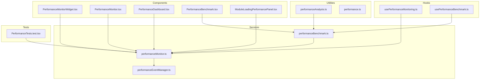
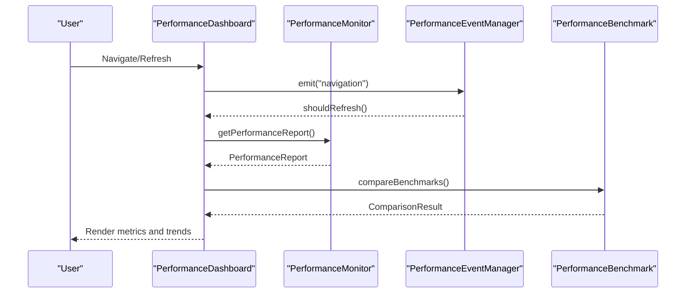
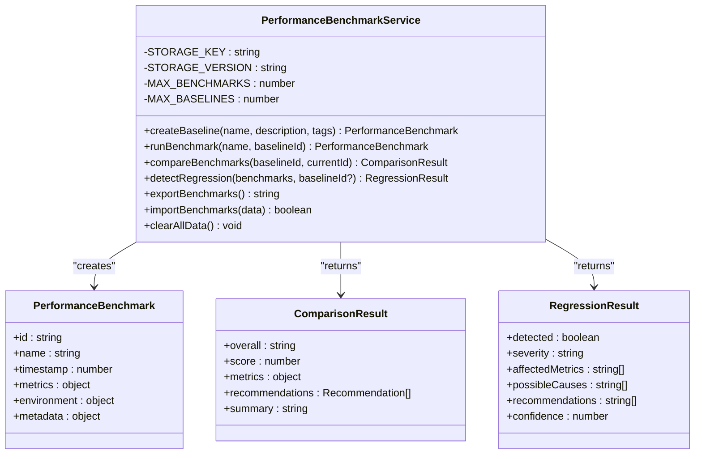
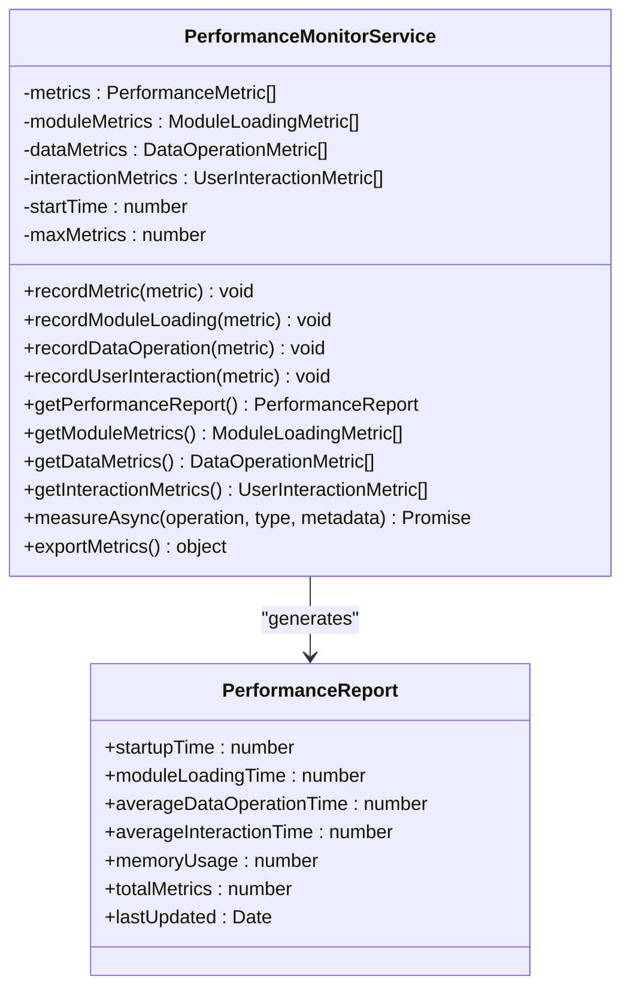
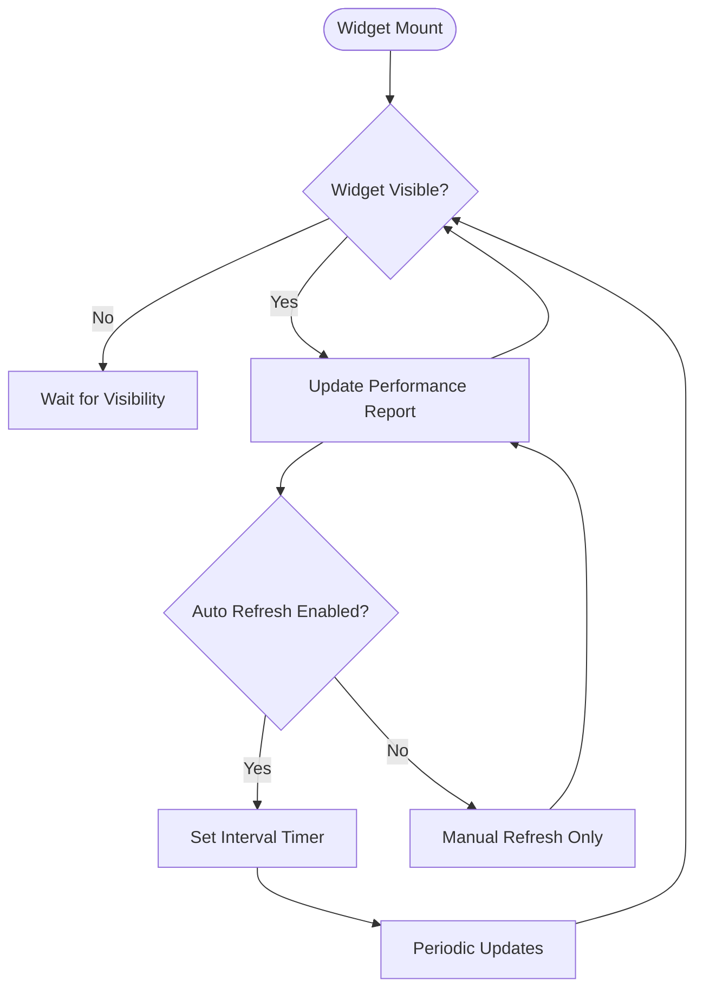
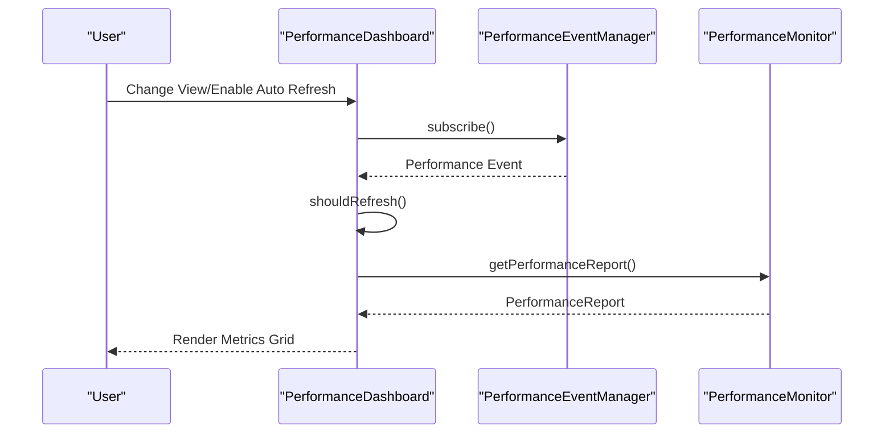
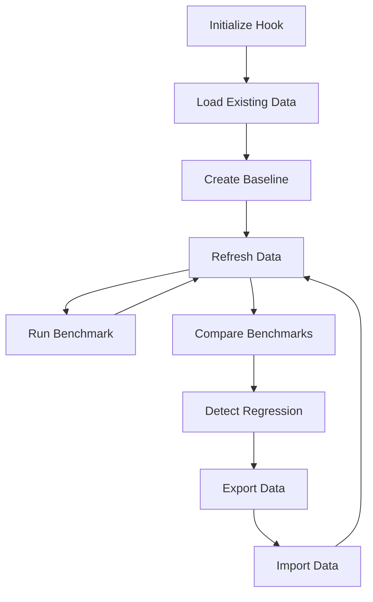
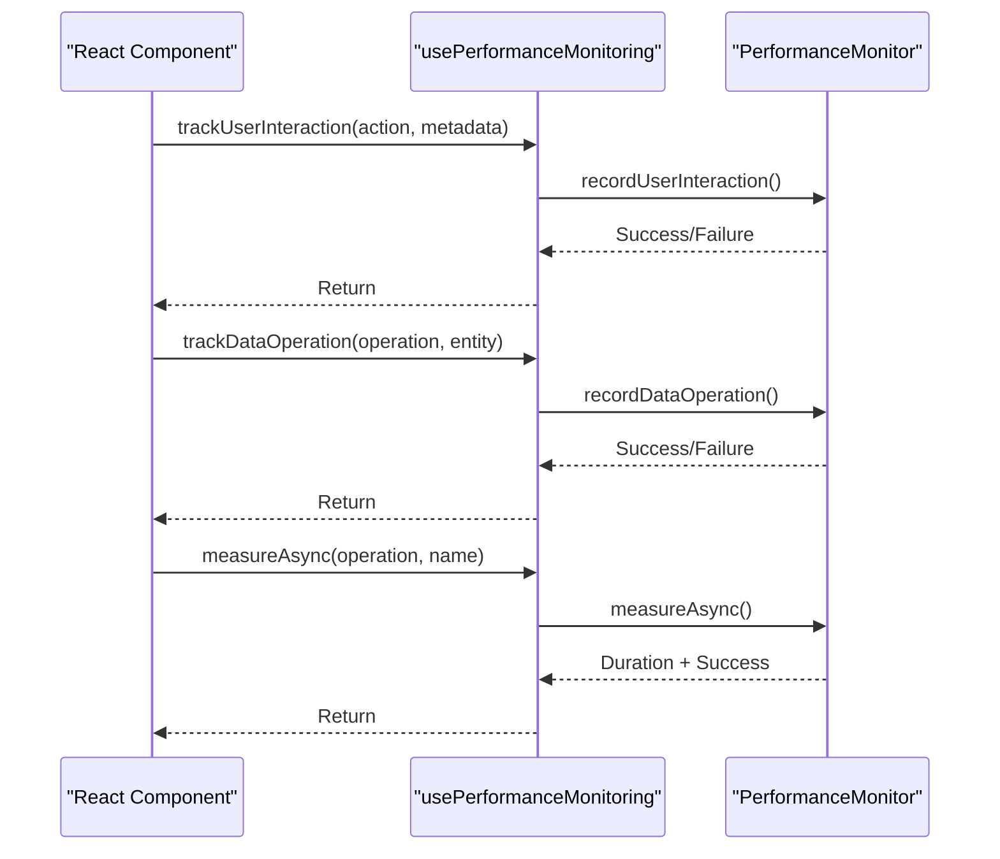
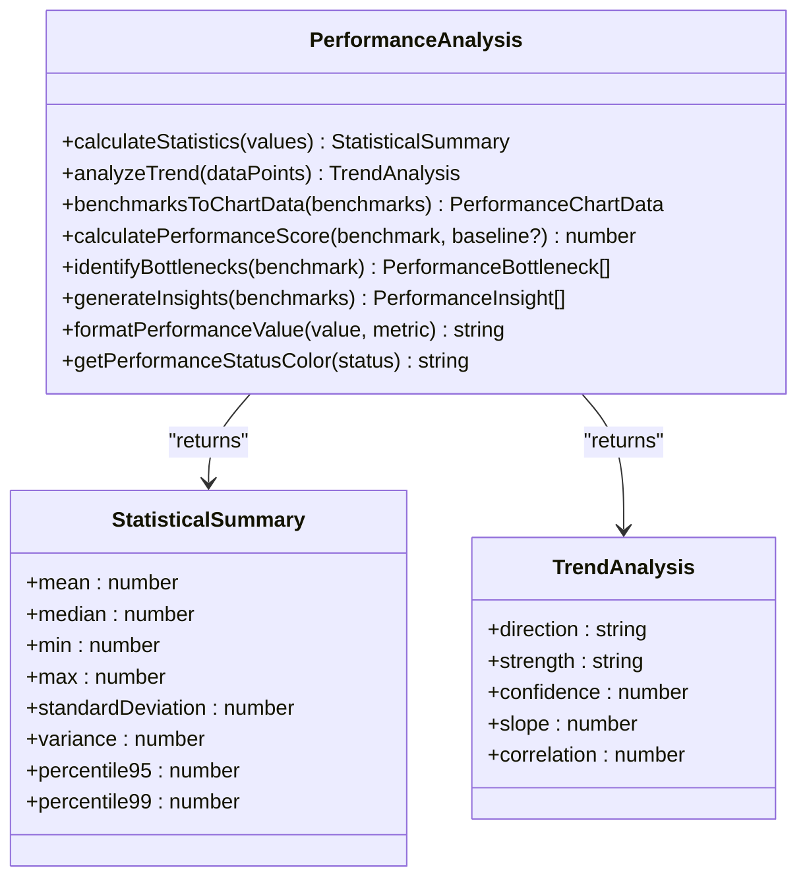
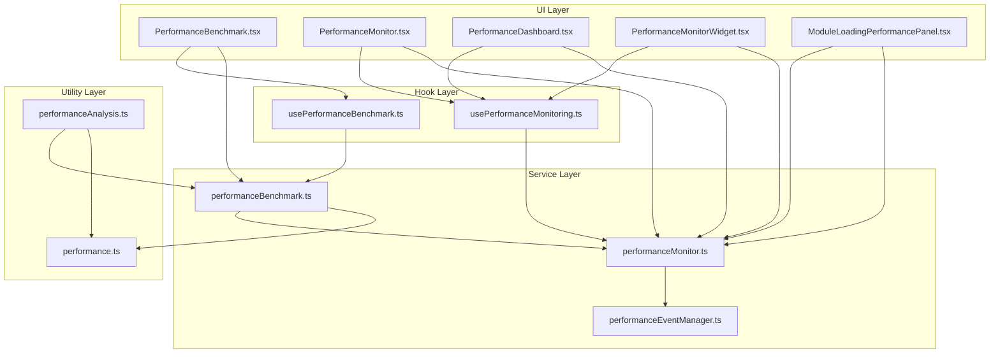

# Performance Benchmarking

<cite>
**Referenced Files in This Document**
- [PerformanceBenchmark.tsx](file://src/components/PerformanceBenchmark.tsx)
- [PerformanceMonitor.tsx](file://src/components/PerformanceMonitor.tsx)
- [PerformanceDashboard.tsx](file://src/components/PerformanceDashboard.tsx)
- [PerformanceMonitorWidget.tsx](file://src/components/PerformanceMonitorWidget.tsx)
- [ModuleLoadingPerformancePanel.tsx](file://src/components/ModuleLoadingPerformancePanel.tsx)
- [usePerformanceBenchmark.ts](file://src/hooks/usePerformanceBenchmark.ts)
- [usePerformanceMonitoring.ts](file://src/hooks/usePerformanceMonitoring.ts)
- [performanceBenchmark.ts](file://src/services/performance/performanceBenchmark.ts)
- [performanceMonitor.ts](file://src/services/performance/performanceMonitor.ts)
- [performanceEventManager.ts](file://src/services/performance/performanceEventManager.ts)
- [performanceAnalysis.ts](file://src/utils/performanceAnalysis.ts)
- [performance.ts](file://src/types/performance.ts)
- [PerformanceTests.test.tsx](file://tests/performance/PerformanceTests.test.tsx)
- [package.json](file://package.json)
</cite>

## Table of Contents
1. [Introduction](#introduction)
2. [Project Structure](#project-structure)
3. [Core Components](#core-components)
4. [Architecture Overview](#architecture-overview)
5. [Detailed Component Analysis](#detailed-component-analysis)
6. [Dependency Analysis](#dependency-analysis)
7. [Performance Considerations](#performance-considerations)
8. [Troubleshooting Guide](#troubleshooting-guide)
9. [Conclusion](#conclusion)

## Introduction
This document provides comprehensive documentation for SchoolPilot3's performance benchmarking and monitoring capabilities. It explains the PerformanceBenchmark service for measuring query performance, system response times, and throughput metrics, and documents the PerformanceMonitor's continuous monitoring features, alerting mechanisms, and performance trend analysis. The guide covers performance testing methodologies, benchmark result interpretation, performance regression detection, optimization recommendation generation, and practical examples for performance test execution, result visualization, and performance comparison tools. It also addresses performance baseline establishment, monitoring dashboard integration, and automated performance alerting systems.

## Project Structure
SchoolPilot3 implements performance monitoring through a layered architecture:
- Services: Core performance measurement and benchmarking logic
- Hooks: React integration for performance tracking
- Components: UI surfaces for monitoring, benchmarking, and dashboards
- Utilities: Statistical analysis and visualization helpers
- Tests: Performance-focused test suites

**Diagram sources**
- [performanceMonitor.ts:1-316](file://src/services/performance/performanceMonitor.ts#L1-L316)
- [performanceBenchmark.ts:1-672](file://src/services/performance/performanceBenchmark.ts#L1-L672)
- [performanceEventManager.ts:1-211](file://src/services/performance/performanceEventManager.ts#L1-L211)
- [usePerformanceMonitoring.ts:1-294](file://src/hooks/usePerformanceMonitoring.ts#L1-L294)
- [usePerformanceBenchmark.ts:1-309](file://src/hooks/usePerformanceBenchmark.ts#L1-L309)
- [PerformanceMonitorWidget.tsx:1-247](file://src/components/PerformanceMonitorWidget.tsx#L1-L247)
- [PerformanceMonitor.tsx:1-311](file://src/components/PerformanceMonitor.tsx#L1-L311)
- [PerformanceDashboard.tsx:1-383](file://src/components/PerformanceDashboard.tsx#L1-L383)
- [PerformanceBenchmark.tsx:1-599](file://src/components/PerformanceBenchmark.tsx#L1-L599)
- [ModuleLoadingPerformancePanel.tsx:1-287](file://src/components/ModuleLoadingPerformancePanel.tsx#L1-L287)
- [performanceAnalysis.ts:1-402](file://src/utils/performanceAnalysis.ts#L1-L402)
- [performance.ts:1-96](file://src/types/performance.ts#L1-L96)
- [PerformanceTests.test.tsx:1-258](file://tests/performance/PerformanceTests.test.tsx#L1-L258)

**Section sources**
- [PerformanceBenchmark.tsx:1-599](file://src/components/PerformanceBenchmark.tsx#L1-L599)
- [PerformanceMonitor.tsx:1-311](file://src/components/PerformanceMonitor.tsx#L1-L311)
- [PerformanceDashboard.tsx:1-383](file://src/components/PerformanceDashboard.tsx#L1-L383)
- [PerformanceMonitorWidget.tsx:1-247](file://src/components/PerformanceMonitorWidget.tsx#L1-L247)
- [ModuleLoadingPerformancePanel.tsx:1-287](file://src/components/ModuleLoadingPerformancePanel.tsx#L1-L287)
- [usePerformanceBenchmark.ts:1-309](file://src/hooks/usePerformanceBenchmark.ts#L1-L309)
- [usePerformanceMonitoring.ts:1-294](file://src/hooks/usePerformanceMonitoring.ts#L1-L294)
- [performanceBenchmark.ts:1-672](file://src/services/performance/performanceBenchmark.ts#L1-L672)
- [performanceMonitor.ts:1-316](file://src/services/performance/performanceMonitor.ts#L1-L316)
- [performanceEventManager.ts:1-211](file://src/services/performance/performanceEventManager.ts#L1-L211)
- [performanceAnalysis.ts:1-402](file://src/utils/performanceAnalysis.ts#L1-L402)
- [performance.ts:1-96](file://src/types/performance.ts#L1-L96)
- [PerformanceTests.test.tsx:1-258](file://tests/performance/PerformanceTests.test.tsx#L1-L258)

## Core Components
This section outlines the primary components responsible for performance benchmarking and monitoring:

- PerformanceBenchmark service: Manages baseline creation, benchmark execution, comparison, regression detection, and optimization recommendations.
- PerformanceMonitor service: Collects real-time metrics for startup time, module loading, data operations, and user interactions.
- PerformanceMonitorWidget: Lightweight widget for displaying performance metrics with optional auto-refresh.
- PerformanceDashboard: Comprehensive dashboard for performance analysis with event-driven updates.
- usePerformanceBenchmark hook: React state management for benchmark operations.
- usePerformanceMonitoring hook: React integration for tracking component interactions, data operations, and async measurements.
- performanceEventManager: Centralized event system coordinating performance updates across components.
- performanceAnalysis utilities: Statistical analysis, trend detection, and visualization helpers.
- ModuleLoadingPerformancePanel: Specialized panel for module loading performance metrics.

**Section sources**
- [performanceBenchmark.ts:86-672](file://src/services/performance/performanceBenchmark.ts#L86-L672)
- [performanceMonitor.ts:49-316](file://src/services/performance/performanceMonitor.ts#L49-L316)
- [PerformanceMonitorWidget.tsx:15-247](file://src/components/PerformanceMonitorWidget.tsx#L15-L247)
- [PerformanceDashboard.tsx:14-383](file://src/components/PerformanceDashboard.tsx#L14-L383)
- [usePerformanceBenchmark.ts:44-309](file://src/hooks/usePerformanceBenchmark.ts#L44-L309)
- [usePerformanceMonitoring.ts:21-294](file://src/hooks/usePerformanceMonitoring.ts#L21-L294)
- [performanceEventManager.ts:22-211](file://src/services/performance/performanceEventManager.ts#L22-L211)
- [performanceAnalysis.ts:21-402](file://src/utils/performanceAnalysis.ts#L21-L402)
- [ModuleLoadingPerformancePanel.tsx:16-287](file://src/components/ModuleLoadingPerformancePanel.tsx#L16-L287)

## Architecture Overview
The performance system follows an event-driven architecture with clear separation of concerns:

**Diagram sources**
- [PerformanceDashboard.tsx:23-60](file://src/components/PerformanceDashboard.tsx#L23-L60)
- [performanceMonitor.ts:169-205](file://src/services/performance/performanceMonitor.ts#L169-L205)
- [performanceEventManager.ts:97-158](file://src/services/performance/performanceEventManager.ts#L97-L158)
- [performanceBenchmark.ts:318-396](file://src/services/performance/performanceBenchmark.ts#L318-L396)

Key architectural patterns:
- Event-driven updates: Components subscribe to performance events rather than polling
- Service isolation: Clear separation between monitoring, benchmarking, and UI
- Hook-based integration: React hooks provide seamless performance tracking
- Persistent storage: Local storage for benchmarks and baselines
- Statistical analysis: Built-in utilities for trend detection and bottleneck identification

**Section sources**
- [performanceEventManager.ts:32-95](file://src/services/performance/performanceEventManager.ts#L32-L95)
- [usePerformanceMonitoring.ts:34-80](file://src/hooks/usePerformanceMonitoring.ts#L34-L80)
- [performanceBenchmark.ts:96-143](file://src/services/performance/performanceBenchmark.ts#L96-L143)

## Detailed Component Analysis

### PerformanceBenchmark Service
The PerformanceBenchmark service is the core of the benchmarking system, providing:

**Diagram sources**
- [performanceBenchmark.ts:86-672](file://src/services/performance/performanceBenchmark.ts#L86-L672)

Key features:
- Baseline management: Create and maintain performance baselines with environment metadata
- Benchmark execution: Automated performance capture with configuration and environment tracking
- Comparison engine: Statistical comparison with significance detection and scoring
- Regression detection: Automated performance regression analysis with severity assessment
- Recommendation system: AI-powered optimization suggestions with prioritization
- Data persistence: Local storage with import/export capabilities

**Section sources**
- [performanceBenchmark.ts:182-262](file://src/services/performance/performanceBenchmark.ts#L182-L262)
- [performanceBenchmark.ts:318-396](file://src/services/performance/performanceBenchmark.ts#L318-L396)
- [performanceBenchmark.ts:504-567](file://src/services/performance/performanceBenchmark.ts#L504-L567)

### PerformanceMonitor Service
The PerformanceMonitor service collects and aggregates performance metrics:

**Diagram sources**
- [performanceMonitor.ts:49-316](file://src/services/performance/performanceMonitor.ts#L49-L316)

Metrics collection includes:
- Startup time via PerformanceObserver navigation timing
- Module loading performance with cache awareness
- Data operation durations and success rates
- User interaction response times
- Memory usage tracking

**Section sources**
- [performanceMonitor.ts:64-111](file://src/services/performance/performanceMonitor.ts#L64-L111)
- [performanceMonitor.ts:169-205](file://src/services/performance/performanceMonitor.ts#L169-L205)

### PerformanceMonitorWidget Component
A lightweight widget for continuous performance monitoring:

**Diagram sources**
- [PerformanceMonitorWidget.tsx:48-64](file://src/components/PerformanceMonitorWidget.tsx#L48-L64)

Features:
- Collapsible interface with color-coded performance indicators
- Configurable auto-refresh with visibility-aware updates
- Position customization (top/bottom, left/right)
- Detailed vs. compact display modes

**Section sources**
- [PerformanceMonitorWidget.tsx:116-247](file://src/components/PerformanceMonitorWidget.tsx#L116-L247)

### PerformanceDashboard Component
Comprehensive performance analytics dashboard:

**Diagram sources**
- [PerformanceDashboard.tsx:23-60](file://src/components/PerformanceDashboard.tsx#L23-L60)
- [performanceEventManager.ts:171-207](file://src/services/performance/performanceEventManager.ts#L171-L207)

Capabilities:
- Real-time metrics display with performance grades
- Module loading performance analysis
- Data operation tracking
- User interaction performance monitoring
- Export functionality for performance reports

**Section sources**
- [PerformanceDashboard.tsx:154-383](file://src/components/PerformanceDashboard.tsx#L154-L383)

### usePerformanceBenchmark Hook
React state management for benchmark operations:

**Diagram sources**
- [usePerformanceBenchmark.ts:54-77](file://src/hooks/usePerformanceBenchmark.ts#L54-L77)

**Section sources**
- [usePerformanceBenchmark.ts:44-256](file://src/hooks/usePerformanceBenchmark.ts#L44-L256)

### usePerformanceMonitoring Hook
React integration for performance tracking:

**Diagram sources**
- [usePerformanceMonitoring.ts:82-161](file://src/hooks/usePerformanceMonitoring.ts#L82-L161)
- [performanceMonitor.ts:280-311](file://src/services/performance/performanceMonitor.ts#L280-L311)

**Section sources**
- [usePerformanceMonitoring.ts:21-161](file://src/hooks/usePerformanceMonitoring.ts#L21-L161)

### performanceAnalysis Utilities
Statistical analysis and visualization helpers:

**Diagram sources**
- [performanceAnalysis.ts:21-104](file://src/utils/performanceAnalysis.ts#L21-L104)

**Section sources**
- [performanceAnalysis.ts:109-182](file://src/utils/performanceAnalysis.ts#L109-L182)
- [performanceAnalysis.ts:196-285](file://src/utils/performanceAnalysis.ts#L196-L285)

## Dependency Analysis
The performance system exhibits strong cohesion within functional areas and loose coupling between services:

**Diagram sources**
- [PerformanceBenchmark.tsx:16-40](file://src/components/PerformanceBenchmark.tsx#L16-L40)
- [PerformanceMonitor.tsx:5-27](file://src/components/PerformanceMonitor.tsx#L5-L27)
- [PerformanceDashboard.tsx:5-21](file://src/components/PerformanceDashboard.tsx#L5-L21)
- [PerformanceMonitorWidget.tsx:5-28](file://src/components/PerformanceMonitorWidget.tsx#L5-L28)
- [ModuleLoadingPerformancePanel.tsx:5-6](file://src/components/ModuleLoadingPerformancePanel.tsx#L5-L6)
- [usePerformanceBenchmark.ts:4-10](file://src/hooks/usePerformanceBenchmark.ts#L4-L10)
- [usePerformanceMonitoring.ts:4-5](file://src/hooks/usePerformanceMonitoring.ts#L4-L5)
- [performanceBenchmark.ts:4-5](file://src/services/performance/performanceBenchmark.ts#L4-L5)
- [performanceMonitor.ts:4-4](file://src/services/performance/performanceMonitor.ts#L4-L4)
- [performanceEventManager.ts:4-11](file://src/services/performance/performanceEventManager.ts#L4-L11)
- [performanceAnalysis.ts:4-5](file://src/utils/performanceAnalysis.ts#L4-L5)
- [performance.ts:5-19](file://src/types/performance.ts#L5-L19)

Key dependency characteristics:
- Low coupling: Services are accessed through hooks and components without tight coupling
- High cohesion: Related functionality is grouped within services and utilities
- Event-driven communication: Components communicate through the event manager
- Type safety: Comprehensive TypeScript definitions ensure compile-time safety

**Section sources**
- [performance.ts:1-96](file://src/types/performance.ts#L1-L96)

## Performance Considerations
The system incorporates several performance optimization strategies:

### Event-Driven Updates
- Components subscribe to performance events rather than polling
- Automatic throttling prevents excessive updates
- Visibility-aware refresh ensures optimal resource usage

### Memory Management
- Metric retention limits prevent memory bloat
- Automatic cleanup of old metrics
- Efficient data structures for performance tracking

### Statistical Analysis
- Linear regression for trend detection
- Percentile calculations for outlier detection
- Confidence-based analysis for reliability assessment

### Configuration Options
- Adjustable auto-refresh intervals
- Toggleable detailed views
- Configurable performance thresholds

**Section sources**
- [performanceEventManager.ts:139-149](file://src/services/performance/performanceEventManager.ts#L139-L149)
- [performanceMonitor.ts:245-258](file://src/services/performance/performanceMonitor.ts#L245-L258)
- [performanceAnalysis.ts:69-104](file://src/utils/performanceAnalysis.ts#L69-L104)

## Troubleshooting Guide
Common issues and solutions:

### Performance Monitoring Not Updating
- Verify event manager subscription: Check that components properly subscribe to performance events
- Inspect auto-refresh settings: Ensure auto-refresh is enabled when needed
- Validate visibility state: Components only update when visible to prevent unnecessary work

### Benchmark Data Issues
- Storage limitations: The system limits stored benchmarks and baselines to prevent performance degradation
- Data corruption: Use import/export functionality to backup and restore benchmark data
- Comparison errors: Ensure both baseline and current benchmark exist before comparison

### Memory Usage Concerns
- Monitor metric counts: The system automatically cleans up old metrics beyond retention limits
- Optimize refresh intervals: Adjust auto-refresh settings to balance accuracy and performance
- Use widget mode: The lightweight widget consumes fewer resources than full dashboard

### Regression Detection False Positives
- Adjust detection thresholds: Modify sensitivity settings for regression detection
- Consider time windows: Analyze performance over appropriate time periods
- Validate environment consistency: Ensure consistent testing environments for accurate comparisons

**Section sources**
- [performanceEventManager.ts:171-207](file://src/services/performance/performanceEventManager.ts#L171-L207)
- [performanceBenchmark.ts:96-111](file://src/services/performance/performanceBenchmark.ts#L96-L111)
- [PerformanceMonitorWidget.tsx:53-64](file://src/components/PerformanceMonitorWidget.tsx#L53-L64)

## Conclusion
SchoolPilot3's performance benchmarking and monitoring system provides a comprehensive solution for measuring, analyzing, and optimizing application performance. The event-driven architecture ensures efficient resource utilization while the statistical analysis capabilities enable data-driven optimization decisions. The system's modular design allows for easy integration and extension, while the built-in recommendation system helps developers identify and address performance bottlenecks effectively. With robust testing support and flexible configuration options, the system supports both development and production performance management needs.