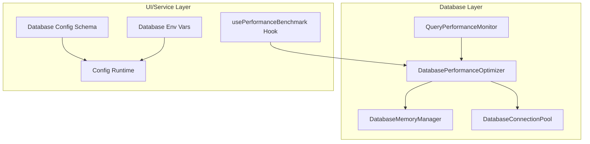
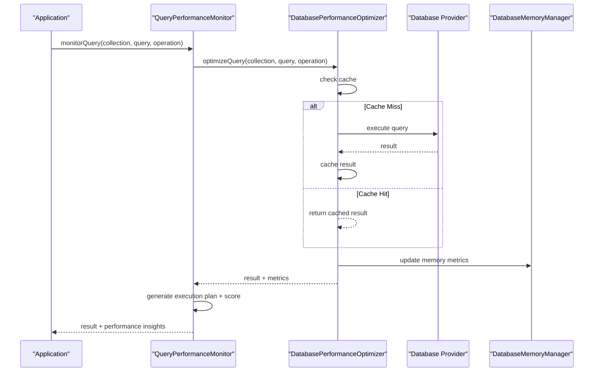
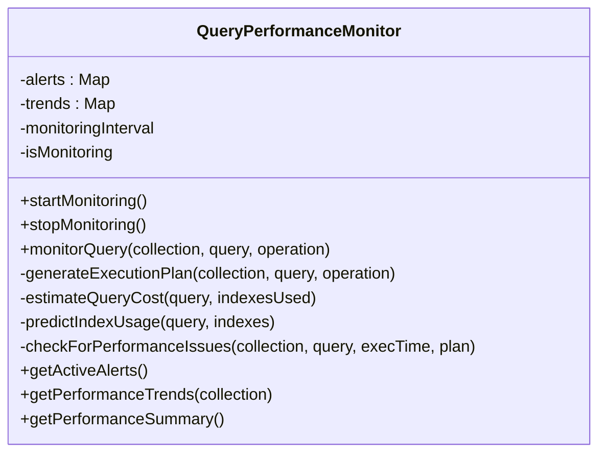
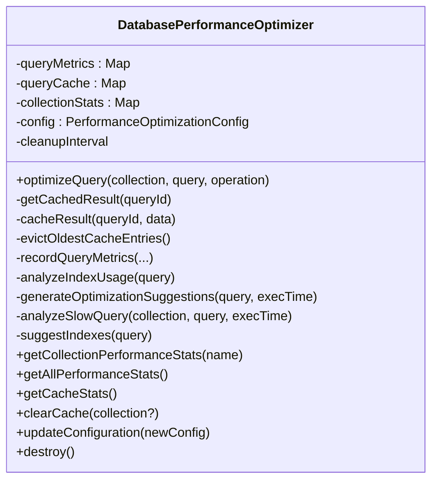
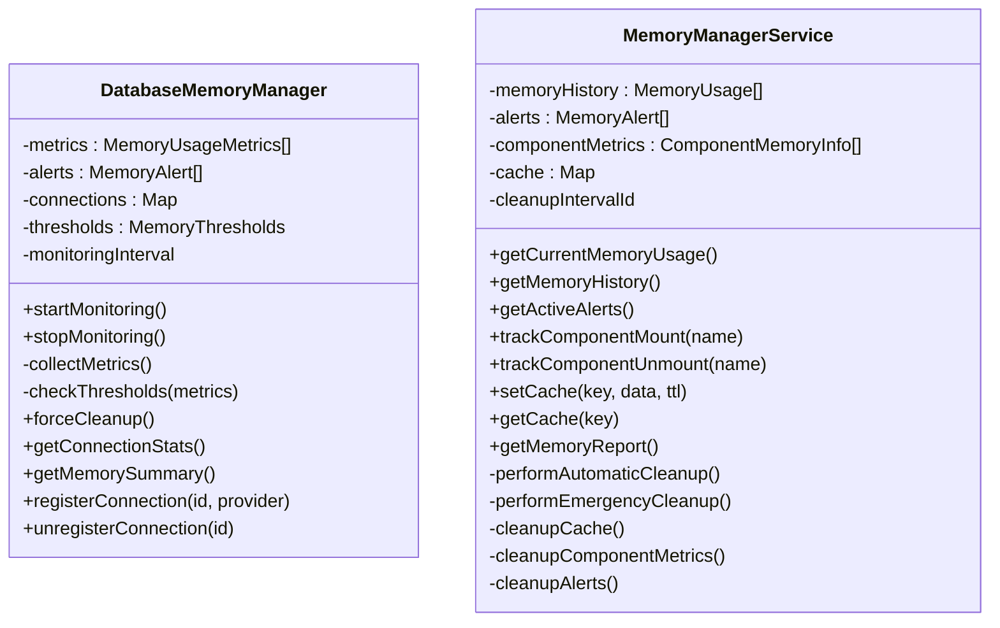
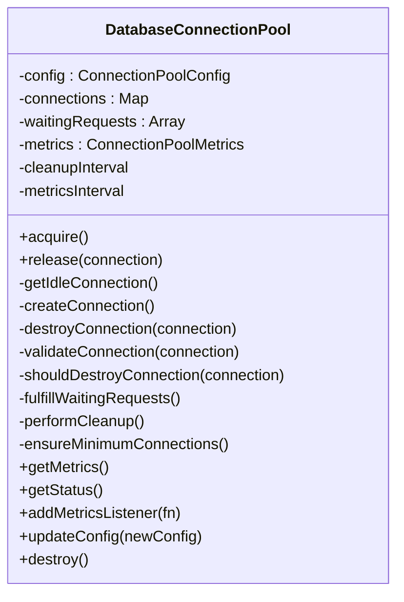
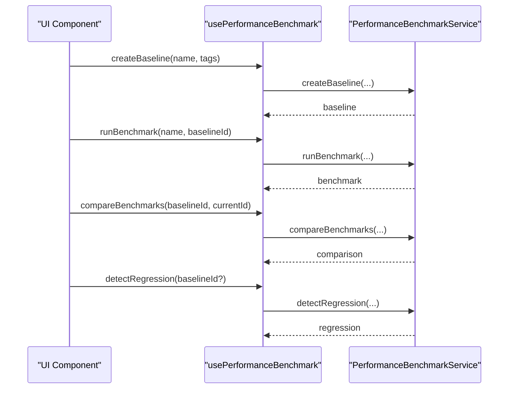
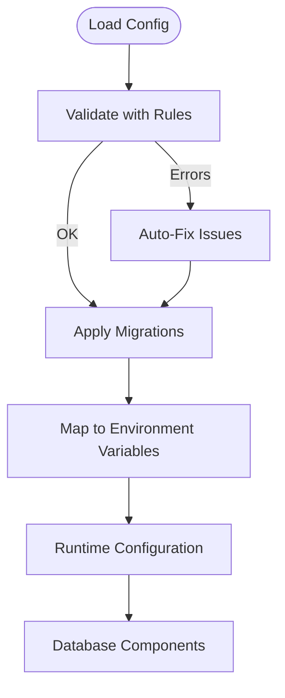
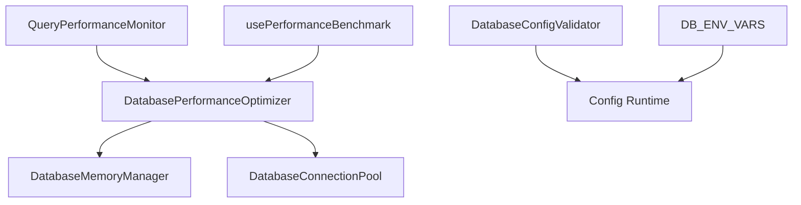

# Performance Optimization

<cite>
**Referenced Files in This Document**
- [QueryPerformanceMonitor.ts](file://src/services/database/performance/QueryPerformanceMonitor.ts)
- [DatabasePerformanceOptimizer.ts](file://src/services/database/performance/DatabasePerformanceOptimizer.ts)
- [MemoryManager.ts](file://src/services/database/MemoryManager.ts)
- [ConnectionPool.ts](file://src/services/database/ConnectionPool.ts)
- [memoryManager.ts](file://src/services/performance/memoryManager.ts)
- [usePerformanceBenchmark.ts](file://src/hooks/usePerformanceBenchmark.ts)
- [databaseConfigSchema.ts](file://src/config/databaseConfigSchema.ts)
- [databaseEnvVars.ts](file://src/config/databaseEnvVars.ts)
- [databaseConfigRuntime.ts](file://src/config/databaseConfigRuntime.ts)
- [PerformanceTestSuite.test.ts](file://src/services/database/__tests__/PerformanceTestSuite.test.ts)
</cite>

## Table of Contents
1. [Introduction](#introduction)
2. [Project Structure](#project-structure)
3. [Core Components](#core-components)
4. [Architecture Overview](#architecture-overview)
5. [Detailed Component Analysis](#detailed-component-analysis)
6. [Dependency Analysis](#dependency-analysis)
7. [Performance Considerations](#performance-considerations)
8. [Troubleshooting Guide](#troubleshooting-guide)
9. [Conclusion](#conclusion)
10. [Appendices](#appendices)

## Introduction
This document provides comprehensive guidance for optimizing database performance in SchoolPilot3. It covers the query performance monitoring system, indexing strategies, caching mechanisms, automatic tuning via the database performance optimizer, memory management for large datasets, connection pooling strategies, and performance benchmarking tools. It also includes practical troubleshooting steps, optimization recommendations, and capacity planning guidelines derived from the repository's implementation.

## Project Structure
SchoolPilot3 organizes performance-critical functionality primarily under:
- Database performance monitoring and optimization: `src/services/database/performance/`
- Database memory management: `src/services/database/MemoryManager.ts`
- Database connection pooling: `src/services/database/ConnectionPool.ts`
- General memory management for UI components: `src/services/performance/memoryManager.ts`
- Performance benchmarking hooks: `src/hooks/usePerformanceBenchmark.ts`
- Configuration validation and environment mapping: `src/config/`

**Diagram sources**
- [QueryPerformanceMonitor.ts:37-635](file://src/services/database/performance/QueryPerformanceMonitor.ts#L37-L635)
- [DatabasePerformanceOptimizer.ts:48-598](file://src/services/database/performance/DatabasePerformanceOptimizer.ts#L48-L598)
- [MemoryManager.ts:44-364](file://src/services/database/MemoryManager.ts#L44-L364)
- [ConnectionPool.ts:52-434](file://src/services/database/ConnectionPool.ts#L52-L434)
- [usePerformanceBenchmark.ts:44-309](file://src/hooks/usePerformanceBenchmark.ts#L44-L309)
- [databaseConfigSchema.ts:305-530](file://src/config/databaseConfigSchema.ts#L305-L530)
- [databaseEnvVars.ts:4-41](file://src/config/databaseEnvVars.ts#L4-L41)
- [databaseConfigRuntime.ts:281-299](file://src/config/databaseConfigRuntime.ts#L281-L299)

**Section sources**
- [QueryPerformanceMonitor.ts:1-635](file://src/services/database/performance/QueryPerformanceMonitor.ts#L1-L635)
- [DatabasePerformanceOptimizer.ts:1-598](file://src/services/database/performance/DatabasePerformanceOptimizer.ts#L1-L598)
- [MemoryManager.ts:1-364](file://src/services/database/MemoryManager.ts#L1-L364)
- [ConnectionPool.ts:1-434](file://src/services/database/ConnectionPool.ts#L1-L434)
- [memoryManager.ts:1-511](file://src/services/performance/memoryManager.ts#L1-L511)
- [usePerformanceBenchmark.ts:1-309](file://src/hooks/usePerformanceBenchmark.ts#L1-L309)
- [databaseConfigSchema.ts:1-530](file://src/config/databaseConfigSchema.ts#L1-L530)
- [databaseEnvVars.ts:1-41](file://src/config/databaseEnvVars.ts#L1-L41)
- [databaseConfigRuntime.ts:281-299](file://src/config/databaseConfigRuntime.ts#L281-L299)

## Core Components
- QueryPerformanceMonitor: Real-time monitoring of query execution, execution plan generation, performance scoring, bottleneck detection, and alerting.
- DatabasePerformanceOptimizer: Query caching, performance metrics recording, automatic indexing suggestions, slow query analysis, and maintenance scheduling.
- DatabaseMemoryManager: Memory usage monitoring, threshold-based alerts, connection lifecycle tracking, and cleanup routines.
- DatabaseConnectionPool: Connection lifecycle management, pooling metrics, validation, and cleanup.
- usePerformanceBenchmark: Benchmark creation, regression detection, and comparison utilities for performance validation.
- Configuration subsystem: Validation rules, migrations, environment variable mapping, and runtime configuration propagation.

**Section sources**
- [QueryPerformanceMonitor.ts:37-635](file://src/services/database/performance/QueryPerformanceMonitor.ts#L37-L635)
- [DatabasePerformanceOptimizer.ts:48-598](file://src/services/database/performance/DatabasePerformanceOptimizer.ts#L48-L598)
- [MemoryManager.ts:44-364](file://src/services/database/MemoryManager.ts#L44-L364)
- [ConnectionPool.ts:52-434](file://src/services/database/ConnectionPool.ts#L52-L434)
- [usePerformanceBenchmark.ts:44-309](file://src/hooks/usePerformanceBenchmark.ts#L44-L309)
- [databaseConfigSchema.ts:305-530](file://src/config/databaseConfigSchema.ts#L305-L530)
- [databaseEnvVars.ts:4-41](file://src/config/databaseEnvVars.ts#L4-L41)
- [databaseConfigRuntime.ts:281-299](file://src/config/databaseConfigRuntime.ts#L281-L299)

## Architecture Overview
The performance optimization architecture integrates monitoring, optimization, and resource management across database and UI layers. QueryPerformanceMonitor coordinates with DatabasePerformanceOptimizer to cache results, record metrics, and suggest optimizations. DatabaseMemoryManager and DatabaseConnectionPool provide resource governance. Configuration validation and environment mapping ensure consistent tuning across environments.

**Diagram sources**
- [QueryPerformanceMonitor.ts:90-135](file://src/services/database/performance/QueryPerformanceMonitor.ts#L90-L135)
- [DatabasePerformanceOptimizer.ts:90-143](file://src/services/database/performance/DatabasePerformanceOptimizer.ts#L90-L143)
- [MemoryManager.ts:91-135](file://src/services/database/MemoryManager.ts#L91-L135)

## Detailed Component Analysis

### Query Performance Monitor
The QueryPerformanceMonitor provides:
- Real-time monitoring with periodic checks and manual invocation.
- Execution plan generation including index availability, predicted index usage, cost estimation, and optimization level.
- Performance scoring and bottleneck detection with alerts for slow queries, missing indexes, low cache hit rates, and memory pressure.
- Trend tracking for collections over time.

**Diagram sources**
- [QueryPerformanceMonitor.ts:37-635](file://src/services/database/performance/QueryPerformanceMonitor.ts#L37-L635)

**Section sources**
- [QueryPerformanceMonitor.ts:58-135](file://src/services/database/performance/QueryPerformanceMonitor.ts#L58-L135)
- [QueryPerformanceMonitor.ts:140-344](file://src/services/database/performance/QueryPerformanceMonitor.ts#L140-L344)
- [QueryPerformanceMonitor.ts:346-471](file://src/services/database/performance/QueryPerformanceMonitor.ts#L346-L471)
- [QueryPerformanceMonitor.ts:473-631](file://src/services/database/performance/QueryPerformanceMonitor.ts#L473-L631)

### Database Performance Optimizer
The DatabasePerformanceOptimizer implements:
- Query caching with TTL and eviction policies.
- Metrics recording for query execution time, result counts, cache hits, indexes used, and optimization suggestions.
- Automatic indexing suggestions based on query patterns and slow query thresholds.
- Maintenance scheduler for cleanup of expired cache entries and old metrics.
- Configuration-driven behavior for caching, logging, and thresholds.

**Diagram sources**
- [DatabasePerformanceOptimizer.ts:48-598](file://src/services/database/performance/DatabasePerformanceOptimizer.ts#L48-L598)

**Section sources**
- [DatabasePerformanceOptimizer.ts:68-143](file://src/services/database/performance/DatabasePerformanceOptimizer.ts#L68-L143)
- [DatabasePerformanceOptimizer.ts:170-225](file://src/services/database/performance/DatabasePerformanceOptimizer.ts#L170-L225)
- [DatabasePerformanceOptimizer.ts:227-280](file://src/services/database/performance/DatabasePerformanceOptimizer.ts#L227-L280)
- [DatabasePerformanceOptimizer.ts:282-348](file://src/services/database/performance/DatabasePerformanceOptimizer.ts#L282-L348)
- [DatabasePerformanceOptimizer.ts:350-415](file://src/services/database/performance/DatabasePerformanceOptimizer.ts#L350-L415)
- [DatabasePerformanceOptimizer.ts:417-470](file://src/services/database/performance/DatabasePerformanceOptimizer.ts#L417-L470)
- [DatabasePerformanceOptimizer.ts:544-594](file://src/services/database/performance/DatabasePerformanceOptimizer.ts#L544-L594)

### Memory Management
Two complementary memory managers exist:
- DatabaseMemoryManager: Tracks memory usage, generates alerts, manages stale connections, and triggers cleanup routines.
- UI MemoryManager (service): Tracks component memory usage, manages cache with TTL/LRU, and provides memory reports.

**Diagram sources**
- [MemoryManager.ts:44-364](file://src/services/database/MemoryManager.ts#L44-L364)
- [memoryManager.ts:55-511](file://src/services/performance/memoryManager.ts#L55-L511)

**Section sources**
- [MemoryManager.ts:71-135](file://src/services/database/MemoryManager.ts#L71-L135)
- [MemoryManager.ts:137-192](file://src/services/database/MemoryManager.ts#L137-L192)
- [MemoryManager.ts:227-278](file://src/services/database/MemoryManager.ts#L227-L278)
- [MemoryManager.ts:280-328](file://src/services/database/MemoryManager.ts#L280-L328)
- [memoryManager.ts:82-103](file://src/services/performance/memoryManager.ts#L82-L103)
- [memoryManager.ts:201-241](file://src/services/performance/memoryManager.ts#L201-L241)
- [memoryManager.ts:243-288](file://src/services/performance/memoryManager.ts#L243-L288)
- [memoryManager.ts:368-430](file://src/services/performance/memoryManager.ts#L368-L430)
- [memoryManager.ts:432-492](file://src/services/performance/memoryManager.ts#L432-L492)

### Connection Pooling
The DatabaseConnectionPool manages:
- Connection lifecycle: creation, validation, acquisition, release, and destruction.
- Pool metrics: active/idle connections, waiting requests, utilization, and timing statistics.
- Cleanup and maintenance: idle timeout, max lifetime, and minimum connection enforcement.
- Integration with memory management for connection tracking.

**Diagram sources**
- [ConnectionPool.ts:52-434](file://src/services/database/ConnectionPool.ts#L52-L434)

**Section sources**
- [ConnectionPool.ts:105-158](file://src/services/database/ConnectionPool.ts#L105-L158)
- [ConnectionPool.ts:163-189](file://src/services/database/ConnectionPool.ts#L163-L189)
- [ConnectionPool.ts:294-340](file://src/services/database/ConnectionPool.ts#L294-L340)
- [ConnectionPool.ts:342-392](file://src/services/database/ConnectionPool.ts#L342-L392)

### Performance Benchmarking
The usePerformanceBenchmark hook enables:
- Baseline creation and deletion.
- Benchmark execution and comparison against baselines.
- Regression detection with severity assessment.
- Data import/export and clearing utilities.

**Diagram sources**
- [usePerformanceBenchmark.ts:44-309](file://src/hooks/usePerformanceBenchmark.ts#L44-L309)

**Section sources**
- [usePerformanceBenchmark.ts:79-117](file://src/hooks/usePerformanceBenchmark.ts#L79-L117)
- [usePerformanceBenchmark.ts:119-157](file://src/hooks/usePerformanceBenchmark.ts#L119-L157)
- [usePerformanceBenchmark.ts:158-187](file://src/hooks/usePerformanceBenchmark.ts#L158-L187)
- [usePerformanceBenchmark.ts:258-309](file://src/hooks/usePerformanceBenchmark.ts#L258-L309)

### Configuration and Environment Integration
The configuration system ensures consistent performance tuning:
- Validation rules define acceptable ranges and provide auto-fix suggestions.
- Migrations transform legacy configurations to the current structure.
- Environment variables map to runtime configuration for seamless deployment.

**Diagram sources**
- [databaseConfigSchema.ts:317-380](file://src/config/databaseConfigSchema.ts#L317-L380)
- [databaseConfigSchema.ts:385-410](file://src/config/databaseConfigSchema.ts#L385-L410)
- [databaseEnvVars.ts:4-41](file://src/config/databaseEnvVars.ts#L4-L41)
- [databaseConfigRuntime.ts:281-299](file://src/config/databaseConfigRuntime.ts#L281-L299)

**Section sources**
- [databaseConfigSchema.ts:54-201](file://src/config/databaseConfigSchema.ts#L54-L201)
- [databaseConfigSchema.ts:203-300](file://src/config/databaseConfigSchema.ts#L203-L300)
- [databaseEnvVars.ts:4-41](file://src/config/databaseEnvVars.ts#L4-L41)
- [databaseConfigRuntime.ts:281-299](file://src/config/databaseConfigRuntime.ts#L281-L299)

## Dependency Analysis
The following diagram illustrates key dependencies among performance components:

**Diagram sources**
- [QueryPerformanceMonitor.ts:4-6](file://src/services/database/performance/QueryPerformanceMonitor.ts#L4-L6)
- [DatabasePerformanceOptimizer.ts:4-6](file://src/services/database/performance/DatabasePerformanceOptimizer.ts#L4-L6)
- [MemoryManager.ts:4-5](file://src/services/database/MemoryManager.ts#L4-L5)
- [databaseConfigSchema.ts:305-530](file://src/config/databaseConfigSchema.ts#L305-L530)
- [databaseEnvVars.ts:4-41](file://src/config/databaseEnvVars.ts#L4-L41)
- [databaseConfigRuntime.ts:281-299](file://src/config/databaseConfigRuntime.ts#L281-L299)

**Section sources**
- [QueryPerformanceMonitor.ts:4-6](file://src/services/database/performance/QueryPerformanceMonitor.ts#L4-L6)
- [DatabasePerformanceOptimizer.ts:4-6](file://src/services/database/performance/DatabasePerformanceOptimizer.ts#L4-L6)
- [MemoryManager.ts:4-5](file://src/services/database/MemoryManager.ts#L4-L5)
- [databaseConfigSchema.ts:305-530](file://src/config/databaseConfigSchema.ts#L305-L530)
- [databaseEnvVars.ts:4-41](file://src/config/databaseEnvVars.ts#L4-L41)
- [databaseConfigRuntime.ts:281-299](file://src/config/databaseConfigRuntime.ts#L281-L299)

## Performance Considerations
- Caching strategy: Enable query caching with TTL and size limits; configure cache eviction to maintain responsiveness under memory pressure.
- Indexing automation: Leverage automatic indexing suggestions for slow queries; monitor index efficiency and adjust thresholds.
- Memory management: Set appropriate memory thresholds; trigger cleanup routines proactively; monitor stale connections.
- Connection pooling: Tune pool size, timeouts, and validation settings; monitor utilization and waiting requests.
- Benchmarking: Establish baselines, run comparative tests, and detect regressions automatically.

[No sources needed since this section provides general guidance]

## Troubleshooting Guide
Common issues and resolutions:
- Slow queries: Investigate execution plans, add indexes for missing fields, limit result sets, and avoid expensive regex filters.
- Low cache hit rate: Increase cache size or TTL, reduce query variability, and ensure cache invalidation aligns with data changes.
- High memory usage: Trigger cleanup routines, clear stale component references, and reduce cache sizes.
- Connection pool bottlenecks: Increase pool size, adjust timeouts, and validate connections on borrow/return.
- Configuration validation failures: Apply auto-fixes or migrations; ensure environment variables match expected values.

**Section sources**
- [QueryPerformanceMonitor.ts:346-388](file://src/services/database/performance/QueryPerformanceMonitor.ts#L346-L388)
- [DatabasePerformanceOptimizer.ts:544-573](file://src/services/database/performance/DatabasePerformanceOptimizer.ts#L544-L573)
- [MemoryManager.ts:137-144](file://src/services/database/MemoryManager.ts#L137-L144)
- [ConnectionPool.ts:373-392](file://src/services/database/ConnectionPool.ts#L373-L392)
- [databaseConfigSchema.ts:317-380](file://src/config/databaseConfigSchema.ts#L317-L380)

## Conclusion
SchoolPilot3’s performance optimization stack combines proactive monitoring, intelligent caching, automated indexing, robust memory management, and connection pooling to deliver scalable database operations. By leveraging the provided components and configuration tools, teams can continuously monitor, tune, and validate performance across environments.

[No sources needed since this section summarizes without analyzing specific files]

## Appendices

### Query Performance Monitoring Metrics Collection
- Execution time, result count, cache hit flag, indexes used, and optimization suggestions are recorded per query.
- Collection-level statistics include total queries, average execution time, slow query counts, cache hit rate, and index efficiency.
- Periodic performance checks aggregate system-wide metrics and generate alerts for high memory usage and slow collections.

**Section sources**
- [DatabasePerformanceOptimizer.ts:227-280](file://src/services/database/performance/DatabasePerformanceOptimizer.ts#L227-L280)
- [DatabasePerformanceOptimizer.ts:350-386](file://src/services/database/performance/DatabasePerformanceOptimizer.ts#L350-L386)
- [QueryPerformanceMonitor.ts:432-471](file://src/services/database/performance/QueryPerformanceMonitor.ts#L432-L471)

### Bottleneck Identification and Optimization Recommendations
- Execution plan generation predicts index usage and estimates cost; optimization level determines recommendations.
- Recommendations include adding indexes, limiting result sets, avoiding large SKIP values, using field projections, and switching to compound indexes for multi-field queries.

**Section sources**
- [QueryPerformanceMonitor.ts:140-169](file://src/services/database/performance/QueryPerformanceMonitor.ts#L140-L169)
- [QueryPerformanceMonitor.ts:302-344](file://src/services/database/performance/QueryPerformanceMonitor.ts#L302-L344)

### Automatic Tuning Capabilities
- Automatic indexing: Creates single-field and compound indexes based on query selectors and sort fields when slow query thresholds are exceeded.
- Maintenance scheduling: Periodically cleans expired cache entries and trims old metrics to maintain performance.

**Section sources**
- [DatabasePerformanceOptimizer.ts:388-415](file://src/services/database/performance/DatabasePerformanceOptimizer.ts#L388-L415)
- [DatabasePerformanceOptimizer.ts:544-573](file://src/services/database/performance/DatabasePerformanceOptimizer.ts#L544-L573)

### Memory Management Policies and Resource Cleanup
- DatabaseMemoryManager: Threshold-based alerts, forced cleanup, stale connection removal, and GC callback registration.
- UI MemoryManager: Component lifecycle tracking, LRU/TTL cache eviction, and memory report generation with recommendations.

**Section sources**
- [MemoryManager.ts:137-192](file://src/services/database/MemoryManager.ts#L137-L192)
- [memoryManager.ts:201-241](file://src/services/performance/memoryManager.ts#L201-L241)
- [memoryManager.ts:243-288](file://src/services/performance/memoryManager.ts#L243-L288)
- [memoryManager.ts:432-492](file://src/services/performance/memoryManager.ts#L432-L492)

### Connection Pooling Strategies
- Acquisition with timeout handling, validation on borrow/return, and idle/max lifetime enforcement.
- Metrics collection and listener notifications for pool health monitoring.

**Section sources**
- [ConnectionPool.ts:105-158](file://src/services/database/ConnectionPool.ts#L105-L158)
- [ConnectionPool.ts:163-189](file://src/services/database/ConnectionPool.ts#L163-L189)
- [ConnectionPool.ts:294-352](file://src/services/database/ConnectionPool.ts#L294-L352)

### Performance Benchmarking Tools and Methodologies
- Baseline creation and benchmark execution with comparison and regression detection.
- Stress testing methodologies for load levels, breaking points, and throughput analysis.

**Section sources**
- [usePerformanceBenchmark.ts:79-187](file://src/hooks/usePerformanceBenchmark.ts#L79-L187)
- [PerformanceTestSuite.test.ts:602-640](file://src/services/database/__tests__/PerformanceTestSuite.test.ts#L602-L640)

### Capacity Planning Guidelines
- Use configuration validation to ensure acceptable ranges for cache size, query timeout, batch size, and retention.
- Apply migrations to adopt newer structures and provider types.
- Map validated configuration to environment variables for consistent runtime behavior.

**Section sources**
- [databaseConfigSchema.ts:54-201](file://src/config/databaseConfigSchema.ts#L54-L201)
- [databaseConfigSchema.ts:203-300](file://src/config/databaseConfigSchema.ts#L203-L300)
- [databaseEnvVars.ts:4-41](file://src/config/databaseEnvVars.ts#L4-L41)
- [databaseConfigRuntime.ts:281-299](file://src/config/databaseConfigRuntime.ts#L281-L299)