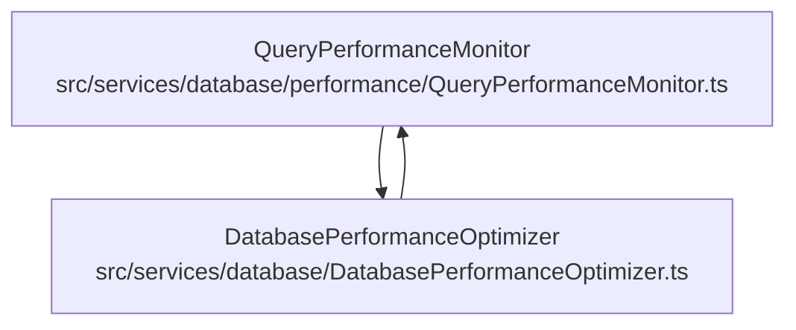
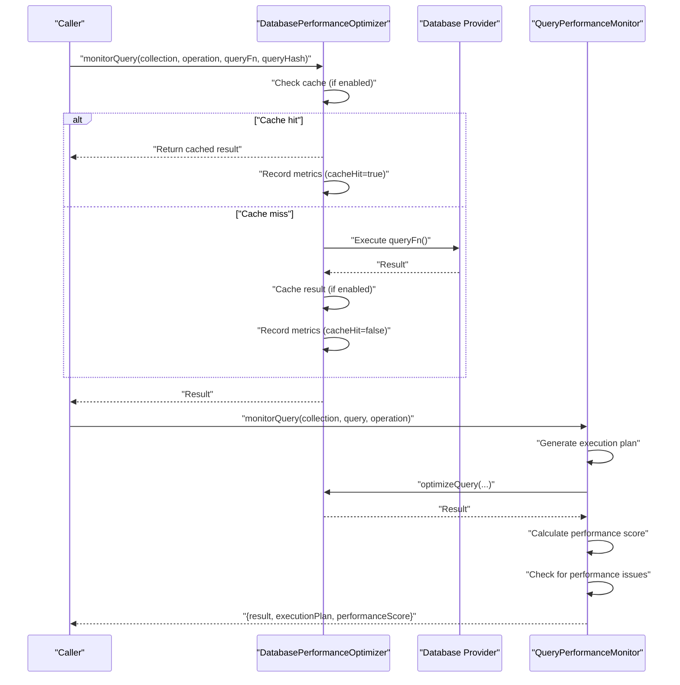
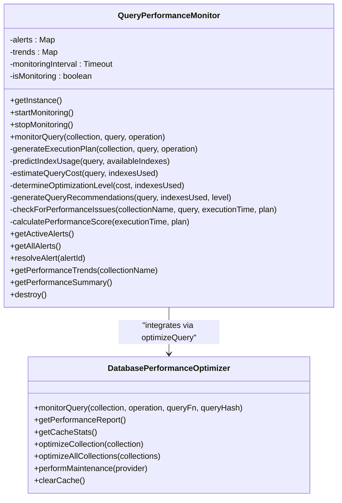
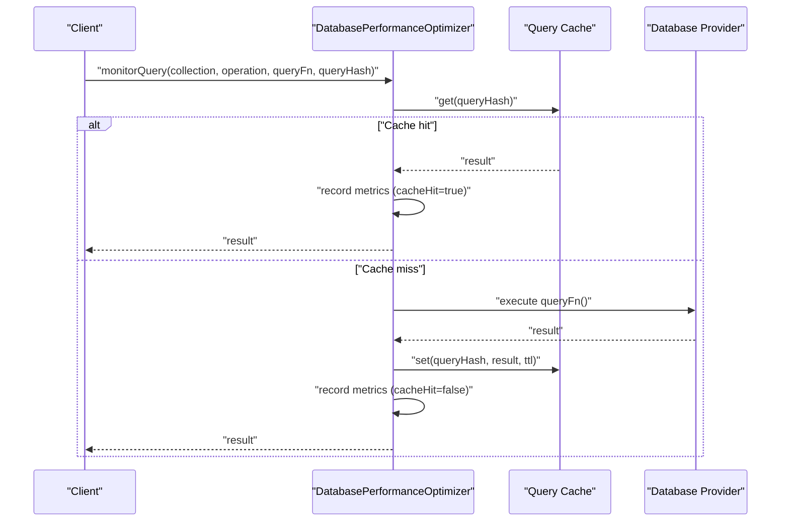
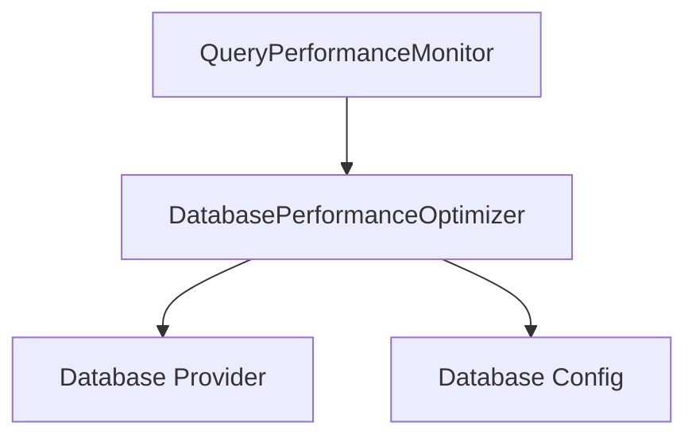

# Query Performance Monitoring

<cite>
**Referenced Files in This Document**
- [QueryPerformanceMonitor.ts](file://src/services/database/performance/QueryPerformanceMonitor.ts)
- [DatabasePerformanceOptimizer.ts](file://src/services/database/DatabasePerformanceOptimizer.ts)
- [performance.ts](file://src/types/performance.ts)
- [PerformanceTestSuite.test.ts](file://src/services/database/__tests__/PerformanceTestSuite.test.ts)
</cite>

## Table of Contents
1. [Introduction](#introduction)
2. [Project Structure](#project-structure)
3. [Core Components](#core-components)
4. [Architecture Overview](#architecture-overview)
5. [Detailed Component Analysis](#detailed-component-analysis)
6. [Dependency Analysis](#dependency-analysis)
7. [Performance Considerations](#performance-considerations)
8. [Troubleshooting Guide](#troubleshooting-guide)
9. [Conclusion](#conclusion)
10. [Appendices](#appendices)

## Introduction
This document explains SchoolPilot3's query performance monitoring system with a focus on the QueryPerformanceMonitor and DatabasePerformanceOptimizer. It covers how metrics are collected, how query execution time and record counts are tracked, how cache hits are detected, and how performance alerts and trends are generated. It also documents the monitoring workflow from query initiation through result caching and metrics recording, along with thresholds, alerting mechanisms, and integration with the optimizer. Guidance is included for interpreting performance reports, identifying bottlenecks, and implementing optimization strategies.

## Project Structure
The performance monitoring system spans two primary services:
- DatabasePerformanceOptimizer: central service that monitors, caches, and optimizes database queries.
- QueryPerformanceMonitor: higher-level monitor that generates execution plans, detects slow queries, and maintains performance trends and alerts.

**Diagram sources**
- [QueryPerformanceMonitor.ts:37-635](file://src/services/database/performance/QueryPerformanceMonitor.ts#L37-L635)
- [DatabasePerformanceOptimizer.ts:45-684](file://src/services/database/DatabasePerformanceOptimizer.ts#L45-L684)

**Section sources**
- [QueryPerformanceMonitor.ts:37-635](file://src/services/database/performance/QueryPerformanceMonitor.ts#L37-L635)
- [DatabasePerformanceOptimizer.ts:45-684](file://src/services/database/DatabasePerformanceOptimizer.ts#L45-L684)

## Core Components
- QueryPerformanceMonitor
  - Singleton monitor that periodically checks performance, generates execution plans, detects slow queries, and maintains trends and alerts.
  - Exposes APIs to start/stop monitoring, get alerts, trends, and performance summaries.
- DatabasePerformanceOptimizer
  - Centralized service that wraps query execution to collect metrics, manage caching, and provide optimization recommendations.
  - Tracks execution time, records affected, cache hit flag, and timestamp for each operation.

Key responsibilities:
- Query execution timing and result caching
- Metrics collection and reporting
- Slow query detection and recommendations
- Periodic maintenance and cache cleanup
- Trend computation and alert generation

**Section sources**
- [QueryPerformanceMonitor.ts:37-135](file://src/services/database/performance/QueryPerformanceMonitor.ts#L37-L135)
- [DatabasePerformanceOptimizer.ts:68-141](file://src/services/database/DatabasePerformanceOptimizer.ts#L68-L141)

## Architecture Overview
The monitoring architecture integrates a lightweight wrapper around database operations with a dedicated monitor that evaluates performance and generates actionable insights.

**Diagram sources**
- [DatabasePerformanceOptimizer.ts:68-141](file://src/services/database/DatabasePerformanceOptimizer.ts#L68-L141)
- [QueryPerformanceMonitor.ts:88-135](file://src/services/database/performance/QueryPerformanceMonitor.ts#L88-L135)

## Detailed Component Analysis

### QueryPerformanceMonitor
Responsibilities:
- Start/stop periodic monitoring
- Generate execution plans with cost estimation and index predictions
- Detect slow queries and missing indexes
- Track cache miss patterns
- Maintain performance trends and alerts
- Compute performance scores and summaries

Key interfaces and types:
- QueryExecutionPlan: includes queryId, collection, estimatedCost, indexesAvailable, indexesUsed, optimizationLevel, recommendations
- PerformanceAlert: includes id, type, severity, collection, message, details, timestamp, resolved
- PerformanceTrend: includes collection, timeframe, arrays for averageQueryTime, queryCount, cacheHitRate, timestamps

Monitoring workflow:
- On each monitored interval, the monitor fetches performance stats and cache stats, then creates alerts for high memory usage and slow collections. It updates hourly trends for each collection.

Alerting thresholds:
- Slow query: > 1000 ms (severity high if > 5000 ms)
- Missing index: critical optimization level with zero index usage
- Low cache hit rate: below 20% when total queries exceed 50
- High memory usage: cache memory usage > 50 MB
- Average slow query time: > 500 ms per collection

Performance scoring:
- Score starts at 100 and penalizes long execution times and poor optimization levels while rewarding index usage.

**Section sources**
- [QueryPerformanceMonitor.ts:37-635](file://src/services/database/performance/QueryPerformanceMonitor.ts#L37-L635)

#### Class Diagram

**Diagram sources**
- [QueryPerformanceMonitor.ts:37-635](file://src/services/database/performance/QueryPerformanceMonitor.ts#L37-L635)
- [DatabasePerformanceOptimizer.ts:45-684](file://src/services/database/DatabasePerformanceOptimizer.ts#L45-L684)

### DatabasePerformanceOptimizer
Responsibilities:
- Wrap database operations to collect metrics
- Manage query cache with TTL and eviction policies
- Record executionTime, recordsAffected, cacheHit, timestamp
- Provide performance reports and recommendations
- Perform maintenance tasks (cleanup, compaction)

Metrics collection:
- Records each query with queryId, collection, operation, executionTime, recordsAffected, timestamp, queryHash, cacheHit
- Computes cache hit rate and memory usage estimates

Caching:
- Enabled/disabled via performance config
- Cacheable operations include find, findOne, count
- TTL defaults to 300000 ms (5 minutes)
- Evicts entries older than TTL during reads and writes

Maintenance:
- Automatic maintenance runs every 6 hours to clear old metrics and expired cache entries
- Optional provider.compact support for underlying database compaction

**Section sources**
- [DatabasePerformanceOptimizer.ts:68-141](file://src/services/database/DatabasePerformanceOptimizer.ts#L68-L141)
- [DatabasePerformanceOptimizer.ts:604-631](file://src/services/database/DatabasePerformanceOptimizer.ts#L604-L631)
- [DatabasePerformanceOptimizer.ts:503-555](file://src/services/database/DatabasePerformanceOptimizer.ts#L503-L555)

#### Sequence Diagram: Query Execution with Caching

**Diagram sources**
- [DatabasePerformanceOptimizer.ts:68-141](file://src/services/database/DatabasePerformanceOptimizer.ts#L68-L141)
- [DatabasePerformanceOptimizer.ts:604-631](file://src/services/database/DatabasePerformanceOptimizer.ts#L604-L631)

### QueryPerformanceMetrics Interface
The metrics structure used by the DatabasePerformanceOptimizer includes:
- queryId: unique identifier for the query
- collection: target collection name
- operation: operation type (find, findOne, insert, update, delete, count)
- executionTime: milliseconds taken to execute
- recordsAffected: number of items affected or returned
- timestamp: when the metric was recorded
- queryHash: hash of the query for caching
- cacheHit: whether the result came from cache

These fields enable precise tracking of query performance, cache effectiveness, and operational patterns.

**Section sources**
- [DatabasePerformanceOptimizer.ts:7-16](file://src/services/database/DatabasePerformanceOptimizer.ts#L7-L16)

### Monitoring Workflow
End-to-end workflow from query initiation to metrics recording:
1. Caller invokes DatabasePerformanceOptimizer.monitorQuery with collection, operation, query function, and optional queryHash.
2. If caching is enabled and queryHash is provided, the optimizer attempts to retrieve the result from cache.
3. On cache miss, the optimizer executes the query function and captures executionTime.
4. The optimizer caches the result (if enabled) and records metrics including cacheHit flag.
5. QueryPerformanceMonitor.monitorQuery generates an execution plan, delegates optimization to DatabasePerformanceOptimizer, calculates a performance score, and checks for performance issues.
6. Alerts are created for slow queries, missing indexes, low cache hit rates, and high memory usage.
7. Trends are updated hourly with average query time, query count, and cache hit rate.

**Section sources**
- [DatabasePerformanceOptimizer.ts:68-141](file://src/services/database/DatabasePerformanceOptimizer.ts#L68-L141)
- [QueryPerformanceMonitor.ts:88-135](file://src/services/database/performance/QueryPerformanceMonitor.ts#L88-L135)
- [QueryPerformanceMonitor.ts:435-471](file://src/services/database/performance/QueryPerformanceMonitor.ts#L435-L471)

### Slow Query Detection Thresholds and Alerting
- Slow query detection: executionTime > 1000 ms; critical severity for > 5000 ms
- Missing index: execution plan optimizationLevel is critical/poor with zero indexesUsed
- Low cache hit rate: cacheHitRate < 20% when totalQueries > 50
- High memory usage: cache memory usage > 50 MB
- Average slow query time: > 500 ms per collection

Alert types:
- slow_query
- missing_index
- cache_miss
- memory_usage
- connection_issue

Severity levels:
- low, medium, high, critical

**Section sources**
- [QueryPerformanceMonitor.ts:355-387](file://src/services/database/performance/QueryPerformanceMonitor.ts#L355-L387)
- [QueryPerformanceMonitor.ts:441-450](file://src/services/database/performance/QueryPerformanceMonitor.ts#L441-L450)
- [QueryPerformanceMonitor.ts:452-463](file://src/services/database/performance/QueryPerformanceMonitor.ts#L452-L463)

### Integration with DatabasePerformanceOptimizer
- QueryPerformanceMonitor delegates actual query execution to DatabasePerformanceOptimizer.optimizeQuery.
- DatabasePerformanceOptimizer handles caching, metrics recording, and maintenance.
- QueryPerformanceMonitor focuses on alerting, trends, and execution plan generation.

**Section sources**
- [QueryPerformanceMonitor.ts:104-106](file://src/services/database/performance/QueryPerformanceMonitor.ts#L104-L106)
- [DatabasePerformanceOptimizer.ts:68-141](file://src/services/database/DatabasePerformanceOptimizer.ts#L68-L141)

### Interpreting Performance Reports and Identifying Bottlenecks
Performance report highlights:
- Total queries and average execution time
- Top slow queries (over 1000 ms)
- Cache hit rate
- Index recommendations (high/medium priority)
- Estimated memory usage
- Maintenance needs

Bottleneck identification tips:
- Review top slow queries by executionTime
- Check cache hit rate; low rates indicate missed opportunities for caching
- Evaluate index recommendations for high-impact fields and composite indexes
- Monitor trends for sustained increases in average query time or query counts

**Section sources**
- [DatabasePerformanceOptimizer.ts:401-432](file://src/services/database/DatabasePerformanceOptimizer.ts#L401-L432)

### Implementing Query Optimization Strategies
Recommended strategies derived from collected metrics:
- Add single-field indexes for frequently queried fields (common fields per collection)
- Create composite indexes for multi-field filters commonly used together
- Apply pagination (limit/skip) to avoid large result sets
- Use field projections to reduce data transfer
- Replace regex-based filters with full-text indexes when applicable
- Cache frequent read operations (find, findOne, count) with appropriate TTL
- Monitor and address slow operations (> 1000 ms) with targeted indexing and query restructuring

**Section sources**
- [DatabasePerformanceOptimizer.ts:195-247](file://src/services/database/DatabasePerformanceOptimizer.ts#L195-L247)
- [DatabasePerformanceOptimizer.ts:252-336](file://src/services/database/DatabasePerformanceOptimizer.ts#L252-L336)
- [QueryPerformanceMonitor.ts:302-344](file://src/services/database/performance/QueryPerformanceMonitor.ts#L302-L344)

## Dependency Analysis
- QueryPerformanceMonitor depends on DatabasePerformanceOptimizer for:
  - Executing queries with caching and metrics
  - Retrieving performance statistics and cache statistics
- DatabasePerformanceOptimizer depends on:
  - Database provider for actual query execution
  - Configuration for enabling caching and cache size limits
  - Internal cache and metrics storage

**Diagram sources**
- [QueryPerformanceMonitor.ts:5-6](file://src/services/database/performance/QueryPerformanceMonitor.ts#L5-L6)
- [DatabasePerformanceOptimizer.ts:5-6](file://src/services/database/DatabasePerformanceOptimizer.ts#L5-L6)
- [DatabasePerformanceOptimizer.ts](file://src/services/database/DatabasePerformanceOptimizer.ts#L54)

**Section sources**
- [QueryPerformanceMonitor.ts:5-6](file://src/services/database/performance/QueryPerformanceMonitor.ts#L5-L6)
- [DatabasePerformanceOptimizer.ts:5-6](file://src/services/database/DatabasePerformanceOptimizer.ts#L5-L6)

## Performance Considerations
- Caching strategy: Enable caching for read-heavy workloads; tune TTL and cache size based on memory constraints.
- Maintenance cadence: Automatic maintenance runs every 6 hours; ensure provider supports compaction for optimal disk usage.
- Metric retention: Recent metrics are kept to balance insight depth with memory usage.
- Cost estimation: Execution plan cost considers selector complexity, sorting, limits, and skip operations; index usage reduces cost.

[No sources needed since this section provides general guidance]

## Troubleshooting Guide
Common issues and resolutions:
- Frequent slow queries (> 1000 ms): Add indexes for queried fields, apply pagination, and consider field projections.
- Low cache hit rate (< 20%): Enable caching for eligible operations, increase cache size, and review TTL settings.
- High memory usage (> 50 MB): Reduce cache size, shorten TTL, or disable caching temporarily to investigate.
- Missing indexes: Review index recommendations and create high-priority indexes for multi-field filters.
- Connection issues: Investigate errors captured in alerts and ensure database connectivity and permissions.

**Section sources**
- [QueryPerformanceMonitor.ts:355-387](file://src/services/database/performance/QueryPerformanceMonitor.ts#L355-L387)
- [QueryPerformanceMonitor.ts:441-450](file://src/services/database/performance/QueryPerformanceMonitor.ts#L441-L450)
- [DatabasePerformanceOptimizer.ts:604-631](file://src/services/database/DatabasePerformanceOptimizer.ts#L604-L631)

## Conclusion
SchoolPilot3’s query performance monitoring system combines a robust DatabasePerformanceOptimizer for caching and metrics with a QueryPerformanceMonitor for execution planning, alerting, and trend analysis. Together, they provide actionable insights into query performance, cache effectiveness, and optimization opportunities. By leveraging the provided thresholds, recommendations, and reports, teams can proactively identify bottlenecks and implement targeted improvements.

[No sources needed since this section summarizes without analyzing specific files]

## Appendices

### Performance Thresholds and Severity Mapping
- Slow query: > 1000 ms (high severity for > 5000 ms)
- Missing index: critical optimization level with zero index usage
- Low cache hit rate: < 20% with totalQueries > 50
- High memory usage: cache memory usage > 50 MB
- Average slow query time: > 500 ms per collection

**Section sources**
- [QueryPerformanceMonitor.ts:355-387](file://src/services/database/performance/QueryPerformanceMonitor.ts#L355-L387)
- [QueryPerformanceMonitor.ts:441-450](file://src/services/database/performance/QueryPerformanceMonitor.ts#L441-L450)
- [QueryPerformanceMonitor.ts:452-463](file://src/services/database/performance/QueryPerformanceMonitor.ts#L452-L463)

### Performance Reporting and Trending
- Performance report includes total queries, average execution time, top slow queries, cache hit rate, index recommendations, memory usage, and maintenance needs.
- Hourly trends track average query time, query count, and cache hit rate for each collection over the past 24 hours.

**Section sources**
- [DatabasePerformanceOptimizer.ts:401-432](file://src/services/database/DatabasePerformanceOptimizer.ts#L401-L432)
- [QueryPerformanceMonitor.ts:476-519](file://src/services/database/performance/QueryPerformanceMonitor.ts#L476-L519)

### Test Suite References
- Performance regression detection compares baseline vs. current durations and flags degradations exceeding 20%.
- Trend analysis examines directional changes in performance metrics over time.

**Section sources**
- [PerformanceTestSuite.test.ts:729-753](file://src/services/database/__tests__/PerformanceTestSuite.test.ts#L729-L753)