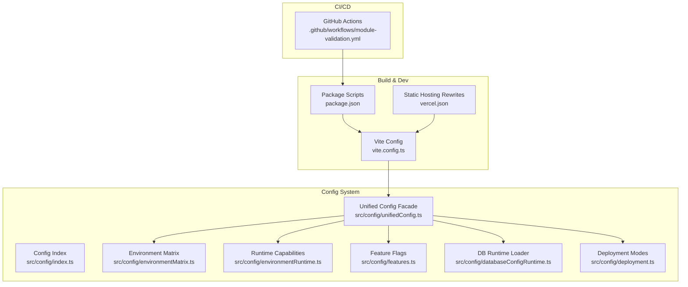
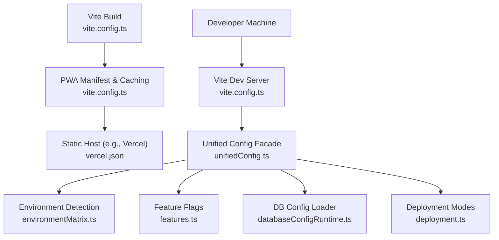
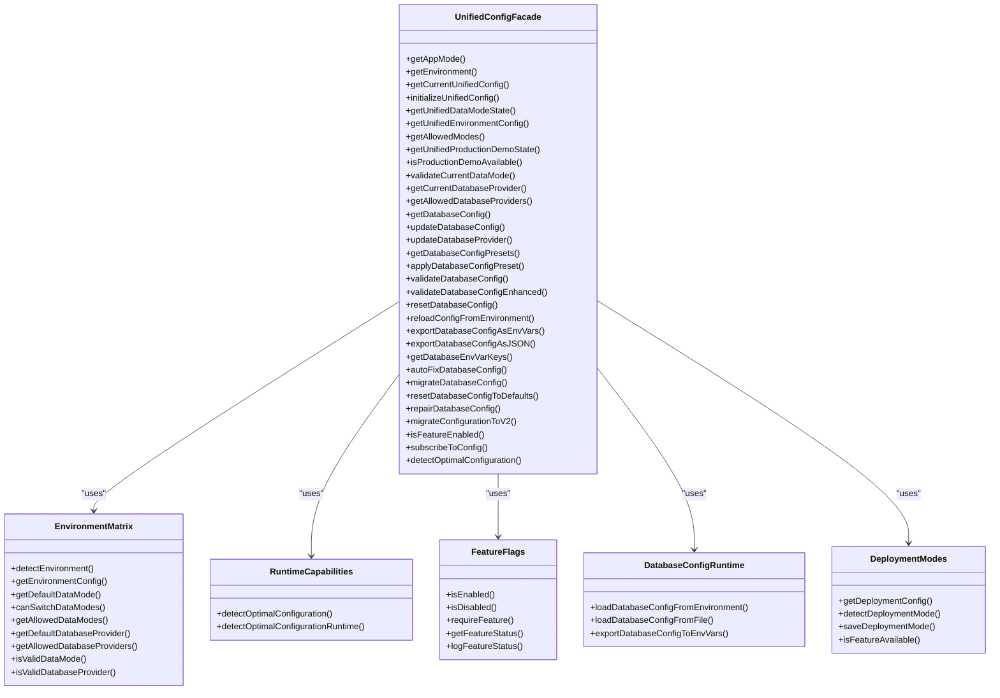
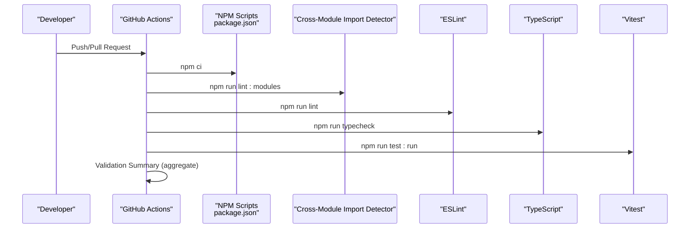
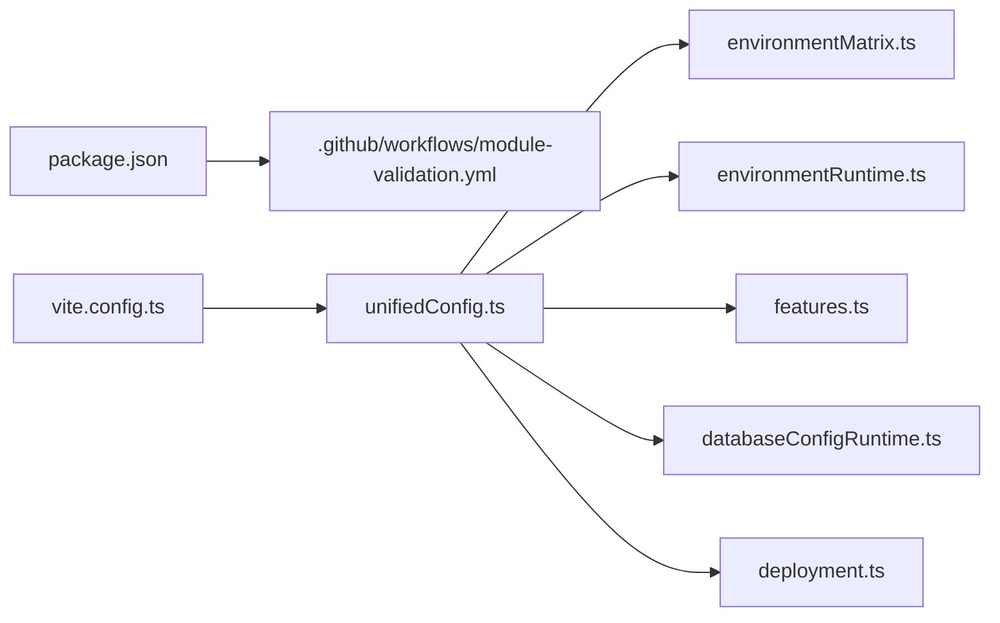

# Deployment & Configuration

<cite>
**Referenced Files in This Document**
- [vite.config.ts](file://vite.config.ts)
- [package.json](file://package.json)
- [vercel.json](file://vercel.json)
- [src/config/index.ts](file://src/config/index.ts)
- [src/config/deployment.ts](file://src/config/deployment.ts)
- [src/config/environmentRuntime.ts](file://src/config/environmentRuntime.ts)
- [src/config/features.ts](file://src/config/features.ts)
- [src/config/databaseConfigRuntime.ts](file://src/config/databaseConfigRuntime.ts)
- [src/config/unifiedConfig.ts](file://src/config/unifiedConfig.ts)
- [src/config/environmentMatrix.ts](file://src/config/environmentMatrix.ts)
- [.github/workflows/module-validation.yml](file://.github/workflows/module-validation.yml)
</cite>

## Table of Contents
1. [Introduction](#introduction)
2. [Project Structure](#project-structure)
3. [Core Components](#core-components)
4. [Architecture Overview](#architecture-overview)
5. [Detailed Component Analysis](#detailed-component-analysis)
6. [Dependency Analysis](#dependency-analysis)
7. [Performance Considerations](#performance-considerations)
8. [Troubleshooting Guide](#troubleshooting-guide)
9. [Conclusion](#conclusion)
10. [Appendices](#appendices)

## Introduction
This document provides comprehensive deployment and configuration guidance for SchoolPilot3. It covers build configuration with Vite, environment-specific optimizations, production bundling strategies, deployment options (self-hosted, cloud hosting, containerization), configuration management (environment variables, feature flags, runtime configuration), CI/CD pipeline setup, automated testing integration, deployment validation, database configuration across environments, backup strategies, monitoring setup, performance optimization techniques, caching strategies, scalability considerations, and step-by-step deployment guides with troubleshooting.

## Project Structure
SchoolPilot3 is a React-based single-tenant frontend application with a modular architecture and a unified configuration system. The build toolchain is powered by Vite, with PWA support for production builds. The configuration system is split into focused modules under src/config, exposing a thin backward-compatible orchestrator via unifiedConfig.ts. CI/CD is implemented with GitHub Actions for module independence validation, linting, type checking, and testing.

**Diagram sources**
- [vite.config.ts:1-200](file://vite.config.ts#L1-L200)
- [package.json:1-161](file://package.json#L1-L161)
- [vercel.json:1-1](file://vercel.json#L1-L1)
- [src/config/index.ts:1-18](file://src/config/index.ts#L1-L18)
- [src/config/unifiedConfig.ts:1-221](file://src/config/unifiedConfig.ts#L1-L221)
- [src/config/environmentMatrix.ts:1-152](file://src/config/environmentMatrix.ts#L1-L152)
- [src/config/environmentRuntime.ts:1-127](file://src/config/environmentRuntime.ts#L1-L127)
- [src/config/features.ts:1-279](file://src/config/features.ts#L1-L279)
- [src/config/databaseConfigRuntime.ts:1-331](file://src/config/databaseConfigRuntime.ts#L1-L331)
- [src/config/deployment.ts:1-241](file://src/config/deployment.ts#L1-L241)
- [.github/workflows/module-validation.yml:1-126](file://.github/workflows/module-validation.yml#L1-L126)

**Section sources**
- [vite.config.ts:1-200](file://vite.config.ts#L1-L200)
- [package.json:1-161](file://package.json#L1-L161)
- [vercel.json:1-1](file://vercel.json#L1-L1)
- [src/config/index.ts:1-18](file://src/config/index.ts#L1-L18)
- [src/config/unifiedConfig.ts:1-221](file://src/config/unifiedConfig.ts#L1-L221)
- [.github/workflows/module-validation.yml:1-126](file://.github/workflows/module-validation.yml#L1-L126)

## Core Components
- Build and bundling with Vite:
  - Development server with configurable host/port and COOP/COEP headers.
  - PWA plugin enabled in production with custom runtime caching and manifest.
  - Manual code-splitting strategy for vendor bundles and per-module chunks.
  - Dependency optimization for libraries like RxJS, RxDB, PouchDB, and SQLite/WebAssembly.
- Configuration management:
  - Environment detection and presets for development, staging, and production.
  - Feature flags with environment-specific presets and runtime toggles.
  - Database configuration loader from environment variables and optional JSON file.
  - Deployment modes with feature sets, network/storage characteristics.
  - Unified configuration facade for backward compatibility.
- CI/CD:
  - GitHub Actions workflow validating module independence, linting, type checking, and tests.

**Section sources**
- [vite.config.ts:1-200](file://vite.config.ts#L1-L200)
- [src/config/environmentMatrix.ts:1-152](file://src/config/environmentMatrix.ts#L1-L152)
- [src/config/features.ts:1-279](file://src/config/features.ts#L1-L279)
- [src/config/databaseConfigRuntime.ts:1-331](file://src/config/databaseConfigRuntime.ts#L1-L331)
- [src/config/deployment.ts:1-241](file://src/config/deployment.ts#L1-L241)
- [src/config/unifiedConfig.ts:1-221](file://src/config/unifiedConfig.ts#L1-L221)
- [.github/workflows/module-validation.yml:1-126](file://.github/workflows/module-validation.yml#L1-L126)

## Architecture Overview
The deployment architecture integrates Vite’s build pipeline with environment-aware configuration and runtime capability detection. The unified configuration orchestrator exposes typed APIs for environment, data modes, database providers, and feature flags. CI/CD enforces quality gates across linting, type checks, and tests.

**Diagram sources**
- [vite.config.ts:1-200](file://vite.config.ts#L1-L200)
- [vercel.json:1-1](file://vercel.json#L1-L1)
- [src/config/environmentMatrix.ts:1-152](file://src/config/environmentMatrix.ts#L1-L152)
- [src/config/features.ts:1-279](file://src/config/features.ts#L1-L279)
- [src/config/databaseConfigRuntime.ts:1-331](file://src/config/databaseConfigRuntime.ts#L1-L331)
- [src/config/deployment.ts:1-241](file://src/config/deployment.ts#L1-L241)
- [src/config/unifiedConfig.ts:1-221](file://src/config/unifiedConfig.ts#L1-L221)

## Detailed Component Analysis

### Build Configuration with Vite
- Development server:
  - Host/port configurable via environment variables.
  - Strict port enforcement and relaxed filesystem rules for monorepo-like setups.
  - COOP/COEP headers for web sandboxing.
- PWA plugin (production):
  - Workbox caching with custom patterns for fonts and API routes.
  - Manifest with icons and scopes.
- Bundling and code splitting:
  - Vendor chunking for React, router, MUI, charts, RxJS, Lodash, Livestore, animations.
  - Per-module chunking for all modules under src/modules/.
  - Shared application chunks for UI components, data hooks, contexts, database services, sync services, core, and routing.
  - Chunk size warning threshold increased to accommodate large modules.
- Dependency optimization:
  - Pre-bundling of frequently used libraries including RxJS, RxDB, PouchDB variants, and semver.
  - Exclusion of SQLite WASM adapter to avoid conflicts.
- Worker format set to ES for modern web workers.

**Section sources**
- [vite.config.ts:1-200](file://vite.config.ts#L1-L200)

### Environment-Specific Optimizations
- Environment detection:
  - Runtime detection based on protocol, hostname, and NODE_ENV.
  - Preset matrices define allowed data modes, providers, and feature flags per environment.
- Feature flags:
  - Defaults aligned with production behavior; development/demo presets enable advanced features.
  - Runtime toggles via Vite environment variables with safe parsing.
- Runtime capability detection:
  - Capability-based feature toggles for IndexedDB, Service Workers, online/offline state, and production mode.
  - Synchronous fallback for environments where async detection is not feasible.

**Section sources**
- [src/config/environmentMatrix.ts:1-152](file://src/config/environmentMatrix.ts#L1-L152)
- [src/config/features.ts:1-279](file://src/config/features.ts#L1-L279)
- [src/config/environmentRuntime.ts:1-127](file://src/config/environmentRuntime.ts#L1-L127)

### Production Bundling Strategies
- Manual chunking ensures predictable bundle sizes and improved caching:
  - Vendor bundles grouped by library families.
  - Module-specific chunks for maintainable lazy-loading.
  - Shared chunks for common UI and service layers.
- PWA caching reduces bandwidth and improves offline readiness:
  - Fonts cached with long TTLs.
  - API responses cached with short TTLs for responsiveness.
- Dependency pre-bundling minimizes cold-start latency.

**Section sources**
- [vite.config.ts:113-198](file://vite.config.ts#L113-L198)

### Configuration Management System
- Centralized re-exports via src/config/index.ts and a unified facade in src/config/unifiedConfig.ts.
- Database configuration:
  - Load from environment variables with robust parsing helpers.
  - Optional runtime loading from a JSON file served at /database-config.json.
  - Export to environment variables for downstream tooling.
- Deployment modes:
  - Define capabilities, network/storage characteristics, and feature availability per mode.
  - Automatic detection with URL parameter override and persisted preference.
- Feature flags:
  - Granular toggles for advanced reporting, real-time sync, notifications, audit logs, and more.
  - Presets per environment and runtime logging in development.

**Diagram sources**
- [src/config/unifiedConfig.ts:1-221](file://src/config/unifiedConfig.ts#L1-L221)
- [src/config/environmentMatrix.ts:1-152](file://src/config/environmentMatrix.ts#L1-L152)
- [src/config/environmentRuntime.ts:1-127](file://src/config/environmentRuntime.ts#L1-L127)
- [src/config/features.ts:1-279](file://src/config/features.ts#L1-L279)
- [src/config/databaseConfigRuntime.ts:1-331](file://src/config/databaseConfigRuntime.ts#L1-L331)
- [src/config/deployment.ts:1-241](file://src/config/deployment.ts#L1-L241)

**Section sources**
- [src/config/index.ts:1-18](file://src/config/index.ts#L1-L18)
- [src/config/unifiedConfig.ts:1-221](file://src/config/unifiedConfig.ts#L1-L221)
- [src/config/environmentMatrix.ts:1-152](file://src/config/environmentMatrix.ts#L1-L152)
- [src/config/environmentRuntime.ts:1-127](file://src/config/environmentRuntime.ts#L1-L127)
- [src/config/features.ts:1-279](file://src/config/features.ts#L1-L279)
- [src/config/databaseConfigRuntime.ts:1-331](file://src/config/databaseConfigRuntime.ts#L1-L331)
- [src/config/deployment.ts:1-241](file://src/config/deployment.ts#L1-L241)

### CI/CD Pipeline Setup and Automated Testing
- Workflow name: Module Independence Validation.
- Triggers: Pushes and pull requests to main and develop.
- Jobs:
  - Detect cross-module imports using a dedicated script.
  - ESLint validation.
  - TypeScript type check.
  - Test execution with Vitest.
- Summary job aggregates results and fails the build if any job fails.

**Diagram sources**
- [.github/workflows/module-validation.yml:1-126](file://.github/workflows/module-validation.yml#L1-L126)
- [package.json:1-161](file://package.json#L1-L161)

**Section sources**
- [.github/workflows/module-validation.yml:1-126](file://.github/workflows/module-validation.yml#L1-L126)
- [package.json:1-161](file://package.json#L1-L161)

### Database Configuration Across Environments
- Environment variables:
  - Provider selection and auto-detection flags.
  - Connection string and API authentication settings.
  - Performance tuning: caching, indexing, timeouts, batch sizes.
  - Storage: size limits, compression, encryption, backup, retention.
  - Sync: intervals, conflict resolution, retries, timeouts.
  - Monitoring: health checks, metrics, error reporting, log level.
  - Features: full-text search, transactions, real-time updates, offline mode, data validation, audit log.
- Runtime loading:
  - Optional JSON file at /database-config.json for dynamic overrides.
- Export:
  - Export current runtime configuration back to environment variables for reproducibility.

**Section sources**
- [src/config/databaseConfigRuntime.ts:1-331](file://src/config/databaseConfigRuntime.ts#L1-L331)

### Deployment Options
- Self-hosted deployment:
  - Serve the static build output from a web server or reverse proxy.
  - Configure environment variables for database provider, connection string, and API settings.
  - Optionally provide /database-config.json for runtime overrides.
- Cloud hosting (Vercel):
  - Static site deployment with SPA routing handled by vercel.json rewrite rules.
  - Ensure API endpoints are proxied or served separately if backend is external.
- Containerization:
  - Package the static build in an Nginx/Apache image.
  - Mount configuration files or pass environment variables at runtime.

Note: The repository does not include Dockerfiles or Kubernetes manifests. Use the static build artifacts produced by Vite for container images.

**Section sources**
- [vercel.json:1-1](file://vercel.json#L1-L1)
- [vite.config.ts:1-200](file://vite.config.ts#L1-L200)
- [src/config/databaseConfigRuntime.ts:1-331](file://src/config/databaseConfigRuntime.ts#L1-L331)

### Step-by-Step Deployment Guides

#### Self-Hosted Deployment
1. Build the application:
   - Run the build script to generate optimized static assets.
2. Prepare environment variables:
   - Set provider, connection string, and API credentials as needed.
3. Serve the build:
   - Deploy the dist folder to your web server or reverse proxy.
4. Optional runtime configuration:
   - Place /database-config.json at the application root for overrides.

**Section sources**
- [package.json:6-16](file://package.json#L6-L16)
- [vite.config.ts:113-198](file://vite.config.ts#L113-L198)
- [src/config/databaseConfigRuntime.ts:250-265](file://src/config/databaseConfigRuntime.ts#L250-L265)

#### Cloud Hosting (Vercel)
1. Commit your build output to the repository or configure Vercel to build from source.
2. Ensure SPA routing is handled by the provided rewrite rule.
3. Configure environment variables for backend/API settings.
4. Verify API endpoints are reachable from the hosted domain.

**Section sources**
- [vercel.json:1-1](file://vercel.json#L1-L1)
- [package.json:6-16](file://package.json#L6-L16)

#### Containerization
1. Build the application.
2. Copy the dist folder into a minimal container image (e.g., nginx:alpine).
3. Expose the appropriate port and serve static files.
4. Pass environment variables for database/provider/API configuration.
5. Optionally mount /database-config.json if dynamic overrides are required.

[No sources needed since this section provides general guidance]

### Performance Optimization Techniques and Caching Strategies
- Code splitting:
  - Vendor and module-specific chunks reduce initial payload and improve caching.
- PWA caching:
  - Fonts cached aggressively; API responses cached with short TTLs for responsiveness.
- Dependency optimization:
  - Pre-bundling RxJS, RxDB, PouchDB, and SQLite/WebAssembly to minimize cold starts.
- Runtime capability-based feature toggles:
  - Enable offline mode and real-time sync only when supported.

**Section sources**
- [vite.config.ts:113-198](file://vite.config.ts#L113-L198)
- [src/config/environmentRuntime.ts:31-127](file://src/config/environmentRuntime.ts#L31-L127)

### Scalability Considerations
- Database provider flexibility:
  - Support for SQLite (WASM/file), PouchDB, backend API, Livestore, and hybrid modes.
- Environment-aware defaults:
  - Staging defaults to SQLite WASM; production defaults to Livestore.
- Feature flags:
  - Gradual rollout of advanced features without breaking changes.

**Section sources**
- [src/config/environmentMatrix.ts:32-86](file://src/config/environmentMatrix.ts#L32-L86)
- [src/config/deployment.ts:42-186](file://src/config/deployment.ts#L42-L186)

## Dependency Analysis
The configuration system is composed of focused modules orchestrated by a unified facade. The build system depends on Vite plugins and Rollup options. CI/CD depends on GitHub Actions and NPM scripts.

**Diagram sources**
- [vite.config.ts:1-200](file://vite.config.ts#L1-L200)
- [package.json:1-161](file://package.json#L1-L161)
- [.github/workflows/module-validation.yml:1-126](file://.github/workflows/module-validation.yml#L1-L126)
- [src/config/unifiedConfig.ts:1-221](file://src/config/unifiedConfig.ts#L1-L221)
- [src/config/environmentMatrix.ts:1-152](file://src/config/environmentMatrix.ts#L1-L152)
- [src/config/environmentRuntime.ts:1-127](file://src/config/environmentRuntime.ts#L1-L127)
- [src/config/features.ts:1-279](file://src/config/features.ts#L1-L279)
- [src/config/databaseConfigRuntime.ts:1-331](file://src/config/databaseConfigRuntime.ts#L1-L331)
- [src/config/deployment.ts:1-241](file://src/config/deployment.ts#L1-L241)

**Section sources**
- [vite.config.ts:1-200](file://vite.config.ts#L1-L200)
- [package.json:1-161](file://package.json#L1-L161)
- [src/config/unifiedConfig.ts:1-221](file://src/config/unifiedConfig.ts#L1-L221)
- [.github/workflows/module-validation.yml:1-126](file://.github/workflows/module-validation.yml#L1-L126)

## Performance Considerations
- Prefer SQLite WASM in staging and Livestore in production for optimal performance and reliability.
- Enable caching and indexing selectively based on workload.
- Monitor API cache hit rates and adjust TTLs accordingly.
- Use feature flags to disable heavy features in constrained environments.

[No sources needed since this section provides general guidance]

## Troubleshooting Guide
- Cross-module imports:
  - Use the dedicated lint script to detect and report violations; upload artifacts on failure.
- Lint and type errors:
  - Run ESLint and TypeScript checks locally before pushing.
- Test failures:
  - Execute tests with Vitest and review failing assertions.
- PWA caching issues:
  - Clear browser cache or adjust Workbox cache patterns in vite.config.ts.
- Database configuration problems:
  - Validate environment variables and export/import runtime configuration for debugging.

**Section sources**
- [.github/workflows/module-validation.yml:1-126](file://.github/workflows/module-validation.yml#L1-L126)
- [src/config/databaseConfigRuntime.ts:267-330](file://src/config/databaseConfigRuntime.ts#L267-L330)

## Conclusion
SchoolPilot3’s deployment and configuration strategy leverages Vite for efficient builds, a flexible environment-aware configuration system, and robust CI/CD validation. By combining environment-specific presets, runtime capability detection, and feature flags, the application adapts to diverse deployment scenarios while maintaining performance and reliability. Use the provided guides to deploy self-hosted, cloud-hosted, or containerized instances, and rely on the configuration system for safe, incremental feature adoption.

[No sources needed since this section summarizes without analyzing specific files]

## Appendices

### Appendix A: Environment Variables Reference
- Database configuration keys are defined centrally and parsed by the runtime loader. Use the exported keys to set values consistently.

**Section sources**
- [src/config/databaseConfigRuntime.ts:4-61](file://src/config/databaseConfigRuntime.ts#L4-L61)

### Appendix B: Feature Flags Reference
- Feature flags are parsed from Vite environment variables with safe defaults. Use the provided helpers to check status and enforce requirements.

**Section sources**
- [src/config/features.ts:171-279](file://src/config/features.ts#L171-L279)

### Appendix C: Deployment Modes Reference
- Deployment modes define capabilities and constraints. Use detection and persistence helpers to select and store the preferred mode.

**Section sources**
- [src/config/deployment.ts:188-241](file://src/config/deployment.ts#L188-L241)