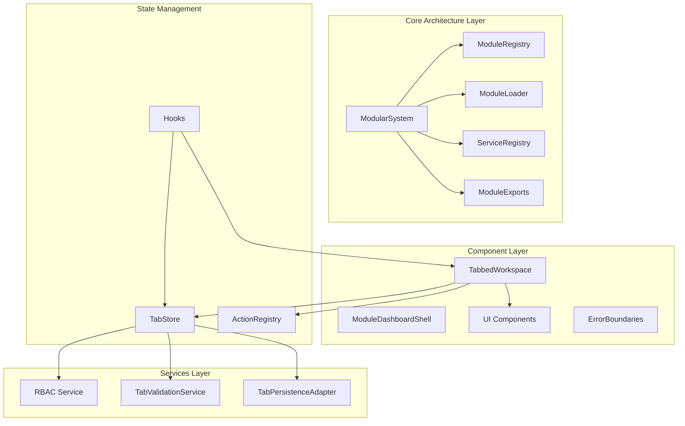
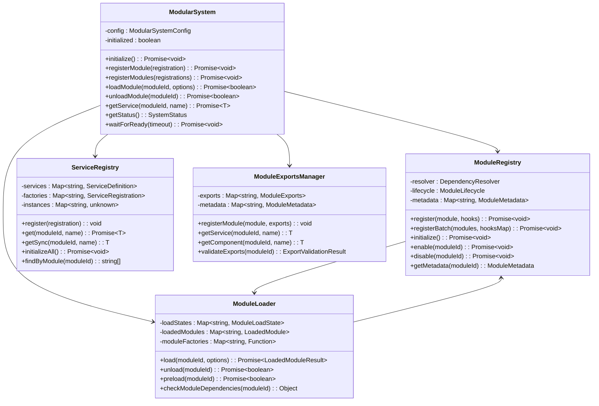
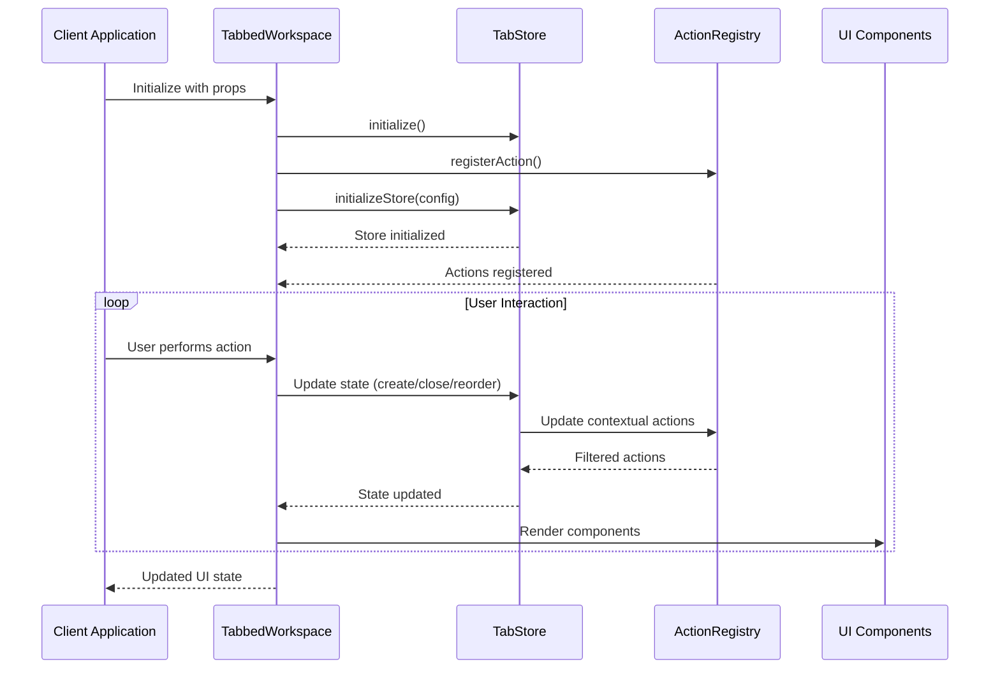
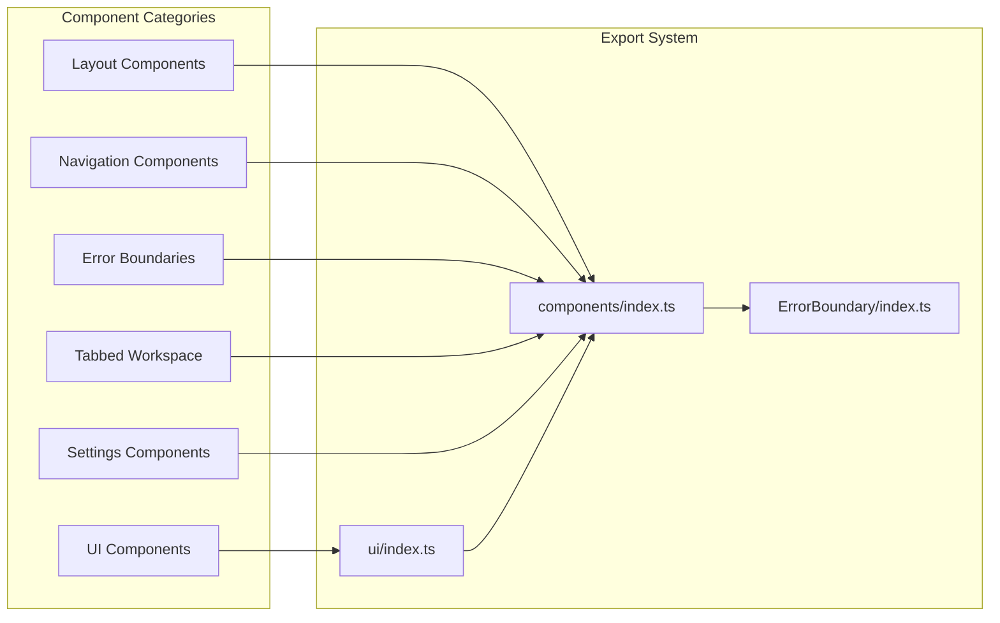
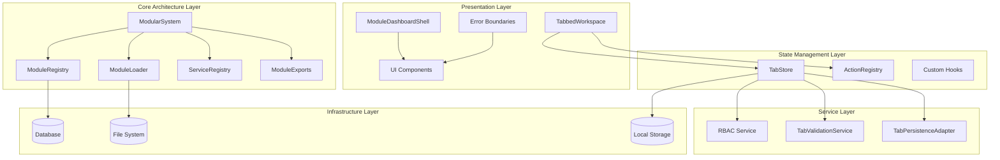
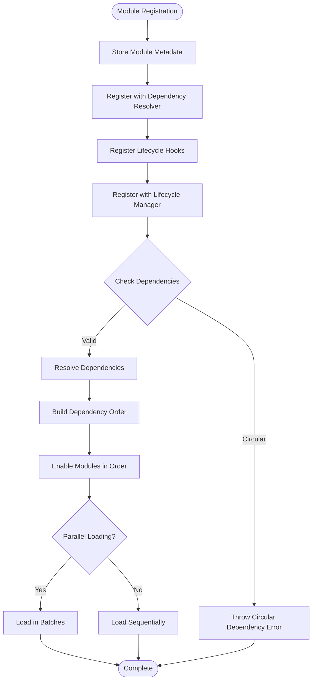
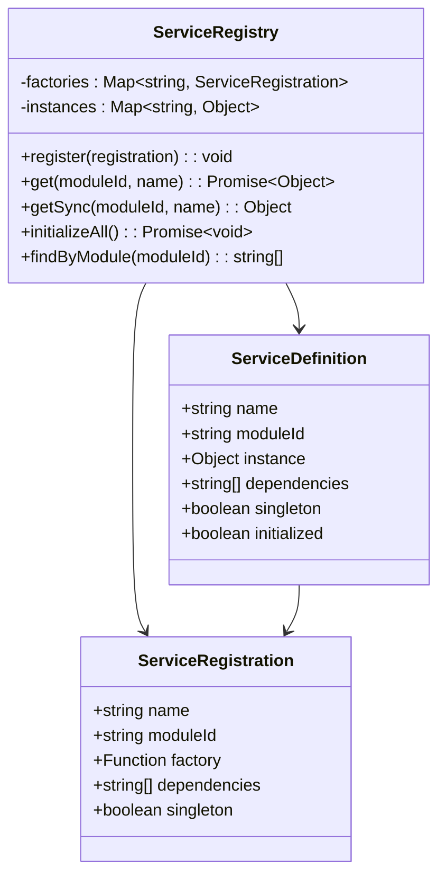
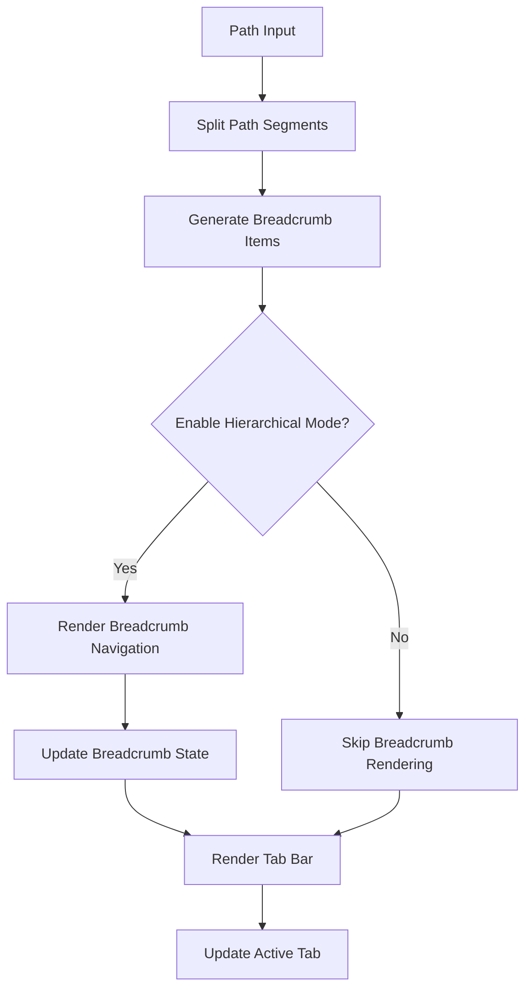
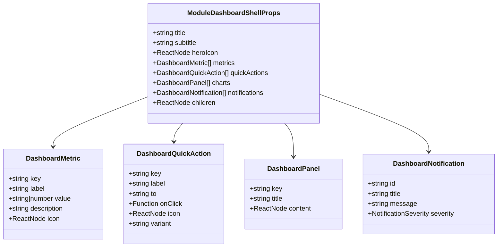
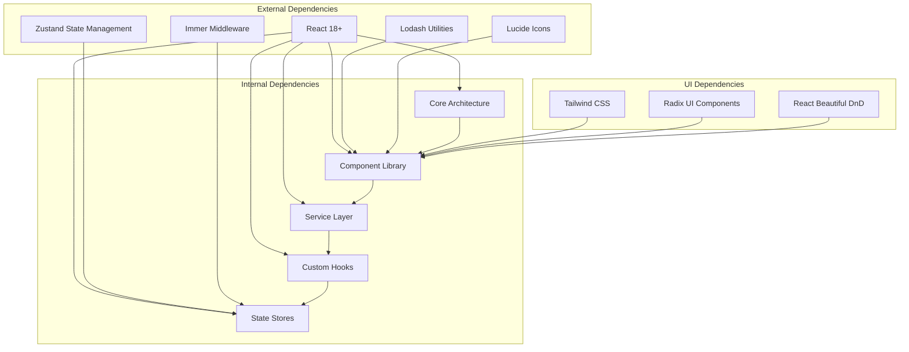

# Component Pattern Improvements

<cite>
**Referenced Files in This Document**
- [components/index.ts](file://src/components/index.ts)
- [ModularSystem.ts](file://src/core/ModularSystem.ts)
- [moduleRegistry.ts](file://src/core/moduleRegistry.ts)
- [moduleLoader.ts](file://src/core/moduleLoader.ts)
- [ServiceRegistry.ts](file://src/core/ServiceRegistry.ts)
- [ModuleExports.ts](file://src/core/ModuleExports.ts)
- [module.ts](file://src/core/types/module.ts)
- [TabbedWorkspace.tsx](file://src/components/tabbedWorkspace/TabbedWorkspace.tsx)
- [ModuleDashboardShell.tsx](file://src/components/ModuleDashboardShell.tsx)
- [ui/index.ts](file://src/components/ui/index.ts)
- [useTabNavigation.ts](file://src/hooks/useTabNavigation.ts)
- [tabStore.ts](file://src/stores/tabStore.ts)
- [actionRegistry.ts](file://src/services/ui/actionRegistry.ts)
- [ErrorBoundary/index.ts](file://src/components/ErrorBoundary/index.ts)
</cite>

## Table of Contents
1. [Introduction](#introduction)
2. [Project Structure](#project-structure)
3. [Core Components](#core-components)
4. [Architecture Overview](#architecture-overview)
5. [Detailed Component Analysis](#detailed-component-analysis)
6. [Dependency Analysis](#dependency-analysis)
7. [Performance Considerations](#performance-considerations)
8. [Troubleshooting Guide](#troubleshooting-guide)
9. [Conclusion](#conclusion)

## Introduction

This document analyzes the component pattern improvements implemented in the SchoolPilot3 educational system. The project demonstrates sophisticated architectural patterns for building scalable, maintainable, and modular React applications. The analysis focuses on three key areas: the modular system architecture, the tabbed workspace component system, and the comprehensive component export patterns.

The system showcases modern React patterns including composition over inheritance, centralized state management, dependency injection, and robust error handling mechanisms. These improvements address common scalability challenges in large-scale educational applications while maintaining excellent developer experience and user interface consistency.

## Project Structure

The project follows a well-organized structure that separates concerns across multiple layers:

**Diagram sources**
- [ModularSystem.ts:1-384](file://src/core/ModularSystem.ts#L1-L384)
- [moduleRegistry.ts:1-348](file://src/core/moduleRegistry.ts#L1-L348)
- [TabbedWorkspace.tsx:1-549](file://src/components/tabbedWorkspace/TabbedWorkspace.tsx#L1-L549)

**Section sources**
- [components/index.ts:1-143](file://src/components/index.ts#L1-L143)
- [ModularSystem.ts:1-384](file://src/core/ModularSystem.ts#L1-L384)

## Core Components

### Modular System Architecture

The modular system represents the foundation of the component pattern improvements, providing a comprehensive framework for managing application modules, services, and exports.

**Diagram sources**
- [ModularSystem.ts:59-384](file://src/core/ModularSystem.ts#L59-L384)
- [moduleRegistry.ts:24-348](file://src/core/moduleRegistry.ts#L24-L348)
- [moduleLoader.ts:43-560](file://src/core/moduleLoader.ts#L43-L560)
- [ServiceRegistry.ts:32-277](file://src/core/ServiceRegistry.ts#L32-L277)
- [ModuleExports.ts:31-309](file://src/core/ModuleExports.ts#L31-L309)

The modular system implements several key patterns:

1. **Centralized Integration Point**: The `ModularSystem` class serves as a single integration point, coordinating all modular system components through event forwarding and coordinated initialization.

2. **Dependency Injection**: The `ServiceRegistry` implements a robust dependency injection system supporting circular dependency detection and service lifecycle management.

3. **Export Management**: The `ModuleExportsManager` provides centralized management of module exports with validation against declared capabilities.

**Section sources**
- [ModularSystem.ts:59-384](file://src/core/ModularSystem.ts#L59-L384)
- [ServiceRegistry.ts:32-277](file://src/core/ServiceRegistry.ts#L32-L277)
- [ModuleExports.ts:31-309](file://src/core/ModuleExports.ts#L31-L309)

### Tabbed Workspace Component System

The tabbed workspace represents a sophisticated component pattern that demonstrates advanced React architecture principles:

**Diagram sources**
- [TabbedWorkspace.tsx:107-200](file://src/components/tabbedWorkspace/TabbedWorkspace.tsx#L107-L200)
- [tabStore.ts:139-244](file://src/stores/tabStore.ts#L139-L244)
- [actionRegistry.ts:115-187](file://src/services/ui/actionRegistry.ts#L115-L187)

Key architectural improvements in the tabbed workspace include:

1. **Performance Optimization**: Extensive use of `useMemo`, `useCallback`, and `useRef` to prevent unnecessary re-renders and optimize state updates.

2. **Hierarchical Navigation Support**: Built-in support for hierarchical tab navigation with breadcrumb generation and path-based routing.

3. **RBAC Integration**: Seamless integration with Role-Based Access Control for tab access validation and permission-based UI rendering.

4. **State Persistence**: Comprehensive tab state persistence with corruption detection and automatic cleanup.

**Section sources**
- [TabbedWorkspace.tsx:1-549](file://src/components/tabbedWorkspace/TabbedWorkspace.tsx#L1-L549)
- [tabStore.ts:1-917](file://src/stores/tabStore.ts#L1-L917)

### Component Export Patterns

The component export system demonstrates a mature approach to managing component accessibility and discoverability:

**Diagram sources**
- [components/index.ts:10-143](file://src/components/index.ts#L10-L143)
- [ui/index.ts:1-104](file://src/components/ui/index.ts#L1-104)

The export system provides:

1. **Centralized Access**: Single import point for all components, simplifying dependency management and reducing import complexity.

2. **Category Organization**: Logical grouping of components by functionality, improving discoverability and maintainability.

3. **Type Safety**: Comprehensive TypeScript definitions for all exported components, ensuring type safety across the application.

**Section sources**
- [components/index.ts:1-143](file://src/components/index.ts#L1-L143)
- [ui/index.ts:1-104](file://src/components/ui/index.ts#L1-L104)

## Architecture Overview

The system implements a layered architecture that separates concerns while maintaining loose coupling between components:

**Diagram sources**
- [ModularSystem.ts:1-384](file://src/core/ModularSystem.ts#L1-L384)
- [tabStore.ts:1-917](file://src/stores/tabStore.ts#L1-L917)
- [actionRegistry.ts:1-502](file://src/services/ui/actionRegistry.ts#L1-L502)

**Section sources**
- [ModularSystem.ts:1-384](file://src/core/ModularSystem.ts#L1-L384)
- [moduleRegistry.ts:1-348](file://src/core/moduleRegistry.ts#L1-L348)

## Detailed Component Analysis

### Modular System Implementation

The modular system demonstrates advanced architectural patterns for managing complex application ecosystems:

#### Dependency Resolution and Lifecycle Management

**Diagram sources**
- [moduleRegistry.ts:51-134](file://src/core/moduleRegistry.ts#L51-L134)
- [moduleRegistry.ts:139-171](file://src/core/moduleRegistry.ts#L139-L171)

The dependency resolution system implements topological sorting to ensure modules are loaded in the correct order, preventing circular dependencies and maintaining system stability.

#### Service Registry Pattern

The service registry implements a sophisticated dependency injection system:

**Diagram sources**
- [ServiceRegistry.ts:12-114](file://src/core/ServiceRegistry.ts#L12-L114)
- [ServiceRegistry.ts:32-114](file://src/core/ServiceRegistry.ts#L32-L114)

**Section sources**
- [moduleRegistry.ts:1-348](file://src/core/moduleRegistry.ts#L1-L348)
- [ServiceRegistry.ts:1-277](file://src/core/ServiceRegistry.ts#L1-L277)

### Tabbed Workspace Advanced Features

The tabbed workspace component showcases several advanced React patterns:

#### Performance Optimization Strategies

The component implements extensive performance optimizations:

1. **Memoization Strategy**: Uses `useMemo` for expensive computations and `useCallback` for stable function references
2. **Reference Management**: Employs `useRef` for stable references to prevent unnecessary re-renders
3. **Conditional Rendering**: Implements efficient conditional rendering based on state changes
4. **Event Delegation**: Uses event delegation patterns for drag-and-drop operations

#### Hierarchical Navigation Implementation

**Diagram sources**
- [TabbedWorkspace.tsx:242-275](file://src/components/tabbedWorkspace/TabbedWorkspace.tsx#L242-L275)
- [tabStore.ts:768-786](file://src/stores/tabStore.ts#L768-L786)

**Section sources**
- [TabbedWorkspace.tsx:1-549](file://src/components/tabbedWorkspace/TabbedWorkspace.tsx#L1-L549)
- [useTabNavigation.ts:1-630](file://src/hooks/useTabNavigation.ts#L1-L630)

### Module Dashboard Shell Pattern

The module dashboard shell demonstrates a reusable component pattern that provides consistent structure across different modules:

**Diagram sources**
- [ModuleDashboardShell.tsx:41-50](file://src/components/ModuleDashboardShell.tsx#L41-L50)
- [ModuleDashboardShell.tsx:11-40](file://src/components/ModuleDashboardShell.tsx#L11-L40)

**Section sources**
- [ModuleDashboardShell.tsx:1-155](file://src/components/ModuleDashboardShell.tsx#L1-L155)

## Dependency Analysis

The system maintains clear dependency relationships through its modular architecture:

**Diagram sources**
- [ModularSystem.ts:8-16](file://src/core/ModularSystem.ts#L8-L16)
- [TabbedWorkspace.tsx:1-15](file://src/components/tabbedWorkspace/TabbedWorkspace.tsx#L1-L15)

**Section sources**
- [module.ts:15-252](file://src/core/types/module.ts#L15-L252)
- [TabbedWorkspace.tsx:1-15](file://src/components/tabbedWorkspace/TabbedWorkspace.tsx#L1-L15)

## Performance Considerations

The component pattern improvements include several performance optimization strategies:

### React Performance Optimizations

1. **Memoization Strategy**: Extensive use of `useMemo`, `useCallback`, and `React.memo` to prevent unnecessary re-renders
2. **State Partitioning**: Careful separation of state to minimize re-render scopes
3. **Event Optimization**: Efficient event handling with proper cleanup and reference management
4. **Lazy Loading**: Dynamic imports and code splitting for optimal bundle sizes

### State Management Efficiency

1. **Zustand Integration**: Lightweight state management with minimal overhead
2. **Immer Middleware**: Immutable state updates with efficient change detection
3. **Selective Updates**: Granular state updates to reduce re-render cycles
4. **Persistence Strategy**: Intelligent caching and persistence with corruption detection

### Component Architecture Benefits

1. **Composition Over Inheritance**: Flexible component composition reduces code duplication
2. **Centralized Configuration**: Single source of truth for component behavior and styling
3. **Type Safety**: Comprehensive TypeScript definitions prevent runtime errors
4. **Testing Support**: Well-structured components facilitate unit testing and mocking

## Troubleshooting Guide

### Common Issues and Solutions

#### Module Loading Problems

**Issue**: Modules fail to load or initialize
**Solution**: Check dependency resolution and circular dependency detection
**Debug Steps**:
1. Verify module metadata in `module.json`
2. Check dependency declarations in module exports
3. Review module registry initialization logs

#### Tab Management Issues

**Issue**: Tabs not rendering or state corruption
**Solution**: Implement tab validation and persistence cleanup
**Debug Steps**:
1. Check tab store initialization
2. Validate tab data integrity
3. Review local storage corruption detection

#### Performance Issues

**Issue**: Slow component rendering or memory leaks
**Solution**: Implement proper memoization and cleanup
**Debug Steps**:
1. Monitor component render counts
2. Check for unnecessary re-renders
3. Verify proper cleanup in useEffect hooks

**Section sources**
- [moduleLoader.ts:85-179](file://src/core/moduleLoader.ts#L85-L179)
- [tabStore.ts:78-136](file://src/stores/tabStore.ts#L78-L136)
- [TabbedWorkspace.tsx:107-200](file://src/components/tabbedWorkspace/TabbedWorkspace.tsx#L107-L200)

## Conclusion

The component pattern improvements in SchoolPilot3 demonstrate a mature approach to building scalable, maintainable React applications. The modular architecture provides excellent separation of concerns while maintaining flexibility and performance. Key improvements include:

1. **Robust Modular System**: Comprehensive module management with dependency injection and lifecycle management
2. **Advanced Component Patterns**: Sophisticated tabbed workspace with hierarchical navigation and RBAC integration
3. **Performance Optimization**: Extensive memoization and state management strategies
4. **Type Safety**: Comprehensive TypeScript integration across all layers
5. **Developer Experience**: Centralized exports and clear architectural patterns

These improvements provide a solid foundation for continued development while maintaining excellent performance characteristics and developer productivity. The architecture supports future enhancements and maintains compatibility with modern React ecosystem standards.