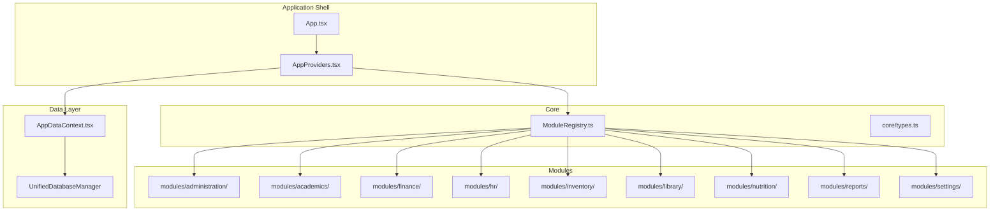
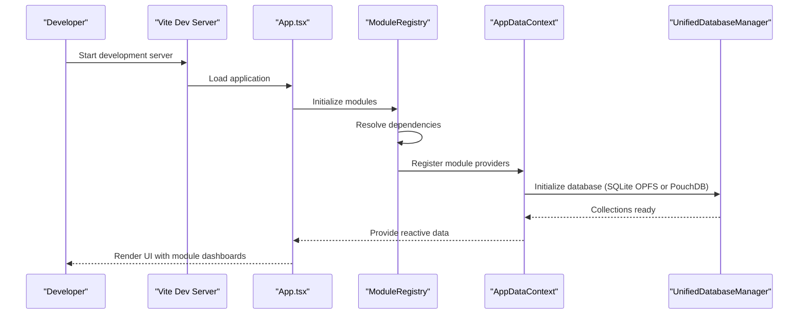
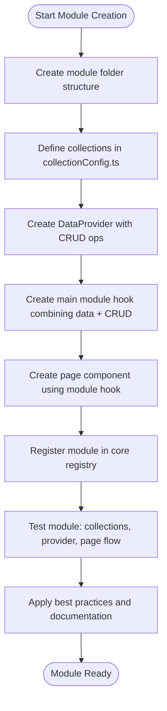
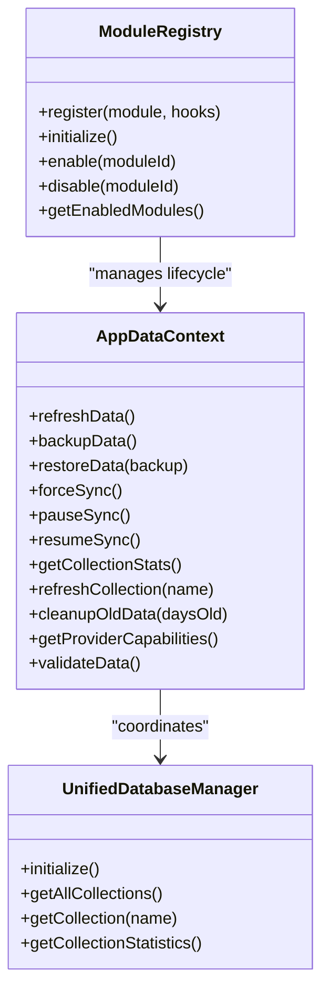
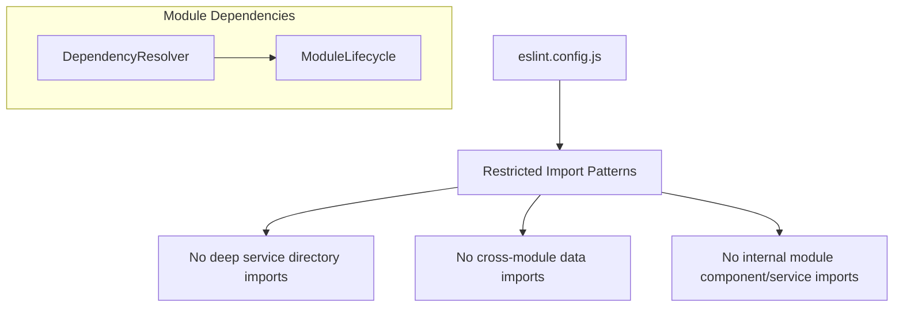

# Development Guides

<cite>
**Referenced Files in This Document**
- [README.md](file://README.md)
- [CONTRIBUTING.md](file://docs/developer/CONTRIBUTING.md)
- [MODULE_DEVELOPMENT_GUIDE.md](file://docs/guides/MODULE_DEVELOPMENT_GUIDE.md)
- [MODULE_STRUCTURE_STANDARD.md](file://docs/architecture/MODULE_STRUCTURE_STANDARD.md)
- [DATA-layer-modernization-plan.md](file://docs/database/DATA-layer-modernization-plan.md)
- [package.json](file://package.json)
- [vite.config.ts](file://vite.config.ts)
- [vitest.config.ts](file://vitest.config.ts)
- [jest.config.js](file://jest.config.js)
- [eslint.config.js](file://eslint.config.js)
- [tsconfig.json](file://tsconfig.json)
- [ModuleRegistry.ts](file://src/core/ModuleRegistry.ts)
- [AppDataContext.tsx](file://src/contexts/AppDataContext.tsx)
- [ModuleDashboardShell.tsx.html](file://coverage/components/ModuleDashboardShell.tsx.html)
- [index.html](file://coverage/index.html)
</cite>

## Update Summary
**Changes Made**
- Updated documentation structure to reflect the move from "Development Guides.md" to "Guides.md" in the docs directory
- Revised all file references to point to the new documentation location
- Updated content organization to align with the restructured documentation system
- Maintained all technical accuracy while updating file paths and references

## Table of Contents
1. [Introduction](#introduction)
2. [Project Structure](#project-structure)
3. [Core Components](#core-components)
4. [Architecture Overview](#architecture-overview)
5. [Detailed Component Analysis](#detailed-component-analysis)
6. [Dependency Analysis](#dependency-analysis)
7. [Performance Considerations](#performance-considerations)
8. [Troubleshooting Guide](#troubleshooting-guide)
9. [Conclusion](#conclusion)
10. [Appendices](#appendices)

## Introduction
This document provides comprehensive development guides for contributors and developers working on SchoolPilot3. It explains the development workflow, coding standards, and best practices for the modular architecture. It covers module development processes, data layer integration, UI component creation, migration strategies for legacy features, and architectural improvements. It also includes contribution guidelines, code review processes, development environment setup, debugging techniques, performance profiling, testing requirements, documentation standards, release procedures, and practical examples for common development tasks.

**Updated** The documentation has been restructured and moved to the "Guides.md" format in the docs directory, providing a more organized and accessible reference for developers.

## Project Structure
SchoolPilot3 is a modular React application with a dual-mode data layer supporting both development (SQLite OPFS) and production (PouchDB/LiveStore) environments. The project emphasizes TypeScript, React 19 compatibility, and a component-driven architecture with shared UI libraries and domain-driven modules.

**Diagram sources**
- [AppDataContext.tsx:1-200](file://src/contexts/AppDataContext.tsx#L1-L200)
- [ModuleRegistry.ts:1-120](file://src/core/ModuleRegistry.ts#L1-L120)

**Section sources**
- [README.md:77-122](file://README.md#L77-L122)
- [vite.config.ts:1-200](file://vite.config.ts#L1-L200)

## Core Components
- ModuleRegistry: Central registry managing module registration, dependency resolution, and lifecycle events with support for sequential and parallel initialization.
- AppDataContext: Unified data provider integrating with the database manager, offering reactive data access, loading states, error handling, toast notifications, sync capabilities, pagination, memory management, and validation.
- Data Layer Modernization: Strategic plan to replace mock data with SQLite OPFS for development and LiveStore as an alternative to PouchDB for production, with a staged rollout and rollback safeguards.

**Section sources**
- [ModuleRegistry.ts:1-348](file://src/core/ModuleRegistry.ts#L1-L348)
- [AppDataContext.tsx:1-800](file://src/contexts/AppDataContext.tsx#L1-L800)
- [DATA-layer-modernization-plan.md:1-327](file://docs/database/DATA-layer-modernization-plan.md#L1-L327)

## Architecture Overview
The system employs a modular architecture with auto-discovery of module collections, a unified data context, and a dual-mode data layer. Modules contribute schemas and data providers that integrate with the core system through the registry and AppDataContext.

**Diagram sources**
- [vite.config.ts:1-200](file://vite.config.ts#L1-L200)
- [ModuleRegistry.ts:108-171](file://src/core/ModuleRegistry.ts#L108-L171)
- [AppDataContext.tsx:298-351](file://src/contexts/AppDataContext.tsx#L298-L351)

## Detailed Component Analysis

### Module Development Process
Follow the module development guide to create new modules with auto-discovery, data providers, and standardized structure. The guide outlines the minimum required files, collection auto-discovery, CRUD operations, pages and components, testing, and best practices.

**Diagram sources**
- [MODULE_DEVELOPMENT_GUIDE.md:92-410](file://docs/guides/MODULE_DEVELOPMENT_GUIDE.md#L92-L410)

**Section sources**
- [MODULE_DEVELOPMENT_GUIDE.md:21-800](file://docs/guides/MODULE_DEVELOPMENT_GUIDE.md#L21-L800)
- [MODULE_STRUCTURE_STANDARD.md:1-109](file://docs/architecture/MODULE_STRUCTURE_STANDARD.md#L1-L109)

### Module Structure Template
Standard module structure includes components, data (types, contexts, hooks, schemas, collections, mock data), hooks, i18n, pages, services, strategies, index exports, lifecycle hooks, module definition, module.json, and RBAC rules. Subdirectories are acceptable for distinct feature areas with multiple related files.

**Section sources**
- [MODULE_STRUCTURE_STANDARD.md:3-21](file://docs/architecture/MODULE_STRUCTURE_STANDARD.md#L3-L21)

### Data Layer Integration
The data layer integrates through AppDataContext, which coordinates with UnifiedDatabaseManager to provide reactive data access, loading states, error handling, and toast notifications. The system supports SQLite OPFS for development and PouchDB/LiveStore for production, with a modernization plan to replace mock data.

**Diagram sources**
- [ModuleRegistry.ts:1-348](file://src/core/ModuleRegistry.ts#L1-L348)
- [AppDataContext.tsx:1-800](file://src/contexts/AppDataContext.tsx#L1-L800)

**Section sources**
- [AppDataContext.tsx:1-800](file://src/contexts/AppDataContext.tsx#L1-L800)
- [DATA-layer-modernization-plan.md:1-327](file://docs/database/DATA-layer-modernization-plan.md#L1-L327)

### UI Component Creation
Follow the component patterns described in the project documentation, emphasizing polymorphic components with advanced TypeScript, type safety, and IntelliSense support. Use the shared UI components library and maintain responsive design principles.

**Section sources**
- [README.md:383-396](file://README.md#L383-L396)

### Migration Strategies
The data layer modernization plan outlines a phased approach to replace mock data with SQLite OPFS for development and LiveStore for production, ensuring API compatibility and providing rollback safeguards. The plan includes immediate benefits (persistent development data, better performance) and long-term benefits (codebase simplification, reduced technical debt).

**Section sources**
- [DATA-layer-modernization-plan.md:1-327](file://docs/database/DATA-layer-modernization-plan.md#L1-L327)

### Contribution Guidelines
Contributors should follow the code of conduct, development workflow, coding guidelines (TypeScript, React components, file organization, naming conventions, state management, error handling), testing guidelines (unit, integration, E2E), commit message conventions, pull request process, and issue reporting procedures.

**Section sources**
- [CONTRIBUTING.md:1-299](file://docs/developer/CONTRIBUTING.md#L1-L299)

### Development Environment Setup
Set up the development environment using Node.js 18+, install dependencies, start the development server, run tests, lint code, and use the provided scripts for data migration and verification. Configure environment variables and use Vite for fast development and building.

**Section sources**
- [README.md:124-183](file://README.md#L124-L183)
- [package.json:1-161](file://package.json#L1-L161)

### Debugging Techniques
Use the development tools and scripts, inspect browser console logs, leverage toast notifications for user feedback, monitor network state and synchronization status, and utilize the performance monitoring widgets. The project includes comprehensive coverage reports and performance dashboards.

**Section sources**
- [AppDataContext.tsx:462-537](file://src/contexts/AppDataContext.tsx#L462-L537)
- [README.md:477-481](file://README.md#L477-L481)

### Performance Profiling
Monitor bundle size with Vite build, analyze performance with Vitest UI, use performance monitoring widgets, and leverage the performance dashboard. The build configuration includes code splitting and vendor chunking for optimal performance.

**Section sources**
- [vite.config.ts:113-198](file://vite.config.ts#L113-L198)
- [vitest.config.ts:1-33](file://vitest.config.ts#L1-L33)

### Testing Requirements
Run unit tests with Vitest, integration tests, and E2E tests. Use Jest for legacy test setups, configure test environments for React 19 compatibility, and maintain coverage reporting. Follow testing guidelines for isolated function testing, component interaction testing, and user interaction testing.

**Section sources**
- [vitest.config.ts:1-33](file://vitest.config.ts#L1-L33)
- [jest.config.js:1-24](file://jest.config.js#L1-L24)
- [CONTRIBUTING.md:167-198](file://docs/developer/CONTRIBUTING.md#L167-L198)

### Documentation Standards
Maintain comprehensive documentation in the docs directory, including architecture guides, feature lists, development guides, and project reports. Update documentation when adding new functionality and ensure consistency across modules.

**Section sources**
- [README.md:404-412](file://README.md#L404-L412)

### Release Procedures
Follow the development workflow outlined in the contribution guidelines, ensure all tests pass, run the linter and type checker, update documentation, add tests for new functionality, and use conventional commit messages for pull requests.

**Section sources**
- [CONTRIBUTING.md:237-270](file://docs/developer/CONTRIBUTING.md#L237-L270)

### Practical Examples
Common development tasks include creating a new module with collection auto-discovery, implementing CRUD operations with data providers, creating pages using module hooks, testing module functionality, and following best practices for naming conventions and error handling.

**Section sources**
- [MODULE_DEVELOPMENT_GUIDE.md:627-777](file://docs/guides/MODULE_DEVELOPMENT_GUIDE.md#L627-L777)

## Dependency Analysis
The project uses ESLint with TypeScript and React hooks configurations, enforcing strict import rules to prevent deep imports and cross-module data imports. The dependency resolver ensures modules are registered and enabled in the correct order, preventing circular dependencies.

**Diagram sources**
- [eslint.config.js:1-77](file://eslint.config.js#L1-L77)
- [ModuleRegistry.ts:1-120](file://src/core/ModuleRegistry.ts#L1-L120)

**Section sources**
- [eslint.config.js:1-77](file://eslint.config.js#L1-L77)
- [ModuleRegistry.ts:1-120](file://src/core/ModuleRegistry.ts#L1-L120)

## Performance Considerations
- Bundle splitting and vendor chunking reduce initial load times.
- Reactive subscriptions and observable streams provide efficient real-time UI updates.
- Memory management includes cleanup of old data and throttled refresh operations.
- Performance monitoring widgets and dashboards help track and optimize performance.

**Section sources**
- [vite.config.ts:113-198](file://vite.config.ts#L113-L198)
- [AppDataContext.tsx:722-769](file://src/contexts/AppDataContext.tsx#L722-L769)

## Troubleshooting Guide
Common issues include database initialization failures, missing translations, type errors after adding new features, and performance problems. The system provides fallback mechanisms, error handling, and diagnostic tools to address these issues.

**Section sources**
- [README.md:452-481](file://README.md#L452-L481)
- [AppDataContext.tsx:337-343](file://src/contexts/AppDataContext.tsx#L337-L343)

## Conclusion
SchoolPilot3 offers a robust, modular architecture with a dual-mode data layer, comprehensive TypeScript coverage, and extensive documentation. Contributors can develop new modules efficiently using the provided guides, adhere to coding standards, and leverage modern development tools and testing frameworks. The data layer modernization plan ensures a smooth transition to more performant and maintainable storage solutions.

## Appendices
- Coverage reports and performance dashboards are available in the coverage directory for quality assurance and performance monitoring.

**Section sources**
- [ModuleDashboardShell.tsx.html](file://coverage/components/ModuleDashboardShell.tsx.html)
- [index.html](file://coverage/index.html)