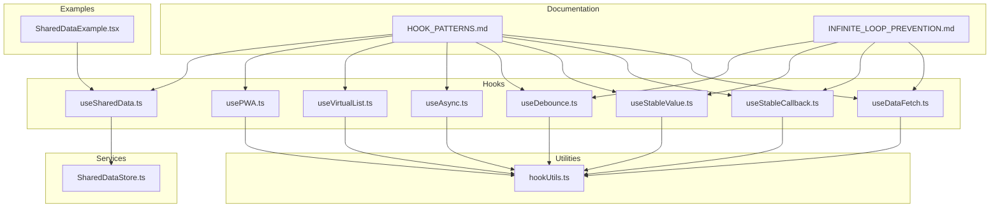
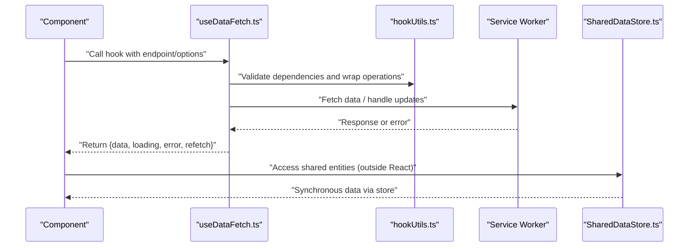
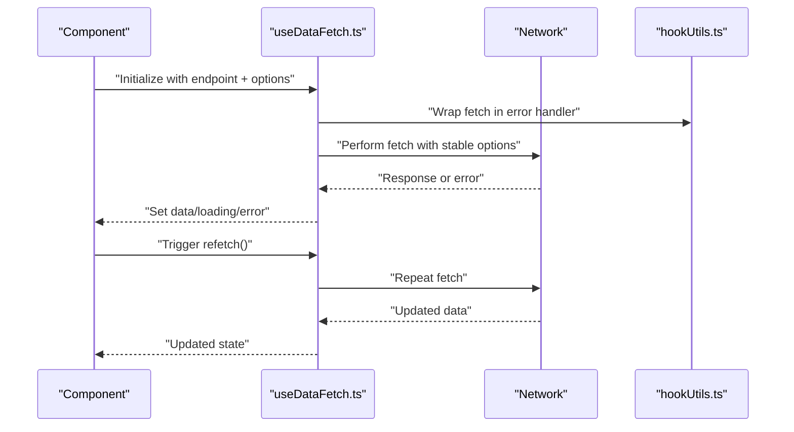
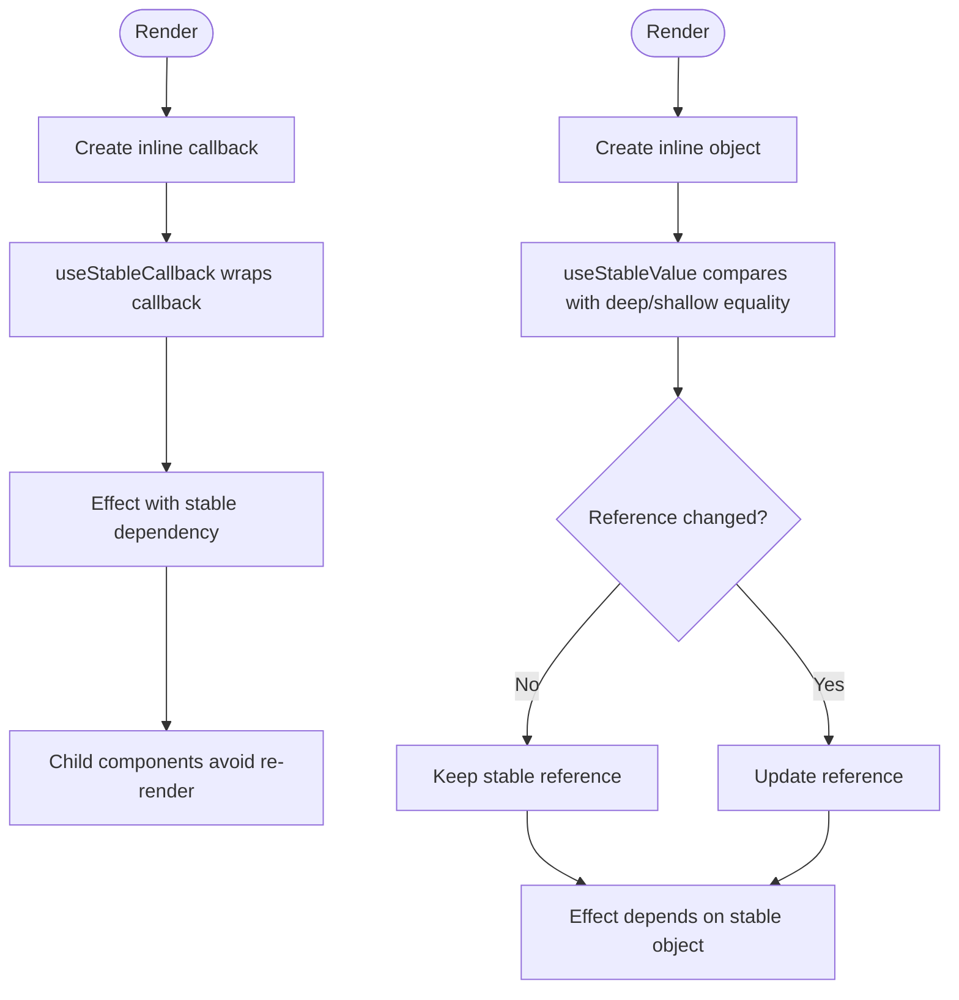
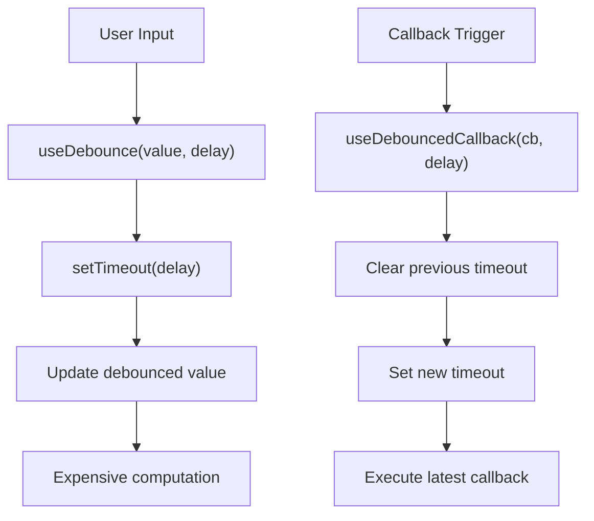
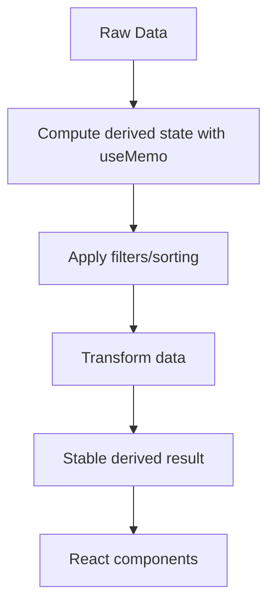
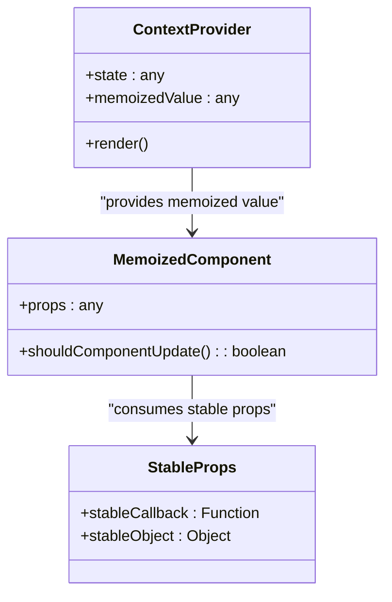
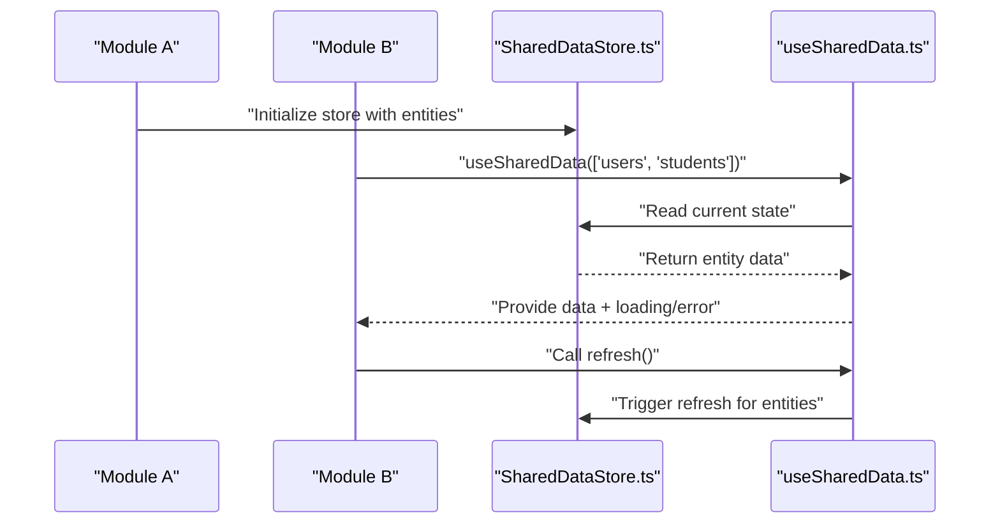
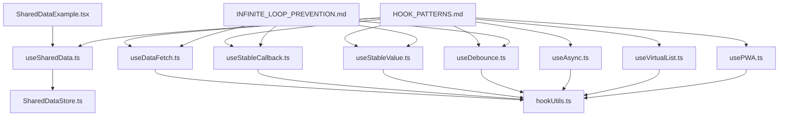
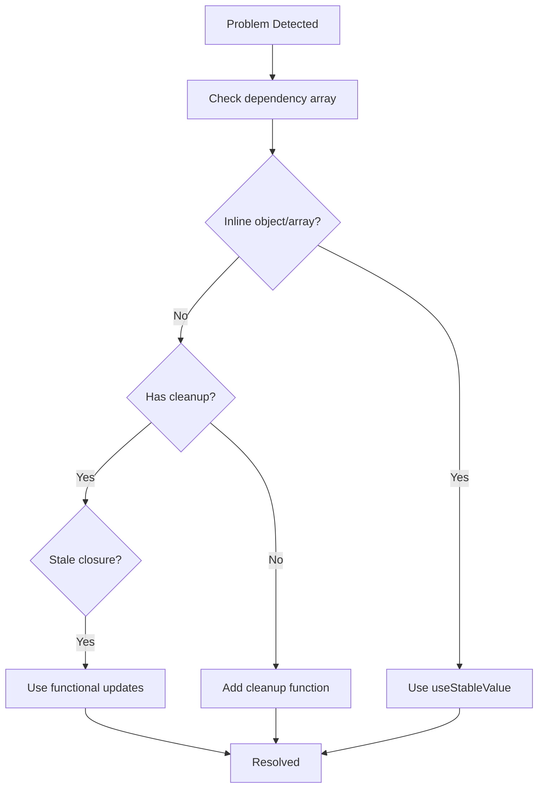

# Hook Patterns Guide

<cite>
**Referenced Files in This Document**
- [HOOK_PATTERNS.md](file://docs/guides/HOOK_PATTERNS.md)
- [useDataFetch.ts](file://src/hooks/useDataFetch.ts)
- [useStableCallback.ts](file://src/hooks/useStableCallback.ts)
- [useStableValue.ts](file://src/hooks/useStableValue.ts)
- [useDebounce.ts](file://src/hooks/useDebounce.ts)
- [useAsync.ts](file://src/hooks/useAsync.ts)
- [usePrevious.ts](file://src/hooks/usePrevious.ts)
- [useMediaQuery.ts](file://src/hooks/useMediaQuery.ts)
- [useKeyPress.ts](file://src/hooks/useKeyPress.ts)
- [useVirtualList.ts](file://src/hooks/useVirtualList.ts)
- [usePWA.ts](file://src/hooks/usePWA.ts)
- [useSharedData.ts](file://src/hooks/useSharedData.ts)
- [SharedDataExample.tsx](file://src/modules/portal/examples/SharedDataExample.tsx)
- [SharedDataStore.ts](file://src/services/data/SharedDataStore.ts)
- [hookUtils.ts](file://src/utils/hookUtils.ts)
- [INFINITE_LOOP_PREVENTION.md](file://docs/INFINITE_LOOP_PREVENTION.md)
</cite>

## Table of Contents
1. [Introduction](#introduction)
2. [Project Structure](#project-structure)
3. [Core Components](#core-components)
4. [Architecture Overview](#architecture-overview)
5. [Detailed Component Analysis](#detailed-component-analysis)
6. [Dependency Analysis](#dependency-analysis)
7. [Performance Considerations](#performance-considerations)
8. [Troubleshooting Guide](#troubleshooting-guide)
9. [Conclusion](#conclusion)

## Introduction
This guide documents the established React hook patterns and implementations used throughout the SchoolPilot3 codebase. It focuses on proven patterns for data fetching, event handling, derived state, context optimization, performance tuning, and common pitfalls. The patterns are backed by concrete hook implementations that prevent infinite loops, manage dependencies safely, and optimize rendering performance.

## Project Structure
The hook patterns are implemented as reusable React hooks located under `src/hooks`. Supporting utilities and documentation live in `src/utils`, `src/services`, and `docs` directories. Cross-module data sharing is facilitated by `useSharedData` and the SharedDataStore service.

**Diagram sources**
- [useDataFetch.ts:1-299](file://src/hooks/useDataFetch.ts#L1-L299)
- [useStableCallback.ts:1-79](file://src/hooks/useStableCallback.ts#L1-L79)
- [useStableValue.ts:1-162](file://src/hooks/useStableValue.ts#L1-L162)
- [useDebounce.ts:1-262](file://src/hooks/useDebounce.ts#L1-L262)
- [useAsync.ts:1-89](file://src/hooks/useAsync.ts#L1-L89)
- [useVirtualList.ts:1-211](file://src/hooks/useVirtualList.ts#L1-L211)
- [usePWA.ts:1-299](file://src/hooks/usePWA.ts#L1-L299)
- [useSharedData.ts:141-215](file://src/hooks/useSharedData.ts#L141-L215)
- [hookUtils.ts:30-82](file://src/utils/hookUtils.ts#L30-L82)
- [SharedDataStore.ts:81-94](file://src/services/data/SharedDataStore.ts#L81-L94)
- [HOOK_PATTERNS.md:1-629](file://docs/guides/HOOK_PATTERNS.md#L1-L629)
- [INFINITE_LOOP_PREVENTION.md:365-414](file://docs/INFINITE_LOOP_PREVENTION.md#L365-L414)
- [SharedDataExample.tsx:1-106](file://src/modules/portal/examples/SharedDataExample.tsx#L1-L106)

**Section sources**
- [HOOK_PATTERNS.md:1-629](file://docs/guides/HOOK_PATTERNS.md#L1-L629)
- [INFINITE_LOOP_PREVENTION.md:365-414](file://docs/INFINITE_LOOP_PREVENTION.md#L365-L414)

## Core Components
This section highlights the primary hooks that implement the documented patterns, along with their responsibilities and safety mechanisms.

- useDataFetch: Provides safe, cancellable data fetching with loading/error states, refetch/reset capabilities, and stable dependency management via refs.
- useStableCallback: Ensures callback references remain stable across renders while always invoking the latest function implementation.
- useStableValue: Maintains stable references for objects/arrays using deep/shallow equality comparisons to prevent unnecessary re-renders.
- useDebounce: Delays value updates or callback execution to optimize performance for frequent events like search or resize.
- useAsync: Encapsulates async operations with mounted checks to prevent state updates on unmounted components.
- useVirtualList: Implements efficient virtualization for large lists with dynamic height estimation and overscan.
- usePWA: Centralizes PWA lifecycle events, service worker updates, and feature availability detection.
- useSharedData: Enables cross-module data access through a shared contract, aggregating loading/error states and providing refresh capabilities.

**Section sources**
- [useDataFetch.ts:1-299](file://src/hooks/useDataFetch.ts#L1-L299)
- [useStableCallback.ts:1-79](file://src/hooks/useStableCallback.ts#L1-L79)
- [useStableValue.ts:1-162](file://src/hooks/useStableValue.ts#L1-L162)
- [useDebounce.ts:1-262](file://src/hooks/useDebounce.ts#L1-L262)
- [useAsync.ts:1-89](file://src/hooks/useAsync.ts#L1-L89)
- [useVirtualList.ts:1-211](file://src/hooks/useVirtualList.ts#L1-L211)
- [usePWA.ts:1-299](file://src/hooks/usePWA.ts#L1-L299)
- [useSharedData.ts:141-215](file://src/hooks/useSharedData.ts#L141-L215)

## Architecture Overview
The hook patterns integrate with the broader application architecture to ensure predictable data flow, optimal rendering, and robust error handling. The SharedDataStore provides synchronous access to shared entities outside React, while useSharedData exposes them to components with consistent loading/error semantics.

**Diagram sources**
- [useDataFetch.ts:103-184](file://src/hooks/useDataFetch.ts#L103-L184)
- [hookUtils.ts:60-82](file://src/utils/hookUtils.ts#L60-L82)
- [usePWA.ts:98-151](file://src/hooks/usePWA.ts#L98-L151)
- [SharedDataStore.ts:81-94](file://src/services/data/SharedDataStore.ts#L81-L94)

## Detailed Component Analysis

### Data Fetching Patterns
The data fetching patterns demonstrate safe, cancellable requests with explicit loading/error handling and refetch capabilities. The hooks avoid infinite loops by stabilizing dependencies and cleaning up resources on unmount.

**Diagram sources**
- [useDataFetch.ts:103-184](file://src/hooks/useDataFetch.ts#L103-L184)
- [hookUtils.ts:60-82](file://src/utils/hookUtils.ts#L60-L82)

**Section sources**
- [useDataFetch.ts:1-299](file://src/hooks/useDataFetch.ts#L1-L299)
- [HOOK_PATTERNS.md:19-107](file://docs/guides/HOOK_PATTERNS.md#L19-L107)

### Stable Callbacks and Values
Stable references are essential for preventing unnecessary re-renders and infinite loops in effects and event handlers. useStableCallback ensures callbacks maintain a constant identity while always invoking the latest implementation. useStableValue stabilizes object/array references using equality checks.

**Diagram sources**
- [useStableCallback.ts:58-76](file://src/hooks/useStableCallback.ts#L58-L76)
- [useStableValue.ts:137-151](file://src/hooks/useStableValue.ts#L137-L151)

**Section sources**
- [useStableCallback.ts:1-79](file://src/hooks/useStableCallback.ts#L1-L79)
- [useStableValue.ts:1-162](file://src/hooks/useStableValue.ts#L1-L162)
- [HOOK_PATTERNS.md:111-204](file://docs/guides/HOOK_PATTERNS.md#L111-L204)

### Debounced Operations
Debouncing optimizes performance for frequent updates such as search inputs and resize events. The hooks provide both value debouncing and callback debouncing with optional leading/trailing edge behavior.

**Diagram sources**
- [useDebounce.ts:60-76](file://src/hooks/useDebounce.ts#L60-L76)
- [useDebounce.ts:152-187](file://src/hooks/useDebounce.ts#L152-L187)
- [useDebounce.ts:207-259](file://src/hooks/useDebounce.ts#L207-L259)

**Section sources**
- [useDebounce.ts:1-262](file://src/hooks/useDebounce.ts#L1-L262)
- [HOOK_PATTERNS.md:171-204](file://docs/guides/HOOK_PATTERNS.md#L171-L204)

### Derived State Management
Derived state should be computed with useMemo rather than useEffect to avoid unnecessary side effects and infinite loops. The patterns show filtering, sorting, and complex transformations while preserving referential stability.

**Diagram sources**
- [HOOK_PATTERNS.md:208-289](file://docs/guides/HOOK_PATTERNS.md#L208-L289)

**Section sources**
- [HOOK_PATTERNS.md:208-289](file://docs/guides/HOOK_PATTERNS.md#L208-L289)

### Context and Performance Optimization
Context values should be memoized to prevent unnecessary re-renders. Splitting contexts reduces update scope. Components can be memoized and paired with stable props/callbacks to further optimize rendering.

**Diagram sources**
- [HOOK_PATTERNS.md:293-389](file://docs/guides/HOOK_PATTERNS.md#L293-L389)

**Section sources**
- [HOOK_PATTERNS.md:293-389](file://docs/guides/HOOK_PATTERNS.md#L293-L389)

### Cross-Module Data Sharing
Cross-module data access is standardized through useSharedData and enforced by SharedDataStore. Components request shared entities, receive loading/error states, and can refresh data collectively.

**Diagram sources**
- [useSharedData.ts:141-215](file://src/hooks/useSharedData.ts#L141-L215)
- [SharedDataStore.ts:81-94](file://src/services/data/SharedDataStore.ts#L81-L94)
- [SharedDataExample.tsx:11-106](file://src/modules/portal/examples/SharedDataExample.tsx#L11-L106)

**Section sources**
- [useSharedData.ts:141-215](file://src/hooks/useSharedData.ts#L141-L215)
- [SharedDataExample.tsx:1-106](file://src/modules/portal/examples/SharedDataExample.tsx#L1-L106)
- [SharedDataStore.ts:81-94](file://src/services/data/SharedDataStore.ts#L81-L94)

## Dependency Analysis
The hooks exhibit low coupling and high cohesion. They rely on React primitives and internal utilities, with minimal external dependencies. The documentation explicitly enumerates hook-to-file mappings for traceability.

**Diagram sources**
- [useDataFetch.ts:1-299](file://src/hooks/useDataFetch.ts#L1-L299)
- [useStableCallback.ts:1-79](file://src/hooks/useStableCallback.ts#L1-L79)
- [useStableValue.ts:1-162](file://src/hooks/useStableValue.ts#L1-L162)
- [useDebounce.ts:1-262](file://src/hooks/useDebounce.ts#L1-L262)
- [useAsync.ts:1-89](file://src/hooks/useAsync.ts#L1-L89)
- [useVirtualList.ts:1-211](file://src/hooks/useVirtualList.ts#L1-L211)
- [usePWA.ts:1-299](file://src/hooks/usePWA.ts#L1-L299)
- [useSharedData.ts:141-215](file://src/hooks/useSharedData.ts#L141-L215)
- [hookUtils.ts:30-82](file://src/utils/hookUtils.ts#L30-L82)
- [SharedDataStore.ts:81-94](file://src/services/data/SharedDataStore.ts#L81-L94)
- [HOOK_PATTERNS.md:1-629](file://docs/guides/HOOK_PATTERNS.md#L1-L629)
- [INFINITE_LOOP_PREVENTION.md:365-414](file://docs/INFINITE_LOOP_PREVENTION.md#L365-L414)

**Section sources**
- [HOOK_PATTERNS.md:1-629](file://docs/guides/HOOK_PATTERNS.md#L1-L629)
- [INFINITE_LOOP_PREVENTION.md:365-414](file://docs/INFINITE_LOOP_PREVENTION.md#L365-L414)

## Performance Considerations
- Prefer useMemo for derived state computations to avoid redundant work and side effects.
- Use stable references (useStableCallback, useStableValue) to prevent unnecessary re-renders of child components.
- Debounce frequent updates (useDebounce, useDebouncedCallback) to reduce network and computation overhead.
- Virtualize large lists (useVirtualList) to limit DOM nodes and improve scrolling performance.
- Wrap potentially expensive operations with HookErrorHandler to capture and handle errors gracefully during development.

[No sources needed since this section provides general guidance]

## Troubleshooting Guide
Common issues and their resolutions:

- Inline object in dependencies: Use useStableValue to stabilize object/array references and avoid infinite re-renders.
- Missing cleanup: Always return cleanup functions from effects to cancel timers, remove event listeners, and abort fetches.
- Stale closures: Use functional state updates (e.g., setCount(c => c + 1)) to always read the latest state.
- Effect for event handler: Move event handling logic into handlers rather than effects to avoid side effects in render.

**Diagram sources**
- [HOOK_PATTERNS.md:483-581](file://docs/guides/HOOK_PATTERNS.md#L483-L581)
- [useStableValue.ts:137-151](file://src/hooks/useStableValue.ts#L137-L151)

**Section sources**
- [HOOK_PATTERNS.md:483-581](file://docs/guides/HOOK_PATTERNS.md#L483-L581)
- [hookUtils.ts:60-82](file://src/utils/hookUtils.ts#L60-L82)

## Conclusion
The hook patterns documented here provide a consistent, reliable foundation for building scalable React applications within the SchoolPilot3 ecosystem. By following these patterns—using stable references, memoized derived state, debounced operations, and safe data fetching—you can prevent common pitfalls like infinite loops, excessive re-renders, and memory leaks while maintaining high performance and developer productivity.