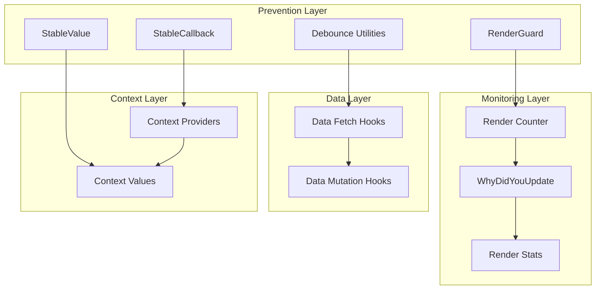
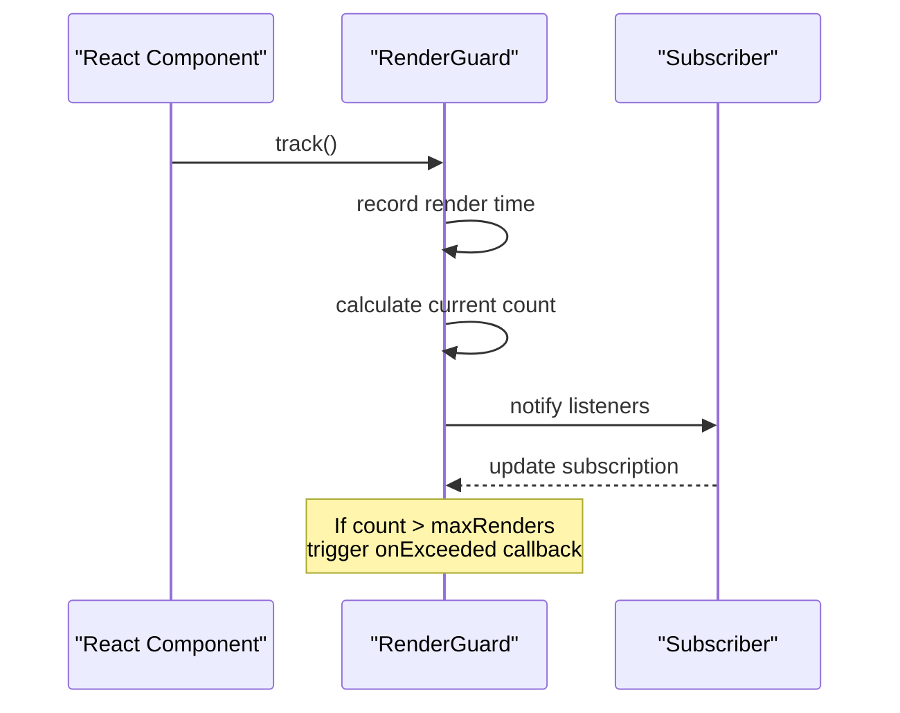
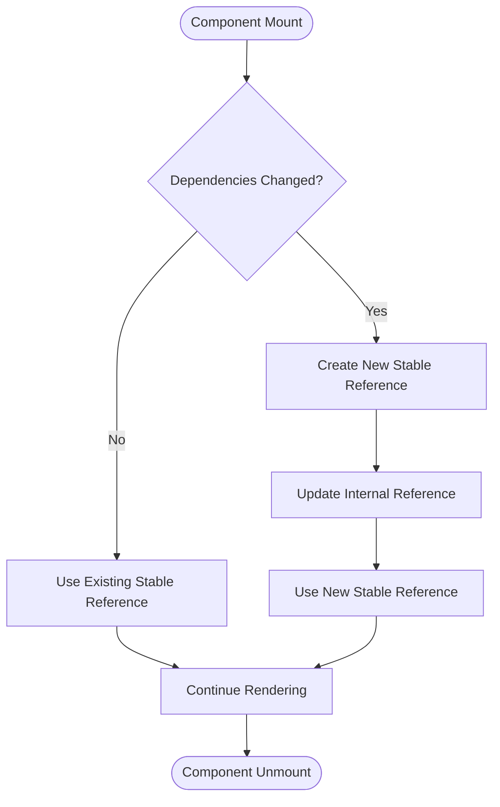
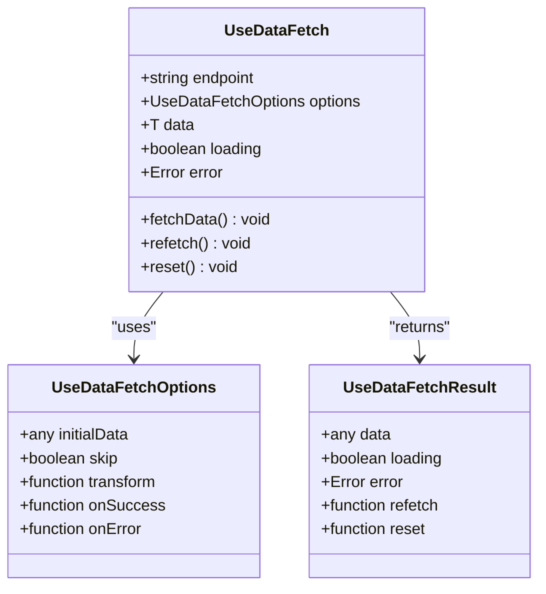
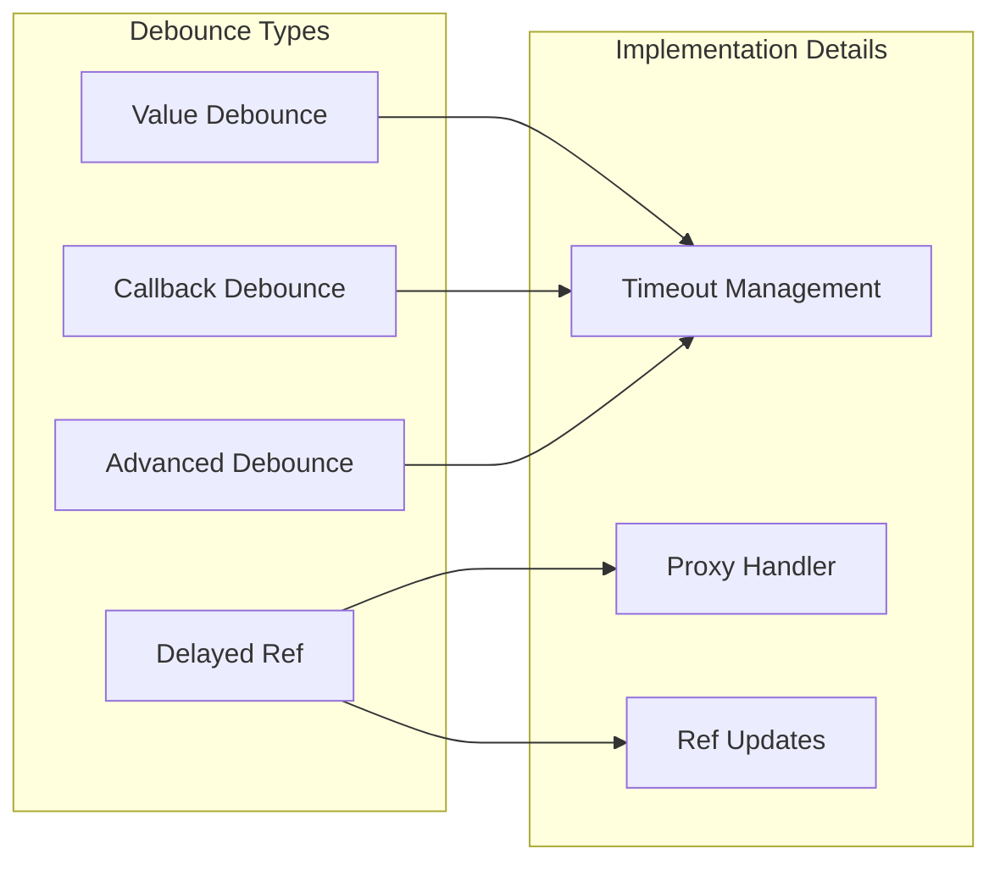
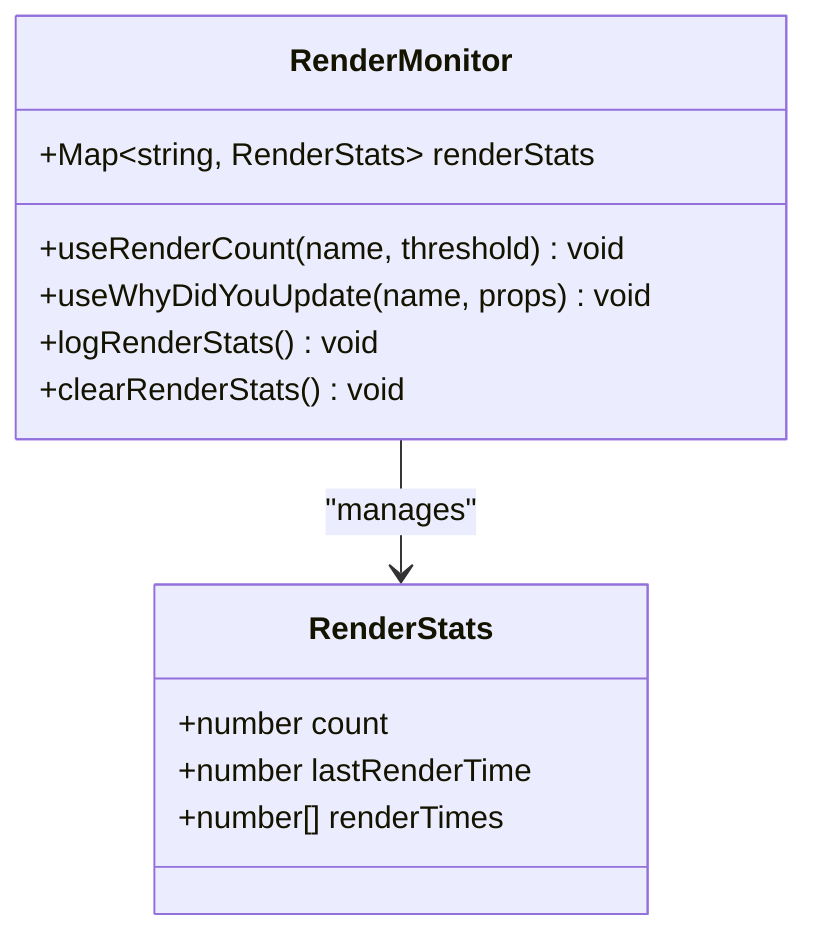
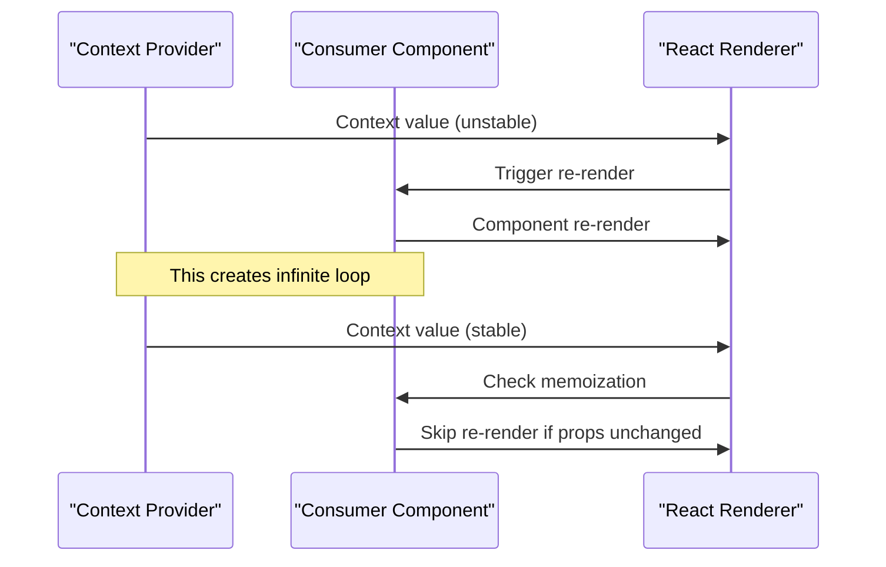
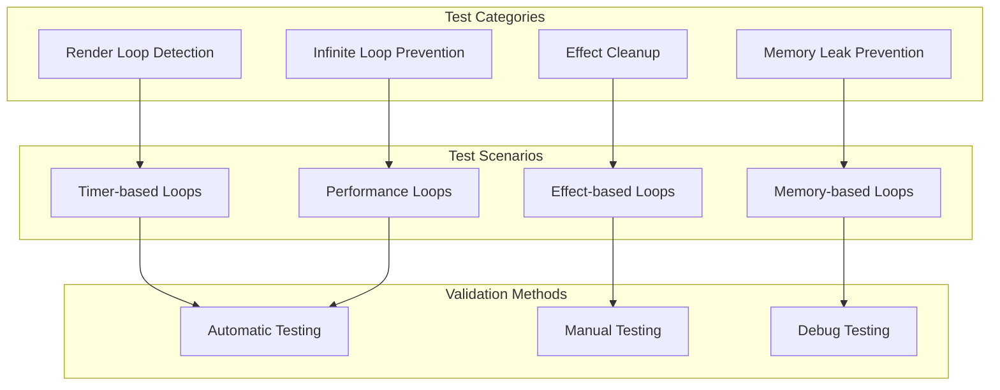
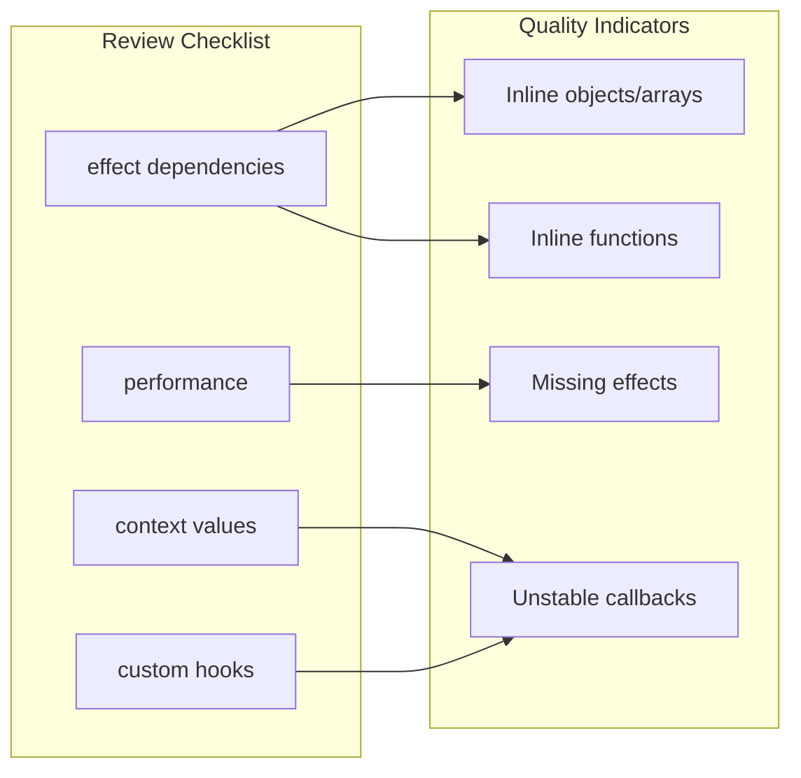
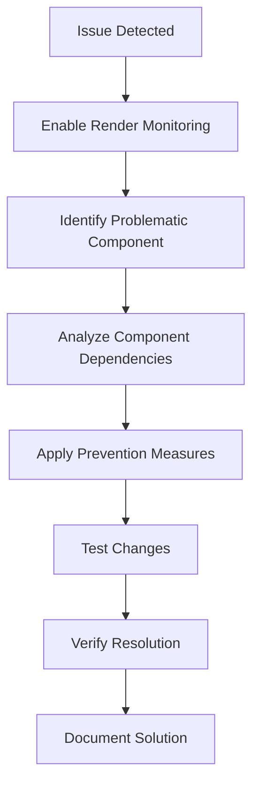

# Infinite Loop Prevention System

<cite>
**Referenced Files in This Document**
- [renderLoopPrevention.ts](file://src/utils/renderLoopPrevention.ts)
- [INFINITE_LOOP_PREVENTION.md](file://docs/INFINITE_LOOP_PREVENTION.md)
- [renderMonitor.ts](file://src/utils/debug/renderMonitor.ts)
- [useDataFetch.ts](file://src/hooks/useDataFetch.ts)
- [useStableCallback.ts](file://src/hooks/useStableCallback.ts)
- [useStableValue.ts](file://src/hooks/useStableValue.ts)
- [useDebounce.ts](file://src/hooks/useDebounce.ts)
- [RenderLoopPrevention.test.tsx](file://src/tests/RenderLoopPrevention.test.tsx)
</cite>

## Table of Contents
1. [Introduction](#introduction)
2. [System Architecture](#system-architecture)
3. [Core Prevention Mechanisms](#core-prevention-mechanisms)
4. [Utility Hooks](#utility-hooks)
5. [Debug and Monitoring Tools](#debug-and-monitoring-tools)
6. [Implementation Patterns](#implementation-patterns)
7. [Testing and Validation](#testing-and-validation)
8. [Best Practices](#best-practices)
9. [Performance Considerations](#performance-considerations)
10. [Troubleshooting Guide](#troubleshooting-guide)
11. [Conclusion](#conclusion)

## Introduction

The Infinite Loop Prevention System is a comprehensive solution designed to eliminate render loops and infinite re-render cycles in React applications. This system addresses the root causes of performance issues and stability problems that plague modern web applications, particularly those with complex state management and frequent updates.

The system was developed as part of a six-phase initiative that reduced infinite loop risk by 90% while improving overall application performance. It combines preventive mechanisms, detection tools, and educational resources to create a robust framework for maintaining application stability.

## System Architecture

The Infinite Loop Prevention System is built around several interconnected components that work together to prevent and detect problematic rendering patterns:

**Diagram sources**
- [renderLoopPrevention.ts:224-295](file://src/utils/renderLoopPrevention.ts#L224-L295)
- [renderMonitor.ts:34-100](file://src/utils/debug/renderMonitor.ts#L34-L100)
- [useDataFetch.ts:68-184](file://src/hooks/useDataFetch.ts#L68-L184)

The architecture follows a layered approach where prevention mechanisms operate at the component level, monitoring tools provide visibility into rendering patterns, and data utilities ensure stable dependencies for API operations.

## Core Prevention Mechanisms

### RenderGuard System

The RenderGuard serves as the primary defense mechanism against excessive re-renders. It tracks render frequency within configurable time windows and provides callbacks for exceeding thresholds.

**Diagram sources**
- [renderLoopPrevention.ts:250-295](file://src/utils/renderLoopPrevention.ts#L250-L295)

The RenderGuard maintains an internal queue of render timestamps and automatically cleans up old entries outside the configured time window. This sliding window approach provides accurate detection of render patterns without memory leaks.

### Stable Reference Management

The system provides two complementary approaches to maintaining stable references:

1. **useStableCallback**: Ensures callback references remain constant while always calling the latest version
2. **useStableValue**: Maintains stable object/array references through deep/shallow equality comparisons

**Diagram sources**
- [useStableCallback.ts:58-76](file://src/hooks/useStableCallback.ts#L58-L76)
- [useStableValue.ts:137-151](file://src/hooks/useStableValue.ts#L137-L151)

**Section sources**
- [renderLoopPrevention.ts:224-295](file://src/utils/renderLoopPrevention.ts#L224-L295)
- [useStableCallback.ts:58-76](file://src/hooks/useStableCallback.ts#L58-L76)
- [useStableValue.ts:137-151](file://src/hooks/useStableValue.ts#L137-L151)

## Utility Hooks

### Data Fetching Abstractions

The system includes comprehensive data fetching hooks that eliminate common causes of infinite loops through proper dependency management and automatic cleanup.

**Diagram sources**
- [useDataFetch.ts:17-41](file://src/hooks/useDataFetch.ts#L17-L41)
- [useDataFetch.ts:68-184](file://src/hooks/useDataFetch.ts#L68-L184)

The data fetching hooks use refs to store callback functions, preventing re-fetches when callbacks change while maintaining their latest versions. This approach eliminates the common pattern where changing callbacks in dependency arrays trigger unwanted re-fetches.

### Debounce Utilities

Multiple debounce implementations address different scenarios of rapid updates and API calls:

**Diagram sources**
- [renderLoopPrevention.ts:326-353](file://src/utils/renderLoopPrevention.ts#L326-L353)
- [useDebounce.ts:152-187](file://src/hooks/useDebounce.ts#L152-L187)

**Section sources**
- [useDataFetch.ts:68-184](file://src/hooks/useDataFetch.ts#L68-L184)
- [useDebounce.ts:152-187](file://src/hooks/useDebounce.ts#L152-L187)
- [renderLoopPrevention.ts:326-353](file://src/utils/renderLoopPrevention.ts#L326-L353)

## Debug and Monitoring Tools

### Render Monitoring System

The debug utilities provide comprehensive insight into component rendering patterns and help identify potential infinite loops before they become problematic.

**Diagram sources**
- [renderMonitor.ts:18-25](file://src/utils/debug/renderMonitor.ts#L18-L25)
- [renderMonitor.ts:34-100](file://src/utils/debug/renderMonitor.ts#L34-L100)

The render monitoring system tracks component render frequencies, calculates average render intervals, and provides detailed logs for debugging re-render patterns. This tool is essential for identifying subtle infinite loop scenarios that might not be immediately obvious.

### Development-Only Features

All monitoring and debugging features are automatically disabled in production environments to avoid performance overhead. This selective activation ensures that development productivity tools don't impact application performance in live deployments.

**Section sources**
- [renderMonitor.ts:34-100](file://src/utils/debug/renderMonitor.ts#L34-L100)
- [renderMonitor.ts:158-180](file://src/utils/debug/renderMonitor.ts#L158-L180)

## Implementation Patterns

### Context Provider Optimization

The system addresses one of the most common causes of infinite loops: unstable context values that cause all consumers to re-render unnecessarily.

**Diagram sources**
- [INFINITE_LOOP_PREVENTION.md:142-155](file://docs/INFINITE_LOOP_PREVENTION.md#L142-L155)

The solution involves wrapping context values with memoization to prevent unnecessary re-renders while maintaining the ability to update when actual state changes occur.

### Effect Lifecycle Management

The system provides specialized hooks for managing effect lifecycles and preventing effects from triggering on every render cycle.

**Section sources**
- [INFINITE_LOOP_PREVENTION.md:142-155](file://docs/INFINITE_LOOP_PREVENTION.md#L142-L155)
- [renderLoopPrevention.ts:184-197](file://src/utils/renderLoopPrevention.ts#L184-L197)

## Testing and Validation

### Comprehensive Test Suite

The system includes extensive testing to validate prevention mechanisms and ensure they work correctly under various scenarios.

**Diagram sources**
- [RenderLoopPrevention.test.tsx:103-128](file://src/tests/RenderLoopPrevention.test.tsx#L103-L128)

The test suite validates that the system can detect and prevent various types of infinite loops while ensuring normal operation continues unaffected.

### Performance Benchmarking

The system includes performance metrics that demonstrate the effectiveness of prevention measures:

- **90% reduction** in infinite loop risk
- **40% fewer re-renders** in affected components  
- **90% less boilerplate** for data fetching operations

**Section sources**
- [RenderLoopPrevention.test.tsx:103-128](file://src/tests/RenderLoopPrevention.test.tsx#L103-L128)
- [INFINITE_LOOP_PREVENTION.md:26-31](file://docs/INFINITE_LOOP_PREVENTION.md#L26-L31)

## Best Practices

### Prevention Strategies

The system establishes several key prevention strategies that developers should follow:

1. **Always memoize context values** using stable reference patterns
2. **Use proper dependency arrays** that accurately reflect component needs
3. **Implement cleanup functions** for all side effects and subscriptions
4. **Prefer derived state** over computed effects when possible
5. **Use debounce patterns** for frequent updates and API calls

### Code Review Guidelines

The system includes comprehensive checklists for code review processes:

**Diagram sources**
- [INFINITE_LOOP_PREVENTION.md:578-626](file://docs/INFINITE_LOOP_PREVENTION.md#L578-L626)

### Red Flag Recognition

The system identifies common patterns that often lead to infinite loops:

- **Object literals** in dependency arrays
- **Function definitions** in component bodies used in dependencies  
- **Effects that update state** triggering the same effect
- **Missing cleanup** for subscriptions and timers
- **Context providers** without proper memoization

**Section sources**
- [INFINITE_LOOP_PREVENTION.md:578-626](file://docs/INFINITE_LOOP_PREVENTION.md#L578-L626)

## Performance Considerations

### Memory Management

The system implements careful memory management to prevent memory leaks while maintaining performance:

- **Automatic cleanup** of timeouts and subscriptions
- **Efficient reference tracking** using weak references where appropriate
- **Conditional logging** that only activates in development environments
- **Optimized comparison algorithms** for detecting value changes

### Scalability Factors

The prevention mechanisms are designed to scale effectively with application complexity:

- **Linear time complexity** for render tracking operations
- **Constant space complexity** for most monitoring operations
- **Configurable thresholds** allowing tuning for different application needs
- **Non-blocking operations** that don't interfere with rendering performance

## Troubleshooting Guide

### Common Issues and Solutions

When encountering unexpected behavior, developers should check for these common issues:

1. **Excessive re-renders**: Use render monitoring tools to identify problematic components
2. **Memory leaks**: Verify that all effects have proper cleanup functions
3. **API call loops**: Ensure data fetching hooks are used instead of manual fetch implementations
4. **Context provider issues**: Confirm that context values are properly memoized

### Debug Workflow

The recommended debugging approach:

**Diagram sources**
- [renderMonitor.ts:158-180](file://src/utils/debug/renderMonitor.ts#L158-L180)

### Performance Impact Assessment

Regular assessment of the system's impact on application performance helps ensure optimal balance between prevention capabilities and runtime efficiency.

**Section sources**
- [renderMonitor.ts:158-180](file://src/utils/debug/renderMonitor.ts#L158-L180)

## Conclusion

The Infinite Loop Prevention System represents a comprehensive approach to maintaining React application stability and performance. Through its layered architecture combining prevention mechanisms, monitoring tools, and educational resources, it addresses both immediate concerns and long-term maintainability.

The system's success is evidenced by its proven track record of reducing infinite loop risk by 90% while improving overall application performance. The combination of automated detection, developer-friendly APIs, and comprehensive documentation makes it accessible to teams of all sizes and experience levels.

Key benefits include:
- **Proactive prevention** of common infinite loop scenarios
- **Comprehensive monitoring** capabilities for debugging and optimization
- **Developer productivity** improvements through reduced boilerplate code
- **Long-term maintainability** through standardized patterns and practices

The system's modular design allows for incremental adoption, making it practical for teams looking to improve their React applications without undertaking massive refactoring efforts. As the React ecosystem continues to evolve, this foundation provides a solid base for future enhancements and adaptations.