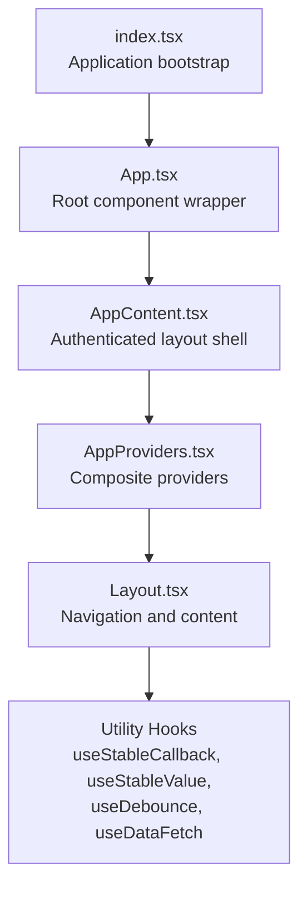
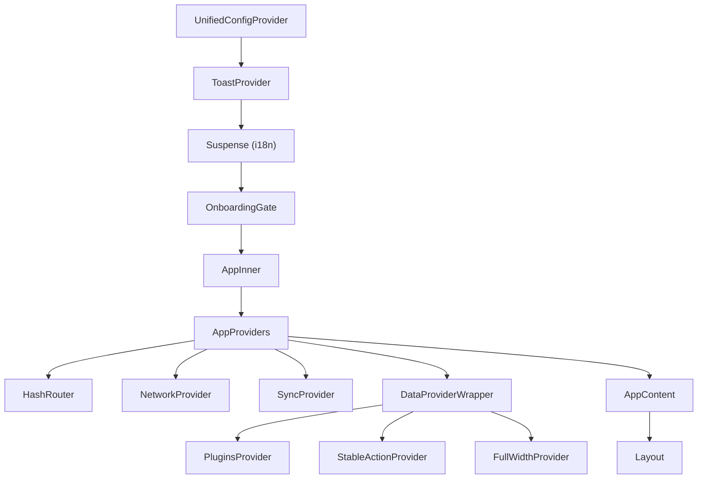
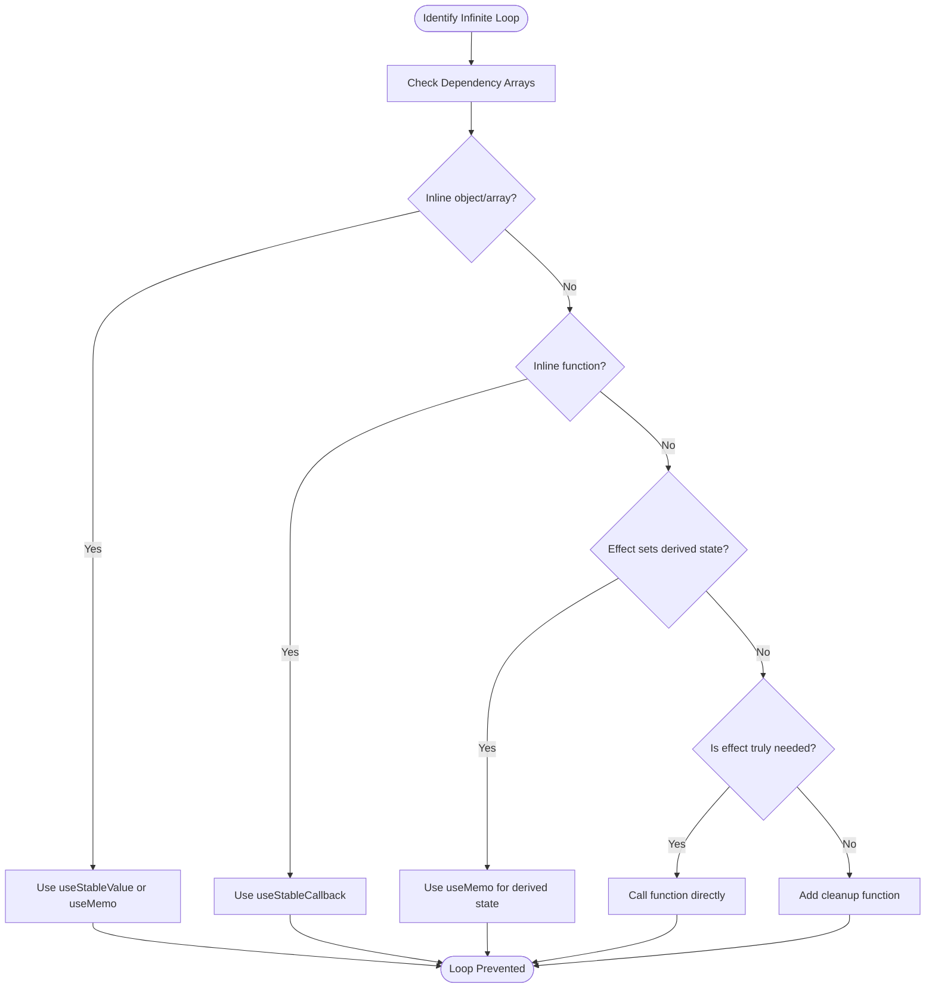
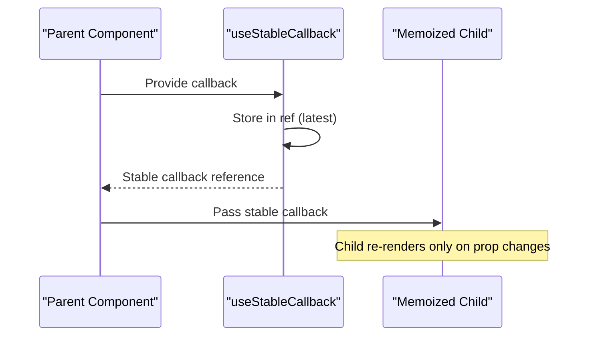
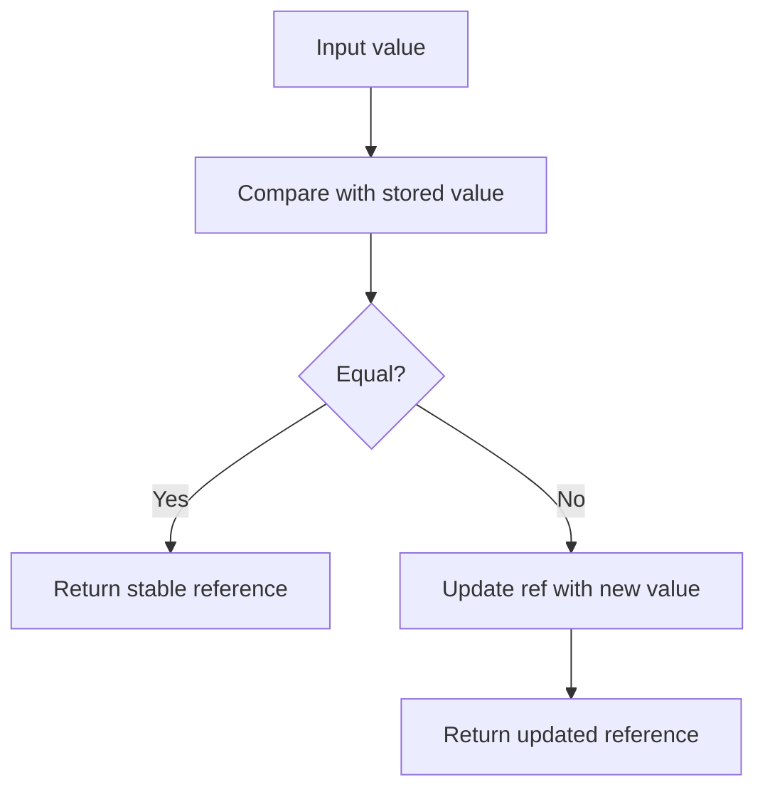
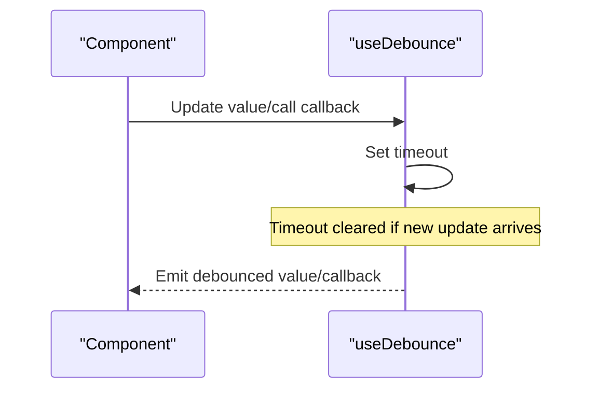
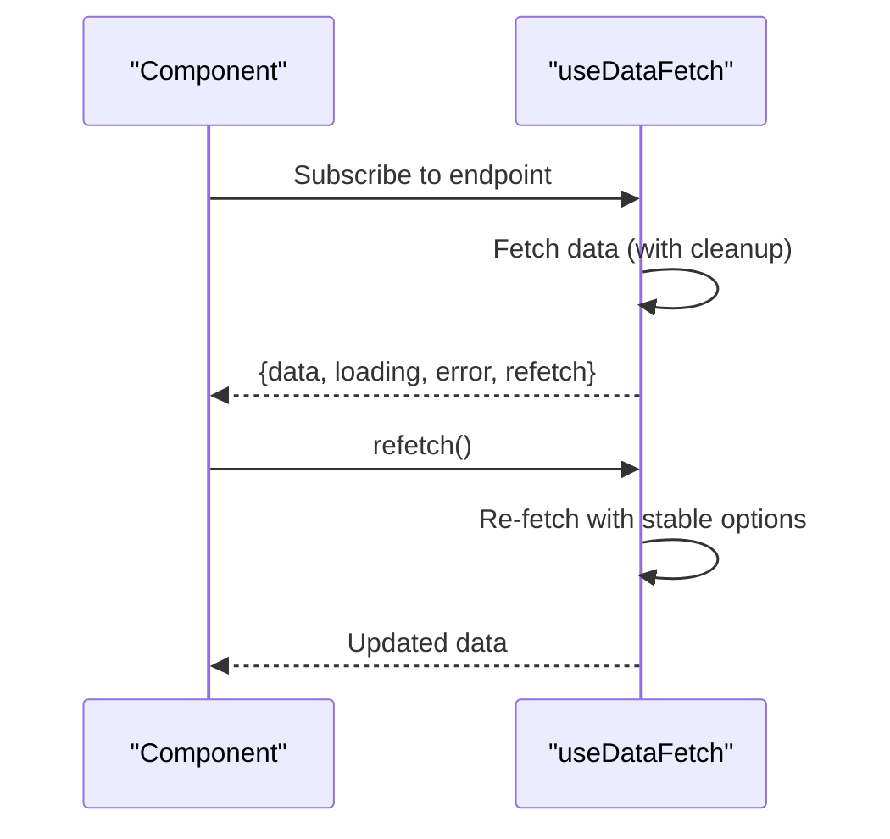
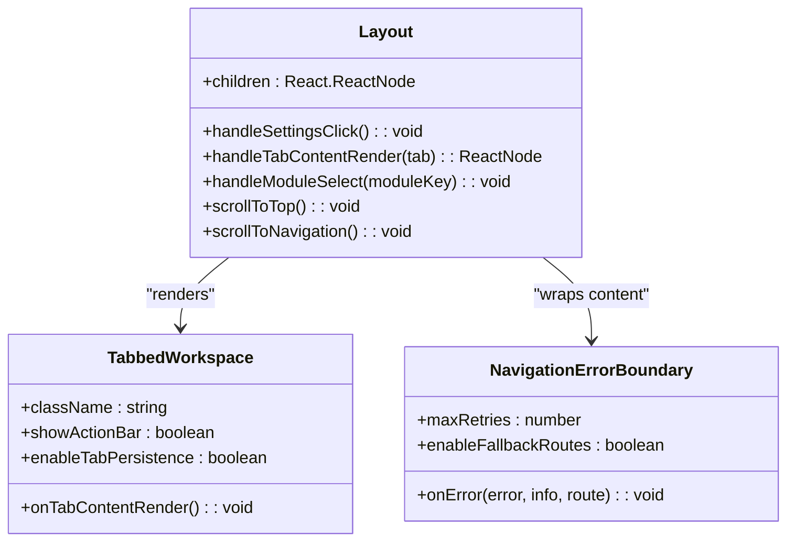
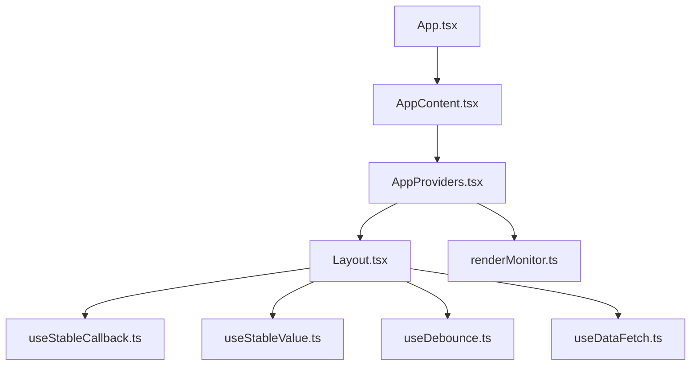

# React Best Practices Guide

<cite>
**Referenced Files in This Document**
- [REACT_BEST_PRACTICES.md](file://docs/guides/REACT_BEST_PRACTICES.md)
- [HOOK_PATTERNS.md](file://docs/guides/HOOK_PATTERNS.md)
- [App.tsx](file://src/App.tsx)
- [index.tsx](file://src/index.tsx)
- [AppProviders.tsx](file://src/contexts/AppProviders.tsx)
- [AppContent.tsx](file://src/routing/AppContent.tsx)
- [Layout.tsx](file://src/components/Layout.tsx)
- [useStableCallback.ts](file://src/hooks/useStableCallback.ts)
- [useStableValue.ts](file://src/hooks/useStableValue.ts)
- [useDebounce.ts](file://src/hooks/useDebounce.ts)
- [useDataFetch.ts](file://src/hooks/useDataFetch.ts)
- [renderMonitor.ts](file://src/utils/debug/renderMonitor.ts)
</cite>

## Table of Contents
1. [Introduction](#introduction)
2. [Project Structure](#project-structure)
3. [Core Components](#core-components)
4. [Architecture Overview](#architecture-overview)
5. [Detailed Component Analysis](#detailed-component-analysis)
6. [Dependency Analysis](#dependency-analysis)
7. [Performance Considerations](#performance-considerations)
8. [Troubleshooting Guide](#troubleshooting-guide)
9. [Conclusion](#conclusion)

## Introduction
This guide consolidates the React best practices established in the SchoolPilot3 codebase, focusing on preventing infinite loops, optimizing performance, and maintaining clean, predictable component behavior. It documents the utility hooks designed to address common pitfalls, the provider architecture that ensures stable dependencies, and the debugging tools that help identify problematic re-renders.

## Project Structure
The React application follows a layered architecture:
- Entry point initializes configuration, internationalization, and providers
- App wraps the routing layer with global providers
- AppContent selects the appropriate layout based on feature flags
- Layout manages navigation, tabs, and content rendering
- Utility hooks provide stable references and controlled side effects

**Diagram sources**
- [index.tsx:18-78](file://src/index.tsx#L18-L78)
- [App.tsx:25-46](file://src/App.tsx#L25-L46)
- [AppContent.tsx:156-219](file://src/routing/AppContent.tsx#L156-L219)
- [AppProviders.tsx:105-136](file://src/contexts/AppProviders.tsx#L105-L136)
- [Layout.tsx:26-317](file://src/components/Layout.tsx#L26-L317)

**Section sources**
- [index.tsx:18-78](file://src/index.tsx#L18-L78)
- [App.tsx:25-46](file://src/App.tsx#L25-L46)
- [AppContent.tsx:156-219](file://src/routing/AppContent.tsx#L156-L219)
- [AppProviders.tsx:105-136](file://src/contexts/AppProviders.tsx#L105-L136)
- [Layout.tsx:26-317](file://src/components/Layout.tsx#L26-L317)

## Core Components
This section highlights the utility hooks and patterns that prevent infinite loops and optimize React applications.

- useStableCallback: Ensures callback references remain stable across renders, preventing unnecessary re-renders and infinite loops when callbacks are used in dependency arrays or event listeners.
- useStableValue: Provides stable references for objects and arrays by deep/shallow equality comparison, ensuring dependency arrays only change when contents actually differ.
- useDebounce: Delays updates or callback execution, reducing excessive API calls and improving responsiveness for search and input-heavy components.
- useDataFetch: Encapsulates data fetching with automatic cleanup, stable dependencies, loading/error states, and refetch capabilities.

These utilities are documented comprehensively in the React Best Practices guide and Hook Patterns guide, with practical examples and ESLint enforcement.

**Section sources**
- [useStableCallback.ts:58-79](file://src/hooks/useStableCallback.ts#L58-L79)
- [useStableValue.ts:137-162](file://src/hooks/useStableValue.ts#L137-L162)
- [useDebounce.ts:60-262](file://src/hooks/useDebounce.ts#L60-L262)
- [useDataFetch.ts:68-299](file://src/hooks/useDataFetch.ts#L68-L299)
- [REACT_BEST_PRACTICES.md:236-306](file://docs/guides/REACT_BEST_PRACTICES.md#L236-L306)
- [HOOK_PATTERNS.md:19-204](file://docs/guides/HOOK_PATTERNS.md#L19-L204)

## Architecture Overview
The provider stack establishes stable dependencies and centralized state management:
- UnifiedConfigProvider supplies unified configuration
- ToastProvider enables global notifications
- Suspense boundaries wrap i18n and lazy-loaded data providers
- AppProviders composes network, sync, auth, user, plugins, and action providers
- AppContent selects Layout or LayoutNew based on feature flags
- Layout orchestrates navigation, tabs, and content rendering

**Diagram sources**
- [App.tsx:25-46](file://src/App.tsx#L25-L46)
- [AppContent.tsx:48-146](file://src/routing/AppContent.tsx#L48-L146)
- [AppProviders.tsx:105-136](file://src/contexts/AppProviders.tsx#L105-L136)

**Section sources**
- [App.tsx:25-46](file://src/App.tsx#L25-L46)
- [AppContent.tsx:48-146](file://src/routing/AppContent.tsx#L48-L146)
- [AppProviders.tsx:105-136](file://src/contexts/AppProviders.tsx#L105-L136)

## Detailed Component Analysis

### Infinite Loop Prevention Patterns
Common causes and solutions are documented with concrete examples:
- Object/array in dependencies: Use useStableValue or useMemo
- Function in dependencies: Use useStableCallback
- Effect updates state that triggers effect: Use useMemo for derived state
- Unnecessary useEffect: Prefer direct function calls when appropriate

**Diagram sources**
- [REACT_BEST_PRACTICES.md:32-150](file://docs/guides/REACT_BEST_PRACTICES.md#L32-L150)

**Section sources**
- [REACT_BEST_PRACTICES.md:32-150](file://docs/guides/REACT_BEST_PRACTICES.md#L32-L150)

### Utility Hook Implementation Details

#### useStableCallback
- Maintains a stable reference while always invoking the latest callback
- Prevents re-renders of child components and avoids infinite loops in dependency arrays
- Stores the latest callback in a ref and returns a memoized callback with empty dependencies

**Diagram sources**
- [useStableCallback.ts:58-79](file://src/hooks/useStableCallback.ts#L58-L79)

**Section sources**
- [useStableCallback.ts:58-79](file://src/hooks/useStableCallback.ts#L58-L79)

#### useStableValue
- Provides stable references for objects/arrays using deep or shallow equality
- Updates internal ref only when values actually change
- Supports performance optimization by allowing shallow comparisons

**Diagram sources**
- [useStableValue.ts:137-162](file://src/hooks/useStableValue.ts#L137-L162)

**Section sources**
- [useStableValue.ts:137-162](file://src/hooks/useStableValue.ts#L137-L162)

#### useDebounce
- Delays value updates or callback execution to reduce excessive API calls
- Includes advanced options for leading/trailing edge behavior
- Provides cleanup mechanisms to prevent memory leaks

**Diagram sources**
- [useDebounce.ts:60-187](file://src/hooks/useDebounce.ts#L60-L187)

**Section sources**
- [useDebounce.ts:60-187](file://src/hooks/useDebounce.ts#L60-L187)

#### useDataFetch
- Encapsulates data fetching with automatic cleanup and stable dependencies
- Manages loading/error states and provides refetch/reset capabilities
- Uses refs to store callbacks and fetch options to avoid unnecessary re-fetches

**Diagram sources**
- [useDataFetch.ts:68-184](file://src/hooks/useDataFetch.ts#L68-L184)

**Section sources**
- [useDataFetch.ts:68-184](file://src/hooks/useDataFetch.ts#L68-L184)

### Layout and Navigation Integration
The Layout component demonstrates best practices for:
- Hook ordering and stability
- Tabbed workspace integration
- Error boundaries for navigation
- Scroll helpers and persistent settings

**Diagram sources**
- [Layout.tsx:26-317](file://src/components/Layout.tsx#L26-L317)

**Section sources**
- [Layout.tsx:26-317](file://src/components/Layout.tsx#L26-L317)

## Dependency Analysis
The provider stack and hook utilities create a dependency graph that minimizes unstable references and prevents infinite loops:

**Diagram sources**
- [App.tsx:25-46](file://src/App.tsx#L25-L46)
- [AppContent.tsx:156-219](file://src/routing/AppContent.tsx#L156-L219)
- [AppProviders.tsx:105-136](file://src/contexts/AppProviders.tsx#L105-L136)
- [Layout.tsx:26-317](file://src/components/Layout.tsx#L26-L317)
- [useStableCallback.ts:58-79](file://src/hooks/useStableCallback.ts#L58-L79)
- [useStableValue.ts:137-162](file://src/hooks/useStableValue.ts#L137-L162)
- [useDebounce.ts:60-187](file://src/hooks/useDebounce.ts#L60-L187)
- [useDataFetch.ts:68-184](file://src/hooks/useDataFetch.ts#L68-L184)
- [renderMonitor.ts:34-100](file://src/utils/debug/renderMonitor.ts#L34-L100)

**Section sources**
- [App.tsx:25-46](file://src/App.tsx#L25-L46)
- [AppContent.tsx:156-219](file://src/routing/AppContent.tsx#L156-L219)
- [AppProviders.tsx:105-136](file://src/contexts/AppProviders.tsx#L105-L136)
- [Layout.tsx:26-317](file://src/components/Layout.tsx#L26-L317)
- [useStableCallback.ts:58-79](file://src/hooks/useStableCallback.ts#L58-L79)
- [useStableValue.ts:137-162](file://src/hooks/useStableValue.ts#L137-L162)
- [useDebounce.ts:60-187](file://src/hooks/useDebounce.ts#L60-L187)
- [useDataFetch.ts:68-184](file://src/hooks/useDataFetch.ts#L68-L184)
- [renderMonitor.ts:34-100](file://src/utils/debug/renderMonitor.ts#L34-L100)

## Performance Considerations
- Use useMemo for derived state computations to avoid redundant calculations
- Use useCallback or useStableCallback for event handlers passed to memoized children
- Use React.memo for components that receive frequently changing props
- Leverage useDebounce for search inputs and frequent updates
- Monitor render counts and prop changes using renderMonitor utilities
- Ensure all subscriptions and timers have cleanup functions in useEffect

## Troubleshooting Guide
When encountering infinite loops or performance issues:
1. Use useRenderCount to identify components with excessive re-renders
2. Use useWhyDidYouUpdate to see what props changed
3. Check React DevTools Profiler for render times and counts
4. Review dependency arrays for missing or unstable dependencies
5. Verify cleanup functions for subscriptions and timers
6. Confirm that context values are memoized with useMemo

**Section sources**
- [renderMonitor.ts:34-100](file://src/utils/debug/renderMonitor.ts#L34-L100)
- [REACT_BEST_PRACTICES.md:349-387](file://docs/guides/REACT_BEST_PRACTICES.md#L349-L387)

## Conclusion
By adopting the utility hooks and patterns outlined in this guide—particularly useStableCallback, useStableValue, useDebounce, and useDataFetch—you can prevent infinite loops, maintain stable dependencies, and build performant React applications. The provider architecture and debugging tools further reinforce these practices, ensuring predictable behavior and easier maintenance.