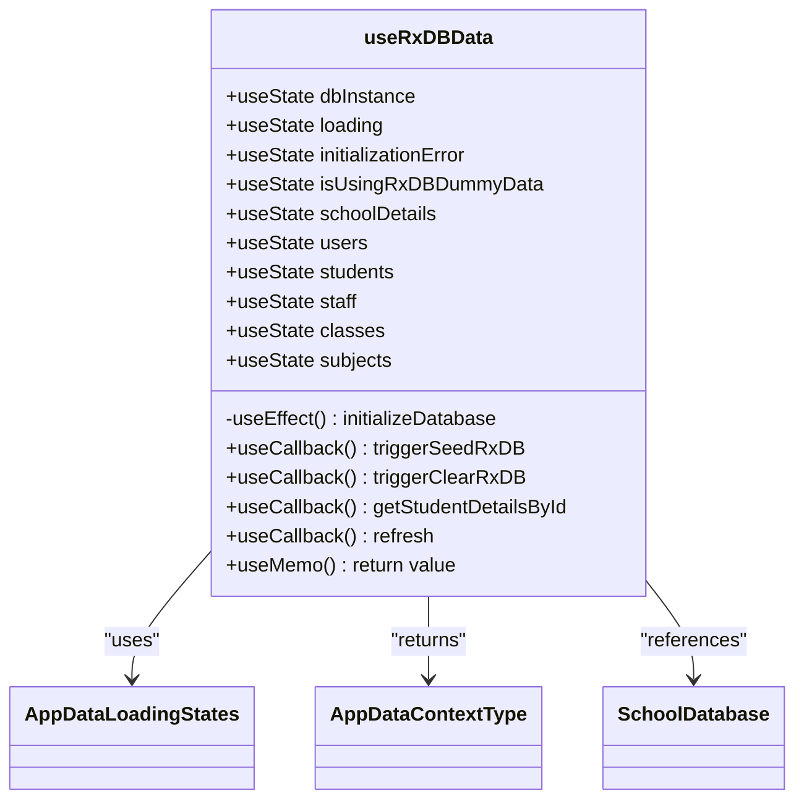
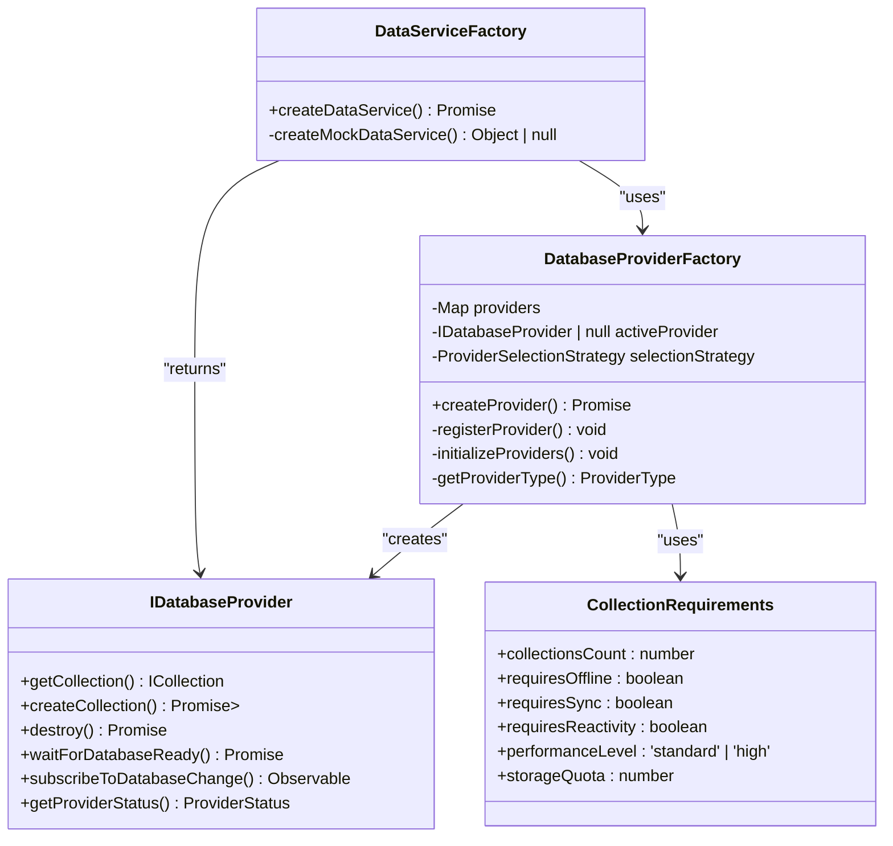
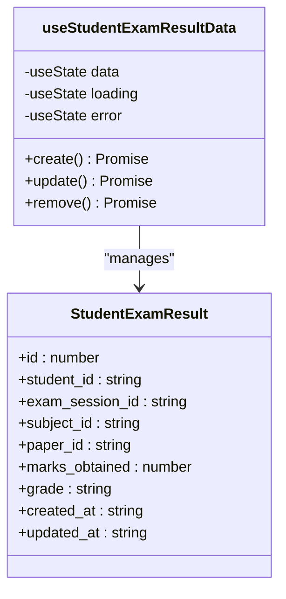
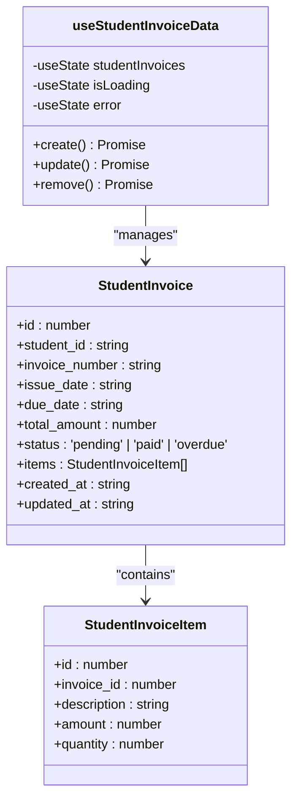
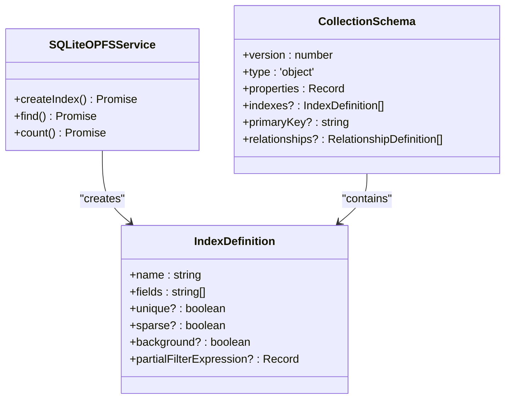
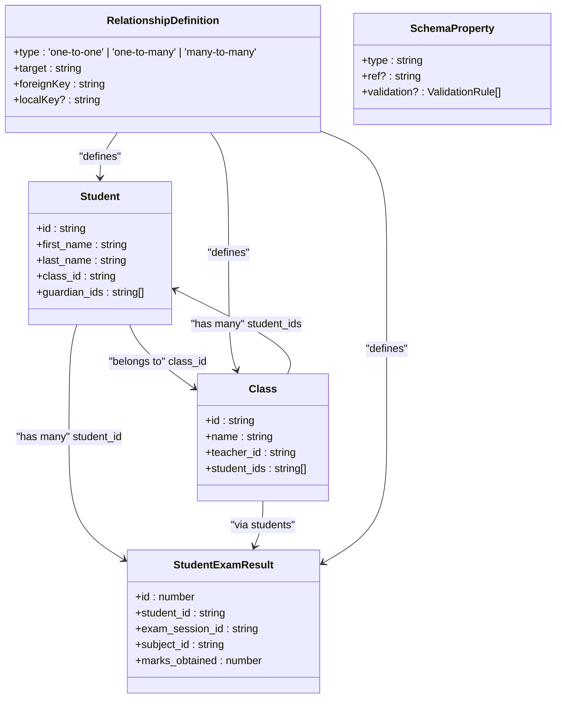

# Data Access Patterns

<cite>
**Referenced Files in This Document**   
- [useRxDBData.ts](file://src/hooks/useRxDBData.ts)
- [UnifiedCRUDService.ts](file://src/services/UnifiedCRUDService.ts)
- [DataServiceFactory.ts](file://src/services/DataServiceFactory.ts)
- [useStudentExamResultData.ts](file://src/modules/academics/data/useStudentExamResultData.ts)
- [useStudentInvoiceData.ts](file://src/modules/finance/data/useStudentInvoiceData.ts)
- [DatabaseProviderFactory.ts](file://src/services/database/DatabaseProviderFactory.ts)
- [interfaces.ts](file://src/services/database/interfaces.ts)
- [SQLiteOPFSService.ts](file://src/services/sqlite/SQLiteOPFSService.ts)
</cite>

## Table of Contents
1. [Introduction](#introduction)
2. [Custom Hooks for React Integration](#custom-hooks-for-react-integration)
3. [Unified CRUD Service Layer](#unified-crud-service-layer)
4. [Data Service Factory Pattern](#data-service-factory-pattern)
5. [Practical Query Examples](#practical-query-examples)
6. [Performance Optimization Techniques](#performance-optimization-techniques)
7. [Handling Relationships in NoSQL Context](#handling-relationships-in-nosql-context)
8. [Conclusion](#conclusion)

## Introduction
This document provides a comprehensive overview of the data access patterns implemented in schoolpilot3, a comprehensive educational management system. The architecture is designed to provide consistent, efficient, and reactive data access across various modules including academics, finance, administration, and human resources. The system employs a layered approach with specialized components for different aspects of data management, ensuring separation of concerns while maintaining high performance and reliability.

The data access layer in schoolpilot3 is built around several key principles: reactivity, consistency, performance, and flexibility. It supports multiple database backends including RxDB, PouchDB, SQLite, and LiveStore, allowing the application to adapt to different environments and requirements. The architecture enables offline-first capabilities, real-time synchronization, and efficient handling of complex educational data relationships.

**Section sources**
- [useRxDBData.ts](file://src/hooks/useRxDBData.ts)
- [UnifiedCRUDService.ts](file://src/services/UnifiedCRUDService.ts)

## Custom Hooks for React Integration

### useRxDBData Hook Implementation
The `useRxDBData` hook serves as a central data access point that abstracts database operations into React-friendly interfaces with proper loading, error, and caching states. This custom hook provides a unified interface for accessing various data entities across the application while managing the complexity of database interactions.



**Diagram sources**
- [useRxDBData.ts](file://src/hooks/useRxDBData.ts#L1-L306)

**Section sources**
- [useRxDBData.ts](file://src/hooks/useRxDBData.ts#L1-L306)

The hook implements several key features:

- **Comprehensive Loading States**: The hook maintains detailed loading states for all data entities through the `AppDataLoadingStates` interface, allowing components to display appropriate loading indicators for specific data types.

- **Error Handling**: Robust error handling is implemented through the `initializationError` state variable, which captures any issues during database initialization.

- **Reactive Data Access**: The hook provides direct access to commonly used data entities like students, staff, classes, and subjects, making it easy for components to consume this data.

- **Utility Functions**: The hook exposes utility functions such as `refresh`, `triggerSeedRxDB`, and `triggerClearRxDB` to control database operations from components.

The implementation follows React best practices with proper dependency management in useEffect and useCallback hooks to prevent unnecessary re-renders. The use of useMemo ensures that the returned context value is only recomputed when necessary, optimizing performance.

## Unified CRUD Service Layer

### UnifiedCRUDService Architecture
The `UnifiedCRUDService` serves as the central service layer providing consistent create, read, update, and delete operations across all modules. This service abstracts the underlying data storage mechanisms and provides a uniform API for data operations regardless of the actual data source.

```mermaid
classDiagram
class UnifiedCRUDService {
-DataCache cache
-DataStrategyManager | null dataStrategyManager
-any mockDataService
-any rxdbService
+create<T>() Promise<CRUDResult<T>>
+read<T>() Promise<CRUDResult<T>>
+query<T>() Promise<CRUDResult<T[]>>
+update<T>() Promise<CRUDResult<T>>
+delete<T>() Promise<CRUDResult<boolean>>
+batchCreate<T>() Promise<BatchCRUDResult<T>>
+getPerformanceMetrics() Promise<Object>
+clearCache() void
+invalidateEntityCache() void
+testConnection() Promise<boolean>
-generateId() string
+updateServices() void
}
class DataCache {
-Map<string, CacheEntry<any>> cache
+set<T>() void
+get<T>() T | null
+invalidate() void
+invalidateEntity() void
+clear() void
+getStats() Object
}
class CRUDResult<T> {
+success : boolean
+data? : T
+error? : Error
+validation? : ValidationResult
+cached? : boolean
+source : 'mock' | 'rxdb' | 'backend' | 'cache' | 'validation' | 'error'
+timestamp : Date
}
class BatchCRUDResult<T> {
+success : boolean
+results : CRUDResult<T>[]
+totalProcessed : number
+totalSuccessful : number
+totalFailed : number
+errors : Error[]
}
UnifiedCRUDService --> DataCache : "contains"
UnifiedCRUDService --> CRUDResult : "returns"
UnifiedCRUDService --> BatchCRUDResult : "returns"
UnifiedCRUDService --> DataStrategyManager : "depends on"
UnifiedCRUDService --> ValidationResult : "uses"
```

**Diagram sources**
- [UnifiedCRUDService.ts](file://src/services/UnifiedCRUDService.ts#L1-L689)

**Section sources**
- [UnifiedCRUDService.ts](file://src/services/UnifiedCRUDService.ts#L1-L689)

The service implements several key features:

- **Consistent API**: The service provides a standardized interface for CRUD operations with consistent return types (`CRUDResult<T>`), making it easy for consumers to handle operation results uniformly.

- **Caching Layer**: An integrated `DataCache` class provides transparent caching for read operations, significantly improving performance by reducing redundant database queries.

- **Validation Integration**: The service integrates with the `globalDataConsistencyService` to perform entity validation before create and update operations, ensuring data integrity.

- **Flexible Data Sources**: The service can work with multiple data sources including `DataStrategyManager`, `mockDataService`, and `rxdbService`, allowing it to adapt to different environments.

- **Batch Operations**: The service supports batch operations like `batchCreate`, enabling efficient processing of multiple records.

- **Global Instance**: The service is exported as `globalUnifiedCRUDService`, providing a singleton instance that can be imported and used throughout the application.

The service follows the dependency injection pattern, allowing data strategy managers and other services to be injected at runtime. This makes the service highly testable and flexible, as different implementations can be provided for different environments (development, production, testing).

## Data Service Factory Pattern

### DataServiceFactory Implementation
The `DataServiceFactory` implements a factory pattern that generates module-specific data services with standardized interfaces. This pattern enables the application to support multiple database technologies while maintaining a consistent API for data access.



**Diagram sources**
- [DataServiceFactory.ts](file://src/services/DataServiceFactory.ts#L1-L90)
- [DatabaseProviderFactory.ts](file://src/services/database/DatabaseProviderFactory.ts)

**Section sources**
- [DataServiceFactory.ts](file://src/services/DataServiceFactory.ts#L1-L90)

The factory pattern implementation includes:

- **Environment-Based Configuration**: The factory creates different data services based on the environment (development, production, demo), with appropriate configuration for each environment.

- **Provider Selection**: The factory uses the `DatabaseProviderFactory` to create the appropriate database provider based on requirements such as offline capability, synchronization needs, and performance requirements.

- **Configuration Management**: Each environment has specific configuration settings including database name, auto-compaction settings, debug mode, and storage quotas.

- **Requirements-Based Selection**: The factory considers various requirements when selecting a provider:
  - **Development**: Uses configured provider with debug mode enabled and auto-compaction
  - **Production**: Uses configured provider with high performance requirements and sync capabilities
  - **Demo**: Uses configured provider with debug mode enabled but without auto-compaction

The factory pattern enables the application to easily switch between different database technologies without changing the code that uses the data services. This abstraction layer is crucial for supporting the dual-database architecture and allowing the application to adapt to different deployment scenarios.

## Practical Query Examples

### Academic Records Query with useStudentExamResultData
The `useStudentExamResultData` hook provides a specialized interface for managing student exam results in the academics module. This hook demonstrates how module-specific data access patterns are implemented while maintaining consistency with the overall architecture.



**Diagram sources**
- [useStudentExamResultData.ts](file://src/modules/academics/data/useStudentExamResultData.ts#L1-L41)

**Section sources**
- [useStudentExamResultData.ts](file://src/modules/academics/data/useStudentExamResultData.ts#L1-L41)

Example usage for querying academic records:
```typescript
// Example: Getting student exam results
const { data: examResults, create, update, remove } = useStudentExamResultData();

// Get all exam results for a specific student
const getStudentResults = (studentId: string) => {
  return examResults.filter(result => result.student_id === studentId);
};

// Get exam results for a specific subject and exam session
const getSubjectResults = (subjectId: string, sessionId: string) => {
  return examResults.filter(
    result => result.subject_id === subjectId && result.exam_session_id === sessionId
  );
};

// Calculate average marks for a student
const calculateAverageMarks = (studentId: string) => {
  const studentResults = getStudentResults(studentId);
  if (studentResults.length === 0) return 0;
  
  const totalMarks = studentResults.reduce((sum, result) => sum + result.marks_obtained, 0);
  return totalMarks / studentResults.length;
};
```

### Financial Transactions Query with useStudentInvoiceData
The `useStudentInvoiceData` hook provides a specialized interface for managing student invoices in the finance module. This hook demonstrates how financial data is accessed and manipulated within the application.



**Diagram sources**
- [useStudentInvoiceData.ts](file://src/modules/finance/data/useStudentInvoiceData.ts#L1-L57)

**Section sources**
- [useStudentInvoiceData.ts](file://src/modules/finance/data/useStudentInvoiceData.ts#L1-L57)

Example usage for querying financial transactions:
```typescript
// Example: Getting student invoice data
const { data: studentInvoices, isLoading, error, create, update, remove } = useStudentInvoiceData();

// Get all invoices for a specific student
const getStudentInvoices = (studentId: string) => {
  return studentInvoices.filter(invoice => invoice.student_id === studentId);
};

// Get outstanding invoices (pending or overdue)
const getOutstandingInvoices = () => {
  const today = new Date();
  return studentInvoices.filter(invoice => 
    (invoice.status === 'pending' || invoice.status === 'overdue') &&
    new Date(invoice.due_date) <= today
  );
};

// Calculate total outstanding amount
const getTotalOutstanding = () => {
  const outstanding = getOutstandingInvoices();
  return outstanding.reduce((total, invoice) => total + invoice.total_amount, 0);
};

// Get payment history for a student
const getPaymentHistory = (studentId: string) => {
  const studentInvoices = getStudentInvoices(studentId);
  return studentInvoices.filter(invoice => invoice.status === 'paid');
};
```

These examples demonstrate how the application provides module-specific data access hooks that are tailored to the specific needs of each module while maintaining a consistent interface pattern. The hooks encapsulate the complexity of data access, providing simple CRUD operations that can be easily consumed by UI components.

## Performance Optimization Techniques

### Indexing Strategies
The application implements comprehensive indexing strategies to optimize query performance, particularly for large datasets. The database providers support index creation on collection fields to accelerate query operations.



**Diagram sources**
- [SQLiteOPFSService.ts](file://src/services/sqlite/SQLiteOPFSService.ts#L614-L660)
- [interfaces.ts](file://src/services/database/interfaces.ts#L1-L57)

The indexing implementation includes:

- **Automatic Index Creation**: The `createIndex` method in `SQLiteOPFSService` allows for the creation of indexes on collection fields, which can significantly improve query performance.

- **Schema-Based Indexing**: The `CollectionSchema` interface includes an `indexes` property that allows indexes to be defined as part of the collection schema, enabling automatic index creation during collection initialization.

- **Composite Indexes**: The system supports composite indexes on multiple fields, which can optimize queries that filter on multiple criteria.

- **Unique and Sparse Indexes**: The system supports unique indexes to enforce data integrity and sparse indexes to optimize storage for fields that may be null or undefined.

Example of index creation:
```typescript
// Create an index on student_id and exam_session_id for faster queries
await collection.createIndex({
  name: "student_exam_session_idx",
  fields: ["student_id", "exam_session_id"],
  unique: false
});
```

### Query Optimization
The application implements several query optimization techniques to ensure efficient data retrieval:

- **Query Builder Pattern**: The `QueryBuilder` class provides a fluent interface for constructing complex queries with filtering, sorting, and pagination.

- **Selector-Based Queries**: The system supports MongoDB-style selector queries with operators like `$eq`, `$ne`, `$gt`, `$gte`, `$lt`, `$lte`, `$in`, `$nin`, `$exists`, and `$regex`.

- **Field Projection**: Queries can specify which fields to return, reducing data transfer and memory usage.

```mermaid
classDiagram
class QueryBuilder<T> {
-query : any
-sortOptions : any[]
-limitValue? : number
-skipValue? : number
-fieldsValue? : string[]
+where() QueryBuilder<T>
+sort() QueryBuilder<T>
+limit() QueryBuilder<T>
+skip() QueryBuilder<T>
+select() QueryBuilder<T>
+execute() Promise<T[]>
}
class QueryOptions {
+filters? : Record<string, any>
+sort? : { field : string; direction : 'asc' | 'desc' }[]
+limit? : number
+offset? : number
+include? : string[]
}
QueryBuilder --> QueryOptions : "builds"
```

**Diagram sources**
- [DatabaseProviderFactory.ts](file://src/services/database/DatabaseProviderFactory.ts#L82-L132)
- [SQLiteOPFSService.ts](file://src/services/sqlite/SQLiteOPFSService.ts#L273-L307)

### Pagination Implementation
The application implements pagination to efficiently handle large datasets and prevent performance issues:

- **Limit and Offset**: The system supports pagination through limit and offset parameters in queries.

- **Cursor-Based Pagination**: For better performance with large datasets, the system can implement cursor-based pagination using indexed fields.

- **Lazy Loading**: Data is loaded incrementally as needed, reducing initial load time and memory usage.

Example of paginated query:
```typescript
// Get students with pagination
const getStudentsPage = async (page: number, pageSize: number) => {
  const offset = (page - 1) * pageSize;
  const queryOptions = {
    limit: pageSize,
    offset: offset,
    sort: [{ field: "last_name", direction: "asc" }]
  };
  
  return await unifiedCRUDService.query<Student>("students", queryOptions);
};
```

The pagination implementation is integrated with the `QueryOptions` interface, which includes `limit` and `offset` properties. This allows for consistent pagination across all modules and data entities.

## Handling Relationships in NoSQL Context

### Relationship Management in NoSQL
The application handles relationships in a NoSQL context through several mechanisms that maintain data integrity while leveraging the flexibility of document databases.



**Diagram sources**
- [interfaces.ts](file://src/services/database/interfaces.ts#L1-L57)
- [useStudentExamResultData.ts](file://src/modules/academics/data/useStudentExamResultData.ts)
- [useStudentInvoiceData.ts](file://src/modules/finance/data/useStudentInvoiceData.ts)

The relationship management system includes:

- **Foreign Key References**: The most common approach is to store foreign keys in documents, such as storing `class_id` in a student document or `student_id` in an exam result document.

- **Array References**: For one-to-many relationships, arrays of IDs are used, such as storing `student_ids` in a class document.

- **Schema-Based Relationship Definitions**: The `RelationshipDefinition` interface allows relationships to be defined in the collection schema, enabling automated relationship management.

- **Reference Properties**: The `SchemaProperty` interface includes a `ref` property that can be used to define references to other collections.

Example of relationship queries:
```typescript
// Get all students in a class
const getClassStudents = async (classId: string) => {
  return await unifiedCRUDService.query<Student>("students", {
    filters: { class_id: classId }
  });
};

// Get all exam results for students in a class
const getClassExamResults = async (classId: string) => {
  const classStudents = await getClassStudents(classId);
  const studentIds = classStudents.data?.map(s => s.id) || [];
  
  return await unifiedCRUDService.query<StudentExamResult>("studentExamResults", {
    filters: { student_id: { $in: studentIds } }
  });
};

// Get student with their exam results (simulated join)
const getStudentWithResults = async (studentId: string) => {
  const studentResult = await unifiedCRUDService.read<Student>("students", studentId);
  const resultsResult = await unifiedCRUDService.query<StudentExamResult>("studentExamResults", {
    filters: { student_id: studentId }
  });
  
  return {
    student: studentResult.data,
    examResults: resultsResult.data
  };
};
```

The application handles the challenges of NoSQL relationships by:

- **Denormalization**: Some data is denormalized to reduce the need for joins, such as storing class name in student documents for display purposes.

- **Application-Level Joins**: Complex queries that require data from multiple collections are handled at the application level by making multiple queries and combining the results.

- **Caching**: Frequently accessed related data is cached to improve performance.

- **Batch Operations**: Related data can be created, updated, or deleted in batches to maintain consistency.

This approach balances the flexibility of NoSQL databases with the need for data integrity and efficient querying in an educational management system.

## Conclusion
The data access patterns in schoolpilot3 demonstrate a sophisticated and well-architected approach to managing educational data in a complex application. The system successfully balances the need for reactivity, performance, and data consistency while supporting multiple database technologies and deployment scenarios.

Key strengths of the architecture include:

- **Layered Design**: The separation of concerns between custom hooks, service layers, and factory patterns creates a maintainable and extensible architecture.

- **Consistency**: The standardized interfaces across all data access components make the system predictable and easy to use.

- **Performance**: Comprehensive optimization techniques including caching, indexing, and pagination ensure the application remains responsive even with large datasets.

- **Flexibility**: The factory pattern and service abstraction allow the application to adapt to different environments and requirements.

- **Scalability**: The modular design enables the addition of new modules and data entities without disrupting existing functionality.

The implementation provides a solid foundation for an educational management system, with patterns that could be applied to other domains requiring complex data relationships and high performance. Future enhancements could include more sophisticated relationship management, advanced query optimization, and enhanced real-time synchronization capabilities.