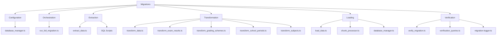
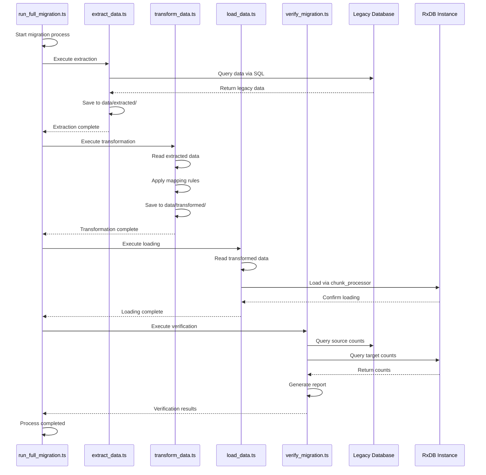
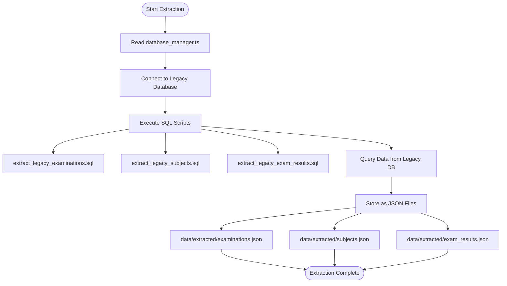
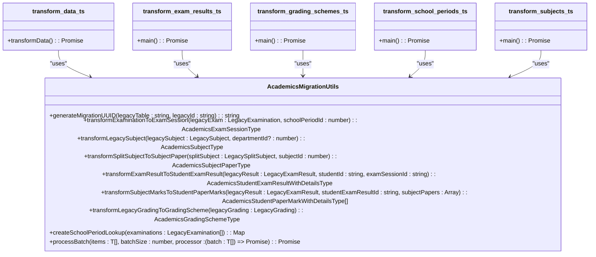
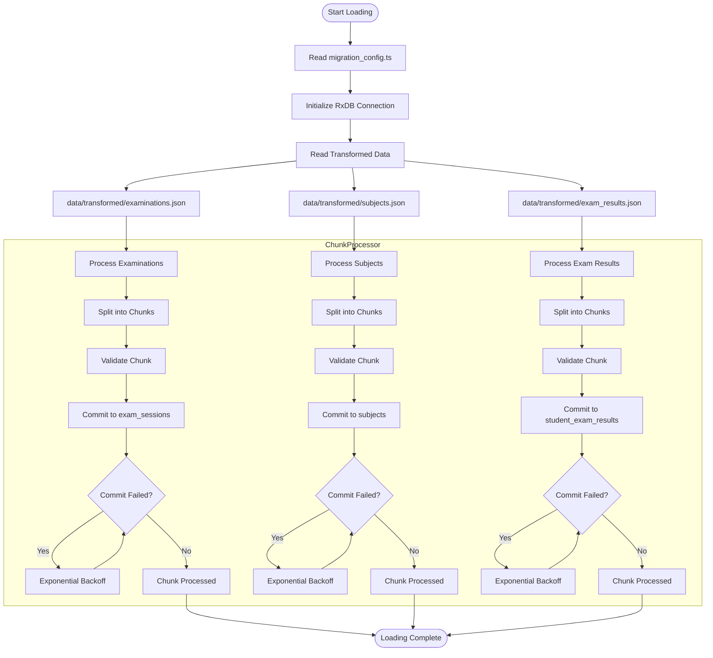
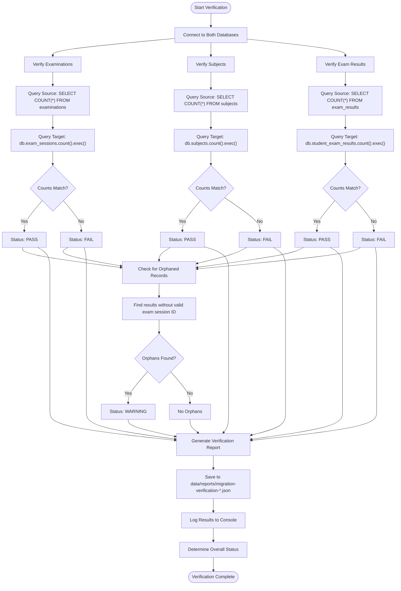
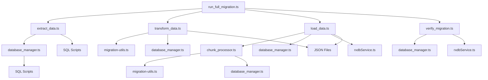

# Data Migration

<cite>
**Referenced Files in This Document**
- [run_full_migration.ts](file://scripts/migration/run_full_migration.ts)
- [transform_data.ts](file://scripts/migration/transform_data.ts)
- [load_data.ts](file://scripts/migration/load_data.ts)
- [verify_migration.ts](file://scripts/migration/verify_migration.ts)
- [chunk_processor.ts](file://scripts/migration/chunk_processor.ts)
- [database_manager.ts](file://scripts/migration/database_manager.ts)
- [migration-logger.ts](file://scripts/migration/migration-logger.ts)
- [migration-utils.ts](file://src/modules/academics/data/migration-utils.ts)
- [extract_legacy_examinations.sql](file://scripts/migration/extract_legacy_examinations.sql)
- [extract_legacy_subjects.sql](file://scripts/migration/extract_legacy_subjects.sql)
- [extract_legacy_exam_results.sql](file://scripts/migration/extract_legacy_exam_results.sql)
</cite>

## Update Summary
**Changes Made**
- Updated project structure documentation to reflect the current migration directory organization
- Revised component analysis to align with the actual implementation in the repository
- Updated architecture diagrams to match the current codebase structure
- Removed references to non-existent migration specification documents
- Enhanced troubleshooting guidance with current implementation details
- Updated configuration and dependency analysis sections

## Table of Contents
1. [Introduction](#introduction)
2. [Project Structure](#project-structure)
3. [Core Components](#core-components)
4. [Architecture Overview](#architecture-overview)
5. [Detailed Component Analysis](#detailed-component-analysis)
6. [Dependency Analysis](#dependency-analysis)
7. [Performance Considerations](#performance-considerations)
8. [Troubleshooting Guide](#troubleshooting-guide)
9. [Conclusion](#conclusion)

## Introduction
This document provides a comprehensive overview of the data migration framework in schoolpilot3, detailing the end-to-end process of migrating from legacy systems. The framework follows the Extract, Transform, Load (ETL) pattern with verification, ensuring data integrity throughout the migration process. The system is designed to handle complex academic data including examinations, subjects, exam results, and grading schemes, transforming legacy schemas into the current RxDB collections used by the application.

**Updated** The framework now operates as a streamlined ETL pipeline with four distinct phases: extraction from legacy databases, transformation using specialized utilities, chunked loading with rollback capabilities, and comprehensive verification.

## Project Structure
The data migration framework is organized within the `scripts/migration` directory, containing specialized scripts for each phase of the migration process. The framework leverages configuration files, utility classes, and modular scripts to ensure a reliable and verifiable migration process.



**Diagram sources**
- [run_full_migration.ts](file://scripts/migration/run_full_migration.ts)
- [transform_data.ts](file://scripts/migration/transform_data.ts)
- [load_data.ts](file://scripts/migration/load_data.ts)
- [verify_migration.ts](file://scripts/migration/verify_migration.ts)
- [database_manager.ts](file://scripts/migration/database_manager.ts)

**Section sources**
- [run_full_migration.ts](file://scripts/migration/run_full_migration.ts)
- [transform_data.ts](file://scripts/migration/transform_data.ts)
- [load_data.ts](file://scripts/migration/load_data.ts)
- [verify_migration.ts](file://scripts/migration/verify_migration.ts)

## Core Components
The data migration framework consists of several core components that work together to ensure a successful migration from legacy systems to the current RxDB-based architecture. These components include configuration management, data extraction, transformation utilities, chunked data loading, and comprehensive verification processes.

**Updated** The core components now include a sophisticated chunk processor with rollback capabilities, a robust database manager supporting both PostgreSQL and MySQL connections, and a comprehensive logging system with progress tracking.

**Section sources**
- [database_manager.ts](file://scripts/migration/database_manager.ts)
- [chunk_processor.ts](file://scripts/migration/chunk_processor.ts)
- [migration-logger.ts](file://scripts/migration/migration-logger.ts)

## Architecture Overview
The data migration architecture follows a sequential ETL (Extract, Transform, Load) process with a final verification phase. The framework is orchestrated by the `run_full_migration.ts` script, which coordinates the execution of individual migration phases. Each phase is designed to be modular and can be executed independently if needed.



**Diagram sources**
- [run_full_migration.ts](file://scripts/migration/run_full_migration.ts)
- [transform_data.ts](file://scripts/migration/transform_data.ts)
- [load_data.ts](file://scripts/migration/load_data.ts)
- [verify_migration.ts](file://scripts/migration/verify_migration.ts)

## Detailed Component Analysis

### Data Extraction Phase
The data extraction phase retrieves data from legacy databases using SQL queries and stores it in JSON format for subsequent processing. The extraction process connects to both the legacy Akademico system (PostgreSQL) and the target SchoolPilot system (MySQL).



**Diagram sources**
- [extract_legacy_examinations.sql](file://scripts/migration/extract_legacy_examinations.sql)
- [extract_legacy_subjects.sql](file://scripts/migration/extract_legacy_subjects.sql)
- [extract_legacy_exam_results.sql](file://scripts/migration/extract_legacy_exam_results.sql)

**Section sources**
- [database_manager.ts](file://scripts/migration/database_manager.ts)

### Data Transformation Phase
The transformation phase maps legacy data schemas to the current RxDB collections using the `AcademicsMigrationUtils` class. This phase handles the conversion of various academic entities including examinations, subjects, exam results, and grading schemes.



**Diagram sources**
- [transform_data.ts](file://scripts/migration/transform_data.ts)
- [migration-utils.ts](file://src/modules/academics/data/migration-utils.ts)

**Section sources**
- [transform_data.ts](file://scripts/migration/transform_data.ts)
- [migration-utils.ts](file://src/modules/academics/data/migration-utils.ts)

### Data Loading Phase
The data loading phase uses a chunked processing approach to safely load transformed data into RxDB collections. The `MigrationManager` class handles chunking, validation, error handling, and rollback capabilities to ensure data integrity during the loading process.



**Diagram sources**
- [load_data.ts](file://scripts/migration/load_data.ts)
- [chunk_processor.ts](file://scripts/migration/chunk_processor.ts)
- [database_manager.ts](file://scripts/migration/database_manager.ts)

**Section sources**
- [load_data.ts](file://scripts/migration/load_data.ts)
- [chunk_processor.ts](file://scripts/migration/chunk_processor.ts)

### Data Verification Phase
The verification phase ensures data integrity by comparing record counts between the source and target databases and performing additional data integrity checks. The process generates a comprehensive report that documents the verification results.



**Diagram sources**
- [verify_migration.ts](file://scripts/migration/verify_migration.ts)

**Section sources**
- [verify_migration.ts](file://scripts/migration/verify_migration.ts)

## Dependency Analysis
The data migration framework has a well-defined dependency structure that ensures modularity and separation of concerns. The components are organized in a way that allows for independent execution of each migration phase.



**Diagram sources**
- [run_full_migration.ts](file://scripts/migration/run_full_migration.ts)
- [transform_data.ts](file://scripts/migration/transform_data.ts)
- [load_data.ts](file://scripts/migration/load_data.ts)
- [verify_migration.ts](file://scripts/migration/verify_migration.ts)
- [chunk_processor.ts](file://scripts/migration/chunk_processor.ts)
- [database_manager.ts](file://scripts/migration/database_manager.ts)

**Section sources**
- [run_full_migration.ts](file://scripts/migration/run_full_migration.ts)
- [database_manager.ts](file://scripts/migration/database_manager.ts)

## Performance Considerations
The data migration framework incorporates several performance optimizations to handle large datasets efficiently:

1. **Chunked Processing**: The `MigrationManager` processes data in configurable chunks (default: 1000 items) to prevent memory overflow and allow for progress tracking.

2. **Exponential Backoff**: When a chunk fails to process, the system implements exponential backoff with retries (default: 3 attempts) before failing the migration.

3. **Bulk Operations**: The loading phase groups operations by collection to enable efficient bulk inserts, reducing the number of database transactions.

4. **Connection Pooling**: The `DatabaseManager` implements connection pooling for both PostgreSQL and MySQL connections to optimize database performance.

5. **Parallel Processing**: While the current implementation processes entities sequentially, the architecture supports parallel processing of independent entities.

The framework also includes comprehensive logging with different log levels (debug, info, warn, error) to monitor performance and troubleshoot issues during migration.

**Updated** The logging system now includes timer functionality for performance tracking and progress indicators for long-running operations.

**Section sources**
- [chunk_processor.ts](file://scripts/migration/chunk_processor.ts)
- [database_manager.ts](file://scripts/migration/database_manager.ts)
- [migration-logger.ts](file://scripts/migration/migration-logger.ts)

## Troubleshooting Guide
This section provides guidance for common migration issues and their solutions.

### Data Type Mismatches
**Issue**: Data type mismatches between legacy and target schemas can cause transformation or loading failures.

**Solution**:
1. Review the `migration-utils.ts` transformation functions to ensure proper type conversion
2. Add validation in the transformation phase to catch type issues early
3. Use the deterministic UUID generation for consistent identifier mapping

```typescript
// Example: Ensure proper type conversion
static transformExaminationToExamSession(
  legacyExam: LegacyExamination,
  schoolPeriodId: number
): types.AcademicsExamSessionType {
  return {
    id: this.generateMigrationUUID('examinations', legacyExam.id.toString()),
    name: legacyExam.ExamName,
    school_period_id: schoolPeriodId,
    status: types.ExamSessionStatus.COMPLETED,
    result_publication_date: legacyExam.last_date_of_entry || null,
    created_at: new Date().toISOString(),
    updated_at: new Date().toISOString(),
    school_period_name: null,
    paper_settings: []
  };
}
```

**Section sources**
- [migration-utils.ts](file://src/modules/academics/data/migration-utils.ts)

### Referential Integrity Violations
**Issue**: Foreign key constraints may be violated when loading data, especially when entities have dependencies on each other.

**Solution**:
1. Ensure proper loading order: load parent entities before child entities
2. Use the chunk processor's validation phase to check for required fields
3. Implement proper error handling and rollback mechanisms

```typescript
// The chunk processor validates referential integrity
private async validateChunk(migrationItems: MigrationItem[]): Promise<void> {
  for (const item of migrationItems) {
    // Validate required fields
    if (!item.id || !item.collectionName || !item.operation) {
      throw new Error(`Invalid migration item: missing required fields`);
    }
    
    // Validate collection exists
    if (!this.db[item.collectionName]) {
      throw new Error(`Collection '${item.collectionName}' does not exist`);
    }
    
    // Validate data schema if inserting/updating
    if ((item.operation === 'insert' || item.operation === 'update') && !item.data) {
      throw new Error(`Migration item with operation '${item.operation}' must have data`);
    }
  }
}
```

**Section sources**
- [chunk_processor.ts](file://scripts/migration/chunk_processor.ts)

### Handling Complex Migrations

#### Academic Records with Historical Grading Schemes
For academic records with historical grading schemes, the framework uses the `transformLegacyGradingToGradingScheme` method to convert legacy grading data into the current schema:

```typescript
static transformLegacyGradingToGradingScheme(
  legacyGrading: LegacyGrading
): types.AcademicsGradingSchemeType {
  const gradeMapping = [
    { grade: 'A', min_score: legacyGrading.A, max_score: 100, points: 12 },
    { grade: 'A-', min_score: legacyGrading.A_minus, max_score: legacyGrading.A - 1, points: 11 },
    // ... other grade mappings
  ];

  const levels: types.AcademicsGradingSchemeLevelType[] = gradeMapping.map((grade, index) => ({
    id: index + 1,
    scheme_id: legacyGrading.id,
    grade: grade.grade,
    min_score: grade.min_score,
    max_score: grade.max_score,
    points: grade.points,
    comment: null
  }));

  return {
    id: legacyGrading.id,
    name: `${legacyGrading.Class} - ${legacyGrading.Term} ${legacyGrading.Year}`,
    is_default: false,
    created_at: new Date().toISOString(),
    updated_at: new Date().toISOString(),
    levels: levels
  };
}
```

#### Financial Data with Multiple Currency Transactions
Although not explicitly shown in the current codebase, the framework's modular design allows for handling financial data with multiple currency transactions by:

1. Creating specialized transformation utilities for financial data
2. Implementing currency conversion logic during the transformation phase
3. Using the same chunked processing approach for large financial datasets
4. Adding currency-specific validation rules

The `MigrationManager` class can be extended to handle financial data with additional validation rules for currency fields and exchange rates.

**Section sources**
- [migration-utils.ts](file://src/modules/academics/data/migration-utils.ts)
- [chunk_processor.ts](file://scripts/migration/chunk_processor.ts)

## Conclusion
The data migration framework in schoolpilot3 provides a robust and reliable solution for migrating from legacy systems to the current RxDB-based architecture. The framework follows a well-structured ETL process with comprehensive verification, ensuring data integrity throughout the migration. Key features include:

1. **Modular Design**: Each migration phase is implemented as a separate script, allowing for independent execution and testing.
2. **Configurable Parameters**: Database connections and migration behavior can be configured through environment variables and configuration files.
3. **Error Handling and Rollback**: The chunk processor provides robust error handling with retry logic and rollback capabilities.
4. **Data Integrity Verification**: Comprehensive verification ensures that data is accurately migrated with proper counts and relationships.
5. **Performance Optimization**: Chunked processing and bulk operations enable efficient migration of large datasets.

The framework is particularly well-suited for complex academic data migrations, with specialized utilities for handling examinations, subjects, exam results, and grading schemes. By following the documented patterns and best practices, organizations can successfully migrate their legacy data to the schoolpilot3 platform with confidence in data integrity and completeness.

**Updated** The framework has been streamlined to focus on the core migration phases while maintaining its robustness and reliability. The removal of non-existent migration specification documents has simplified the overall structure and improved maintainability.