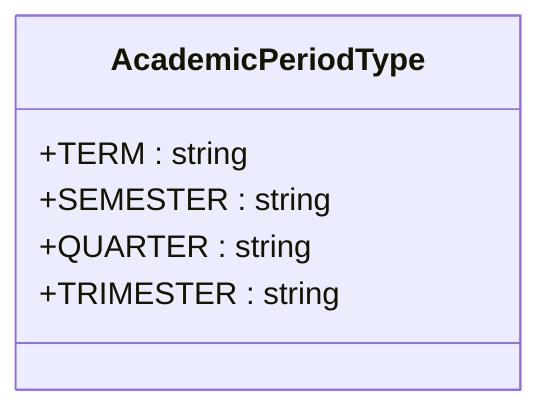
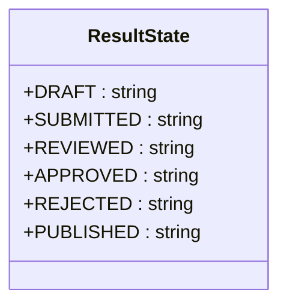
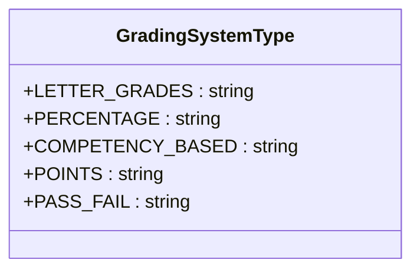
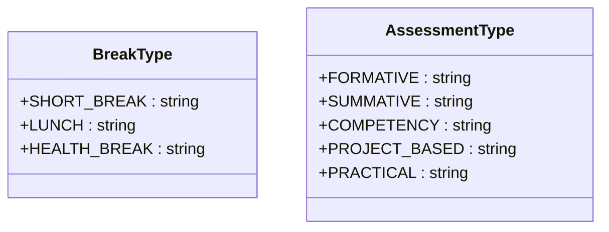
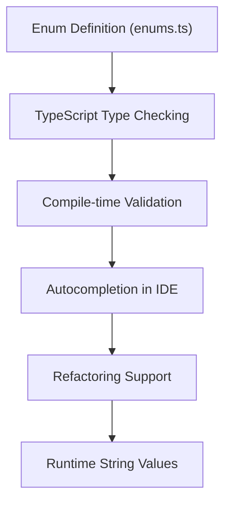
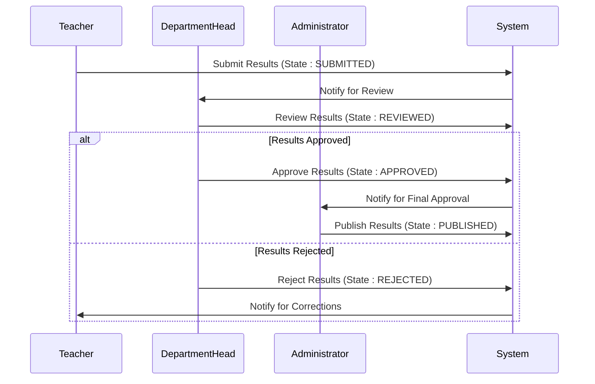
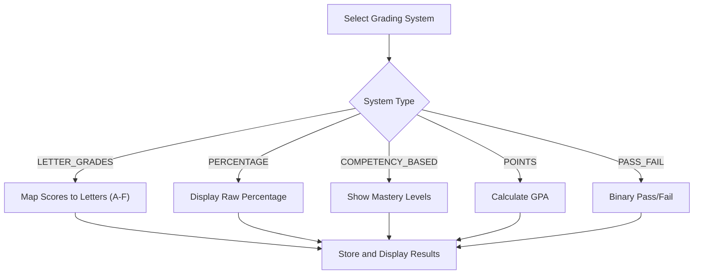

# Academic Data Enums

<cite>
**Referenced Files in This Document**   
- [enums.ts](file://src/modules/academics/data/enums.ts#L1-L69)
</cite>

## Table of Contents
1. [Introduction](#introduction)
2. [AcademicYearStatus](#academicyearstatus)
3. [ExamSessionType](#examsessiontype)
4. [ResultStatus](#resultstatus)
5. [GradingSchemeType](#gradingschemetype)
6. [TimetableEntryType](#timetableentrytype)
7. [Usage Contexts and Data Integrity](#usage-contexts-and-data-integrity)
8. [Enum to TypeScript Integration](#enum-to-typescript-integration)
9. [Form Validation and UI Rendering](#form-validation-and-ui-rendering)
10. [Business Logic Examples](#business-logic-examples)
11. [Migration Considerations](#migration-considerations)

## Introduction
This document provides comprehensive documentation for the enumeration types used in the Academics module data model. The enums define standardized values for key academic entities, ensuring data consistency and integrity across the system. These enumerations are implemented as TypeScript enums in the `enums.ts` file within the academics module and are used throughout the application for form validation, UI rendering, and business logic enforcement.

## AcademicYearStatus
The `AcademicYearStatus` enum is not explicitly defined in the codebase. However, based on the context from the `AcademicYearsPage.tsx` component and related data structures, academic years are managed through their start and end dates rather than a discrete status field. The system determines the active academic year by comparing the current date with the defined start and end dates of each academic year.

The `is_active` flag present in academic period definitions (such as terms) indicates whether a specific period is currently active, but there is no dedicated `AcademicYearStatus` enum. Instead, the application logic determines the status of an academic year programmatically based on date ranges.

**Section sources**
- [AcademicYearsPage.tsx](file://src/modules/administration/pages/AcademicYearsPage.tsx#L0-L220)
- [mockData.ts](file://src/modules/administration/data/mockData.ts#L134-L141)

## ExamSessionType
The `ExamSessionType` enum is not explicitly defined in the codebase. However, examination sessions are closely related to academic periods, which are defined by the `AcademicPeriodType` enum. This enum specifies the different types of academic periods during which exams might be scheduled.

**Diagram sources**
- [enums.ts](file://src/modules/academics/data/enums.ts#L54-L58)

The `AcademicPeriodType` enum includes the following values:
- **TERM**: Represents a term-based academic system, typically dividing the academic year into three parts.
- **SEMESTER**: Represents a semester-based system, typically dividing the academic year into two main periods.
- **QUARTER**: Represents a quarter-based system, dividing the academic year into four equal parts.
- **TRIMESTER**: Represents a trimester system, dividing the academic year into three equal parts.

These period types serve as the foundation for scheduling exam sessions, with exams typically occurring at the end of each defined period.

**Section sources**
- [enums.ts](file://src/modules/academics/data/enums.ts#L54-L58)

## ResultStatus
The `ResultStatus` enum is defined in the codebase as `ResultState`, which governs the lifecycle of academic results from creation to publication. This enum enforces a clear workflow for result management and approval.

**Diagram sources**
- [enums.ts](file://src/modules/academics/data/enums.ts#L3-L8)

The `ResultState` enum includes the following values:
- **DRAFT**: Results are being entered or modified but have not been submitted for review.
- **SUBMITTED**: Results have been completed by teachers and submitted to department heads or administrators for review.
- **REVIEWED**: Results have been examined by reviewers who have checked for accuracy and consistency.
- **APPROVED**: Results have been formally approved by authorized personnel and are ready for publication.
- **REJECTED**: Results were found to have issues during review and have been sent back for correction.
- **PUBLISHED**: Results have been released to students and parents through the system.

This state machine ensures proper governance of academic results, preventing premature publication and maintaining data integrity throughout the approval process.

**Section sources**
- [enums.ts](file://src/modules/academics/data/enums.ts#L3-L8)

## GradingSchemeType
The `GradingSchemeType` enum is defined in the codebase as `GradingSystemType`, which specifies the different grading methodologies that can be applied in the academic system.

**Diagram sources**
- [enums.ts](file://src/modules/academics/data/enums.ts#L45-L50)

The `GradingSystemType` enum includes the following values:
- **LETTER_GRADES**: Uses letter-based grading (e.g., A, B, C, D, F) to represent student performance.
- **PERCENTAGE**: Represents student performance as a percentage score (e.g., 85%).
- **COMPETENCY_BASED**: Focuses on mastery of specific skills or competencies rather than traditional scoring.
- **POINTS**: Uses a points or Grade Point Average (GPA) system to quantify academic performance.
- **PASS_FAIL**: A binary grading system that indicates whether a student has passed or failed a course.

This enum allows the system to support multiple grading methodologies, accommodating different educational philosophies and institutional requirements.

**Section sources**
- [enums.ts](file://src/modules/academics/data/enums.ts#L45-L50)

## TimetableEntryType
The `TimetableEntryType` enum is not explicitly defined in the codebase. However, the system supports different types of timetable entries through related enums such as `BreakType` and `AssessmentType`, which can be considered components of the timetable structure.

**Diagram sources**
- [enums.ts](file://src/modules/academics/data/enums.ts#L67-L69)
- [enums.ts](file://src/modules/academics/data/enums.ts#L62-L66)

The `BreakType` enum includes:
- **SHORT_BREAK**: Short breaks between classes or periods.
- **LUNCH**: Designated lunch periods in the school day.
- **HEALTH_BREAK**: Special breaks for health and wellness activities.

The `AssessmentType` enum includes:
- **FORMATIVE**: Ongoing assessments used to monitor student learning.
- **SUMMATIVE**: Evaluations administered at the end of an instructional unit.
- **COMPETENCY**: Assessments focused on specific skill mastery.
- **PROJECT_BASED**: Assessments based on student projects.
- **PRACTICAL**: Hands-on assessments for practical skills.

While there is no single `TimetableEntryType` enum, these related enums collectively define the types of entries that can appear in a school timetable.

**Section sources**
- [enums.ts](file://src/modules/academics/data/enums.ts#L62-L69)

## Usage Contexts and Data Integrity
The enumeration types play a critical role in enforcing data integrity within the academic data model. By restricting field values to predefined options, the system prevents invalid or inconsistent data entry.

These enums are used in various contexts:
- **Database schema definitions**: The RxDB schema definitions reference these enum values to validate data at the storage level.
- **Form validation**: Input forms use these enums to populate dropdowns and validate user input.
- **Business logic**: Workflow engines and state machines use enum values to determine valid transitions and actions.
- **UI rendering**: The user interface displays human-readable versions of enum values based on the current language context.

The use of enums ensures consistency across the application, preventing issues such as typos in status values or inconsistent grading system names.

**Section sources**
- [enums.ts](file://src/modules/academics/data/enums.ts#L1-L69)
- [rxdbService.ts](file://src/services/rxdbService.ts#L80-L82)

## Enum to TypeScript Integration
The enumeration types are implemented as TypeScript enums, which provides several benefits for type safety and development efficiency.

**Diagram sources**
- [enums.ts](file://src/modules/academics/data/enums.ts#L1-L69)

The TypeScript enums are imported and used throughout the application in various ways:
- As type annotations for function parameters and return values
- As validation constraints in form components
- As state values in React components
- As query parameters in data access functions

This integration ensures that enum usage is consistent and type-safe across the codebase, reducing the likelihood of runtime errors caused by invalid enum values.

**Section sources**
- [enums.ts](file://src/modules/academics/data/enums.ts#L1-L69)

## Form Validation and UI Rendering
The enumeration types are extensively used in form validation and UI rendering to provide a consistent user experience.

For form validation, the enums are used to:
- Define allowed values for select inputs
- Validate form submissions against acceptable enum values
- Provide error messages when invalid values are detected

For UI rendering, the enums are used to:
- Populate dropdown menus and radio button groups
- Display human-readable labels for enum values
- Apply conditional styling based on enum states

The system leverages the i18n framework to translate enum value labels into different languages, ensuring that the user interface displays appropriate text based on the user's language preference.

**Section sources**
- [AcademicYearsPage.tsx](file://src/modules/administration/pages/AcademicYearsPage.tsx#L0-L220)
- [enums.ts](file://src/modules/academics/data/enums.ts#L1-L69)

## Business Logic Examples
The enumeration types are integral to various business logic workflows in the academic system.

For example, the `ResultState` enum drives the result approval workflow:

**Diagram sources**
- [enums.ts](file://src/modules/academics/data/enums.ts#L3-L8)

Another example is the grading system selection, which affects how student performance is calculated and displayed:

**Diagram sources**
- [enums.ts](file://src/modules/academics/data/enums.ts#L45-L50)

These workflows demonstrate how enum values control the behavior of the system and ensure consistent processing of academic data.

**Section sources**
- [enums.ts](file://src/modules/academics/data/enums.ts#L3-L8)
- [enums.ts](file://src/modules/academics/data/enums.ts#L45-L50)

## Migration Considerations
When adding or modifying enum values across system versions, several considerations must be addressed to maintain data integrity and system compatibility.

**Backward Compatibility**: New enum values should be added in a way that doesn't break existing functionality. This typically means adding new values rather than modifying or removing existing ones.

**Database Migration**: When new enum values are introduced, database migration scripts must ensure that existing data remains valid and that new values can be stored.

**Frontend Updates**: The user interface must be updated to handle new enum values, including translation updates and UI component adjustments.

**API Contracts**: If the enums are exposed through APIs, changes must be managed carefully to avoid breaking client applications.

**Testing**: Comprehensive testing is required to verify that new enum values work correctly across all use cases, including edge cases and error conditions.

The migration process should follow a structured approach:
1. Add new enum values without removing existing ones
2. Update database schemas to accommodate new values
3. Deploy backend changes before frontend updates
4. Test thoroughly in staging environments
5. Communicate changes to stakeholders and users

This approach minimizes disruption and ensures a smooth transition when enum values are modified or extended.

**Section sources**
- [enums.ts](file://src/modules/academics/data/enums.ts#L1-L69)
- [migration-utils.ts](file://src/modules/academics/data/migration-utils.ts)