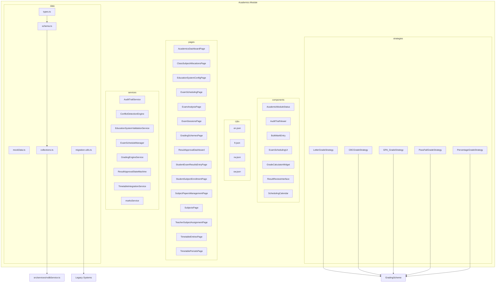
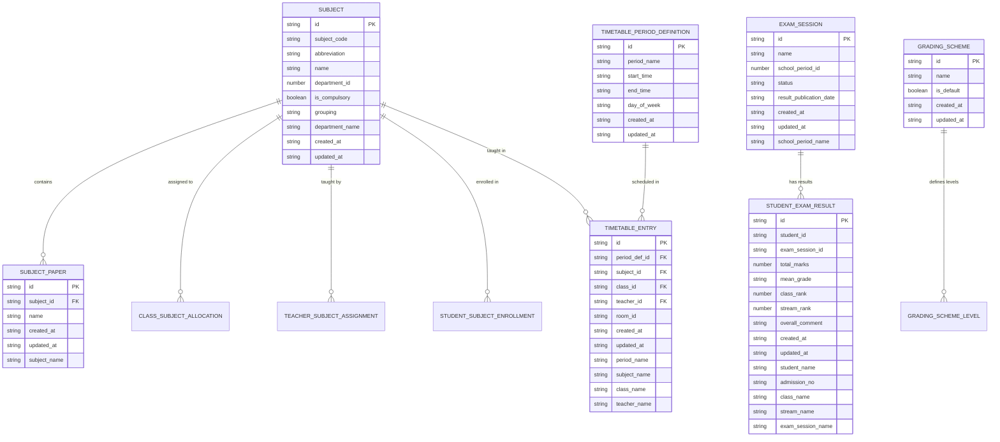
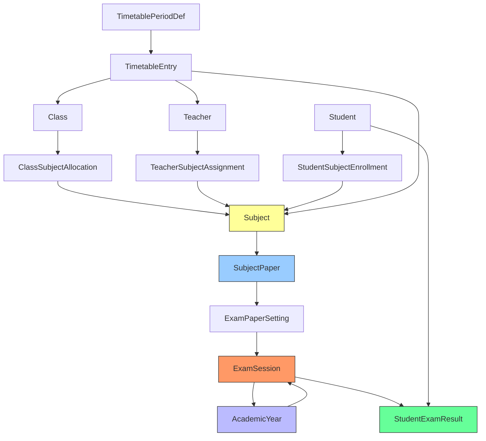
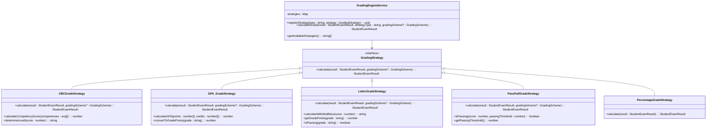
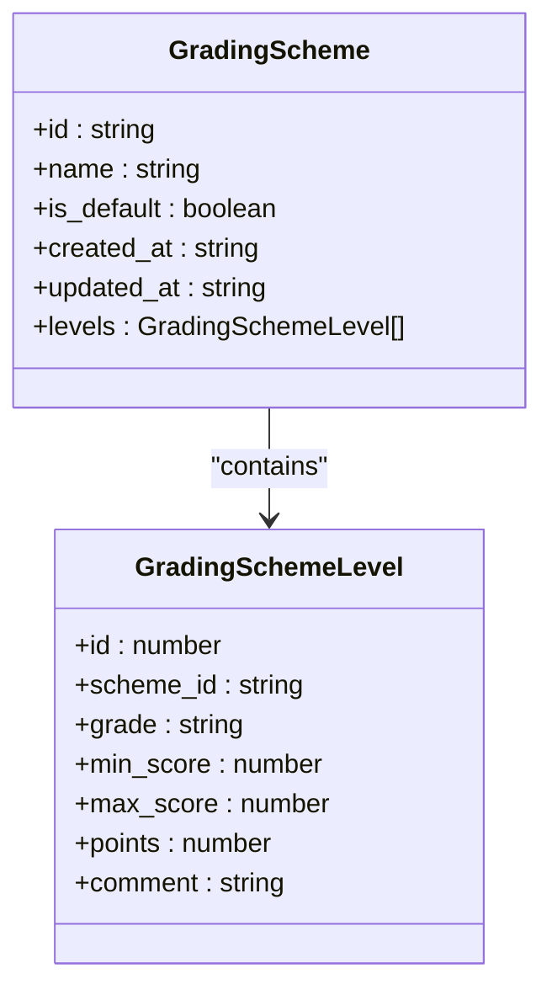
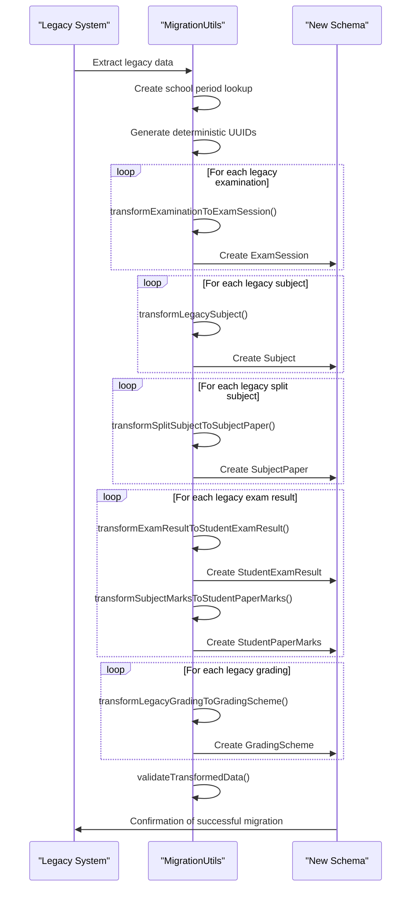
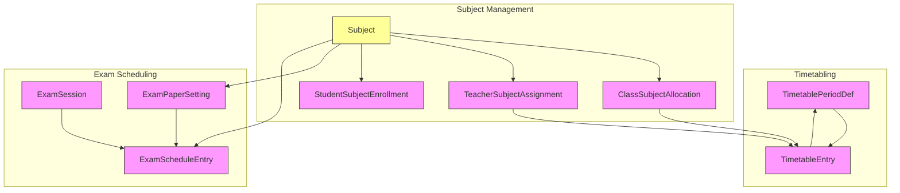

# Academics Data Model

<cite>
**Referenced Files in This Document**   
- [collections.ts](file://src/modules/academics/data/collections.ts#L1-L51)
- [schema.ts](file://src/modules/academics/data/schema.ts)
- [types.ts](file://src/modules/academics/data/types.ts)
- [migration-utils.ts](file://src/modules/academics/data/migration-utils.ts#L1-L357)
- [LetterGradeStrategy.ts](file://src/modules/academics/strategies/LetterGradeStrategy.ts#L1-L86)
- [PercentageGradeStrategy.ts](file://src/modules/academics/strategies/PercentageGradeStrategy.ts#L1-L15)
- [CBCGradeStrategy.ts](file://src/modules/academics/strategies/CBCGradeStrategy.ts)
- [GPA_GradeStrategy.ts](file://src/modules/academics/strategies/GPA_GradeStrategy.ts)
- [PassFailGradeStrategy.ts](file://src/modules/academics/strategies/PassFailGradeStrategy.ts)
- [education_integration_summary.md](file://src/modules/academics/education_integration_summary.md#L1-L59)
- [README.md](file://README.md#L1-L467)
- [core/types.ts](file://src/core/types.ts#L373-L383)
</cite>

## Table of Contents
1. [Introduction](#introduction)
2. [Project Structure](#project-structure)
3. [Core Data Collections](#core-data-collections)
4. [Hierarchical Relationships](#hierarchical-relationships)
5. [Polymorphic Grading Strategy Pattern](#polymorphic-grading-strategy-pattern)
6. [Field-Level Documentation](#field-level-documentation)
7. [Sample JSON Instances](#sample-json-instances)
8. [Schema Evolution and Migration](#schema-evolution-and-migration)
9. [Timetabling and Exam Scheduling Relationships](#timetabling-and-exam-scheduling-relationships)
10. [Conclusion](#conclusion)

## Introduction

The Academics module in schoolpilot3 provides a comprehensive data model for managing educational institutions' academic operations. This documentation details the schema design for over 12 collections including AcademicYear, EducationSystem, Subject, ExamSession, GradingScheme, StudentExamResult, and TimetableEntry. The system implements a polymorphic grading strategy pattern supporting CBC, GPA, Letter, Pass/Fail, and Percentage grading systems. The data model supports hierarchical relationships between educational entities and provides robust mechanisms for schema evolution and migration from legacy systems.

**Section sources**
- [README.md](file://README.md#L1-L467)
- [education_integration_summary.md](file://src/modules/academics/education_integration_summary.md#L1-L59)

## Project Structure

The Academics module follows a domain-driven design pattern with a consistent structure across all modules in the schoolpilot3 application. The module is organized into components, data, i18n, pages, services, and strategies directories, each serving a specific purpose in the application architecture.

The data directory contains the core schema definitions, types, and collection configurations that define the academic data model. The strategies directory implements the polymorphic grading system, while the services directory contains business logic for academic operations. The pages directory contains the user interface components for interacting with academic data.



**Diagram sources**
- [collections.ts](file://src/modules/academics/data/collections.ts#L1-L51)
- [schema.ts](file://src/modules/academics/data/schema.ts)
- [types.ts](file://src/modules/academics/data/types.ts)

**Section sources**
- [README.md](file://README.md#L1-L467)
- [collections.ts](file://src/modules/academics/data/collections.ts#L1-L51)

## Core Data Collections

The Academics module defines 12+ collections that represent the core entities in the academic data model. These collections are configured in the collections.ts file and use schema definitions from the schema.ts file. The collections follow RxDB conventions and are registered with the central database service.

The primary collections include:
- **subjects**: Academic subjects offered by the institution
- **subject_papers**: Components or papers that make up a subject
- **exam_sessions**: Examination periods within an academic year
- **exam_schedules**: Detailed schedules for examinations
- **grading_schemes**: Configuration for grading systems
- **student_exam_results**: Results of students in examinations
- **class_subject_allocations**: Assignment of subjects to class streams
- **teacher_subject_assignments**: Assignment of teachers to subjects
- **student_subject_enrollments**: Enrollment of students in subjects
- **timetable_period_definitions**: Definitions of timetable periods
- **timetable_entries**: Scheduled classes in the timetable



**Diagram sources**
- [collections.ts](file://src/modules/academics/data/collections.ts#L1-L51)
- [schema.ts](file://src/modules/academics/data/schema.ts)

**Section sources**
- [collections.ts](file://src/modules/academics/data/collections.ts#L1-L51)
- [schema.ts](file://src/modules/academics/data/schema.ts)

## Hierarchical Relationships

The academic data model implements a hierarchical relationship structure that reflects the organizational nature of educational institutions. The primary hierarchy flows from EducationSystem to AcademicYear to ExamSession to StudentExamResult, with parallel hierarchies for curriculum management through Subject to SubjectPaper to ExamPaperSetting.

The EducationSystem represents the highest level of academic organization, defining the curriculum framework, grading approaches, and assessment methodologies used by the institution. Each EducationSystem contains one or more AcademicYears, which represent the annual academic cycle.

Each AcademicYear contains multiple ExamSessions, which represent examination periods such as mid-term, end-of-term, or final examinations. Each ExamSession contains StudentExamResults for all students who participated in that examination session.

Parallel to this assessment hierarchy, the Subject hierarchy manages the curriculum. Subjects are composed of SubjectPapers, which represent components or papers within a subject. SubjectPapers are linked to ExamPaperSettings, which define the assessment parameters for each paper in an examination.



**Diagram sources**
- [education_integration_summary.md](file://src/modules/academics/education_integration_summary.md#L1-L59)
- [schema.ts](file://src/modules/academics/data/schema.ts)

**Section sources**
- [education_integration_summary.md](file://src/modules/academics/education_integration_summary.md#L1-L59)
- [schema.ts](file://src/modules/academics/data/schema.ts)

## Polymorphic Grading Strategy Pattern

The Academics module implements a polymorphic grading strategy pattern through a set of strategy classes that handle different grading methodologies. This design follows the Strategy pattern, allowing the system to support multiple grading systems while maintaining a consistent interface for grade calculation.

The grading strategies are implemented as classes that implement the GradingStrategy interface, which defines a calculate method for computing student grades. The available strategies include:

- **CBCGradeStrategy**: Competency-Based Curriculum grading
- **GPA_GradeStrategy**: Grade Point Average system
- **LetterGradeStrategy**: Letter grade system (A, B, C, etc.)
- **PassFailGradeStrategy**: Binary pass/fail assessment
- **PercentageGradeStrategy**: Percentage-based grading

Each strategy encapsulates the logic for its specific grading methodology, allowing the system to switch between grading systems based on institutional requirements or educational frameworks.



**Diagram sources**
- [LetterGradeStrategy.ts](file://src/modules/academics/strategies/LetterGradeStrategy.ts#L1-L86)
- [PercentageGradeStrategy.ts](file://src/modules/academics/strategies/PercentageGradeStrategy.ts#L1-L15)
- [CBCGradeStrategy.ts](file://src/modules/academics/strategies/CBCGradeStrategy.ts)
- [GPA_GradeStrategy.ts](file://src/modules/academics/strategies/GPA_GradeStrategy.ts)
- [PassFailGradeStrategy.ts](file://src/modules/academics/strategies/PassFailGradeStrategy.ts)

**Section sources**
- [LetterGradeStrategy.ts](file://src/modules/academics/strategies/LetterGradeStrategy.ts#L1-L86)
- [PercentageGradeStrategy.ts](file://src/modules/academics/strategies/PercentageGradeStrategy.ts#L1-L15)

## Field-Level Documentation

This section provides detailed documentation for critical properties in the academic data model, explaining their purpose, data types, constraints, and usage patterns.

### GradingScheme Fields

**gradingScale**: This field represents the scale used for grading, typically defined by the levels array in the grading scheme. It determines the range of possible grades and their corresponding score ranges.

**passingThreshold**: The minimum score required to pass an assessment. This value is used by grading strategies to determine pass/fail status and can be configured per grading scheme.

**levels**: An array of GradingSchemeLevel objects that define the grade boundaries, points, and comments for each grade. Each level specifies a minimum score threshold and the corresponding grade.



### StudentExamResult Fields

**resultStatus**: Indicates the current status of the exam result, such as DRAFT, SUBMITTED, APPROVED, or PUBLISHED. This field is used in the result approval workflow.

**total_marks**: The total score achieved by the student in the examination, calculated from the sum of marks across all subject papers.

**mean_grade**: The letter or symbolic grade corresponding to the total marks, calculated using the configured grading strategy.

**class_rank** and **stream_rank**: The student's position within their class and stream based on their performance relative to peers.

**Section sources**
- [schema.ts](file://src/modules/academics/data/schema.ts)
- [types.ts](file://src/modules/academics/data/types.ts)

## Sample JSON Instances

This section provides sample JSON instances for complex entities in the academic data model, illustrating the structure and relationships between fields.

### GradingScheme with Levels

```json
{
  "id": "gs-kenya-secondary-2023",
  "name": "Kenya Secondary School Grading Scheme 2023",
  "is_default": true,
  "created_at": "2023-01-01T00:00:00Z",
  "updated_at": "2023-01-01T00:00:00Z",
  "levels": [
    {
      "id": 1,
      "scheme_id": "gs-kenya-secondary-2023",
      "grade": "A",
      "min_score": 80,
      "max_score": 100,
      "points": 12,
      "comment": "Excellent"
    },
    {
      "id": 2,
      "scheme_id": "gs-kenya-secondary-2023",
      "grade": "A-",
      "min_score": 75,
      "max_score": 79,
      "points": 11,
      "comment": "Very Good"
    },
    {
      "id": 3,
      "scheme_id": "gs-kenya-secondary-2023",
      "grade": "B+",
      "min_score": 70,
      "max_score": 74,
      "points": 10,
      "comment": "Good"
    },
    {
      "id": 4,
      "scheme_id": "gs-kenya-secondary-2023",
      "grade": "B",
      "min_score": 65,
      "max_score": 69,
      "points": 9,
      "comment": "Good"
    },
    {
      "id": 5,
      "scheme_id": "gs-kenya-secondary-2023",
      "grade": "B-",
      "min_score": 60,
      "max_score": 64,
      "points": 8,
      "comment": "Above Average"
    }
  ]
}
```

### SubjectPaper with Assessment Weightings

```json
{
  "id": "sp-mat-p1-2023",
  "subject_id": "sub-mathematics-2023",
  "name": "Paper 1",
  "created_at": "2023-01-01T00:00:00Z",
  "updated_at": "2023-01-01T00:00:00Z",
  "subject_name": "Mathematics",
  "assessment_weightings": [
    {
      "component": "exam",
      "weight": 70,
      "description": "Final examination"
    },
    {
      "component": "continuous_assessment",
      "weight": 30,
      "description": "Class exercises, quizzes, and assignments"
    }
  ],
  "marks_out_of": 100,
  "duration_minutes": 180,
  "syllabus_sections": [
    "Algebra",
    "Geometry",
    "Trigonometry"
  ]
}
```

**Section sources**
- [schema.ts](file://src/modules/academics/data/schema.ts)
- [types.ts](file://src/modules/academics/data/types.ts)

## Schema Evolution and Migration

The academic data model includes comprehensive mechanisms for schema evolution and migration from legacy examination systems. The migration-utils.ts file contains utilities for transforming data from legacy systems to the new SP3 schema, implementing the transformation rules defined in the Phase 4 data schema mapping.

The migration process uses deterministic UUID generation to ensure consistent mapping between legacy and new records. The AcademicsMigrationUtils class provides methods for transforming various legacy entities to their new counterparts:

- **transformExaminationToExamSession**: Converts legacy examinations to new exam sessions
- **transformLegacySubject**: Transforms legacy subjects to the new subject schema
- **transformSplitSubjectToSubjectPaper**: Converts split subjects to subject papers
- **transformExamResultToStudentExamResult**: Transforms legacy exam results to student exam results
- **transformSubjectMarksToStudentPaperMarks**: Transforms subject column marks to student paper marks
- **transformLegacyGradingToGradingScheme**: Converts legacy grading configurations to grading schemes

The migration process also includes validation methods to ensure data integrity during transformation, with batch processing capabilities for handling large datasets efficiently.



**Diagram sources**
- [migration-utils.ts](file://src/modules/academics/data/migration-utils.ts#L1-L357)

**Section sources**
- [migration-utils.ts](file://src/modules/academics/data/migration-utils.ts#L1-L357)

## Timetabling and Exam Scheduling Relationships

The academic data model includes comprehensive relationships between timetabling, subject allocation, and exam scheduling entities. These relationships ensure that the curriculum, instruction, and assessment components are properly coordinated.

The timetabling system is built around TimetablePeriodDefinition and TimetableEntry entities. Period definitions specify the time slots for classes (e.g., 8:00-9:00 AM, Monday-Friday), while timetable entries assign specific subjects, classes, teachers, and rooms to these periods.

These timetabling entities are linked to subject allocation through ClassSubjectAllocation and TeacherSubjectAssignment, ensuring that only subjects allocated to a class and teachers assigned to those subjects can be scheduled in the timetable.

Exam scheduling is coordinated with timetabling through the ExamSession and ExamSchedule entities. Exam sessions represent examination periods, while exam schedules detail the specific dates, times, and venues for each subject examination.

The integration between timetabling and exam scheduling ensures that examination periods do not conflict with regular class schedules and that appropriate venues are available for examinations.



**Diagram sources**
- [schema.ts](file://src/modules/academics/data/schema.ts)
- [collections.ts](file://src/modules/academics/data/collections.ts#L1-L51)

**Section sources**
- [schema.ts](file://src/modules/academics/data/schema.ts)
- [collections.ts](file://src/modules/academics/data/collections.ts#L1-L51)

## Conclusion

The Academics module in schoolpilot3 provides a robust and flexible data model for managing educational institutions' academic operations. The schema design supports 12+ collections with well-defined hierarchical relationships between educational entities. The polymorphic grading strategy pattern allows the system to support multiple grading methodologies including CBC, GPA, Letter, Pass/Fail, and Percentage systems.

The data model includes comprehensive field-level documentation for critical properties and provides sample JSON instances for complex entities. Schema evolution practices are well-documented, with migration procedures from legacy examination systems implemented through the migration-utils.ts file.

The relationships between timetabling, subject allocation, and exam scheduling entities are clearly defined, ensuring proper coordination between curriculum, instruction, and assessment components. The modular architecture and domain-driven design make the system scalable and maintainable, with clear separation of concerns and consistent patterns across all components.

This comprehensive data model enables educational institutions to effectively manage their academic operations while providing flexibility to adapt to different curricula, grading systems, and assessment methodologies.

**Section sources**
- [README.md](file://README.md#L1-L467)
- [education_integration_summary.md](file://src/modules/academics/education_integration_summary.md#L1-L59)