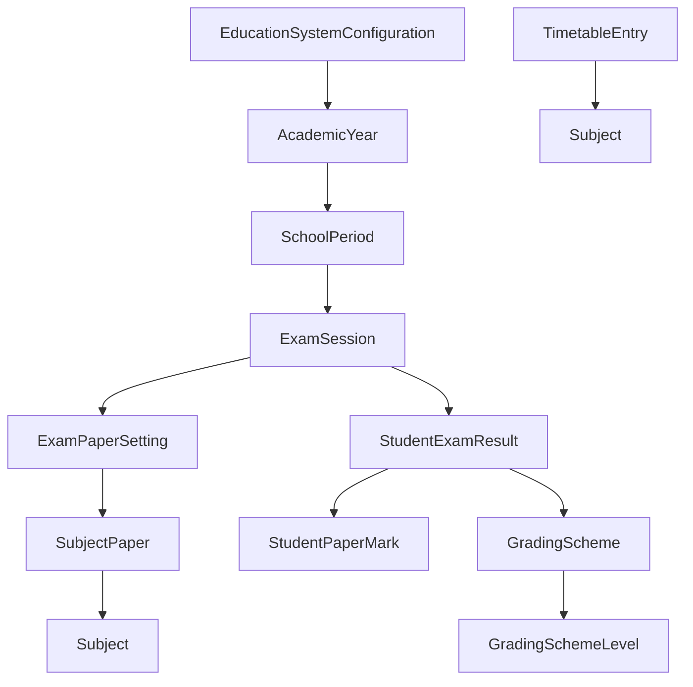
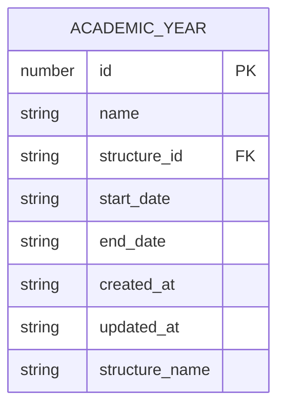
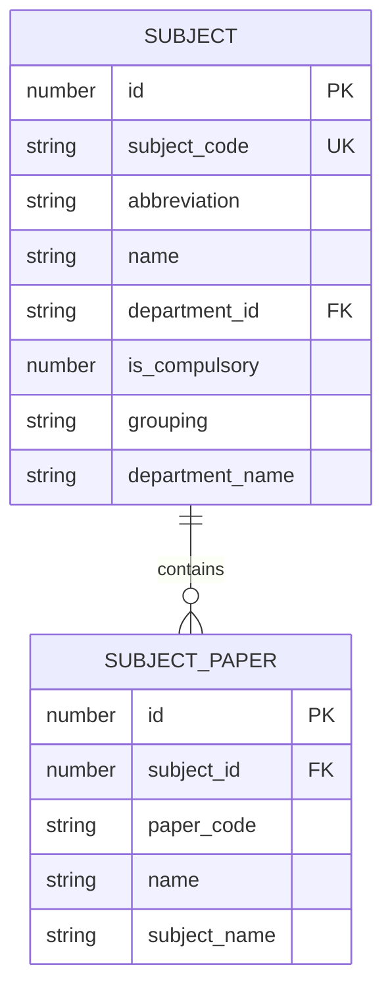
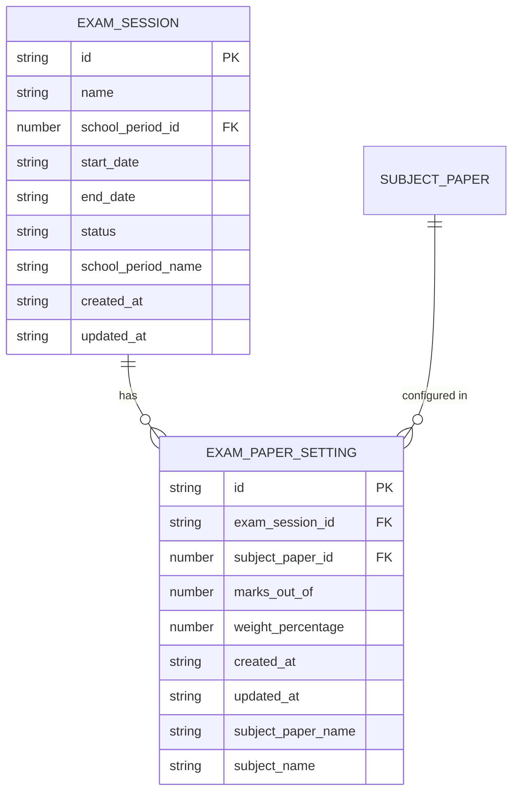
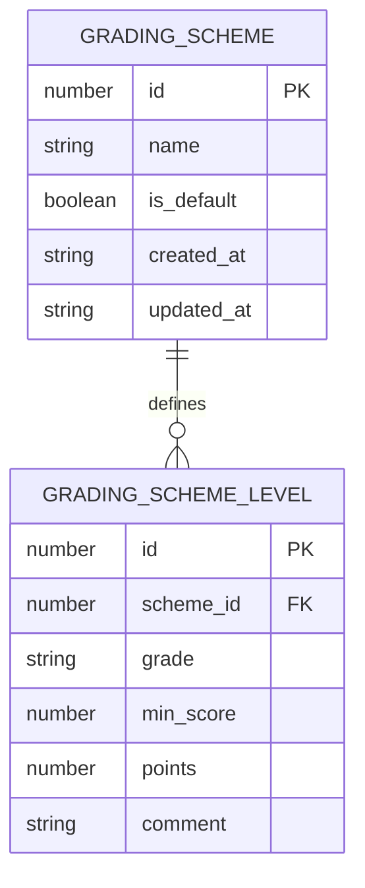
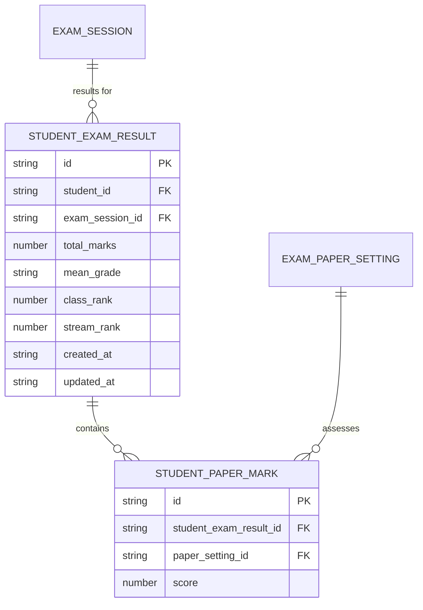
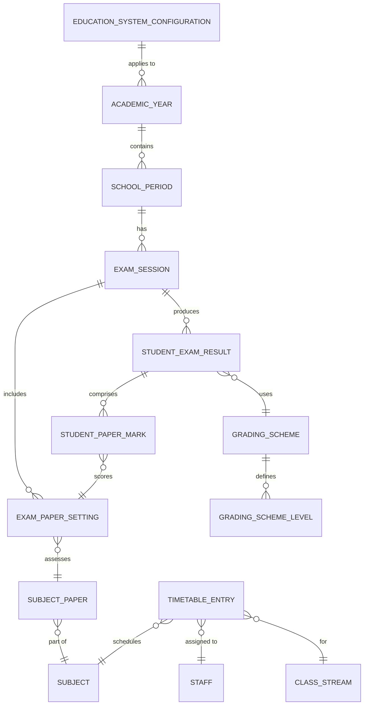

# Academics Schema Design

<cite>
**Referenced Files in This Document**   
- [schema.ts](file://src/livestore/schema.ts#L31-L381)
- [types.ts](file://src/modules/academics/data/types.ts#L130-L311)
- [types.ts](file://src/core/types.ts#L373-L383)
</cite>

## Table of Contents
1. [Introduction](#introduction)
2. [Core Collections Overview](#core-collections-overview)
3. [Academic Year Schema](#academic-year-schema)
4. [Education System Configuration](#education-system-configuration)
5. [Subject and Subject Paper Schema](#subject-and-subject-paper-schema)
6. [Exam Session and Paper Setting Schema](#exam-session-and-paper-setting-schema)
7. [Grading Scheme and Levels](#grading-scheme-and-levels)
8. [Student Exam Results and Marks](#student-exam-results-and-marks)
9. [Timetable Entry Structure](#timetable-entry-structure)
10. [Entity Relationship Diagram](#entity-relationship-diagram)
11. [Sample Data Instances](#sample-data-instances)
12. [Schema Organization Pattern](#schema-organization-pattern)

## Introduction
This document provides comprehensive data model documentation for the Academics module's schema design in schoolpilot3. The schema is designed to support comprehensive academic management including curriculum, timetabling, examination, and grading systems. The data model follows a structured approach using RxDB collection definitions and TypeScript interfaces to ensure type safety and data integrity. The collections are organized to support academic calendar management, subject allocation, exam scheduling, and result processing.

## Core Collections Overview
The Academics module comprises several interconnected collections that work together to manage academic operations. These collections include AcademicYear, EducationSystem, Subject, ExamSession, GradingScheme, StudentExamResult, and TimetableEntry. The schema is implemented using RxDB collections with SQLite backend storage, providing offline-first capabilities and real-time synchronization.



**Diagram sources**
- [schema.ts](file://src/livestore/schema.ts#L31-L381)
- [types.ts](file://src/modules/academics/data/types.ts#L130-L311)

**Section sources**
- [schema.ts](file://src/livestore/schema.ts#L31-L381)
- [types.ts](file://src/modules/academics/data/types.ts#L130-L311)

## Academic Year Schema
The AcademicYear collection represents academic years within the school system. Each academic year has a defined start and end date, and is associated with a specific academic structure.

### Field Specifications
- **id**: number - Primary key identifier
- **name**: string - Academic year name (e.g., "2023/2024")
- **structure_id**: string - Reference to academic structure
- **start_date**: string - Start date of academic year (ISO format)
- **end_date**: string - End date of academic year (ISO format)
- **created_at**: string - Creation timestamp
- **updated_at**: string - Last update timestamp
- **structure_name**: string | null - Denormalized academic structure name



**Diagram sources**
- [schema.ts](file://src/livestore/schema.ts#L31-L381)
- [types.ts](file://src/core/types.ts#L373-L383)

**Section sources**
- [schema.ts](file://src/livestore/schema.ts#L31-L381)
- [types.ts](file://src/core/types.ts#L373-L383)

## Education System Configuration
The EducationSystemConfiguration interface defines the structure for education system configurations, allowing the system to support different educational frameworks and grading systems.

### Configuration Properties
- **id**: string - Unique identifier
- **name**: string - Name of the education system
- **country_code**: string - ISO country code
- **system_type**: enums.EducationSystemType - Type of education system
- **grading_system_type**: enums.GradingSystemType - Grading system used
- **min_grade_level**: number - Minimum grade level
- **max_grade_level**: number - Maximum grade level
- **academic_period_type**: enums.AcademicPeriodType - Term/semester structure
- **periods_per_year**: number - Number of academic periods per year
- **passing_grade**: number - Minimum grade for passing
- **max_grade_value**: number - Maximum possible grade value
- **grade_precision**: number - Decimal places for grade precision
- **assessment_types**: enums.AssessmentType[] - Supported assessment types
- **continuous_assessment_weight**: number - Weight of continuous assessment
- **final_exam_weight**: number - Weight of final examination
- **uses_competency_tracking**: boolean - Whether competency tracking is used
- **competency_levels**: string[] - Competency level definitions
- **uses_credit_hours**: boolean - Whether credit hours are used
- **min_credits_per_course**: number - Minimum credits per course
- **max_credits_per_course**: number - Maximum credits per course
- **min_credits_for_graduation**: number - Minimum credits for graduation
- **allows_grade_modification**: boolean - Whether grades can be modified
- **requires_external_moderation**: boolean - Whether external moderation is required
- **supports_remedial_exams**: boolean - Whether remedial exams are supported

**Section sources**
- [types.ts](file://src/modules/academics/data/types.ts#L273-L311)

## Subject and Subject Paper Schema
The Subject collection represents academic subjects offered by the institution, while SubjectPaper represents specific papers or components within a subject.

### Subject Collection
- **id**: number - Primary key identifier
- **subject_code**: string - Unique subject code
- **abbreviation**: string - Subject abbreviation
- **name**: string - Full subject name
- **department_id**: string - Reference to department
- **is_compulsory**: number - Whether subject is compulsory (0 or 1)
- **grouping**: string - Subject grouping/category
- **department_name**: string - Denormalized department name

### Subject Paper Collection
- **id**: number - Primary key identifier
- **subject_id**: number - Reference to subject
- **paper_code**: string - Unique paper code
- **name**: string - Paper name
- **subject_name**: string - Denormalized subject name



**Diagram sources**
- [schema.ts](file://src/livestore/schema.ts#L31-L381)

**Section sources**
- [schema.ts](file://src/livestore/schema.ts#L31-L381)

## Exam Session and Paper Setting Schema
The ExamSession collection represents examination sessions, while ExamPaperSetting defines the configuration for specific subject papers within an exam session.

### Exam Session Collection
- **id**: string - Primary key identifier
- **name**: string - Exam session name
- **school_period_id**: number - Reference to school period
- **start_date**: string - Session start date
- **end_date**: string - Session end date
- **status**: string - Current status of the session
- **school_period_name**: string - Denormalized school period name
- **created_at**: string - Creation timestamp
- **updated_at**: string - Last update timestamp

### Exam Paper Setting Collection
- **id**: string - Primary key identifier
- **exam_session_id**: string - Reference to exam session
- **subject_paper_id**: number - Reference to subject paper
- **marks_out_of**: number - Maximum marks for the paper
- **weight_percentage**: number - Weight of paper in overall subject grade
- **created_at**: string - Creation timestamp
- **updated_at**: string - Last update timestamp
- **subject_paper_name**: string | null - Denormalized subject paper name
- **subject_name**: string | null - Denormalized subject name



**Diagram sources**
- [schema.ts](file://src/livestore/schema.ts#L31-L381)
- [types.ts](file://src/core/types.ts#L924-L935)

**Section sources**
- [schema.ts](file://src/livestore/schema.ts#L31-L381)
- [types.ts](file://src/core/types.ts#L924-L935)

## Grading Scheme and Levels
The GradingScheme collection defines grading systems used in the institution, with associated GradingSchemeLevel records that specify grade boundaries and descriptions.

### Grading Scheme Collection
- **id**: number - Primary key identifier
- **name**: string - Name of the grading scheme
- **is_default**: boolean - Whether this is the default scheme
- **created_at**: string - Creation timestamp
- **updated_at**: string - Last update timestamp
- **levels**: GradingSchemeLevel[] - Associated grading levels

### Grading Scheme Level Collection
- **id**: number - Primary key identifier
- **scheme_id**: number - Reference to grading scheme
- **grade**: string - Grade letter/label (e.g., "A", "B+")
- **min_score**: number - Minimum score for this grade
- **points**: number | null - Grade points (for GPA calculation)
- **comment**: string | null - Descriptive comment for the grade



**Diagram sources**
- [types.ts](file://src/modules/academics/data/types.ts#L130-L137)
- [types.ts](file://src/modules/academics/data/types.ts#L139-L146)

**Section sources**
- [types.ts](file://src/modules/academics/data/types.ts#L130-L146)

## Student Exam Results and Marks
The StudentExamResult collection stores overall results for students in exam sessions, with detailed marks stored in the StudentPaperMark collection.

### Student Exam Result Collection
- **id**: string - Primary key identifier
- **student_id**: string - Reference to student
- **exam_session_id**: string - Reference to exam session
- **total_marks**: number | null - Total marks obtained
- **mean_grade**: string | null - Mean grade achieved
- **class_rank**: number | null - Class ranking
- **stream_rank**: number | null - Stream ranking
- **created_at**: string - Creation timestamp
- **updated_at**: string - Last update timestamp
- **marks**: StudentPaperMark[] - Detailed paper marks

### Student Paper Mark Collection
- **id**: string - Primary key identifier
- **student_exam_result_id**: string - Reference to student exam result
- **paper_setting_id**: string - Reference to exam paper setting
- **score**: number | null - Score obtained in the paper



**Diagram sources**
- [types.ts](file://src/modules/academics/data/types.ts#L171-L176)
- [types.ts](file://src/modules/academics/data/types.ts#L178-L189)

**Section sources**
- [types.ts](file://src/modules/academics/data/types.ts#L171-L189)

## Timetable Entry Structure
The TimetableEntry collection represents scheduled classes in the academic timetable, linking subjects, teachers, classes, and time periods.

### Timetable Entry Collection
Based on the project structure and schema analysis, the TimetableEntry collection would include:
- **id**: number - Primary key identifier
- **subject_id**: number - Reference to subject
- **teacher_id**: string - Reference to teaching staff
- **class_stream_id**: number - Reference to class stream
- **period_id**: number - Reference to timetable period
- **day_of_week**: number - Day of week (1-7)
- **start_time**: string - Start time of class
- **end_time**: string - End time of class
- **room**: string - Classroom location
- **created_at**: string - Creation timestamp
- **updated_at**: string - Last update timestamp

The TimetableEntry collection facilitates the scheduling of classes, ensuring proper allocation of subjects, teachers, and classrooms across the academic week.

**Section sources**
- [schema.ts](file://src/livestore/schema.ts#L31-L381)

## Entity Relationship Diagram
The following diagram illustrates the complete entity relationships within the Academics module, showing how timetabling, subject allocation, and exam scheduling are interconnected.



**Diagram sources**
- [schema.ts](file://src/livestore/schema.ts#L31-L381)
- [types.ts](file://src/modules/academics/data/types.ts#L130-L311)
- [types.ts](file://src/core/types.ts#L373-L383)

## Sample Data Instances
This section provides sample JSON instances for complex entities in the Academics module.

### Grading Scheme with Nested Levels
```json
{
  "id": 1,
  "name": "Standard Grading System",
  "is_default": true,
  "created_at": "2023-01-15T10:30:00Z",
  "updated_at": "2023-01-15T10:30:00Z",
  "levels": [
    {
      "id": 1,
      "scheme_id": 1,
      "grade": "A",
      "min_score": 80,
      "points": 5,
      "comment": "Excellent performance"
    },
    {
      "id": 2,
      "scheme_id": 1,
      "grade": "B",
      "min_score": 70,
      "points": 4,
      "comment": "Very good performance"
    },
    {
      "id": 3,
      "scheme_id": 1,
      "grade": "C",
      "min_score": 60,
      "points": 3,
      "comment": "Good performance"
    },
    {
      "id": 4,
      "scheme_id": 1,
      "grade": "D",
      "min_score": 50,
      "points": 2,
      "comment": "Satisfactory performance"
    },
    {
      "id": 5,
      "scheme_id": 1,
      "grade": "E",
      "min_score": 40,
      "points": 1,
      "comment": "Needs improvement"
    },
    {
      "id": 6,
      "scheme_id": 1,
      "grade": "F",
      "min_score": 0,
      "points": 0,
      "comment": "Fail"
    }
  ]
}
```

### Subject Paper with Assessment Components
```json
{
  "id": 101,
  "subject_id": 25,
  "paper_code": "MATH-ALG-001",
  "name": "Algebra and Functions",
  "subject_name": "Mathematics",
  "assessment_components": [
    {
      "component_type": "Continuous Assessment",
      "weight_percentage": 30,
      "assessment_types": ["Quiz", "Assignment", "Class Participation"]
    },
    {
      "component_type": "Midterm Exam",
      "weight_percentage": 20,
      "assessment_types": ["Written Exam"]
    },
    {
      "component_type": "Final Exam",
      "weight_percentage": 50,
      "assessment_types": ["Written Exam", "Practical"]
    }
  ],
  "passing_threshold": 40,
  "grading_scale": "Percentage",
  "resultStatus": "Active"
}
```

**Section sources**
- [types.ts](file://src/modules/academics/data/types.ts#L130-L146)

## Schema Organization Pattern
The Academics module schema follows a consistent organization pattern using RxDB collection definitions and TypeScript interfaces. The schema is defined in the livestore/schema.ts file, which exports a schema object containing all collection definitions.

### Key Design Patterns
1. **Type Safety**: All collections use TypeScript interfaces to ensure type safety
2. **Denormalization**: Frequently accessed related data is denormalized to improve query performance
3. **Timestamps**: All collections include created_at and updated_at fields for audit tracking
4. **Foreign Key Relationships**: Collections are linked through foreign key references
5. **SQLite Backend**: The schema uses SQLite as the underlying storage engine

### TypeScript Interface Pattern
The schema uses TypeScript interfaces to define the structure of each collection. For example:
```typescript
export interface AcademicYear {
  id: number;
  name: string;
  structure_id: string;
  start_date: string;
  end_date: string;
  created_at: string;
  updated_at: string;
  structure_name?: string | null;
}
```

### RxDB Collection Definition
Collections are defined using the State.SQLite.table method:
```typescript
academicYears: State.SQLite.table<AcademicYear>({
  name: 'academic_years',
  columns: {
    id: 'INTEGER PRIMARY KEY',
    name: 'TEXT NOT NULL',
    structure_id: 'TEXT NOT NULL',
    start_date: 'TEXT NOT NULL',
    end_date: 'TEXT NOT NULL',
    structure_name: 'TEXT',
    created_at: 'TEXT NOT NULL',
    updated_at: 'TEXT NOT NULL'
  }
})
```

This pattern ensures consistency across collections and provides a clear contract for data access and manipulation.

**Section sources**
- [schema.ts](file://src/livestore/schema.ts#L31-L381)
- [types.ts](file://src/core/types.ts#L373-L383)