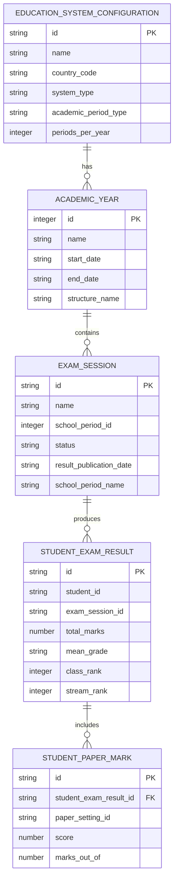
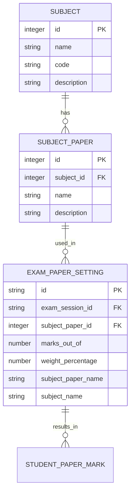
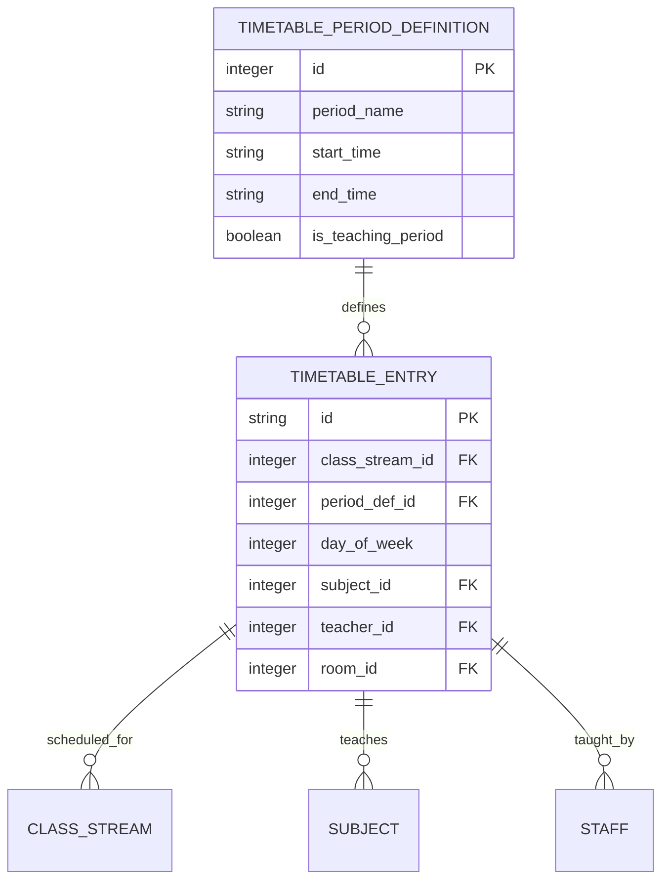
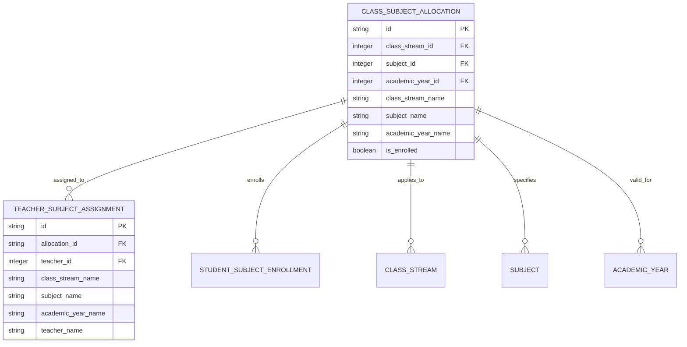

# Data Relationships and Hierarchy

<cite>
**Referenced Files in This Document**   
- [schema.ts](file://src/modules/academics/data/schema.ts)
- [types.ts](file://src/modules/academics/data/types.ts)
- [useTimetablePeriodDefData.ts](file://src/modules/academics/data/useTimetablePeriodDefData.ts)
- [TimetablePeriodsPage.tsx](file://src/modules/academics/pages/TimetablePeriodsPage.tsx)
- [TeacherSubjectAssignmentPage.tsx](file://src/modules/academics/pages/TeacherSubjectAssignmentPage.tsx)
- [core/types.ts](file://src/core/types.ts)
</cite>

## Table of Contents
1. [Hierarchical Data Model Overview](#hierarchical-data-model-overview)
2. [Education System to Exam Result Hierarchy](#education-system-to-exam-result-hierarchy)
3. [Subject to Exam Paper Setting Hierarchy](#subject-to-exam-paper-setting-hierarchy)
4. [Timetabling Entities Relationship](#timetabling-entities-relationship)
5. [Subject Allocation Structure](#subject-allocation-structure)
6. [Complex Query Examples](#complex-query-examples)
7. [Performance Considerations](#performance-considerations)

## Hierarchical Data Model Overview

The academic data model follows a strict hierarchical structure that organizes educational data from the highest level (Education System) down to individual student results. This hierarchy ensures data integrity, enables efficient querying, and supports cascading operations across related entities.

The model is divided into two primary hierarchies:
- **Assessment Hierarchy**: EducationSystem → AcademicYear → ExamSession → StudentExamResult
- **Curriculum Hierarchy**: Subject → SubjectPaper → ExamPaperSetting

Additionally, timetabling and subject allocation entities provide the infrastructure for organizing teaching and learning activities.

## Education System to Exam Result Hierarchy

### Parent-Child Relationships

The assessment hierarchy establishes a clear parent-child relationship from the education system level down to individual student results:



**Diagram sources**
- [schema.ts](file://src/modules/academics/data/schema.ts#L117-L198)
- [types.ts](file://src/modules/academics/data/types.ts#L160-L189)

**Section sources**
- [schema.ts](file://src/modules/academics/data/schema.ts#L117-L198)
- [types.ts](file://src/modules/academics/data/types.ts#L160-L189)

### Foreign Key References

The hierarchy is maintained through foreign key relationships:

- **EducationSystemConfiguration → AcademicYear**: The education system configuration serves as the root entity, defining the rules and structure for all academic years within that system.
- **AcademicYear → ExamSession**: Each academic year contains multiple exam sessions, linked through the school_period_id field in the exam_session table.
- **ExamSession → StudentExamResult**: Each exam session produces multiple student results, with the exam_session_id serving as the foreign key.
- **StudentExamResult → StudentPaperMark**: Each student result contains multiple paper marks, with the student_exam_result_id as the foreign key.

### Cascading Behaviors

The system implements specific cascading behaviors to maintain data integrity:

- **Delete Cascade**: When an ExamSession is deleted, all associated StudentExamResult records are automatically removed.
- **Update Cascade**: Changes to the education system configuration (such as grading policies) propagate to all related academic years and exam sessions.
- **Restricted Delete**: An EducationSystemConfiguration cannot be deleted if it has associated AcademicYear records.

## Subject to Exam Paper Setting Hierarchy

### Curriculum Structure Relationships

The curriculum hierarchy organizes subjects and their assessments:



**Diagram sources**
- [schema.ts](file://src/modules/academics/data/schema.ts#L90-L120)
- [types.ts](file://src/core/types.ts#L924-L935)

**Section sources**
- [schema.ts](file://src/modules/academics/data/schema.ts#L90-L120)
- [types.ts](file://src/core/types.ts#L924-L935)

### Foreign Key References

Key foreign key relationships in the curriculum hierarchy:

- **Subject → SubjectPaper**: Each subject can have multiple papers (e.g., Paper 1, Paper 2), linked by subject_id.
- **SubjectPaper → ExamPaperSetting**: Each subject paper is used in specific exam sessions, with subject_paper_id as the foreign key.
- **ExamPaperSetting → StudentPaperMark**: The exam paper setting defines the parameters for student paper marks.

### Data Access Patterns

Common data access patterns for the curriculum hierarchy:

- **Subject-Centric Access**: Retrieve all papers for a specific subject.
- **Exam-Centric Access**: Retrieve all paper settings for a specific exam session.
- **Result-Centric Access**: Retrieve all student paper marks for a specific subject paper.

## Timetabling Entities Relationship

### Timetable Structure

The timetabling system organizes teaching periods and class schedules:



**Diagram sources**
- [schema.ts](file://src/modules/academics/data/schema.ts#L251-L287)
- [useTimetablePeriodDefData.ts](file://src/modules/academics/data/useTimetablePeriodDefData.ts#L0-L39)

**Section sources**
- [schema.ts](file://src/modules/academics/data/schema.ts#L251-L287)
- [useTimetablePeriodDefData.ts](file://src/modules/academics/data/useTimetablePeriodDefData.ts#L0-L39)

### Key Relationships

- **TimetablePeriodDefinition → TimetableEntry**: Period definitions (e.g., "Lesson 1", "Break") define the structure, while timetable entries schedule specific classes.
- **TimetableEntry → ClassStream**: Each timetable entry is associated with a specific class stream.
- **TimetableEntry → Subject**: Each entry specifies which subject is taught during that period.
- **TimetableEntry → Staff**: Each entry identifies the teacher assigned to teach the class.

## Subject Allocation Structure

### Class-Subject Allocation Hierarchy

The subject allocation system connects classes, subjects, and teachers:



**Diagram sources**
- [schema.ts](file://src/modules/academics/data/schema.ts#L216-L251)
- [TeacherSubjectAssignmentPage.tsx](file://src/modules/academics/pages/TeacherSubjectAssignmentPage.tsx#L29-L160)

**Section sources**
- [schema.ts](file://src/modules/academics/data/schema.ts#L216-L251)
- [TeacherSubjectAssignmentPage.tsx](file://src/modules/academics/pages/TeacherSubjectAssignmentPage.tsx#L29-L160)

### Allocation Relationships

- **ClassSubjectAllocation → TeacherSubjectAssignment**: Each class-subject allocation can have one or more teachers assigned to teach it.
- **ClassSubjectAllocation → StudentSubjectEnrollment**: Students enroll in specific class-subject allocations.
- **ClassSubjectAllocation → ClassStream**: The allocation applies to a specific class stream (e.g., Grade 10A).
- **ClassSubjectAllocation → Subject**: The allocation specifies which subject is taught.
- **ClassSubjectAllocation → AcademicYear**: The allocation is valid for a specific academic year.

## Complex Query Examples

### Multi-Level Traversal Queries

**Query 1: Retrieve all student results for a specific education system with subject breakdown**

```sql
SELECT 
    es.name as education_system,
    ay.name as academic_year,
    ex.name as exam_session,
    s.student_name,
    ser.total_marks,
    ser.mean_grade,
    spm.subject_name,
    spm.subject_paper_name,
    spm.score,
    spm.marks_out_of
FROM education_system_configurations es
JOIN exam_sessions ex ON es.id = ex.education_system_id
JOIN academic_years ay ON ex.school_period_id = ay.id
JOIN student_exam_results ser ON ex.id = ser.exam_session_id
JOIN students s ON ser.student_id = s.id
JOIN student_paper_marks spm ON ser.id = spm.student_exam_result_id
WHERE es.id = 'system_001'
    AND ay.id = 2023
ORDER BY s.student_name, spm.subject_name;
```

**Query 2: Find all teachers teaching Mathematics in Grade 10 for Academic Year 2023**

```sql
SELECT 
    t.teacher_name,
    cs.class_stream_name,
    sub.name as subject_name,
    ay.name as academic_year,
    tt.period_name,
    tt.day_of_week,
    tt.start_time,
    tt.end_time
FROM teacher_subject_assignments tsa
JOIN class_subject_allocations csa ON tsa.allocation_id = csa.id
JOIN class_streams cs ON csa.class_stream_id = cs.id
JOIN subjects sub ON csa.subject_id = sub.id
JOIN academic_years ay ON csa.academic_year_id = ay.id
JOIN staff t ON tsa.teacher_id = t.id
JOIN timetable_entries te ON cs.id = te.class_stream_id 
    AND sub.id = te.subject_id
JOIN timetable_period_definitions tt ON te.period_def_id = tt.id
WHERE sub.name = 'Mathematics'
    AND cs.grade_level = 10
    AND ay.name = '2023'
ORDER BY t.teacher_name, tt.day_of_week, tt.start_time;
```

**Query 3: Generate exam paper settings report with weighting and marks distribution**

```sql
SELECT 
    ex.name as exam_session,
    sub.name as subject,
    sp.name as paper,
    eps.marks_out_of,
    eps.weight_percentage,
    SUM(eps.marks_out_of * eps.weight_percentage / 100) 
        OVER (PARTITION BY ex.id, sub.id) as total_weighted_marks,
    COUNT(*) OVER (PARTITION BY ex.id, sub.id) as papers_per_subject
FROM exam_paper_settings eps
JOIN exam_sessions ex ON eps.exam_session_id = ex.id
JOIN subject_papers sp ON eps.subject_paper_id = sp.id
JOIN subjects sub ON sp.subject_id = sub.id
WHERE ex.status = 'ACTIVE'
ORDER BY ex.name, sub.name, sp.name;
```

## Performance Considerations

### Deeply Nested Data Retrieval Challenges

Retrieving data from deeply nested hierarchies presents several performance challenges:

- **N+1 Query Problem**: Naive implementations can result in multiple database queries when traversing relationships.
- **Large Result Sets**: Joining multiple levels of the hierarchy can produce very large result sets.
- **Indexing Requirements**: Proper indexing is critical for performance on foreign key fields.

### Efficient Data Loading Strategies

**Strategy 1: Batch Loading with Indexing**

```javascript
// Example implementation pattern
async function getStudentResultsWithDetails(studentId, examSessionId) {
    // 1. Load primary result with indexes
    const studentResult = await db.student_exam_results
        .find({ selector: { student_id: studentId, exam_session_id: examSessionId } });
    
    // 2. Batch load paper marks using result ID
    const paperMarks = await db.student_paper_marks
        .find({ selector: { student_exam_result_id: studentResult.id } });
    
    // 3. Load exam session details (cached or indexed)
    const examSession = await db.exam_sessions.findById(examSessionId);
    
    // 4. Combine results
    return {
        ...studentResult,
        marks: paperMarks,
        exam_session: examSession
    };
}
```

**Strategy 2: Denormalization for Read Performance**

The schema includes denormalized fields to reduce join operations:

- **Computed Fields**: Fields like `subject_name`, `class_stream_name`, and `academic_year_name` are stored in multiple tables to avoid joins.
- **Index Optimization**: Critical foreign key fields are indexed (e.g., `exam_session_id`, `student_id`, `class_stream_id`).

**Strategy 3: Caching Hierarchy**

Implement a caching strategy that respects the data hierarchy:

- **Level 1 Cache**: Frequently accessed reference data (subjects, periods)
- **Level 2 Cache**: Academic year and exam session configurations
- **Level 3 Cache**: Student results and paper marks

**Strategy 4: Pagination and Filtering**

For large datasets, implement:

- **Server-side pagination** for result sets
- **Filtering at the database level** rather than in application code
- **Selective field retrieval** to minimize data transfer

These strategies ensure that even complex queries across multiple hierarchy levels perform efficiently while maintaining data consistency and integrity.