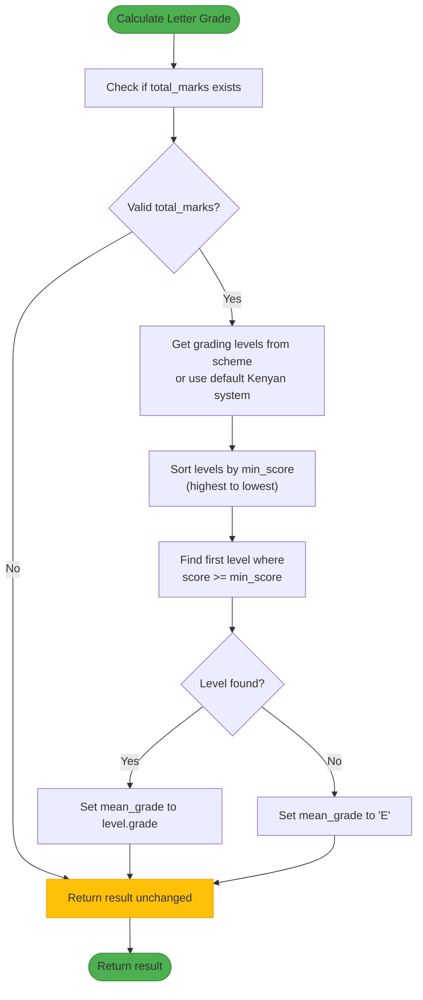
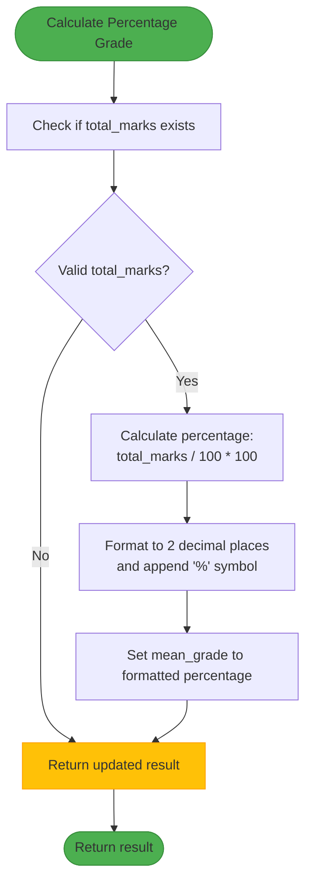
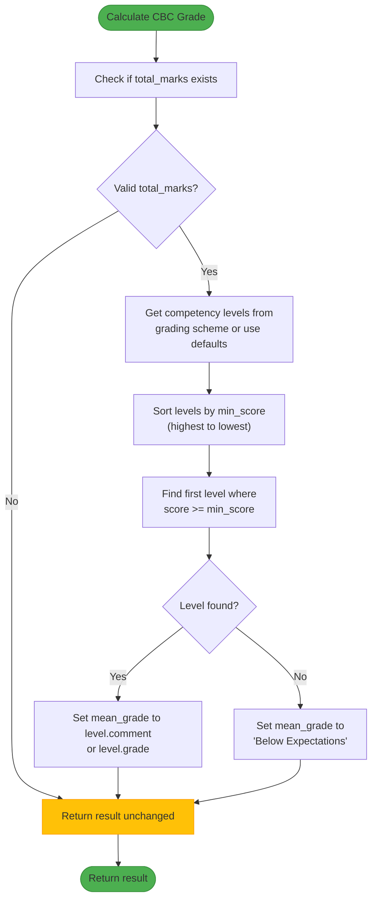
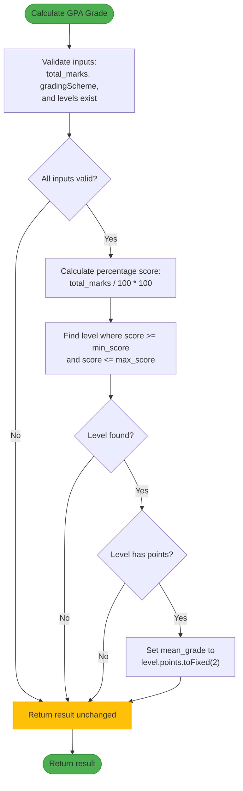
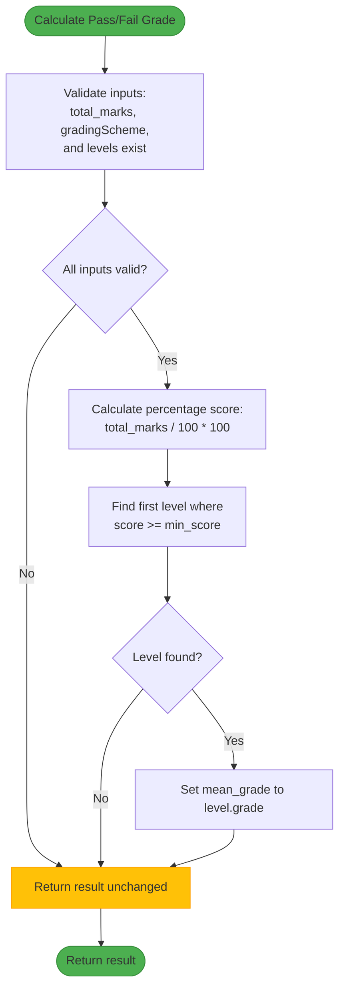
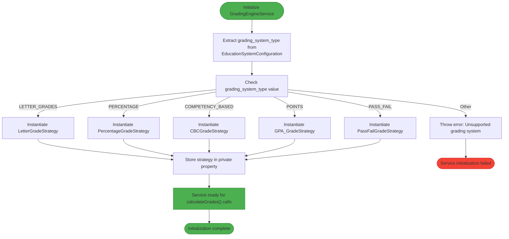
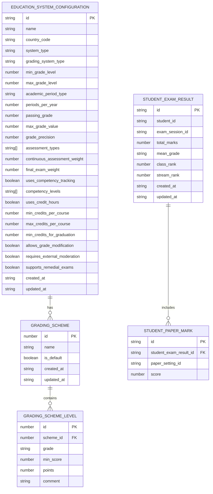
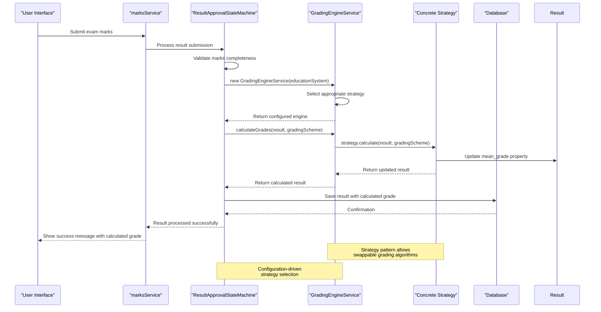

# Grading Strategy Implementation

<cite>
**Referenced Files in This Document**   
- [GradingEngineService.ts](file://src/modules/academics/services/GradingEngineService.ts)
- [LetterGradeStrategy.ts](file://src/modules/academics/strategies/LetterGradeStrategy.ts)
- [PercentageGradeStrategy.ts](file://src/modules/academics/strategies/PercentageGradeStrategy.ts)
- [CBCGradeStrategy.ts](file://src/modules/academics/strategies/CBCGradeStrategy.ts)
- [GPA_GradeStrategy.ts](file://src/modules/academics/strategies/GPA_GradeStrategy.ts)
- [PassFailGradeStrategy.ts](file://src/modules/academics/strategies/PassFailGradeStrategy.ts)
- [types.ts](file://src/modules/academics/data/types.ts)
- [enums.ts](file://src/modules/academics/data/enums.ts)
- [ResultApprovalStateMachine.ts](file://src/modules/academics/services/ResultApprovalStateMachine.ts)
</cite>

## Table of Contents
1. [Introduction](#introduction)
2. [Grading Strategy Interface](#grading-strategy-interface)
3. [Grading Engine Service](#grading-engine-service)
4. [Individual Grading Strategies](#individual-grading-strategies)
   - [Letter Grade Strategy](#letter-grade-strategy)
   - [Percentage Grade Strategy](#percentage-grade-strategy)
   - [CBC Grade Strategy](#cbc-grade-strategy)
   - [GPA Grade Strategy](#gpa-grade-strategy)
   - [Pass/Fail Grade Strategy](#passfail-grade-strategy)
5. [Strategy Selection Mechanism](#strategy-selection-mechanism)
6. [Data Structures](#data-structures)
7. [Integration Points](#integration-points)
8. [Common Issues and Solutions](#common-issues-and-solutions)

## Introduction
The polymorphic grading strategy pattern in the Academics module implements a flexible system for calculating student grades using different grading methodologies. This document details the implementation of various grading strategies including CBC, GPA, Letter, Pass/Fail, and Percentage systems. The architecture follows the Strategy design pattern, allowing the system to dynamically select and apply the appropriate grading algorithm based on the configured education system. The GradingEngineService orchestrates these strategies, providing a unified interface for grade calculation across different educational frameworks.

## Grading Strategy Interface
The grading system is built around a common interface that ensures all grading strategies follow the same contract. This interface defines the method signature that all concrete strategy implementations must adhere to, enabling polymorphic behavior.

```mermaid
classDiagram
class GradingStrategy {
<<interface>>
+calculate(result : StudentExamResult, gradingScheme? : GradingScheme) : StudentExamResult
}
class LetterGradeStrategy {
+calculate(result : StudentExamResult, gradingScheme? : GradingScheme) : StudentExamResult
+calculateWithModifiers(score : number) : string
+getGradePoints(grade : string) : number
+isPassing(grade : string) : boolean
}
class PercentageGradeStrategy {
+calculate(result : StudentExamResult) : StudentExamResult
}
class CBCGradeStrategy {
+calculate(result : StudentExamResult, gradingScheme? : GradingScheme) : StudentExamResult
+calculateWeighted(continuousMarks : number, finalMarks : number, continuousWeight : number, finalWeight : number) : number
+getCompetencyDescription(score : number) : string
}
class GPA_GradeStrategy {
+calculate(result : StudentExamResult, gradingScheme : GradingScheme) : StudentExamResult
}
class PassFailGradeStrategy {
+calculate(result : StudentExamResult, gradingScheme : GradingScheme) : StudentExamResult
}
GradingStrategy <|-- LetterGradeStrategy
GradingStrategy <|-- PercentageGradeStrategy
GradingStrategy <|-- CBCGradeStrategy
GradingStrategy <|-- GPA_GradeStrategy
GradingStrategy <|-- PassFailGradeStrategy
```



**Diagram sources**
- [GradingEngineService.ts](file://src/modules/academics/services/GradingEngineService.ts#L15-L17)
- [LetterGradeStrategy.ts](file://src/modules/academics/strategies/LetterGradeStrategy.ts#L5-L7)
- [PercentageGradeStrategy.ts](file://src/modules/academics/strategies/PercentageGradeStrategy.ts#L5-L7)
- [CBCGradeStrategy.ts](file://src/modules/academics/strategies/CBCGradeStrategy.ts#L5-L7)
- [GPA_GradeStrategy.ts](file://src/modules/academics/strategies/GPA_GradeStrategy.ts#L5-L7)
- [PassFailGradeStrategy.ts](file://src/modules/academics/strategies/PassFailGradeStrategy.ts#L5-L7)

**Section sources**
- [GradingEngineService.ts](file://src/modules/academics/services/GradingEngineService.ts#L15-L17)

## Grading Engine Service
The GradingEngineService acts as the context in the Strategy pattern, responsible for selecting and executing the appropriate grading strategy based on the education system configuration. It provides a consistent API for grade calculation regardless of the underlying grading methodology.

```mermaid
sequenceDiagram
participant Client as "Client Application"
participant Engine as "GradingEngineService"
participant Strategy as "Concrete Strategy"
participant Result as "StudentExamResult"
Client->>Engine : new GradingEngineService(educationSystem)
Engine->>Engine : Determine strategy type from educationSystem
alt Letter Grades
Engine->>Strategy : Initialize LetterGradeStrategy()
elif Percentage
Engine->>Strategy : Initialize PercentageGradeStrategy()
elif Competency Based
Engine->>Strategy : Initialize CBCGradeStrategy()
elif Points/GPA
Engine->>Strategy : Initialize GPA_GradeStrategy()
elif Pass/Fail
Engine->>Strategy : Initialize PassFailGradeStrategy()
else
Engine->>Client : Throw Unsupported Grading System Error
end
Client->>Engine : calculateGrades(result, gradingScheme)
Engine->>Strategy : strategy.calculate(result, gradingScheme)
Strategy->>Result : Update mean_grade property
Strategy->>Engine : Return updated result
Engine->>Client : Return calculated result
Note over Engine,Strategy : Strategy pattern implementation<br/>allows interchangeable algorithms
```

**Diagram sources**
- [GradingEngineService.ts](file://src/modules/academics/services/GradingEngineService.ts#L13-L41)

**Section sources**
- [GradingEngineService.ts](file://src/modules/academics/services/GradingEngineService.ts#L13-L41)

## Individual Grading Strategies
This section details each of the five grading strategies implemented in the system, including their algorithms, parameters, and specific behaviors.

### Letter Grade Strategy
The LetterGradeStrategy converts numerical scores into letter grades (A, B, C, etc.) based on predefined score ranges. It supports both configured grading schemes and a default Kenyan letter grade system.



The strategy also provides utility methods for calculating grades with plus/minus modifiers, converting letter grades to grade points for GPA calculation, and determining if a grade is passing.

**Diagram sources**
- [LetterGradeStrategy.ts](file://src/modules/academics/strategies/LetterGradeStrategy.ts#L9-L45)

**Section sources**
- [LetterGradeStrategy.ts](file://src/modules/academics/strategies/LetterGradeStrategy.ts#L9-L45)

### Percentage Grade Strategy
The PercentageGradeStrategy formats the numerical score as a percentage value. This is the simplest strategy, directly converting the total marks to a percentage representation.



This strategy does not require a grading scheme parameter, as it performs a direct mathematical conversion of the score.

**Diagram sources**
- [PercentageGradeStrategy.ts](file://src/modules/academics/strategies/PercentageGradeStrategy.ts#L7-L13)

**Section sources**
- [PercentageGradeStrategy.ts](file://src/modules/academics/strategies/PercentageGradeStrategy.ts#L7-L13)

### CBC Grade Strategy
The CBCGradeStrategy implements Competency-Based grading, which focuses on mastery of specific skills or competencies rather than numerical scores. It supports both configured grading schemes and a default competency level system.



The strategy includes additional methods for calculating weighted competency assessments, where continuous assessment typically carries more weight (60%) than final exams (40%), and for generating competency descriptions based on performance levels.

**Diagram sources**
- [CBCGradeStrategy.ts](file://src/modules/academics/strategies/CBCGradeStrategy.ts#L9-L45)

**Section sources**
- [CBCGradeStrategy.ts](file://src/modules/academics/strategies/CBCGradeStrategy.ts#L9-L45)

### GPA Grade Strategy
The GPA_GradeStrategy converts numerical scores into grade points on a 4.0 scale or similar system. It requires a grading scheme that defines the point values for each grade level.



The calculated GPA points are stored as a string with two decimal places in the mean_grade field of the StudentExamResult object.

**Diagram sources**
- [GPA_GradeStrategy.ts](file://src/modules/academics/strategies/GPA_GradeStrategy.ts#L9-L20)

**Section sources**
- [GPA_GradeStrategy.ts](file://src/modules/academics/strategies/GPA_GradeStrategy.ts#L9-L20)

### PassFail Grade Strategy
The PassFailGradeStrategy implements a binary grading system where students either pass or fail based on whether their score meets the minimum threshold defined in the grading scheme.



This strategy is commonly used in courses where mastery of material is required, and partial credit is not awarded.

**Diagram sources**
- [PassFailGradeStrategy.ts](file://src/modules/academics/strategies/PassFailGradeStrategy.ts#L9-L20)

**Section sources**
- [PassFailGradeStrategy.ts](file://src/modules/academics/strategies/PassFailGradeStrategy.ts#L9-L20)

## Strategy Selection Mechanism
The strategy selection mechanism is implemented in the GradingEngineService constructor, which uses the grading_system_type property from the EducationSystemConfiguration to determine which strategy to instantiate.



The selection is based on the GradingSystemType enum, which defines the five supported grading systems: Letter Grades, Percentage, Competency Based, Points/GPA, and Pass/Fail. This configuration-driven approach allows educational institutions to select the grading methodology that best fits their academic framework.

**Diagram sources**
- [GradingEngineService.ts](file://src/modules/academics/services/GradingEngineService.ts#L18-L38)
- [enums.ts](file://src/modules/academics/data/enums.ts#L42-L48)

**Section sources**
- [GradingEngineService.ts](file://src/modules/academics/services/GradingEngineService.ts#L18-L38)
- [enums.ts](file://src/modules/academics/data/enums.ts#L42-L48)

## Data Structures
The grading system relies on several key data structures that define the relationships between entities and the data flow through the system.



The StudentExamResult entity is the primary data structure used in grade calculation, containing the total_marks from assessments and the mean_grade that is populated by the grading strategies. The GradingScheme and GradingSchemeLevel entities define the grading scale used by most strategies, with levels specifying the minimum score required for each grade.

**Diagram sources**
- [types.ts](file://src/modules/academics/data/types.ts#L129-L177)
- [enums.ts](file://src/modules/academics/data/enums.ts#L42-L48)

**Section sources**
- [types.ts](file://src/modules/academics/data/types.ts#L129-L177)

## Integration Points
The grading strategies are integrated into the broader academic system through several key components, with the most important being the ResultApprovalStateMachine.



The ResultApprovalStateMachine uses the GradingEngineService during the result approval workflow to automatically calculate final grades once all marks have been entered and validated. This integration ensures that grade calculation is consistent and follows the institution's configured grading policies.

**Diagram sources**
- [ResultApprovalStateMachine.ts](file://src/modules/academics/services/ResultApprovalStateMachine.ts#L3)
- [GradingEngineService.ts](file://src/modules/academics/services/GradingEngineService.ts#L13-L41)

**Section sources**
- [ResultApprovalStateMachine.ts](file://src/modules/academics/services/ResultApprovalStateMachine.ts#L3)
- [GradingEngineService.ts](file://src/modules/academics/services/GradingEngineService.ts#L13-L41)

## Common Issues and Solutions
This section addresses common issues encountered in grade calculation and their solutions as implemented in the system.

### Rounding Rules
Different grading systems have different precision requirements. The system handles this through the grade_precision configuration in the EducationSystemConfiguration:

- **Percentage grades**: Always rounded to 2 decimal places
- **GPA points**: Displayed with exactly 2 decimal places using toFixed(2)
- **Letter grades**: No rounding needed as they are categorical
- **Pass/Fail**: Binary outcome, no rounding applicable
- **CBC grades**: May use the grade_precision setting for competency scores

### Special Case Handling
The system includes several safeguards for handling incomplete or missing data:

1. **Missing total_marks**: All strategies check for the existence of total_marks before calculation and return the result unchanged if missing
2. **Missing grading scheme**: Letter and CBC strategies provide default grading levels when no scheme is provided
3. **Empty grading levels**: Strategies validate that gradingScheme.levels exists before attempting to find matching levels
4. **Score boundaries**: The sorting of grading levels by min_score in descending order ensures that the highest applicable grade is assigned

### Configuration Validation
The system validates education system configurations to prevent runtime errors:

- The GradingEngineService throws an error if an unsupported grading_system_type is specified
- Required fields in EducationSystemConfiguration are enforced through TypeScript interfaces
- Default values are provided for optional configuration parameters

These measures ensure robust grade calculation even when dealing with incomplete data or edge cases.

**Section sources**
- [LetterGradeStrategy.ts](file://src/modules/academics/strategies/LetterGradeStrategy.ts#L11-L13)
- [CBCGradeStrategy.ts](file://src/modules/academics/strategies/CBCGradeStrategy.ts#L11-L13)
- [GPA_GradeStrategy.ts](file://src/modules/academics/strategies/GPA_GradeStrategy.ts#L11-L12)
- [PassFailGradeStrategy.ts](file://src/modules/academics/strategies/PassFailGradeStrategy.ts#L11-L12)
- [PercentageGradeStrategy.ts](file://src/modules/academics/strategies/PercentageGradeStrategy.ts#L9-L10)
- [GradingEngineService.ts](file://src/modules/academics/services/GradingEngineService.ts#L36-L38)