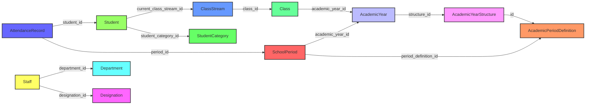
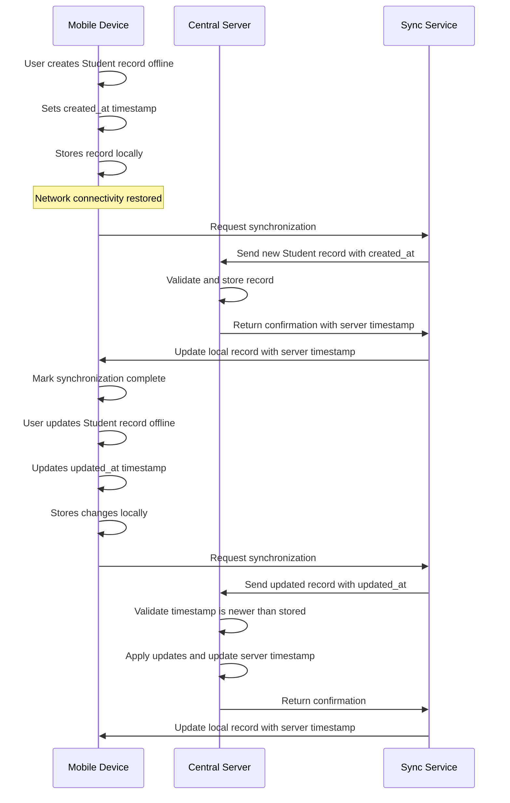

# Administration Data Model

<cite>
**Referenced Files in This Document**   
- [schema.ts](file://src/modules/administration/data/schema.ts)
- [types.ts](file://src/modules/administration/data/types.ts)
- [mockData.ts](file://src/modules/administration/data/mockData.ts)
- [rxdbService.ts](file://src/services/rxdbService.ts)
- [livestore/schema.ts](file://src/livestore/schema.ts)
- [useDepartmentData.ts](file://src/modules/administration/data/useDepartmentData.ts)
- [useDesignationData.ts](file://src/modules/administration/data/useDesignationData.ts)
- [useStudentCategoryData.ts](file://src/modules/administration/data/useStudentCategoryData.ts)
- [useStudentHealthRecordData.ts](file://src/modules/administration/data/useStudentHealthRecordData.ts)
- [useStudentAttendanceData.ts](file://src/modules/administration/data/useStudentAttendanceData.ts)
- [useAcademicYearData.ts](file://src/modules/administration/data/useAcademicYearData.ts)
- [useAcademicPeriodDefinitionData.ts](file://src/modules/administration/data/useAcademicPeriodDefinitionData.ts)
- [useSchoolPeriodData.ts](file://src/modules/administration/data/useSchoolPeriodData.ts)
- [useStaffData.ts](file://src/modules/administration/data/useStaffData.ts)
- [useClassData.ts](file://src/modules/administration/data/useClassData.ts)
</cite>

## Table of Contents
1. [Introduction](#introduction)
2. [Entity-Relationship Model](#entity-relationship-model)
3. [Core Data Collections](#core-data-collections)
4. [Hierarchical Academic Organization](#hierarchical-academic-organization)
5. [Data Integrity Constraints](#data-integrity-constraints)
6. [Synchronization Metadata Patterns](#synchronization-metadata-patterns)
7. [Sample Data Instances](#sample-data-instances)
8. [Conclusion](#conclusion)

## Introduction
The Administration module in schoolpilot3 provides a comprehensive data model for managing educational institutions. This documentation details the schema design for over 20 collections including Student, Staff, Class, AcademicPeriod, SchoolPeriod, Department, and AttendanceRecord. The system implements an entity-relationship model that connects students to classes and academic periods, while staff members are organized through departments and designations. The data model supports offline-first operation through synchronization metadata patterns and maintains data integrity through well-defined constraints between related entities.

## Entity-Relationship Model

The administration data model implements a comprehensive entity-relationship structure that connects students, staff, classes, and organizational units. The model establishes relationships between entities through reference fields and denormalized data for performance optimization.

```mermaid
erDiagram
STUDENT {
string id PK
string admission_no UK
string first_name
string last_name
string gender
string status
string current_class_stream_id FK
string student_category_id FK
string dormitory_id FK
string user_id FK
string display_name
timestamp created_at
timestamp updated_at
string deleted_at
}
STAFF {
string id PK
string staff_no UK
string first_name
string last_name
string department_id FK
string designation_id FK
string hod_of_department_id FK
string user_id FK
boolean is_active
string display_name
timestamp created_at
timestamp updated_at
string deleted_at
}
CLASS {
string id PK
string name
string stream_id
string teacher_id FK
string academic_year_id FK
timestamp created_at
timestamp updated_at
}
CLASS_STREAM {
string id PK
string name
string class_id FK
string teacher_id FK
timestamp created_at
timestamp updated_at
}
ACADEMIC_YEAR {
string id PK
string name
string structure_id FK
date start_date
date end_date
string structure_name
timestamp created_at
timestamp updated_at
}
SCHOOL_PERIOD {
string id PK
string academic_year_id FK
string period_definition_id FK
date start_date
date end_date
boolean is_active
string name
timestamp created_at
timestamp updated_at
}
DEPARTMENT {
string id PK
string name
boolean is_academic
timestamp created_at
timestamp updated_at
}
DESIGNATION {
string id PK
string title
string description
timestamp created_at
timestamp updated_at
}
STUDENT_CATEGORY {
string id PK
string name
}
STUDENT_HEALTH_RECORD {
string id PK
string student_id FK
string blood_type
string allergies
string medical_conditions
string emergency_contact_override
timestamp created_at
timestamp updated_at
}
STUDENT_ATTENDANCE {
string id PK
string student_id FK
string period_id FK
date date
string status
string reason_for_absence
timestamp created_at
timestamp updated_at
}
ACADEMIC_YEAR_STRUCTURE {
string id PK
string name
timestamp created_at
timestamp updated_at
}
ACADEMIC_PERIOD_DEFINITION {
string id PK
string structure_id FK
string name
number sequence_order
string structure_name
timestamp created_at
timestamp updated_at
}
STUDENT ||--o{ CLASS_STREAM : "enrolled_in"
STAFF ||--o{ DEPARTMENT : "belongs_to"
STAFF ||--o{ DESIGNATION : "holds"
DEPARTMENT ||--o{ STAFF : "manages"
DESIGNATION ||--o{ STAFF : "assigned_to"
STUDENT ||--o{ STUDENT_CATEGORY : "classified_as"
STUDENT ||--o{ STUDENT_HEALTH_RECORD : "has"
STUDENT ||--o{ STUDENT_ATTENDANCE : "has"
ACADEMIC_YEAR ||--o{ SCHOOL_PERIOD : "contains"
ACADEMIC_YEAR ||--o{ CLASS : "contains"
ACADEMIC_YEAR_STRUCTURE ||--o{ ACADEMIC_PERIOD_DEFINITION : "defines"
ACADEMIC_YEAR ||--o{ ACADEMIC_YEAR_STRUCTURE : "follows"
CLASS ||--o{ CLASS_STREAM : "has"
CLASS_STREAM ||--o{ STUDENT : "contains"
SCHOOL_PERIOD ||--o{ STUDENT_ATTENDANCE : "contains"
```

**Diagram sources**
- [schema.ts](file://src/modules/administration/data/schema.ts)
- [types.ts](file://src/modules/administration/data/types.ts)

## Core Data Collections

### Student Collection
The Student collection represents individual students within the educational institution. It contains personal information, enrollment details, and references to related entities.

**Key Fields:**
- **id**: Unique identifier for the student
- **admission_no**: Unique admission number (unique constraint)
- **first_name, last_name**: Student's full name
- **gender**: Gender of the student
- **current_class_stream_id**: Reference to the current class stream
- **student_category_id**: Reference to student category (e.g., Boarder, Day Scholar)
- **dormitory_id**: Reference to dormitory (for boarding students)
- **status**: Current enrollment status (e.g., Active, Transferred, Graduated)
- **user_id**: Reference to user account
- **display_name**: Computed full name for display purposes
- **created_at, updated_at**: Timestamps for record creation and modification
- **deleted_at**: Soft delete timestamp

**Section sources**
- [schema.ts](file://src/modules/administration/data/schema.ts#L129-L169)
- [types.ts](file://src/modules/administration/data/types.ts#L436-L486)

### Staff Collection
The Staff collection manages employee information within the institution, including their departmental assignments and designations.

**Key Fields:**
- **id**: Unique identifier for staff member
- **staff_no**: Unique staff number (unique constraint)
- **first_name, last_name**: Staff member's full name
- **department_id**: Reference to department
- **designation_id**: Reference to designation/role
- **hod_of_department_id**: Reference to department this staff member heads (nullable)
- **is_active**: Boolean indicating active employment status
- **user_id**: Reference to user account
- **date_of_employment**: Date when staff member was hired
- **contract_expiry_date**: Contract end date (nullable)
- **department_name, designation_title**: Denormalized fields for performance
- **display_name**: Computed full name for display purposes
- **created_at, updated_at**: Timestamps for record creation and modification

**Section sources**
- [rxdbService.ts](file://src/services/rxdbService.ts#L91-L91)
- [types.ts](file://src/modules/administration/data/types.ts#L436-L486)

### Class Collection
The Class collection represents academic classes within the institution, typically organized by grade level or year.

**Key Fields:**
- **id**: Unique identifier for the class
- **name**: Class name (e.g., "Form 1", "Grade 5")
- **teacher_id**: Reference to the class teacher/form master
- **academic_year_id**: Reference to the academic year
- **created_at, updated_at**: Timestamps for record creation and modification

**Section sources**
- [useClassData.ts](file://src/modules/administration/data/useClassData.ts)

### AcademicPeriod Collection
The AcademicPeriod collection defines the structure of academic years, including terms, semesters, or other divisions.

**Key Fields:**
- **id**: Unique identifier for the academic period definition
- **structure_id**: Reference to academic year structure
- **name**: Name of the period (e.g., "Term 1", "Semester 2")
- **sequence_order**: Order of the period within the academic year
- **structure_name**: Denormalized academic year structure name

**Section sources**
- [rxdbService.ts](file://src/services/rxdbService.ts#L78-L79)
- [useAcademicPeriodDefinitionData.ts](file://src/modules/administration/data/useAcademicPeriodDefinitionData.ts)

### SchoolPeriod Collection
The SchoolPeriod collection represents specific instances of academic periods within a given academic year.

**Key Fields:**
- **id**: Unique identifier for the school period
- **academic_year_id**: Reference to the academic year
- **period_definition_id**: Reference to the period definition
- **start_date, end_date**: Date range for the period
- **mid_break_start, mid_break_end**: Optional mid-term break dates
- **is_active**: Boolean indicating if this is the currently active period
- **name**: Computed name combining period and academic year
- **academic_year_name, period_definition_name**: Denormalized names for display

**Section sources**
- [livestore/schema.ts](file://src/livestore/schema.ts#L169-L199)
- [useSchoolPeriodData.ts](file://src/modules/administration/data/useSchoolPeriodData.ts)

### Department Collection
The Department collection organizes staff into administrative and academic units.

**Key Fields:**
- **id**: Unique identifier for the department
- **name**: Department name (e.g., "Sciences", "Administration")
- **is_academic**: Boolean indicating if the department is academic
- **created_at, updated_at**: Timestamps for record creation and modification

**Section sources**
- [rxdbService.ts](file://src/services/rxdbService.ts#L92-L94)
- [types.ts](file://src/modules/administration/data/types.ts#L536-L544)

### AttendanceRecord Collection
The AttendanceRecord collection tracks student attendance for specific periods and dates.

**Key Fields:**
- **id**: Unique identifier for the attendance record
- **student_id**: Reference to the student
- **period_id**: Reference to the timetable period
- **date**: Date of attendance record
- **status**: Attendance status (enum: PRESENT, ABSENT, LATE, EXCUSED, SICK_LEAVE, ON_LEAVE)
- **reason_for_absence**: Text explanation for absences
- **student_name, period_name**: Denormalized fields for display
- **created_at**: Timestamp for record creation

**Section sources**
- [schema.ts](file://src/modules/administration/data/schema.ts#L76-L117)

## Hierarchical Academic Organization

The academic organization in schoolpilot3 follows a hierarchical structure that flows from the academic year down to specific school periods. This hierarchy enables flexible configuration of different academic calendars and structures.

```mermaid
graph TD
A[Academic Year Structure] --> B[Academic Period Definitions]
B --> C[Academic Year]
C --> D[School Periods]
D --> E[Classes]
E --> F[Class Streams]
F --> G[Students]
H[Academic Year Structure] --> |Example: "Standard 3-Term System"| I[Term 1, Term 2, Term 3]
I --> |Instance| J[AY 2023/2024]
J --> |Contains| K[Term 1 - AY 2023/2024]
K --> |Scheduled| L[Form 1A Classes]
L --> |Enrolled| M[Students]
style A fill:#f9f,stroke:#333,stroke-width:2px
style C fill:#bbf,stroke:#333,stroke-width:2px
style D fill:#f96,stroke:#333,stroke-width:2px
style E fill:#6f9,stroke:#333,stroke-width:2px
style F fill:#69f,stroke:#333,stroke-width:2px
style G fill:#9f6,stroke:#333,stroke-width:2px
```

**Diagram sources**
- [rxdbService.ts](file://src/services/rxdbService.ts#L78-L79)
- [mockData.ts](file://src/modules/administration/data/mockData.ts#L118-L130)

### AcademicYearStructure
The AcademicYearStructure defines the template for how an academic year is divided. For example, a "Standard 3-Term System" structure would define three period definitions: Term 1, Term 2, and Term 3.

### AcademicPeriodDefinition
The AcademicPeriodDefinition specifies the individual periods within an academic year structure, including their sequence order. Each definition is linked to a specific structure.

### AcademicYear
The AcademicYear represents a specific instance of an academic year (e.g., "AY 2023/2024") and is linked to an AcademicYearStructure. It includes start and end dates for the entire year.

### SchoolPeriod
The SchoolPeriod represents a specific instance of a period definition within an academic year (e.g., "Term 1 - AY 2023/2024"). It has specific start and end dates and can be marked as active.

This hierarchical approach allows schools to:
- Configure different academic calendars (semester, trimester, quarterly)
- Easily set up new academic years by cloning previous structures
- Maintain historical academic year data
- Support multiple concurrent academic year structures

**Section sources**
- [useAcademicYearData.ts](file://src/modules/administration/data/useAcademicYearData.ts)
- [useAcademicYearStructureData.ts](file://src/modules/administration/data/useAcademicYearStructureData.ts)

## Data Integrity Constraints

The administration data model implements several data integrity constraints to ensure consistency across related entities.

### Class → Student Enrollment Constraints
When a student is enrolled in a class, the system maintains referential integrity through the current_class_stream_id field in the Student collection. This creates a direct relationship between students and their current class streams.

The system also denormalizes class and stream names into the student record (current_class_name, current_class_stream_name) to optimize display performance while maintaining the referential integrity through the ID-based relationship.

### Staff → Teaching Assignments Constraints
Staff teaching assignments are managed through references in the Class and ClassStream collections. The teacher_id field in these collections references the Staff collection, ensuring that only valid staff members can be assigned as teachers.

For department heads, the hod_of_department_id field in the Staff collection creates a self-referential relationship, ensuring that only staff members within a department can be designated as its head.

### Student Category Constraints
The student_category_id field in the Student collection references the StudentCategory collection, ensuring that students are only assigned to valid categories. The system includes denormalized student_category_name for display purposes.

### Attendance Record Constraints
Attendance records are constrained by requiring both a valid student_id and period_id. The system also enforces that each student can only have one attendance record per period per date, preventing duplicate entries.



**Diagram sources**
- [schema.ts](file://src/modules/administration/data/schema.ts)
- [types.ts](file://src/modules/administration/data/types.ts)

## Synchronization Metadata Patterns

The administration data model implements synchronization metadata patterns to support offline-first operation in school administration workflows. These patterns enable data to be synchronized between client devices and central servers, even when network connectivity is intermittent.

### Timestamp-Based Synchronization
Each collection includes created_at and updated_at timestamp fields that enable the system to track when records were created or modified. These timestamps are used to determine the order of operations during synchronization.



**Diagram sources**
- [rxdbService.ts](file://src/services/rxdbService.ts)
- [livestore/schema.ts](file://src/livestore/schema.ts)

### Conflict Resolution
The system handles conflicts that may arise when the same record is modified on multiple devices before synchronization. The conflict resolution strategy prioritizes the most recent update based on timestamps.

### Soft Deletion Pattern
Instead of permanently deleting records, the system implements a soft deletion pattern using the deleted_at field. When a record is "deleted," the system sets the deleted_at timestamp rather than removing the record entirely. This allows for:
- Recovery of accidentally deleted records
- Maintaining referential integrity in related records
- Audit trails of data changes
- Synchronization of deletion status across devices

### Denormalization for Performance
To optimize performance in offline scenarios, the system denormalizes frequently accessed data into related records. For example:
- Student records include department_name and designation_title from staff records
- Attendance records include student_name for display purposes
- School periods include academic_year_name and period_definition_name

This reduces the need for complex joins when the device is offline, at the cost of some data redundancy.

**Section sources**
- [rxdbService.ts](file://src/services/rxdbService.ts)
- [schema.ts](file://src/modules/administration/data/schema.ts)

## Sample Data Instances

### Student with Nested Health Records and Emergency Contacts
```json
{
  "id": "STU001",
  "admission_no": "ADM001",
  "first_name": "Jim",
  "last_name": "Halpert",
  "gender": "Male",
  "date_of_birth": "2008-05-15",
  "photo_path": "/photos/students/STU001.jpg",
  "current_class_stream_id": "CS001",
  "student_category_id": "SC001",
  "dormitory_id": "D001",
  "admission_date": "2023-01-15",
  "status": "Active",
  "address": "123 Office Park Drive, Scranton, PA",
  "email": "j.halpert.stu@example.com",
  "phone": "0700111222",
  "display_name": "Jim Halpert",
  "user_id": "STU001_USR",
  "current_class_name": "Form 1",
  "current_class_stream_name": "A",
  "student_category_name": "Boarder",
  "dormitory_name": "Simba House",
  "primary_guardian": {
    "id": "PG001",
    "name": "William Halpert",
    "phone": "0711223344",
    "relationship_type": "Father",
    "email": "w.halpert@email.com"
  },
  "health_records": [
    {
      "id": "HR001",
      "blood_type": "O+",
      "allergies": "Peanuts",
      "medical_conditions": "Asthma",
      "emergency_contact_override": "0711223344"
    }
  ],
  "created_at": "2023-01-15T08:00:00Z",
  "updated_at": "2023-01-15T08:00:00Z"
}
```

**Section sources**
- [mockData.ts](file://src/modules/administration/data/mockData.ts)
- [schema.ts](file://src/modules/administration/data/schema.ts)

### Staff Member with Department and Designation
```json
{
  "id": "STF001",
  "staff_no": "EMP001",
  "first_name": "Michael",
  "last_name": "Scott",
  "is_active": true,
  "user_id": "STF001_USR",
  "phone": "0722000001",
  "email": "m.scott@example.com",
  "department_id": "DEPT002",
  "designation_id": "1",
  "hod_of_department_id": null,
  "date_of_employment": "2023-01-02",
  "contract_expiry_date": null,
  "department_name": "Administration",
  "designation_title": "Principal",
  "display_name": "Michael Scott",
  "created_at": "2023-01-02T08:00:00Z",
  "updated_at": "2023-01-02T08:00:00Z"
}
```

**Section sources**
- [mockData.ts](file://src/modules/administration/data/mockData.ts)
- [rxdbService.ts](file://src/services/rxdbService.ts#L91-L91)

### Academic Year Structure with Period Definitions
```json
{
  "academicYearStructure": {
    "id": "STR001",
    "name": "Standard 3-Term System",
    "created_at": "2023-01-01T00:00:00Z",
    "updated_at": "2023-01-01T00:00:00Z"
  },
  "periodDefinitions": [
    {
      "id": "PD001",
      "structure_id": "STR001",
      "name": "Term 1",
      "sequence_order": 1,
      "structure_name": "Standard 3-Term System",
      "created_at": "2023-01-01T00:00:00Z",
      "updated_at": "2023-01-01T00:00:00Z"
    },
    {
      "id": "PD002",
      "structure_id": "STR001",
      "name": "Term 2",
      "sequence_order": 2,
      "structure_name": "Standard 3-Term System",
      "created_at": "2023-01-01T00:00:00Z",
      "updated_at": "2023-01-01T00:00:00Z"
    },
    {
      "id": "PD003",
      "structure_id": "STR001",
      "name": "Term 3",
      "sequence_order": 3,
      "structure_name": "Standard 3-Term System",
      "created_at": "2023-01-01T00:00:00Z",
      "updated_at": "2023-01-01T00:00:00Z"
    }
  ]
}
```

**Section sources**
- [mockData.ts](file://src/modules/administration/data/mockData.ts)
- [rxdbService.ts](file://src/services/rxdbService.ts#L78-L79)

## Conclusion
The Administration module in schoolpilot3 implements a comprehensive data model that effectively manages the complex relationships between students, staff, classes, and academic periods. The entity-relationship model provides a flexible foundation for educational institutions to organize their data according to their specific needs.

Key strengths of the data model include:
- Clear hierarchical organization of academic structures from year to period
- Robust data integrity constraints between related entities
- Support for offline-first operation through synchronization metadata
- Denormalization strategies that optimize performance in disconnected scenarios
- Flexible configuration of academic year structures and period definitions

The model successfully balances normalization for data integrity with denormalization for performance, making it suitable for both online and offline educational administration workflows. By implementing soft deletion and comprehensive timestamp tracking, the system supports robust data synchronization across multiple devices while maintaining audit trails and enabling recovery of accidentally deleted records.

This comprehensive data model forms the foundation for effective school administration, enabling institutions to manage student enrollment, staff assignments, attendance tracking, and academic scheduling with reliability and efficiency.