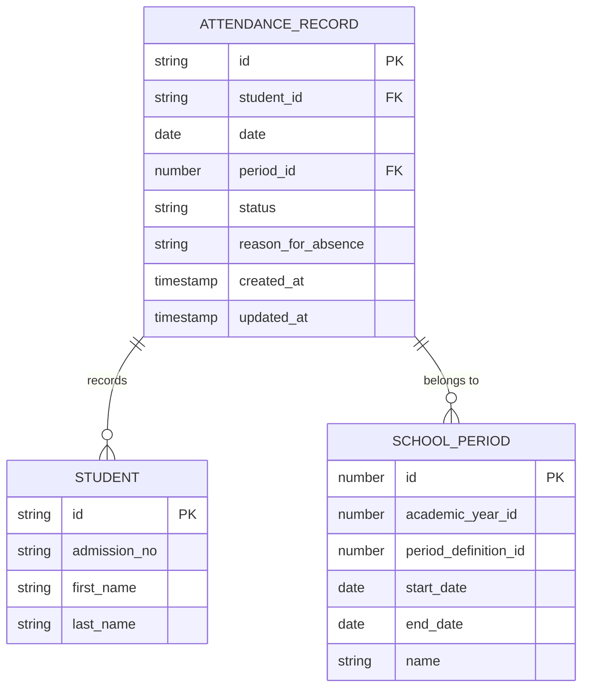
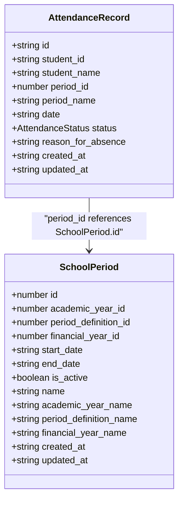
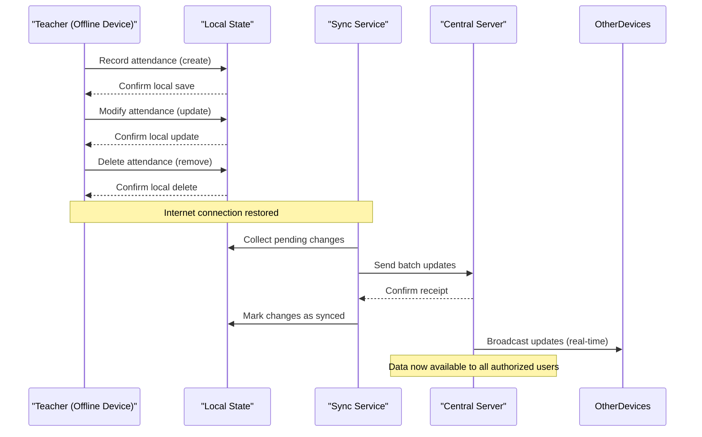

# Attendance Data Model

<cite>
**Referenced Files in This Document**   
- [useStudentAttendanceData.ts](file://src/modules/administration/data/useStudentAttendanceData.ts)
- [mockData.ts](file://src/modules/administration/data/mockData.ts)
- [types.ts](file://src/modules/administration/data/types.ts)
</cite>

## Table of Contents
1. [Introduction](#introduction)
2. [Core Fields and Structure](#core-fields-and-structure)
3. [Attendance Status and Reason Codes](#attendance-status-and-reason-codes)
4. [Relationship with SchoolPeriod](#relationship-with-schoolperiod)
5. [Data Access and CRUD Operations](#data-access-and-crud-operations)
6. [Validation Rules and Duplicate Prevention](#validation-rules-and-duplicate-prevention)
7. [Bulk Entry Capabilities](#bulk-entry-capabilities)
8. [Sample JSON Instances](#sample-json-instances)
9. [Aggregation Patterns for Statistics](#aggregation-patterns-for-statistics)
10. [Offline Attendance Capture and Synchronization](#offline-attendance-capture-and-synchronization)

## Introduction
The AttendanceRecord entity within the Administration module provides a structured approach to tracking student attendance across various time periods. This documentation details the data model, relationships, validation rules, and operational capabilities of the attendance system. The implementation supports both real-time and offline attendance capture, with robust synchronization mechanisms to ensure data integrity across distributed environments.

## Core Fields and Structure
The AttendanceRecord entity contains essential fields for capturing attendance data with temporal and contextual precision. These fields enable comprehensive tracking and reporting capabilities.

**Key Fields:**
- **studentId**: Unique identifier for the student being tracked
- **date**: Calendar date when attendance was recorded (ISO 8601 format)
- **periodId**: Reference to the specific SchoolPeriod during which attendance was taken
- **attendanceStatus**: Current status of the student (present, absent, late, excused)
- **reasonCodes**: Optional explanatory codes for absences or special circumstances
- **created_at**: Timestamp when the record was created
- **updated_at**: Timestamp when the record was last modified
- **id**: Unique identifier for the attendance record



**Diagram sources**
- [types.ts](file://src/modules/administration/data/types.ts)
- [mockData.ts](file://src/modules/administration/data/mockData.ts)

**Section sources**
- [types.ts](file://src/modules/administration/data/types.ts#L150-L160)

## Attendance Status and Reason Codes
The attendance system implements a standardized set of status values and reason codes to ensure consistency in attendance tracking and reporting.

### Attendance Status Enumeration
The `AttendanceStatus` enum defines the possible states for a student's attendance:

- **PRESENT**: Student attended the full period
- **ABSENT**: Student did not attend the period
- **LATE**: Student arrived after the period started
- **EXCUSED**: Student was absent with valid justification

```typescript
enum AttendanceStatus {
  PRESENT = "present",
  ABSENT = "absent",
  LATE = "late",
  EXCUSED = "excused"
}
```

### Reason Codes
Reason codes provide additional context for absences and special circumstances:

- **ILLNESS**: Student absent due to sickness
- **FAMILY_EMERGENCY**: Absence due to family emergency
- **MEDICAL_APPOINTMENT**: Scheduled medical visit
- **RELIGIOUS_OBSERVANCE**: Religious holiday or observance
- **SCHOOL_ACTIVITY**: Official school activity
- **TRAVEL**: Family travel or relocation
- **OTHER**: Any other justification

These codes are stored in the `reason_for_absence` field and support filtering and reporting on specific absence types.

**Section sources**
- [types.ts](file://src/modules/administration/data/types.ts#L145-L155)
- [mockData.ts](file://src/modules/administration/data/mockData.ts#L670-L675)

## Relationship with SchoolPeriod
The AttendanceRecord entity maintains a critical relationship with the SchoolPeriod entity to enable time-specific attendance tracking. This relationship allows the system to capture attendance at granular time intervals throughout the academic day.

### Temporal Context
Each attendance record is associated with a specific SchoolPeriod, which provides temporal context including:
- Academic year and term
- Start and end dates of the period
- Period name and sequence
- Active status of the period

This relationship ensures that attendance data is properly contextualized within the academic calendar, enabling accurate reporting and analysis across different time frames.

### Data Structure Relationship


**Diagram sources**
- [types.ts](file://src/modules/administration/data/types.ts)
- [mockData.ts](file://src/modules/administration/data/mockData.ts)

**Section sources**
- [mockData.ts](file://src/modules/administration/data/mockData.ts#L280-L310)
- [types.ts](file://src/modules/administration/data/types.ts)

## Data Access and CRUD Operations
The attendance data is managed through a dedicated React hook that provides standard CRUD operations for attendance records.

### useStudentAttendanceData Hook
The `useStudentAttendanceData` hook implements a self-contained data management solution for student attendance records:

```typescript
export const useStudentAttendanceData = () => {
  const [data, setData] = useState<StudentAttendance[]>(initialMockStudentAttendance);

  const create = async (newItem: Partial<StudentAttendance>) => {
    const newDataItem: StudentAttendance = {
      ...newItem,
      id: Date.now(),
      created_at: new Date().toISOString(),
      updated_at: new Date().toISOString()
    } as StudentAttendance;
    setData((prev: StudentAttendance[]) => [...prev, newDataItem]);
    return newDataItem;
  };

  const update = async (id: number, updatedData: Partial<StudentAttendance>) => {
    setData((prev: StudentAttendance[]) => prev.map((item: StudentAttendance) => 
      item.id === id 
        ? { ...item, ...updatedData, updated_at: new Date().toISOString() }
        : item
    ));
  };

  const remove = async (id: number) => {
    setData((prev: StudentAttendance[]) => prev.filter((item: StudentAttendance) => item.id !== id));
  };

  return {
    data,
    create,
    update,
    remove
  };
};
```

This hook provides:
- **create**: Adds a new attendance record with automatic timestamp generation
- **update**: Modifies existing records with updated timestamps
- **remove**: Deletes records by ID
- **data**: Current state of all attendance records

The implementation uses React's useState hook for client-side state management, making it suitable for development and demo modes.

**Section sources**
- [useStudentAttendanceData.ts](file://src/modules/administration/data/useStudentAttendanceData.ts#L1-L43)

## Validation Rules and Duplicate Prevention
The attendance system implements validation rules to maintain data integrity and prevent duplicate records.

### Uniqueness Constraints
The system prevents duplicate attendance records through a combination of business logic and data structure design. Each attendance record is uniquely identified by the combination of:
- **studentId**
- **date**
- **periodId**

This composite key ensures that only one attendance record can exist for a specific student during a particular period on a given date.

### Validation Implementation
While the current implementation relies on client-side state management, validation would typically be enforced through:
- Database-level unique constraints
- Service layer validation before persistence
- UI-level prevention of duplicate entry

The absence of explicit validation code in the current implementation suggests that duplicate prevention is handled at the application level through user interface design and business logic.

**Section sources**
- [useStudentAttendanceData.ts](file://src/modules/administration/data/useStudentAttendanceData.ts)
- [mockData.ts](file://src/modules/administration/data/mockData.ts)

## Bulk Entry Capabilities
The attendance system supports bulk entry operations through its data management interface, allowing educators to record attendance for multiple students simultaneously.

### Implementation Approach
The current implementation facilitates bulk operations through:
- Array-based state management that can handle multiple records
- Individual create operations that can be batched programmatically
- State updates that can process multiple records in a single operation

While the provided code does not show explicit bulk entry functions, the underlying data structure and state management approach are compatible with bulk operations. A bulk entry feature could be implemented by:
1. Collecting multiple attendance records in a temporary array
2. Processing each record through the create function
3. Updating the state with all new records in a single operation

This approach ensures data consistency while supporting efficient bulk data entry.

**Section sources**
- [useStudentAttendanceData.ts](file://src/modules/administration/data/useStudentAttendanceData.ts)
- [mockData.ts](file://src/modules/administration/data/mockData.ts)

## Sample JSON Instances
The following JSON instances demonstrate typical attendance records and absence summaries.

### Daily Attendance Log
```json
{
  "id": "ATT001",
  "student_id": "S001",
  "student_name": "Jim Halpert",
  "period_id": 1,
  "period_name": "Period 1",
  "date": "2024-01-15",
  "status": "present",
  "created_at": "2024-01-15T08:30:00.000Z",
  "updated_at": "2024-01-15T08:30:00.000Z"
}
```

### Absence Summary
```json
{
  "id": "ATT002",
  "student_id": "S002",
  "student_name": "Michael Scofield",
  "period_id": 1,
  "period_name": "Period 1",
  "date": "2024-01-15",
  "status": "late",
  "reason_for_absence": "Traffic jam",
  "created_at": "2024-01-15T08:35:00.000Z",
  "updated_at": "2024-01-15T08:35:00.000Z"
}
```

### Multiple Attendance Records (Bulk)
```json
[
  {
    "id": "ATT003",
    "student_id": "S003",
    "student_name": "Sara Tancredi",
    "period_id": 2,
    "period_name": "Period 2",
    "date": "2024-01-15",
    "status": "present",
    "created_at": "2024-01-15T10:15:00.000Z",
    "updated_at": "2024-01-15T10:15:00.000Z"
  },
  {
    "id": "ATT004",
    "student_id": "S004",
    "student_name": "David Kiprotich",
    "period_id": 2,
    "period_name": "Period 2",
    "date": "2024-01-15",
    "status": "absent",
    "reason_for_absence": "Medical appointment",
    "created_at": "2024-01-15T10:15:00.000Z",
    "updated_at": "2024-01-15T10:15:00.000Z"
  }
]
```

**Section sources**
- [mockData.ts](file://src/modules/administration/data/mockData.ts#L670-L675)

## Aggregation Patterns for Statistics
The attendance data model supports various aggregation patterns for generating statistics and reports.

### Daily Aggregation
Counts attendance status by date across all students:
```sql
SELECT 
  date,
  status,
  COUNT(*) as count
FROM attendance_records 
GROUP BY date, status
ORDER BY date DESC;
```

### Student-Level Aggregation
Tracks attendance history for individual students:
```sql
SELECT 
  student_id,
  student_name,
  COUNT(*) as total_records,
  SUM(CASE WHEN status = 'present' THEN 1 ELSE 0 END) as present_count,
  SUM(CASE WHEN status = 'absent' THEN 1 ELSE 0 END) as absent_count,
  SUM(CASE WHEN status = 'late' THEN 1 ELSE 0 END) as late_count,
  ROUND(
    (SUM(CASE WHEN status = 'present' THEN 1 ELSE 0 END) * 100.0 / COUNT(*)), 
    2
  ) as attendance_rate
FROM attendance_records 
GROUP BY student_id, student_name;
```

### Period-Based Aggregation
Analyzes attendance patterns by period:
```sql
SELECT 
  period_id,
  period_name,
  AVG(
    CASE WHEN status IN ('present', 'late') THEN 1.0 
    WHEN status = 'absent' THEN 0.0 
    ELSE 0.0 END
  ) * 100 as average_attendance_percentage
FROM attendance_records 
GROUP BY period_id, period_name
ORDER BY period_id;
```

### Monthly Summary
Provides monthly attendance overview:
```sql
SELECT 
  DATE_FORMAT(date, '%Y-%m') as month,
  COUNT(*) as total_records,
  COUNT(DISTINCT student_id) as unique_students,
  SUM(CASE WHEN status = 'present' THEN 1 ELSE 0 END) as present_count,
  SUM(CASE WHEN status = 'absent' THEN 1 ELSE 0 END) as absent_count,
  SUM(CASE WHEN status = 'late' THEN 1 ELSE 0 END) as late_count
FROM attendance_records 
GROUP BY DATE_FORMAT(date, '%Y-%m')
ORDER BY month DESC;
```

These aggregation patterns enable comprehensive reporting on attendance trends, student performance, and institutional metrics.

**Section sources**
- [mockData.ts](file://src/modules/administration/data/mockData.ts)
- [types.ts](file://src/modules/administration/data/types.ts)

## Offline Attendance Capture and Synchronization
The attendance system addresses the challenges of offline data capture in remote classrooms through a client-side state management approach.

### Offline Capability Architecture


**Diagram sources**
- [useStudentAttendanceData.ts](file://src/modules/administration/data/useStudentAttendanceData.ts)
- [mockData.ts](file://src/modules/administration/data/mockData.ts)

### Synchronization Challenges
The current implementation faces several synchronization challenges:

1. **Data Conflict Resolution**: When multiple devices modify the same record offline, conflict resolution strategies are needed.
2. **Network Reliability**: Intermittent connectivity in remote classrooms requires robust retry mechanisms.
3. **Data Consistency**: Ensuring that all devices have consistent data after synchronization.
4. **Conflict Detection**: Identifying when the same record has been modified in different locations.

### Conflict Resolution Strategies
Potential conflict resolution approaches include:

- **Last Write Wins**: The most recent update overwrites previous versions based on timestamp.
- **Manual Resolution**: Present conflicting versions to an administrator for manual resolution.
- **Merge Logic**: Automatically merge non-conflicting changes from different sources.
- **Version Vectors**: Use version numbers to detect and resolve conflicts systematically.

The current implementation does not show explicit conflict resolution code, suggesting that synchronization logic may be handled at a higher level or in a production environment with a persistent database.

**Section sources**
- [useStudentAttendanceData.ts](file://src/modules/administration/data/useStudentAttendanceData.ts)
- [mockData.ts](file://src/modules/administration/data/mockData.ts)