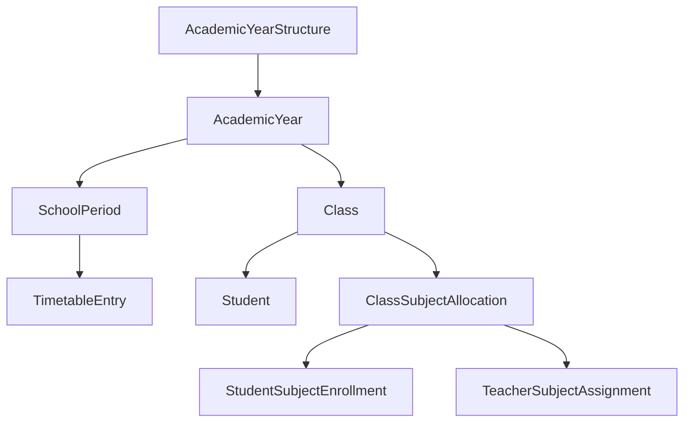
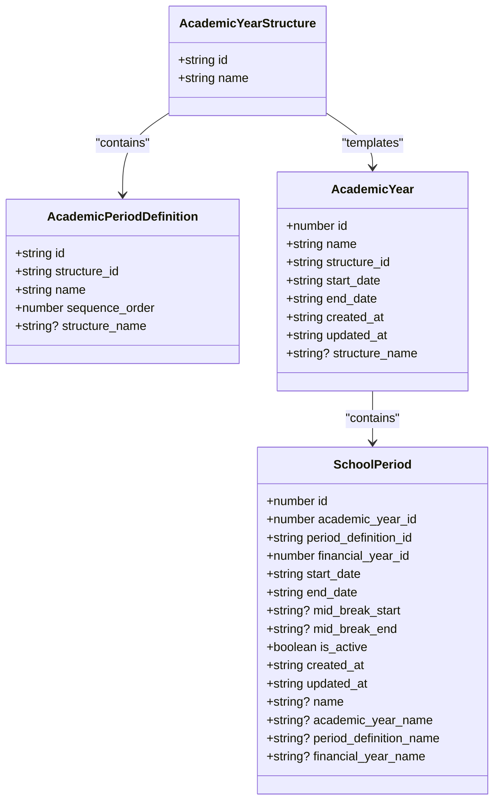
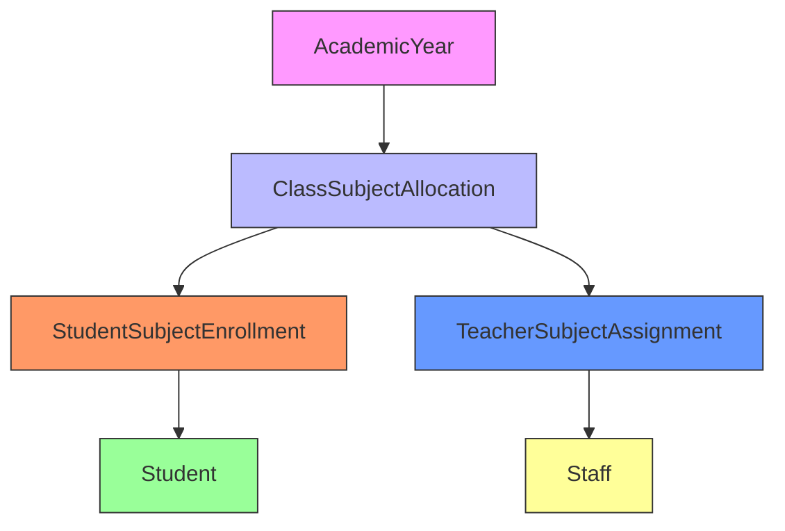
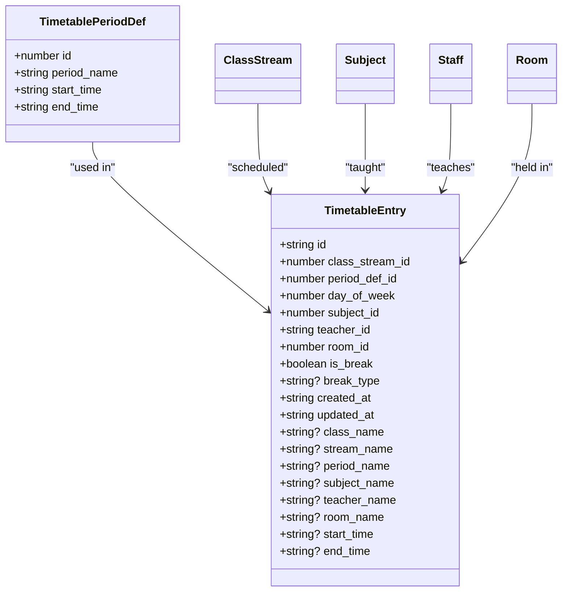
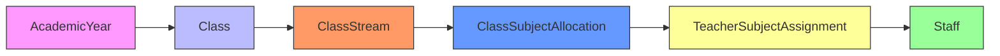
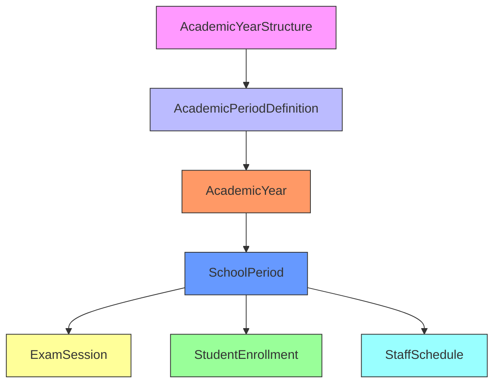

# Class and Academic Structure Model

<cite>
**Referenced Files in This Document**   
- [schema.ts](file://src/modules/administration/data/schema.ts#L200-L483)
- [types.ts](file://src/modules/administration/data/types.ts#L0-L537)
- [types.ts](file://src/core/types.ts#L350-L1150)
- [schema.ts](file://src/modules/academics/data/schema.ts#L105-L304)
</cite>

## Table of Contents
1. [Academic Hierarchy Overview](#academic-hierarchy-overview)
2. [Academic Year and Period Structure](#academic-year-and-period-structure)
3. [Class and Student Enrollment Chain](#class-and-student-enrollment-chain)
4. [School Periods and Timetable Model](#school-periods-and-timetable-model)
5. [Teacher-Subject Assignment System](#teacher-subject-assignment-system)
6. [Academic Structure Configuration Examples](#academic-structure-configuration-examples)
7. [Referential Integrity Rules](#referential-integrity-rules)

## Academic Hierarchy Overview

The academic structure model implements a hierarchical organization system that organizes educational activities from the highest level (AcademicYear) down to daily operations (SchoolPeriods). This model supports multiple education systems and provides flexibility for different school calendar configurations.

The core hierarchy follows this chain:
- **AcademicYearStructure**: Defines the template for academic organization
- **AcademicYear**: Specific instance of an academic year using a structure
- **AcademicPeriodDefinition**: Template for periods within a structure
- **SchoolPeriod**: Concrete time period within an academic year
- **Class**: Educational grouping of students
- **Student**: Individual learner enrolled in classes



**Diagram sources**
- [types.ts](file://src/core/types.ts#L359-L371)
- [types.ts](file://src/core/types.ts#L373-L385)

**Section sources**
- [types.ts](file://src/core/types.ts#L359-L385)

## Academic Year and Period Structure

### AcademicYearStructure Configuration

The `AcademicYearStructure` serves as a template that defines how an academic year is organized. It contains the framework for term schedules and grading periods without specifying actual dates.

```typescript
export interface AcademicYearStructure {
    id: string;
    name: string;
}
```

This structure is referenced by multiple academic years, allowing schools to reuse the same organizational pattern across different years.

### AcademicPeriodDefinition

The `AcademicPeriodDefinition` represents a template for academic periods within a structure. It defines the sequence and naming of periods like terms, semesters, or quarters.

```typescript
export interface AcademicPeriodDefinition {
    id: string;
    structure_id: string;
    name: string;
    sequence_order: number;
    structure_name?: string | null;
}
```

**Section sources**
- [types.ts](file://src/core/types.ts#L364-L371)

### AcademicYear Model

The `AcademicYear` model represents a specific academic year with defined start and end dates. It links to an `AcademicYearStructure` to inherit the organizational framework.

```typescript
export interface AcademicYear {
  id: number;
  name: string;
  structure_id: string;
  start_date: string;
  end_date: string;
  created_at: string;
  updated_at: string;
  structure_name?: string | null;
}
```

### SchoolPeriod Model

The `SchoolPeriod` represents a concrete time period within an academic year, such as a term or semester. It contains the actual dates and status information.

```typescript
export interface SchoolPeriod {
  id: number;
  academic_year_id: number;
  period_definition_id: string;
  financial_year_id: number;
  start_date: string;
  end_date: string;
  mid_break_start?: string | null;
  mid_break_end?: string | null;
  is_active: boolean;
  created_at: string;
  updated_at: string;
  name?: string | null;
  academic_year_name?: string | null;
  period_definition_name?: string | null;
  financial_year_name?: string | null;
}
```



**Diagram sources**
- [types.ts](file://src/core/types.ts#L359-L385)

**Section sources**
- [types.ts](file://src/core/types.ts#L359-L385)

## Class and Student Enrollment Chain

### Class and ClassStream Models

The class system uses a two-tier approach with `Class` and `ClassStream` entities. A class represents the grade level (e.g., Grade 10), while a stream represents a specific section or division within that grade.

```typescript
export interface Class {
  id: number;
  name: string;
  streams?: ClassStream[];
}

export interface ClassStream {
    id: number;
    class_id: number;
    name: string;
    class_teacher_id?: string | null;
    class_name?: string | null;
    class_teacher_name?: string | null;
}
```

### Student Model

The `Student` interface represents an individual learner with personal information, enrollment status, and denormalized fields for efficient data access.

```typescript
export interface Student {
  id: string;
  admission_no: string;
  first_name: string;
  middle_name?: string | null;
  last_name: string;
  gender: PersonGender;
  date_of_birth?: string | null;
  current_class_stream_id?: number | null;
  status: StudentStatus;
  created_at: string;
  updated_at: string;
  current_class_name?: string | null;
  current_class_stream_name?: string | null;
}
```

### Enrollment Chain

The enrollment system follows a hierarchical chain from academic year down to individual student enrollments:



**Diagram sources**
- [types.ts](file://src/core/types.ts#L373-L385)
- [types.ts](file://src/core/types.ts#L1000-L1010)
- [schema.ts](file://src/modules/academics/data/schema.ts#L250-L270)
- [types.ts](file://src/core/types.ts#L400-L450)
- [schema.ts](file://src/modules/academics/data/schema.ts#L230-L250)
- [types.ts](file://src/core/types.ts#L450-L500)

### ClassSubjectAllocation

This entity links a class stream to a subject within a specific academic year, forming the foundation of the curriculum structure.

```typescript
export interface ClassSubjectAllocation {
    id: string;
    class_stream_id: number;
    subject_id: number;
    academic_year_id: number;
    class_stream_name?: string | null;
    subject_name?: string | null;
    academic_year_name?: string | null;
    is_enrolled?: boolean | null;
}
```

### StudentSubjectEnrollment

This model represents a student's enrollment in a specific subject allocation, capturing the enrollment date and status.

```typescript
export const studentSubjectEnrollmentSchema: DatabaseSchema = createDatabaseSchema({
    title: 'student_subject_enrollment',
    primaryKey: 'id',
    properties: {
        id: SchemaHelpers.string({ description: 'Unique identifier', maxLength: 100 }),
        student_id: SchemaHelpers.ref('students', { description: 'Reference to student', maxLength: 100 }),
        class_subject_allocation_id: SchemaHelpers.ref('class_subject_allocations', { description: 'Reference to class subject allocation', maxLength: 100 }),
        enrollment_date: SchemaHelpers.string({ description: 'Enrollment date', format: 'date', maxLength: 20 }),
        status: SchemaHelpers.string({ description: 'Enrollment status', enum: Object.values(StudentEnrollmentStatus), maxLength: 50 }),
        created_at: SchemaHelpers.timestamp({ description: 'Creation timestamp' }),
        updated_at: SchemaHelpers.timestamp({ description: 'Last update timestamp' }),
        student_name: SchemaHelpers.string({ description: 'Student name (computed)', maxLength: 200 }),
        class_name: SchemaHelpers.string({ description: 'Class name (computed)', maxLength: 100 }),
        stream_name: SchemaHelpers.string({ description: 'Stream name (computed)', maxLength: 100 }),
        subject_name: SchemaHelpers.string({ description: 'Subject name (computed)', maxLength: 100 }),
        academic_year_name: SchemaHelpers.string({ description: 'Academic year name (computed)', maxLength: 100 }),
        enrollment_status_display: SchemaHelpers.string({ description: 'Enrollment status display (computed)', maxLength: 50 }),
    },
    required: ['id', 'student_id', 'class_subject_allocation_id', 'status', 'created_at', 'updated_at'],
    indexes: ['student_id', 'class_subject_allocation_id']
});
```

**Section sources**
- [types.ts](file://src/core/types.ts#L1000-L1010)
- [schema.ts](file://src/modules/academics/data/schema.ts#L250-L270)

## School Periods and Timetable Model

### TimetablePeriodDef Model

The `TimetablePeriodDef` represents a definition of a timetable period, including its name and time slots.

```typescript
export interface TimetablePeriodDef {
    id: number;
    period_name: string;
    start_time: string;
    end_time: string;
}
```

### TimetableEntry Model

The `TimetableEntry` links a class stream to a specific period, subject, teacher, and room for a particular day of the week.

```typescript
export const timetableEntrySchema: DatabaseSchema = createDatabaseSchema({
    title: 'timetable_entry',
    primaryKey: 'id',
    properties: {
        id: SchemaHelpers.string({ description: 'Unique identifier', maxLength: 100 }),
        class_stream_id: SchemaHelpers.ref('class_streams', { description: 'Reference to class stream', maxLength: 100 }),
        period_def_id: SchemaHelpers.ref('timetable_period_definitions', { description: 'Reference to period definition', minimum: 1, maximum: 999999999 }),
        day_of_week: SchemaHelpers.number({ description: 'Day of week (1-7)', minimum: 1, maximum: 7 }),
        subject_id: SchemaHelpers.ref('subjects', { description: 'Reference to subject', maxLength: 100 }),
        teacher_id: SchemaHelpers.ref('staff', { description: 'Reference to teacher', maxLength: 100 }),
        room_id: SchemaHelpers.ref('rooms', { description: 'Reference to room', maxLength: 100 }),
        is_break: SchemaHelpers.boolean({ description: 'Is this a break period', default: false }),
        break_type: SchemaHelpers.string({ description: 'Type of break', enum: [...Object.values(BreakType), null], maxLength: 50 }),
        created_at: SchemaHelpers.timestamp({ description: 'Creation timestamp' }),
        updated_at: SchemaHelpers.timestamp({ description: 'Last update timestamp' }),
        class_name: SchemaHelpers.string({ description: 'Class name (computed)', maxLength: 100 }),
        stream_name: SchemaHelpers.string({ description: 'Stream name (computed)', maxLength: 100 }),
        period_name: SchemaHelpers.string({ description: 'Period name (computed)', maxLength: 100 }),
        subject_name: SchemaHelpers.string({ description: 'Subject name (computed)', maxLength: 100 }),
        teacher_name: SchemaHelpers.string({ description: 'Teacher name (computed)', maxLength: 200 }),
        room_name: SchemaHelpers.string({ description: 'Room name (computed)', maxLength: 100 }),
        start_time: SchemaHelpers.string({ description: 'Start time (computed)', maxLength: 20 }),
        end_time: SchemaHelpers.string({ description: 'End time (computed)', maxLength: 20 }),
    },
    required: ['id', 'class_stream_id', 'period_def_id', 'day_of_week', 'is_break', 'created_at', 'updated_at'],
    indexes: ['class_stream_id', 'period_def_id', 'day_of_week']
});
```



**Diagram sources**
- [types.ts](file://src/core/types.ts#L1050-L1060)
- [schema.ts](file://src/modules/academics/data/schema.ts#L280-L304)

**Section sources**
- [types.ts](file://src/core/types.ts#L1050-L1060)
- [schema.ts](file://src/modules/academics/data/schema.ts#L280-L304)

## Teacher-Subject Assignment System

### TeacherSubjectAssignment Model

This model links teachers to specific subject allocations, establishing who teaches what subject to which class stream.

```typescript
export const teacherSubjectAssignmentSchema: DatabaseSchema = createDatabaseSchema({
    title: 'teacher_subject_assignment',
    primaryKey: 'id',
    properties: {
        id: SchemaHelpers.string({ description: 'Unique identifier', maxLength: 100 }),
        allocation_id: SchemaHelpers.ref('class_subject_allocations', { description: 'Reference to class subject allocation', maxLength: 100 }),
        teacher_id: SchemaHelpers.ref('staff', { description: 'Reference to teacher', maxLength: 100 }),
        class_stream_name: SchemaHelpers.string({ description: 'Class stream name (computed)', maxLength: 150 }),
        subject_name: SchemaHelpers.string({ description: 'Subject name (computed)', maxLength: 100 }),
        academic_year_name: SchemaHelpers.string({ description: 'Academic year name (computed)', maxLength: 100 }),
        teacher_name: SchemaHelpers.string({ description: 'Teacher name (computed)', maxLength: 200 }),
    },
    required: ['id', 'allocation_id', 'teacher_id'],
    indexes: ['allocation_id', 'teacher_id']
});
```

### Assignment Chain

The teacher assignment system follows this chain:



**Section sources**
- [schema.ts](file://src/modules/academics/data/schema.ts#L230-L250)

## Academic Structure Configuration Examples

### Example 1: Kenyan Secondary School System

```typescript
// AcademicYearStructure: "Kenyan Secondary System"
// AcademicPeriodDefinitions: ["Form 1", "Form 2", "Form 3", "Form 4"]

// AcademicYear: "2024 Academic Year"
// SchoolPeriods: [
//   { name: "Term 1", start_date: "2024-01-08", end_date: "2024-04-05" },
//   { name: "Term 2", start_date: "2024-05-06", end_date: "2024-08-09" },
//   { name: "Term 3", start_date: "2024-09-09", end_date: "2024-12-13" }
// ]
```

### Example 2: American Semester System

```typescript
// AcademicYearStructure: "American University System"
// AcademicPeriodDefinitions: ["Freshman", "Sophomore", "Junior", "Senior"]

// AcademicYear: "2024-2025 Academic Year"
// SchoolPeriods: [
//   { name: "Fall Semester", start_date: "2024-08-26", end_date: "2024-12-14" },
//   { name: "Spring Semester", start_date: "2025-01-13", end_date: "2025-05-16" },
//   { name: "Summer Session", start_date: "2025-06-02", end_date: "2025-08-08" }
// ]
```

### Example 3: British Term System

```typescript
// AcademicYearStructure: "British School System"
// AcademicPeriodDefinitions: ["Year 7", "Year 8", "Year 9", "Year 10", "Year 11"]

// AcademicYear: "2024-2025 School Year"
// SchoolPeriods: [
//   { name: "Autumn Term", start_date: "2024-09-02", end_date: "2024-12-13" },
//   { name: "Spring Term", start_date: "2025-01-06", end_date: "2025-03-28" },
//   { name: "Summer Term", start_date: "2025-04-14", end_date: "2025-07-18" }
// ]
```

**Section sources**
- [types.ts](file://src/core/types.ts#L359-L385)
- [schema.ts](file://src/modules/administration/data/schema.ts#L200-L483)

## Referential Integrity Rules

The academic structure model enforces strict referential integrity to ensure consistency across the system:

### Academic Period Alignment

All academic entities must align with the same academic period hierarchy:



### Key Integrity Constraints

1. **Academic Year Consistency**: All class subject allocations, student enrollments, and exam sessions must reference the same academic year.

2. **Period Alignment**: School periods must fall within their parent academic year's date range.

3. **Enrollment Validity**: Student subject enrollments must reference active class subject allocations.

4. **Timetable Constraints**: Timetable entries must reference existing class streams, subjects, and teachers.

5. **Teacher Assignment**: Teacher subject assignments must reference valid class subject allocations and active staff members.

### Foreign Key Relationships

```typescript
// ClassSubjectAllocation references:
// - class_streams (via class_stream_id)
// - subjects (via subject_id) 
// - academic_years (via academic_year_id)

// StudentSubjectEnrollment references:
// - students (via student_id)
// - class_subject_allocations (via class_subject_allocation_id)

// TeacherSubjectAssignment references:
// - class_subject_allocations (via allocation_id)
// - staff (via teacher_id)

// TimetableEntry references:
// - class_streams (via class_stream_id)
// - timetable_period_definitions (via period_def_id)
// - subjects (via subject_id)
// - staff (via teacher_id)
// - rooms (via room_id)
```

**Section sources**
- [schema.ts](file://src/modules/academics/data/schema.ts#L105-L304)
- [schema.ts](file://src/modules/administration/data/schema.ts#L200-L483)
- [types.ts](file://src/core/types.ts#L350-L1150)