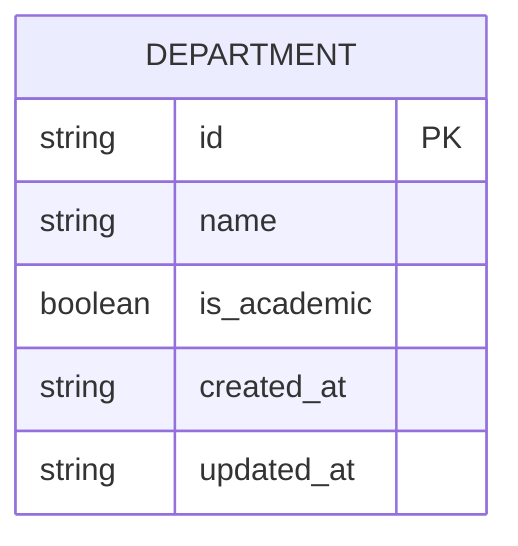
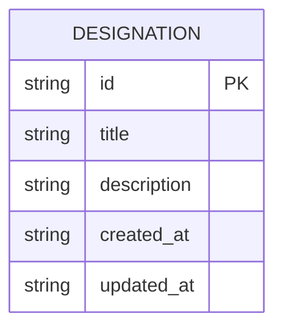
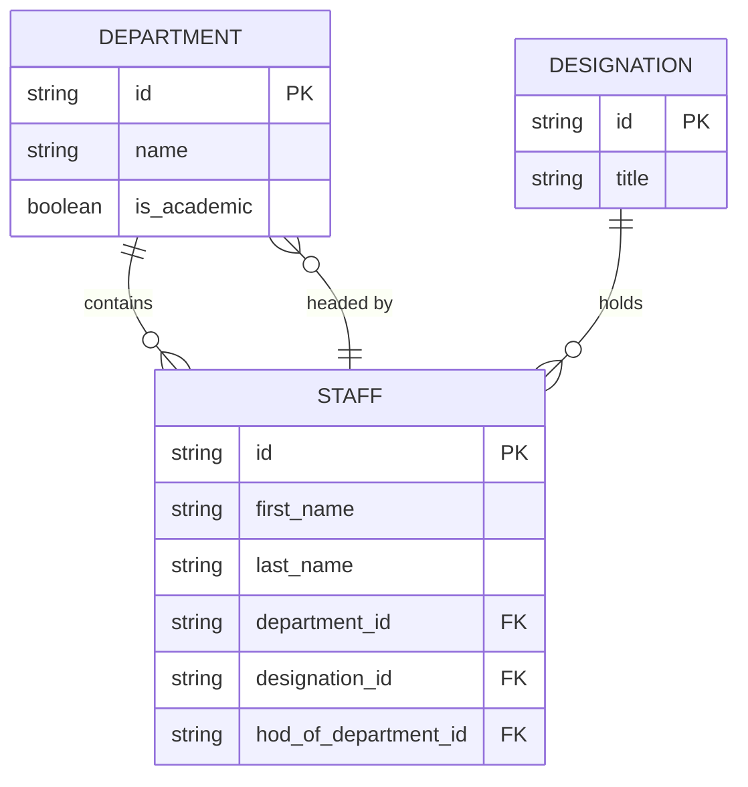
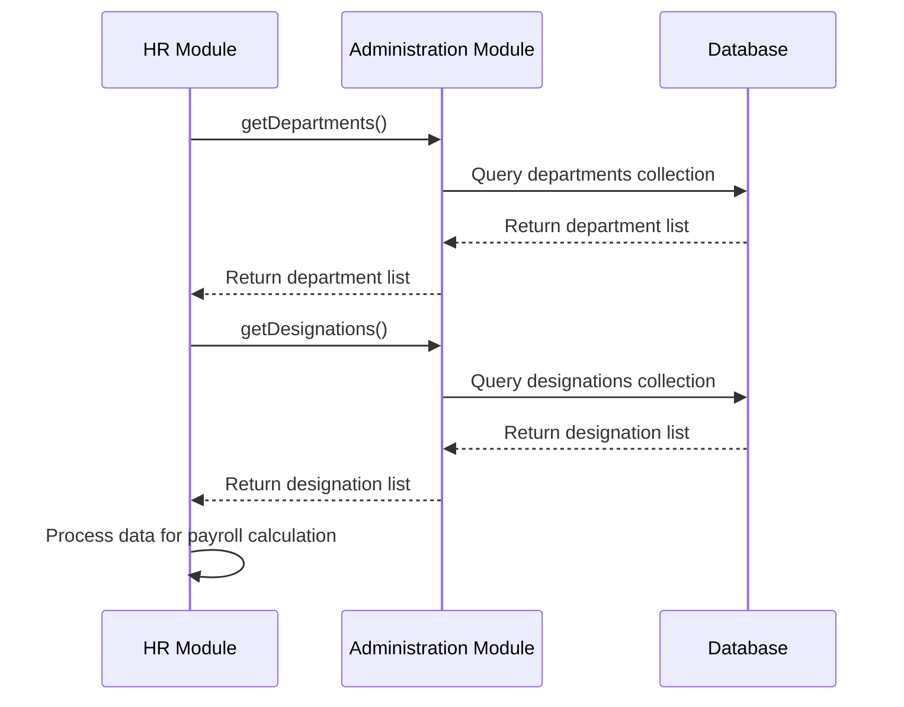

# Department and Organizational Model

<cite>
**Referenced Files in This Document**   
- [useDepartmentData.ts](file://src/modules/administration/data/useDepartmentData.ts)
- [DepartmentsPage.tsx](file://src/modules/administration/pages/DepartmentsPage.tsx)
- [DesignationsPage.tsx](file://src/modules/administration/pages/DesignationsPage.tsx)
- [mockData.ts](file://src/modules/administration/data/mockData.ts)
- [schema.ts](file://src/modules/administration/data/schema.ts)
- [types.ts](file://src/core/types.ts)
- [rxdbService.ts](file://src/services/rxdbService.ts)
</cite>

## Table of Contents
1. [Introduction](#introduction)
2. [Department Entity](#department-entity)
3. [Designation Entity](#designation-entity)
4. [Staff-Department-Designation Relationship](#staff-department-designation-relationship)
5. [Common Department Configurations](#common-department-configurations)
6. [Data Constraints and Hierarchical Integrity](#data-constraints-and-hierarchical-integrity)
7. [Integration with HR and Payroll Systems](#integration-with-hr-and-payroll-systems)

## Introduction
This document details the organizational structure model centered on the **Department** and **Designation** entities within the SchoolPilot system. It explains the data model, relationships, and business logic governing staff management, departmental hierarchy, and role assignment. The model supports both academic and administrative functions, ensuring a clear organizational structure for efficient school operations.

## Department Entity

The **Department** entity represents a functional unit within the school, such as "Academics," "Finance & Accounts," or "Human Resources." It serves as a container for staff members and defines the organizational hierarchy.

### Department Fields
The `Department` interface, defined in the core types, includes the following key fields:

- **departmentId**: A unique string identifier for the department.
- **name**: The full name of the department (e.g., "Sciences").
- **is_academic**: A boolean flag indicating whether the department is part of the academic faculty.
- **created_at**, **updated_at**: Timestamps for record creation and modification.

```typescript
// From src/core/types.ts
export interface Department {
  id: string;
  name: string;
  is_academic: boolean;
  created_at: string;
  updated_at: string;
}
```

### Department Schema
The database schema for the `department` collection is defined in `rxdbService.ts`. It enforces data integrity with required fields and type constraints.



**Diagram sources**
- [rxdbService.ts](file://src/services/rxdbService.ts#L92-L95)

**Section sources**
- [types.ts](file://src/core/types.ts)
- [rxdbService.ts](file://src/services/rxdbService.ts#L92-L95)

## Designation Entity

The **Designation** entity represents a job title or role within the organization, such as "Principal," "Teacher," or "Accountant." It defines the position a staff member holds.

### Designation Fields
The `Designation` interface includes the following fields:

- **designationId**: A unique identifier for the designation.
- **title**: The job title (e.g., "Head of Department (HOD)").
- **description**: An optional description of the role.
- **created_at**, **updated_at**: Timestamps for record creation and modification.

```typescript
// From src/core/types.ts
export interface Designation {
  id: number;
  title: string;
  description?: string;
  created_at: string;
  updated_at: string;
}
```

### Designation Schema
The database schema for the `designation` collection is also defined in `rxdbService.ts`.



**Diagram sources**
- [rxdbService.ts](file://src/services/rxdbService.ts#L96-L99)

**Section sources**
- [types.ts](file://src/core/types.ts)
- [rxdbService.ts](file://src/services/rxdbService.ts#L96-L99)

## Staff-Department-Designation Relationship

The organizational model establishes a clear relationship chain: **Staff → Department → Designation**. A staff member belongs to a single department and holds a specific designation within that department.

### Relationship Model
The `Staff` entity links to both `Department` and `Designation` through foreign key references (`department_id` and `designation_id`). It also includes a special field, `hod_of_department_id`, which creates a self-referential link to indicate that a staff member is the Head of a department.



**Diagram sources**
- [rxdbService.ts](file://src/services/rxdbService.ts#L90-L99)
- [mockData.ts](file://src/modules/administration/data/mockData.ts#L100-L120)

**Section sources**
- [rxdbService.ts](file://src/services/rxdbService.ts#L90-L99)
- [mockData.ts](file://src/modules/administration/data/mockData.ts)

## Common Department Configurations

The system supports a variety of common academic and administrative department configurations, as demonstrated by the mock data.

### Academic Departments
These departments are directly involved in teaching and curriculum delivery.
- **Academics**: An overarching department for general academic oversight.
- **Sciences**: For science subjects (e.g., Biology, Chemistry).
- **Humanities & Arts**: For subjects like History, Geography, and Art.
- **Languages & Literature**: For language instruction and literature.

### Administrative Departments
These departments handle non-academic operations.
- **Administration**: For general school management.
- **Finance & Accounts**: For financial operations and fee management.
- **Human Resources**: For staff recruitment, payroll, and personnel management.

```typescript
// Example from mockData.ts
export const initialMockDepartments: Department[] = [
    { id: 'DEPT001', name: 'Academics', is_academic: true, ... },
    { id: 'DEPT002', name: 'Administration', is_academic: false, ... },
    { id: 'DEPT003', name: 'Sciences', is_academic: true, ... },
    { id: 'DEPT006', name: 'Finance & Accounts', is_academic: false, ... },
    { id: 'DEPT007', name: 'Human Resources', is_academic: false, ... },
];
```

**Section sources**
- [mockData.ts](file://src/modules/administration/data/mockData.ts#L100-L106)

## Data Constraints and Hierarchical Integrity

The system enforces several data constraints to ensure the validity of the organizational hierarchy and prevent data corruption.

### Required Fields
Both `Department` and `Designation` entities have required fields that must be provided upon creation:
- **Department**: `id`, `name`, `is_academic`, `created_at`, `updated_at`.
- **Designation**: `id`, `title`, `created_at`, `updated_at`.

### Preventing Circular References
The model prevents circular references through the `hod_of_department_id` field. A staff member can be the Head of a department, but the system logic (not shown in schema) must ensure that a staff member cannot be the Head of a department they do not belong to, and that no circular chains (e.g., A is HOD of B, B is HOD of A) are created.

### Validation in UI
The `DepartmentsPage.tsx` and `DesignationsPage.tsx` components enforce client-side validation. For example, the `DepartmentsPage` ensures that a department name is provided before submission.

```typescript
// From DepartmentsPage.tsx
const handleSubmit = async () => {
    if (!formData.name) {
      alert(t('validation.departmentNameIsRequired'));
      return;
    }
    // ... proceed with save
};
```

**Section sources**
- [schema.ts](file://src/modules/administration/data/schema.ts)
- [DepartmentsPage.tsx](file://src/modules/administration/pages/DepartmentsPage.tsx#L75-L80)
- [DesignationsPage.tsx](file://src/modules/administration/pages/DesignationsPage.tsx#L73-L78)

## Integration with HR and Payroll Systems

The organizational model is tightly integrated with the HR and payroll modules to support comprehensive staff management workflows.

### Pay Grade Association
Although not explicitly shown in the `Designation` schema, the `title` field (e.g., "Senior Teacher," "Principal") is used by the HR system to determine the appropriate **payGrade**. The HR module (`src/modules/hr/data/types.ts`) likely contains a mapping between designations and salary scales.

### Workflow Example
1. **Hiring**: A new staff member is added to the `staff` collection with a `designation_id` (e.g., "Teacher").
2. **Payroll Setup**: The HR system uses the `designation_id` to assign a base salary and benefits.
3. **Promotion**: The staff member's `designation_id` is updated (e.g., to "Senior Teacher"), which automatically triggers a salary review in the payroll system.
4. **Department Change**: If the staff member is transferred to a new department, the `department_id` is updated, and the HR system can track career progression.

### Data Flow
The `useDepartmentData` and `useDesignationData` hooks provide a clean API for the HR module to retrieve and manage organizational data without direct database access, promoting modularity.



**Diagram sources**
- [useDepartmentData.ts](file://src/modules/administration/data/useDepartmentData.ts)
- [useDesignationData.ts](file://src/modules/administration/data/useDesignationData.ts)

**Section sources**
- [useDepartmentData.ts](file://src/modules/administration/data/useDepartmentData.ts)
- [useDesignationData.ts](file://src/modules/administration/data/useDesignationData.ts)
- [hr/data/types.ts](file://src/modules/hr/data/types.ts)