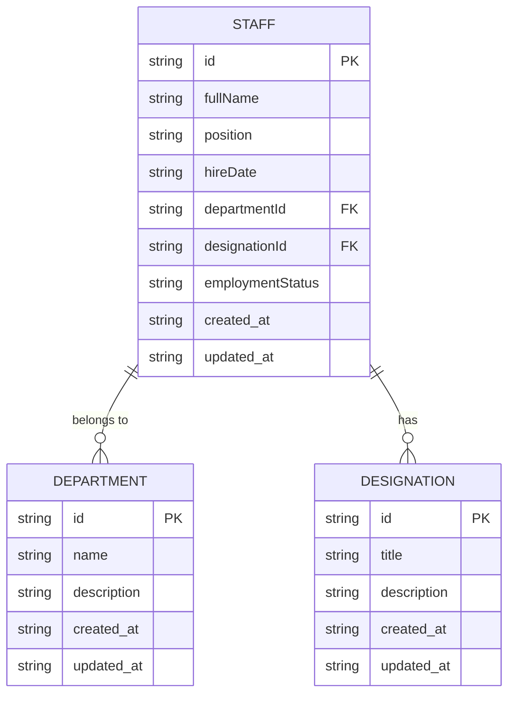
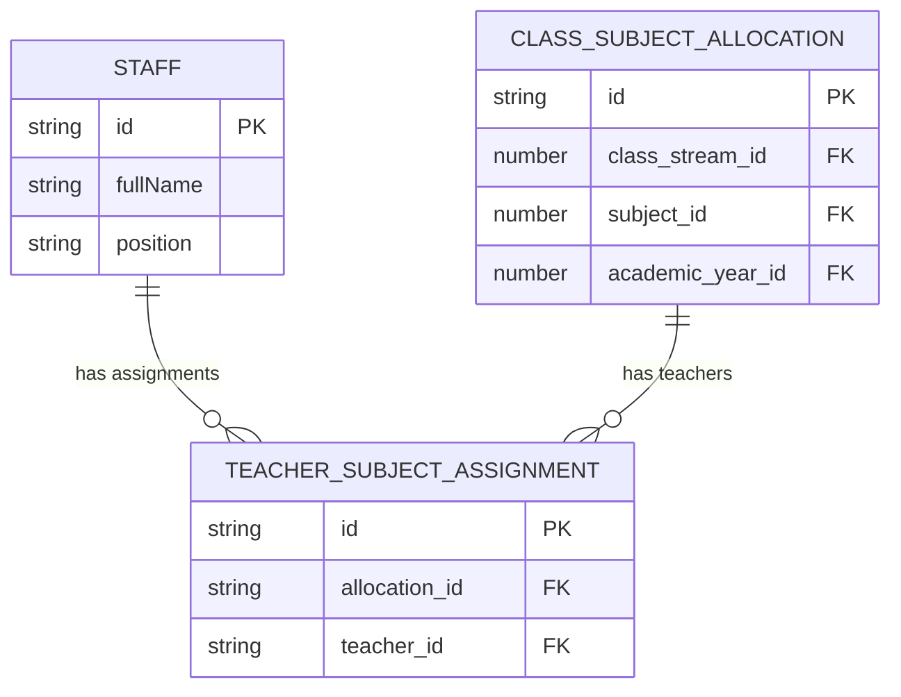

# Staff Data Model

<cite>
**Referenced Files in This Document**   
- [schema.ts](file://src/modules/administration/data/schema.ts)
- [types.ts](file://src/modules/administration/data/types.ts)
- [useStaffData.ts](file://src/modules/administration/data/useStaffData.ts)
- [schema.ts](file://src/modules/academics/data/schema.ts)
- [types.ts](file://src/modules/academics/data/types.ts)
- [useClassSubjectAllocationData.ts](file://src/modules/academics/data/useClassSubjectAllocationData.ts)
</cite>

## Table of Contents
1. [Introduction](#introduction)
2. [Core Staff Fields](#core-staff-fields)
3. [Department and Designation Relationships](#department-and-designation-relationships)
4. [Teaching Assignment Linkages](#teaching-assignment-linkages)
5. [Employment Status and Role-Based Access](#employment-status-and-role-based-access)
6. [Sample JSON Representation](#sample-json-representation)
7. [Data Integrity Constraints](#data-integrity-constraints)
8. [Synchronization Metadata](#synchronization-metadata)
9. [Conclusion](#conclusion)

## Introduction
This document provides a comprehensive overview of the Staff data model within the Administration module of the educational system. The Staff entity serves as a central component for managing personnel information, their organizational relationships, and teaching assignments. The model is designed to support complex educational workflows while maintaining data integrity and enabling role-based access control.

**Section sources**
- [schema.ts](file://src/modules/administration/data/schema.ts)
- [types.ts](file://src/modules/administration/data/types.ts)

## Core Staff Fields

The Staff entity contains essential information for identifying and managing staff members within the educational institution. The core fields include:

- **staffId**: Unique identifier for the staff member
- **fullName**: Full name of the staff member
- **position**: Professional position or role within the institution
- **hireDate**: Date when the staff member was hired
- **contact information**: Various contact details including phone and email

These fields form the foundation of the Staff entity and are critical for personnel management and communication.

**Section sources**
- [schema.ts](file://src/modules/administration/data/schema.ts)
- [types.ts](file://src/modules/administration/data/types.ts)

## Department and Designation Relationships

The Staff entity maintains relationships with both Department and Designation entities through foreign key references. These relationships are implemented as follows:

- **departmentId**: Foreign key reference to the Department entity, establishing which department the staff member belongs to
- **designationId**: Foreign key reference to the Designation entity, specifying the staff member's official designation

These relationships enable organizational hierarchy management and role-based functionality within the system. The foreign key constraints ensure referential integrity between the Staff entity and its related entities.



**Diagram sources**
- [schema.ts](file://src/modules/administration/data/schema.ts)
- [types.ts](file://src/modules/administration/data/types.ts)

## Teaching Assignment Linkages

Staff members are linked to teaching assignments through the classSubjectAllocations relationship. This connection is established via the teacherSubjectAssignment entity, which acts as a bridge between staff members and class subject allocations.

The relationship is implemented as follows:
- The `teacherSubjectAssignment` collection contains a `teacher_id` field that references the `staff` collection
- Each teacher subject assignment is linked to a specific `class_subject_allocation`
- This creates a many-to-many relationship between staff members and class subject allocations



**Diagram sources**
- [schema.ts](file://src/modules/academics/data/schema.ts)
- [useClassSubjectAllocationData.ts](file://src/modules/academics/data/useClassSubjectAllocationData.ts)

## Employment Status and Role-Based Access

The Staff data model includes employment status tracking and integrates with role-based access control (RBAC) to manage staff permissions and system access.

### Employment Status Tracking
The model tracks employment status through:
- **employmentStatus field**: Indicates the current employment status (active, on leave, terminated, etc.)
- **hireDate and terminationDate**: Track the employment timeline
- **status change history**: Maintains an audit trail of status changes

### Role-Based Access Control Integration
The integration with RBAC is achieved through:
- **role assignments**: Staff members are assigned roles that determine their system permissions
- **permission inheritance**: Roles inherit permissions based on the organizational hierarchy
- **access level determination**: The system uses staff roles to determine access to sensitive information and functionality

This integration ensures that staff members have appropriate access to system features based on their roles and responsibilities.

**Section sources**
- [schema.ts](file://src/modules/administration/data/schema.ts)
- [types.ts](file://src/modules/administration/data/types.ts)

## Sample JSON Representation

Below is a sample JSON representation of a Staff record with associated department and designation references:

```json
{
  "id": "STF001",
  "fullName": "John Doe",
  "position": "Senior Mathematics Teacher",
  "hireDate": "2020-09-01",
  "email": "john.doe@school.edu",
  "phone": "+1234567890",
  "departmentId": "DEP003",
  "departmentName": "Mathematics Department",
  "designationId": "DES005",
  "designationTitle": "Senior Teacher",
  "employmentStatus": "ACTIVE",
  "classSubjectAllocations": [
    {
      "allocationId": "CSA001",
      "classStreamId": 1,
      "classStreamName": "Form 1 A",
      "subjectId": 3,
      "subjectName": "Mathematics",
      "academicYearId": 1,
      "academicYearName": "AY 2023/2024"
    },
    {
      "allocationId": "CSA002",
      "classStreamId": 2,
      "classStreamName": "Form 2 B",
      "subjectId": 3,
      "subjectName": "Mathematics",
      "academicYearId": 1,
      "academicYearName": "AY 2023/2024"
    }
  ],
  "created_at": "2020-08-25T10:30:00Z",
  "updated_at": "2023-08-15T14:20:00Z",
  "lastSync": "2023-10-01T08:00:00Z"
}
```

**Section sources**
- [schema.ts](file://src/modules/administration/data/schema.ts)
- [types.ts](file://src/modules/administration/data/types.ts)

## Data Integrity Constraints

The Staff data model enforces several data integrity constraints to ensure valid relationships across staff assignments:

### Foreign Key Constraints
- **departmentId**: Must reference an existing department in the departments collection
- **designationId**: Must reference an existing designation in the designations collection
- **teacher_id in teacherSubjectAssignment**: Must reference an existing staff member

### Validation Rules
- **Required fields**: staffId, fullName, position, and hireDate are mandatory
- **Date validation**: hireDate must be a valid date and cannot be in the future
- **Unique constraints**: staffId must be unique across all staff records
- **Status validation**: employmentStatus must be one of the predefined values (ACTIVE, ON_LEAVE, TERMINATED, etc.)

### Referential Integrity
The system maintains referential integrity through:
- Cascade updates: When a department or designation is updated, related staff records are updated accordingly
- Restrict deletes: Departments or designations cannot be deleted if they have active staff members assigned
- Consistency checks: Regular validation of foreign key relationships to prevent orphaned records

These constraints ensure that the data remains consistent and reliable across the system.

**Section sources**
- [schema.ts](file://src/modules/administration/data/schema.ts)
- [schema.ts](file://src/modules/academics/data/schema.ts)

## Synchronization Metadata

The Staff data model includes synchronization metadata to support conflict resolution in distributed environments:

### Synchronization Fields
- **created_at**: Timestamp when the record was created
- **updated_at**: Timestamp when the record was last updated
- **lastSync**: Timestamp of the last synchronization event
- **version**: Version number for optimistic locking

### Conflict Resolution Strategy
The system implements a timestamp-based conflict resolution strategy:
- When conflicts occur during synchronization, the system compares the updated_at timestamps
- The record with the most recent timestamp is considered authoritative
- Conflicting changes are logged for audit purposes
- Users are notified of conflicts that require manual resolution

### Offline Support
The synchronization metadata enables robust offline functionality:
- Staff records can be accessed and modified offline
- Changes are queued and synchronized when connectivity is restored
- The system detects and resolves conflicts that may arise from concurrent edits

This synchronization framework ensures data consistency across distributed systems and supports reliable offline operation.

**Section sources**
- [schema.ts](file://src/modules/administration/data/schema.ts)
- [useStaffData.ts](file://src/modules/administration/data/useStaffData.ts)

## Conclusion
The Staff data model provides a comprehensive framework for managing personnel information within the educational institution. It effectively captures core staff details, establishes organizational relationships through department and designation links, and connects staff to their teaching assignments via class subject allocations. The model incorporates employment status tracking and integrates with role-based access control to ensure appropriate system access. Data integrity is maintained through strict foreign key constraints and validation rules, while synchronization metadata supports conflict resolution in distributed environments. This robust data model serves as a foundation for effective staff management and educational administration.