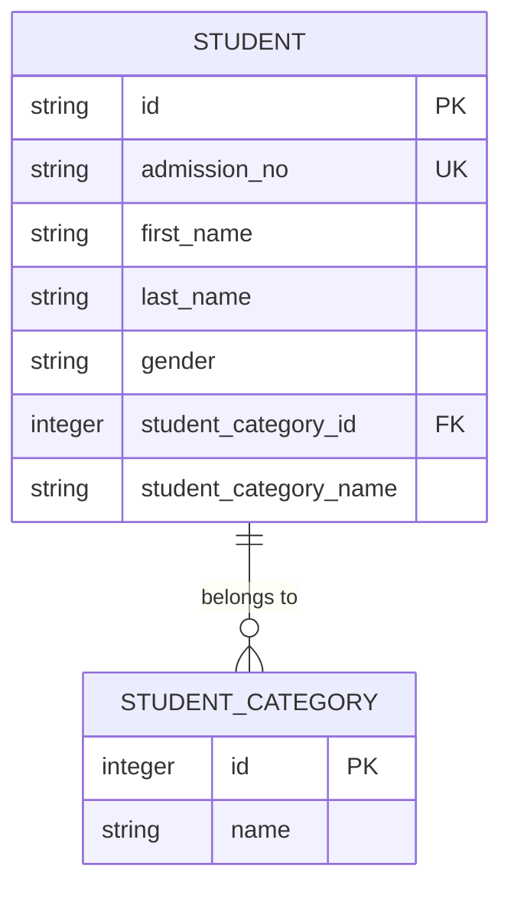
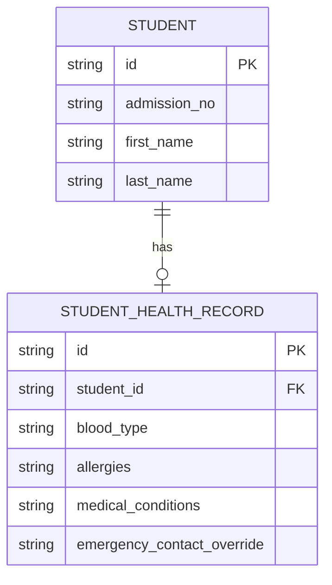
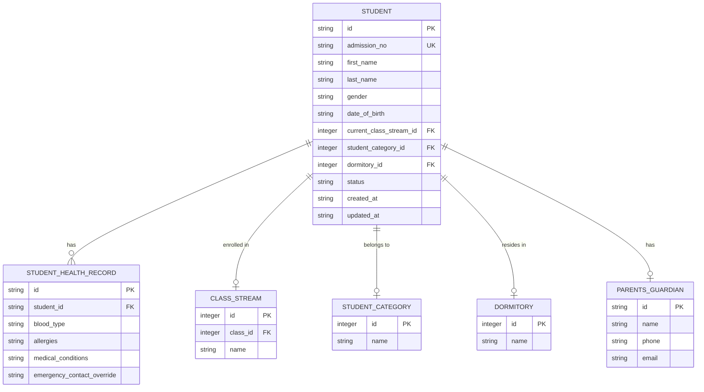

# Student Data Model

<cite>
**Referenced Files in This Document**   
- [types.ts](file://src/core/types.ts)
- [schema.ts](file://src/modules/administration/data/schema.ts)
- [collections.ts](file://src/modules/administration/data/collections.ts)
- [livestore/schema.ts](file://src/livestore/schema.ts)
</cite>

## Table of Contents
1. [Introduction](#introduction)
2. [Core Student Fields](#core-student-fields)
3. [Academic Associations](#academic-associations)
4. [Student Category](#student-category)
5. [Health Records](#health-records)
6. [Validation Rules](#validation-rules)
7. [Sample JSON Instance](#sample-json-instance)
8. [Synchronization Metadata](#synchronization-metadata)
9. [Relationship Diagrams](#relationship-diagrams)

## Introduction
This document provides comprehensive documentation for the Student entity in the Administration module of the SchoolPilot3 system. The Student data model serves as a central entity that connects various aspects of student information including personal details, academic enrollment, categorization, and health records. The model is designed to support both online and offline operations through synchronization metadata fields.

**Section sources**
- [types.ts](file://src/core/types.ts#L414-L454)

## Core Student Fields
The Student entity contains comprehensive personal information and identification data. The core fields include:

**Personal Information**
- `id`: Unique identifier for the student (string, primary key)
- `admission_no`: Unique admission number (string, required, unique)
- `upi_no`: Unique Personal Identifier number (optional)
- `first_name`: Student's first name (string, required)
- `middle_name`: Student's middle name (optional)
- `last_name`: Student's last name (string, required)
- `gender`: Student's gender (PersonGender enum, required)
- `date_of_birth`: Date of birth in ISO format (optional)
- `photo_path`: Path to student's photo (optional)

**Contact Information**
- `email`: Student's email address (optional)
- `phone`: Student's phone number (optional)
- `address`: Physical address (optional)

**System Metadata**
- `created_at`: Creation timestamp (ISO string, required)
- `updated_at`: Last update timestamp (ISO string, required)
- `deleted_at`: Deletion timestamp for soft deletes (optional)

**Section sources**
- [types.ts](file://src/core/types.ts#L414-L454)
- [livestore/schema.ts](file://src/livestore/schema.ts#L129-L169)

## Academic Associations
The Student entity maintains relationships with academic structures through foreign key references and denormalized fields for efficient querying.

### Class Enrollment
Students are associated with classes through the `current_class_stream_id` field, which references the ClassStream entity:

- `current_class_stream_id`: Foreign key to ClassStream (integer, optional)
- `current_class_name`: Denormalized class name for display (optional)
- `current_class_stream_name`: Denormalized stream name for display (optional)

The relationship follows this hierarchy:
```
Student → ClassStream → Class
```

### Academic Period
The student record includes fields related to academic periods:

- `admission_date`: Date of admission to the institution (optional)
- `status`: Student status (StudentStatus enum, required)

**Section sources**
- [types.ts](file://src/core/types.ts#L414-L515)
- [livestore/schema.ts](file://src/livestore/schema.ts#L129-L169)

## Student Category
Students are categorized using the StudentCategory entity, which allows for grouping students based on various criteria such as boarding status, scholarship recipients, or special programs.

### Category Structure
```typescript
export interface StudentCategory {
    id: number;
    name: string;
}
```

### Student-Category Relationship
- `student_category_id`: Foreign key to StudentCategory (integer, optional)
- `student_category_name`: Denormalized category name for display (optional)

The relationship is a many-to-one association where multiple students can belong to the same category.



**Diagram sources**
- [types.ts](file://src/core/types.ts#L534-L537)
- [schema.ts](file://src/modules/administration/data/schema.ts#L77-L88)

**Section sources**
- [types.ts](file://src/core/types.ts#L534-L537)
- [schema.ts](file://src/modules/administration/data/schema.ts#L77-L88)

## Health Records
The Student Health Record system provides a comprehensive view of student medical information and emergency contacts.

### Health Record Structure
The `StudentHealthRecord` interface defines the medical information structure:

```typescript
export interface StudentHealthRecord {
    id: string;
    student_id: string;
    blood_type?: string | null;
    allergies?: string | null;
    medical_conditions?: string | null;
    emergency_contact_override?: string | null;
    created_at: string;
    updated_at: string;
    student_name?: string | null;
}
```

### Validation Rules
Based on the schema definition, the following validation rules apply:

- `blood_type`: Maximum length of 10 characters
- `allergies`: Maximum length of 500 characters
- `medical_conditions`: Maximum length of 500 characters  
- `emergency_contact_override`: Maximum length of 200 characters

### Relationship with Student
The health record has a one-to-one relationship with the Student entity:



**Diagram sources**
- [types.ts](file://src/core/types.ts#L876-L887)
- [schema.ts](file://src/modules/administration/data/schema.ts#L48-L76)

**Section sources**
- [types.ts](file://src/core/types.ts#L876-L887)
- [schema.ts](file://src/modules/administration/data/schema.ts#L48-L76)

## Validation Rules
The Student entity enforces several validation rules to ensure data integrity.

### Critical Field Validations
- **Student ID Uniqueness**: The `admission_no` field must be unique across all students
- **Required Fields**: `id`, `admission_no`, `first_name`, `last_name`, `gender`, `status`, `created_at`, and `updated_at` are required
- **Date Constraints**: `date_of_birth` must be a valid date in the past
- **Status Validation**: `status` must be a valid StudentStatus enum value

### Database Constraints
From the LiveStore schema definition:

```typescript
admission_no: 'TEXT NOT NULL UNIQUE'
```

This enforces both the presence and uniqueness of the admission number at the database level.

**Section sources**
- [livestore/schema.ts](file://src/livestore/schema.ts#L129-L169)
- [types.ts](file://src/core/types.ts#L414-L454)

## Sample JSON Instance
The following is a fully populated Student record with nested health and contact data:

```json
{
  "id": "STU001",
  "admission_no": "ADM001",
  "upi_no": "UPI123456",
  "first_name": "Jim",
  "middle_name": "Halpert",
  "last_name": "Halpert",
  "gender": "Male",
  "date_of_birth": "2005-06-15",
  "photo_path": "/photos/students/STU001.jpg",
  "current_class_stream_id": 1,
  "student_category_id": 1,
  "dormitory_id": 1,
  "admission_date": "2023-01-15",
  "status": "Active",
  "address": "123 Main Street, Nairobi",
  "email": "jim.halpert@student.school.edu",
  "phone": "+254700111222",
  "display_name": "Jim Halpert",
  "created_at": "2023-01-10T08:30:00Z",
  "updated_at": "2023-08-20T14:45:00Z",
  "current_class_name": "Form 1",
  "current_class_stream_name": "A",
  "student_category_name": "Boarder",
  "dormitory_name": "Simba House",
  "primary_guardian": {
    "id": "PG001",
    "name": "William Halpert",
    "phone": "+254711223344",
    "email": "w.halpert@parent.email",
    "relationship_type": "Father",
    "created_at": "2023-01-10T08:30:00Z",
    "updated_at": "2023-01-10T08:30:00Z"
  },
  "exam_result_summary": null,
  "student_health_record": {
    "id": "HR001",
    "student_id": "STU001",
    "blood_type": "O+",
    "allergies": "Peanuts, Penicillin",
    "medical_conditions": "Asthma",
    "emergency_contact_override": "+254722111000",
    "created_at": "2023-01-10T08:30:00Z",
    "updated_at": "2023-06-15T10:20:00Z",
    "student_name": "Jim Halpert"
  }
}
```

**Section sources**
- [types.ts](file://src/core/types.ts#L414-L454)
- [schema.ts](file://src/modules/administration/data/schema.ts#L48-L76)

## Synchronization Metadata
The Student entity includes metadata fields to support offline-first operations and data synchronization across devices.

### Synchronization Fields
- `_rev`: Document revision identifier for conflict detection (not explicitly shown but implied by RxDB usage)
- `_lastSync`: Timestamp of the last successful synchronization (not explicitly shown but standard in RxDB)
- `_deleted`: Flag for soft deletion and synchronization of deletions

These fields are managed by the RxDB database layer and are used to coordinate changes between client devices and the central server, ensuring data consistency even when operating offline.

While these fields are not explicitly defined in the TypeScript interfaces, they are automatically added by the RxDB framework which is used as the underlying database system.

**Section sources**
- [collections.ts](file://src/modules/administration/data/collections.ts#L0-L56)
- [types.ts](file://src/core/types.ts#L414-L454)

## Relationship Diagrams
The following diagram illustrates the relationships between the Student entity and related collections:



**Diagram sources**
- [types.ts](file://src/core/types.ts#L414-L537)
- [schema.ts](file://src/modules/administration/data/schema.ts#L48-L76)
- [collections.ts](file://src/modules/administration/data/collections.ts#L0-L56)