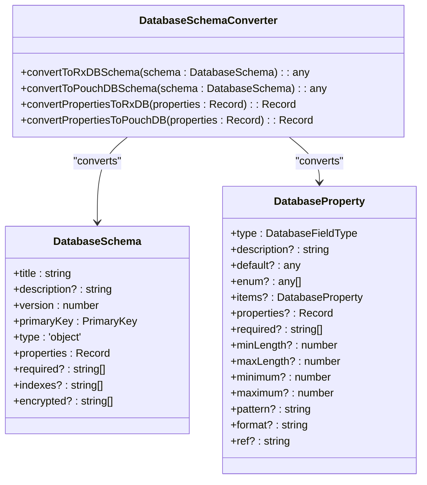
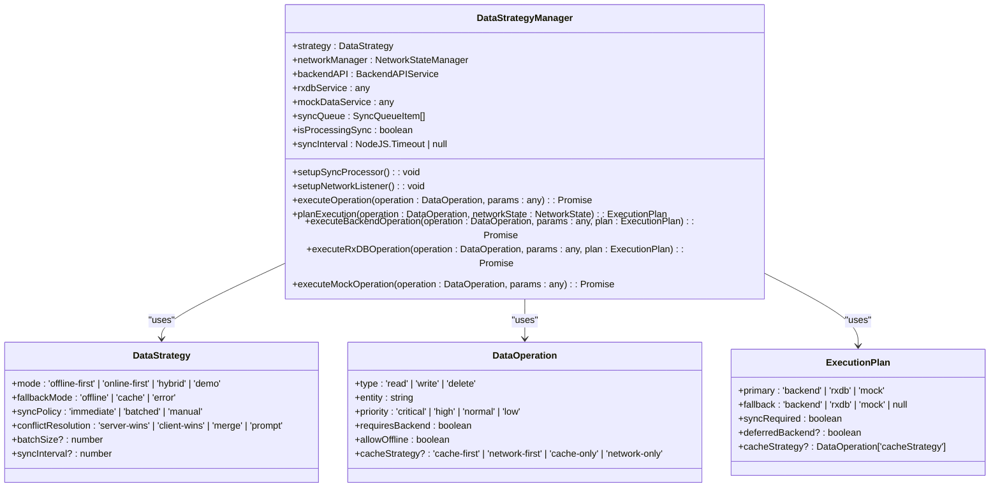
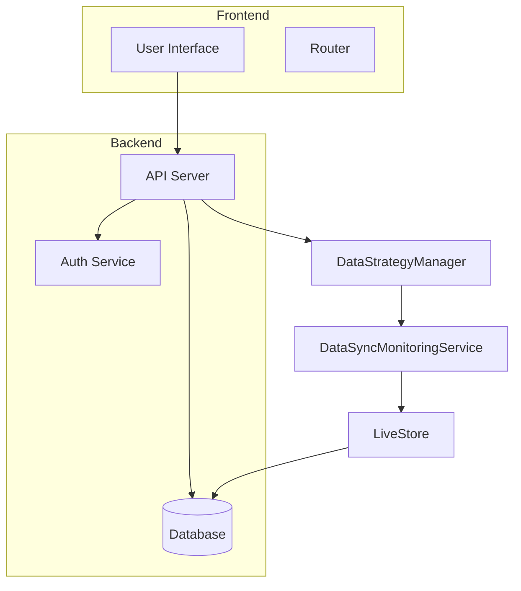

# Core Data Architecture

<cite>
**Referenced Files in This Document**   
- [databaseAgnosticSchema.ts](file://src/utils/databaseAgnosticSchema.ts)
- [DataStrategyManager.ts](file://src/services/DataStrategyManager.ts)
- [DataSyncMonitoringService.ts](file://src/services/DataSyncMonitoringService.ts)
- [schema.ts](file://src/modules/administration/data/schema.ts)
- [schema.ts](file://src/livestore/schema.ts)
- [dataLayerConfig.ts](file://src/config/dataLayerConfig.ts)
- [types.ts](file://src/core/types.ts)
</cite>

## Table of Contents
1. [Introduction](#introduction)
2. [Unified Schema Design Principles](#unified-schema-design-principles)
3. [Database-Agnostic Interface Patterns](#database-agnostic-interface-patterns)
4. [Synchronization Metadata Structure](#synchronization-metadata-structure)
5. [Base Entity Structure and Sample JSON](#base-entity-structure-and-sample-json)
6. [Schema Evolution and Migration Procedures](#schema-evolution-and-migration-procedures)
7. [Core Data Layer and LiveStore Integration](#core-data-layer-and-livestore-integration)
8. [Conclusion](#conclusion)

## Introduction
The Core Data Architecture of schoolpilot3 is designed to support a robust, scalable, and offline-first educational management system. This document details the unified schema design principles, database-agnostic interface patterns, synchronization metadata structure, and integration with the LiveStore real-time data synchronization system. The architecture ensures consistency across 88 collections in RxDB databases while providing flexible data strategy management and conflict resolution mechanisms.

## Unified Schema Design Principles

The unified schema design principles in schoolpilot3 ensure consistency and interoperability across all 88 collections in the RxDB databases. These principles are implemented through a database-agnostic schema utility that abstracts RxDB types and provides common interfaces for both RxDB and PouchDB.

### Database-Agnostic Schema Utility
The `databaseAgnosticSchema.ts` file defines a set of interfaces and a converter class that facilitate the creation and conversion of database schemas. The key interfaces include:

- **DatabaseFieldType**: A union type that includes various field types such as `string`, `number`, `integer`, `boolean`, `array`, `object`, `date`, `timestamp`, `uuid`, and `ref`.
- **DatabaseProperty**: An interface that defines the properties of a database field, including type, description, default value, enum, items, properties, required fields, and validation constraints.
- **DatabaseSchema**: An interface that defines the structure of a database schema, including title, description, version, primary key, type, properties, required fields, indexes, and encrypted fields.
- **DatabaseCollectionConfig**: An interface that configures a database collection, including name, schema, migration strategies, statics, methods, and attachment settings.

### Schema Conversion
The `DatabaseSchemaConverter` class provides methods to convert database-agnostic schemas to RxDB and PouchDB formats. The conversion process involves mapping the generic schema properties to the specific requirements of each database system.



**Diagram sources**
- [databaseAgnosticSchema.ts](file://src/utils/databaseAgnosticSchema.ts#L42-L92)

**Section sources**
- [databaseAgnosticSchema.ts](file://src/utils/databaseAgnosticSchema.ts#L0-L200)

## Database-Agnostic Interface Patterns

The database-agnostic interface patterns in schoolpilot3 are implemented through the `ProviderSelector` and `DataStrategyManager` classes. These patterns enable the system to operate seamlessly across different database providers, ensuring flexibility and maintainability.

### ProviderSelector
The `ProviderSelector` class is responsible for selecting the appropriate database provider based on the current environment and configuration. It supports multiple providers, including SQLite, PouchDB, LiveStore, and mock databases.

### DataStrategyManager
The `DataStrategyManager` class manages the data strategy and intelligent operation routing. It determines the primary and fallback execution plans based on the current network state and data strategy mode.



**Diagram sources**
- [DataStrategyManager.ts](file://src/services/DataStrategyManager.ts#L0-L42)

**Section sources**
- [DataStrategyManager.ts](file://src/services/DataStrategyManager.ts#L0-L300)

## Synchronization Metadata Structure

The synchronization metadata structure in schoolpilot3 is designed to support offline-first operations with conflict detection and resolution. The metadata includes fields such as `_meta.syncStatus`, `_meta.version`, and `_meta.lastModified`.

### SyncConflict Interface
The `SyncConflict` interface defines the structure of a synchronization conflict, including the entity name, entity ID, conflict type, local data, remote data, timestamp, and resolution status.

```typescript
export interface SyncConflict {
  id: string;
  entityName: string;
  entityId: string | number;
  conflictType: 'version' | 'concurrent_edit' | 'deleted_locally' | 'deleted_remotely';
  localData: any;
  remoteData: any;
  timestamp: Date;
  resolved: boolean;
  resolution?: ConflictResolution;
}
```

### ConflictResolution Interface
The `ConflictResolution` interface defines the resolution strategy for a conflict, including the strategy type, resolved data, resolver, resolution timestamp, and notes.

```typescript
export interface ConflictResolution {
  strategy: 'local_wins' | 'remote_wins' | 'merge' | 'manual';
  resolvedData?: any;
  resolvedBy?: string;
  resolvedAt: Date;
  notes?: string;
}
```

### SyncStatus Interface
The `SyncStatus` interface provides the current status of the synchronization process, including active status, mode, progress, queue, conflicts, last sync, next sync, errors, and performance metrics.

```typescript
export interface SyncStatus {
  isActive: boolean;
  mode: 'idle' | 'syncing' | 'paused' | 'error';
  progress: {
    current: number;
    total: number;
    percentage: number;
  };
  queue: {
    pending: number;
    processing: number;
    completed: number;
    failed: number;
    byPriority: Record<string, number>;
  };
  conflicts: {
    total: number;
    unresolved: number;
    byType: Record<string, number>;
  };
  lastSync: Date | null;
  nextSync: Date | null;
  errors: SyncError[];
  performance: {
    averageSyncTime: number;
    successRate: number;
    throughput: number; // items per minute
  };
}
```

### SyncError Interface
The `SyncError` interface defines the structure of a synchronization error, including the error ID, timestamp, entity name, entity ID, operation, error message, retry count, and resolution status.

```typescript
export interface SyncError {
  id: string;
  timestamp: Date;
  entityName: string;
  entityId?: string | number;
  operation: 'create' | 'update' | 'delete' | 'sync';
  error: string;
  retryCount: number;
  resolved: boolean;
}
```

### SyncMetrics Interface
The `SyncMetrics` interface provides performance metrics for the synchronization process, including total operations, successful operations, failed operations, average latency, peak latency, throughput, error rate, conflict rate, and cache hit rate.

```typescript
export interface SyncMetrics {
  totalOperations: number;
  successfulOperations: number;
  failedOperations: number;
  averageLatency: number;
  peakLatency: number;
  throughput: number;
  errorRate: number;
  conflictRate: number;
  cacheHitRate: number;
}
```

```mermaid
classDiagram
class DataSyncMonitoringService {
+dataStrategyManager : DataStrategyManager | null
+networkManager : NetworkStateManager
+conflicts : Map<string, SyncConflict>
+errors : SyncError[]
+metrics : SyncMetrics
+syncHistory : Array<{ timestamp : Date; duration : number; success : boolean }>
+subscribers : Array<(status : SyncStatus) => void>
+monitoringInterval : NodeJS.Timeout | null
+startMonitoring() : void
+stopMonitoring() : void
+getSyncStatus() : SyncStatus
+determineSyncMode(queueStatus : any) : SyncStatus['mode']
+handleNetworkStateChange(networkState : NetworkState) : void
+resumeSync() : void
+pauseSync() : void
+recordConflict(entityName : string, entityId : string | number, conflictType : SyncConflict['conflictType'], localData : any, remoteData : any) : string
+resolveConflict(conflictId : string, resolution : ConflictResolution) : Promise<boolean>
+recordError(operation : SyncError['operation'], entityId : string | number | string, error : any) : void
+updateMetrics() : void
+calculateThroughput() : number
+getLastSyncTime() : Date | null
+getNextSyncTime() : Date | null
+subscribe(callback : (status : SyncStatus) => void) : () => void
+notifySubscribers() : void
+getUnresolvedConflicts() : SyncConflict[]
+getMetrics() : SyncMetrics
+clearResolvedConflicts() : void
+clearErrors() : void
+forceSyncAll() : Promise<void>
+updateDataStrategyManager(dataStrategyManager : DataStrategyManager) : void
+destroy() : void
}
class SyncConflict {
+id : string
+entityName : string
+entityId : string | number
+conflictType : 'version' | 'concurrent_edit' | 'deleted_locally' | 'deleted_remotely'
+localData : any
+remoteData : any
+timestamp : Date
+resolved : boolean
+resolution? : ConflictResolution
}
class ConflictResolution {
+strategy : 'local_wins' | 'remote_wins' | 'merge' | 'manual'
+resolvedData? : any
+resolvedBy? : string
+resolvedAt : Date
+notes? : string
}
class SyncStatus {
+isActive : boolean
+mode : 'idle' | 'syncing' | 'paused' | 'error'
+progress : { current : number; total : number; percentage : number }
+queue : { pending : number; processing : number; completed : number; failed : number; byPriority : Record<string, number> }
+conflicts : { total : number; unresolved : number; byType : Record<string, number> }
+lastSync : Date | null
+nextSync : Date | null
+errors : SyncError[]
+performance : { averageSyncTime : number; successRate : number; throughput : number }
}
class SyncError {
+id : string
+timestamp : Date
+entityName : string
+entityId? : string | number
+operation : 'create' | 'update' | 'delete' | 'sync'
+error : string
+retryCount : number
+resolved : boolean
}
class SyncMetrics {
+totalOperations : number
+successfulOperations : number
+failedOperations : number
+averageLatency : number
+peakLatency : number
+throughput : number
+errorRate : number
+conflictRate : number
+cacheHitRate : number
}
DataSyncMonitoringService --> SyncConflict : "manages"
DataSyncMonitoringService --> ConflictResolution : "uses"
DataSyncMonitoringService --> SyncStatus : "provides"
DataSyncMonitoringService --> SyncError : "records"
DataSyncMonitoringService --> SyncMetrics : "tracks"
```

**Diagram sources**
- [DataSyncMonitoringService.ts](file://src/services/DataSyncMonitoringService.ts#L0-L47)

**Section sources**
- [DataSyncMonitoringService.ts](file://src/services/DataSyncMonitoringService.ts#L0-L200)

## Base Entity Structure and Sample JSON

The base entity structure in schoolpilot3 is defined in the `types.ts` file, which consolidates global and cross-module types. The base entity structure includes common fields such as `id`, `name`, `created_at`, and `updated_at`.

### Base Entity Structure
The base entity structure is defined in the `types.ts` file and includes the following fields:

- **id**: A unique identifier for the entity.
- **name**: The name of the entity.
- **created_at**: The timestamp when the entity was created.
- **updated_at**: The timestamp when the entity was last updated.

### Sample JSON Instance
A sample JSON instance of a base entity is shown below:

```json
{
  "id": "12345678-1234-1234-1234-123456789012",
  "name": "Sample Entity",
  "created_at": "2023-10-01T12:00:00Z",
  "updated_at": "2023-10-01T12:00:00Z"
}
```

**Section sources**
- [types.ts](file://src/core/types.ts#L0-L200)

## Schema Evolution and Migration Procedures

The schema evolution and migration procedures in schoolpilot3 ensure that database version upgrades are handled smoothly and consistently. The system uses a combination of schema conversion, migration strategies, and chunk processing to manage schema changes.

### Schema Conversion
The `convertRxDBSchema` function in the `migrate-mock-data-to-sqlite.ts` file converts RxDB schema definitions to a format compatible with SQLite. This function validates the schema source and converts it to the target format.

```typescript
for (const [name, def] of Object.entries(collectionsDefinition)) {
  const schemaSource = def && typeof def === 'object' && 'schema' in def ? def.schema : def;
  if (!schemaSource || typeof schemaSource !== 'object') {
    throw new Error(`Invalid schema for collection '${name}': expected object, got ${typeof schemaSource}`);
  }
  const convertedSchema = convertRxDBSchema(schemaSource);
  await sqliteService.createCollection(name, convertedSchema);
}
```

### Migration Strategies
The `DatabaseCollectionConfig` interface includes a `migrationStrategies` field that defines the migration strategies for each collection. These strategies are used to handle schema changes and ensure data integrity during upgrades.

### Chunk Processing
The `chunk_processor.ts` file implements a chunk processing mechanism for data migration. This mechanism groups migration items by collection and processes them in batches, with retry logic and rollback management.

```typescript
class MigrationManager {
  private db: RxDatabase;
  private logger = createLogger('MigrationManager');
  private rollbackLog: MigrationItem[] = [];
  private options: ChunkProcessorOptions;

  constructor(db: RxDatabase, options: Partial<ChunkProcessorOptions> = {}) {
    this.db = db;
    this.options = {
      chunkSize: 1000,
      maxRetries: 3,
      rollbackOnError: true,
      validateBeforeCommit: true,
      logLevel: 'info',
      ...options
    };
  }

  private async processChunkWithRetry<T>(
    chunk: T[],
    processor: (batch: T[]) => Promise<MigrationItem[]>
  ): Promise<MigrationItem[]> {
    let lastError: Error;
    
    for (let attempt = 1; attempt <= this.options.maxRetries; attempt++) {
      try {
        return await processor(chunk);
      } catch (error) {
        lastError = error as Error;
        this.logger.warn(`Chunk processing attempt ${attempt} failed:`, error);
        
        if (attempt < this.options.maxRetries) {
          const delay = Math.pow(2, attempt) * 1000; // Exponential backoff
          await new Promise(resolve => setTimeout(resolve, delay));
        }
      }
    }
    
    throw new Error(`Chunk processing failed after ${this.options.maxRetries} attempts: ${lastError.message}`);
  }
}
```

**Section sources**
- [migrate-mock-data-to-sqlite.ts](file://src/scripts/data-migration/migrate-mock-data-to-sqlite.ts#L27-L56)
- [chunk_processor.ts](file://scripts/migration/chunk_processor.ts#L0-L47)

## Core Data Layer and LiveStore Integration

The core data layer in schoolpilot3 is integrated with the LiveStore real-time data synchronization system to provide seamless offline-first operations and real-time data updates.

### Data Layer Configuration
The `dataLayerConfig.ts` file defines the configuration options for different database providers, including development, production, and demo environments. The configuration specifies the provider and options for each environment.

```typescript
export const DATA_LAYER_CONFIG: DataLayerConfig = {
  development: {
    provider: 'sqlite',
    options: {
      persistence: true,
      cacheSize: 1000
    }
  },
  production: {
    provider: 'livestore',
    options: {
      sync: true,
      offlineSupport: true,
      wasmSqlite: true,
      opfsStorage: true,
      crossTabPersistence: true
    }
  },
  demo: {
    provider: 'livestore',
    options: {
      sync: false,
      offlineSupport: true,
      wasmSqlite: true,
      opfsStorage: true,
      crossTabPersistence: false
    }
  }
};
```

### LiveStore Schema
The `schema.ts` file in the `src/livestore` directory defines the schema for the LiveStore system. This schema includes tables for core school information, user management, academic structure, and other entities.

```typescript
export const schema = {
  schoolDetails: State.SQLite.table<SchoolDetails>({
    name: 'school_details',
    columns: {
      id: 'INTEGER PRIMARY KEY',
      name: 'TEXT NOT NULL',
      telephone: 'TEXT',
      email: 'TEXT',
      postal_address: 'TEXT',
      town: 'TEXT',
      motto: 'TEXT',
      logo_path: 'TEXT',
      school_gender: 'TEXT',
      school_type: 'TEXT',
      head_teacher_name: 'TEXT',
      school_code: 'TEXT',
      created_at: 'TEXT NOT NULL',
      updated_at: 'TEXT NOT NULL'
    }
  }),
  users: State.SQLite.table<User>({
    name: 'users',
    columns: {
      id: 'TEXT PRIMARY KEY',
      username: 'TEXT NOT NULL UNIQUE',
      hashed_password: 'TEXT',
      email: 'TEXT NOT NULL',
      role_id: 'INTEGER',
      role: 'TEXT',
      display_name: 'TEXT',
      userType: 'TEXT NOT NULL',
      isActive: 'INTEGER NOT NULL DEFAULT 1'
    }
  }),
  // ... other tables
};
```

### Integration with Core Data Layer
The core data layer and LiveStore integration are managed through the `DataStrategyManager` and `DataSyncMonitoringService` classes. These classes ensure that data operations are routed correctly and that synchronization is handled efficiently.



**Diagram sources**
- [dataLayerConfig.ts](file://src/config/dataLayerConfig.ts#L0-L46)
- [schema.ts](file://src/livestore/schema.ts#L0-L199)

**Section sources**
- [dataLayerConfig.ts](file://src/config/dataLayerConfig.ts#L0-L46)
- [schema.ts](file://src/livestore/schema.ts#L0-L199)

## Conclusion
The Core Data Architecture of schoolpilot3 is a robust and flexible system designed to support a wide range of educational management needs. By implementing unified schema design principles, database-agnostic interface patterns, and a comprehensive synchronization metadata structure, the system ensures consistency, reliability, and scalability. The integration with the LiveStore real-time data synchronization system further enhances the system's capabilities, providing seamless offline-first operations and real-time data updates. This architecture is well-suited for both small and large educational institutions, offering a solid foundation for managing complex data requirements.