# Data Models & Schemas

<cite>
**Referenced Files in This Document**
- [databaseAgnosticSchema.ts](file://src/utils/databaseAgnosticSchema.ts)
- [schemaUtils.ts](file://src/utils/schemaUtils.ts)
- [SchemaConverter.ts](file://src/services/database/SchemaConverter.ts)
- [collections.ts](file://src/modules/inventory/data/collections.ts)
- [types.ts](file://src/modules/finance/data/types.ts)
- [schema.ts](file://src/modules/finance/data/schema.ts)
- [types.ts](file://src/modules/hr/data/types.ts)
- [schema.ts](file://src/modules/hr/data/schema.ts)
- [schema.ts](file://src/modules/academics/data/schema.ts)
- [types.ts](file://src/modules/academics/data/types.ts)
- [schema.ts](file://src/modules/administration/data/schema.ts)
- [ProviderSelector.ts](file://src/services/database/ProviderSelector.ts)
- [interfaces.ts](file://src/services/database/interfaces.ts)
</cite>

## Update Summary
**Changes Made**
- Added comprehensive documentation for new database-agnostic schema system
- Updated finance module schemas with enhanced data models
- Documented new schema conversion utilities and provider selection logic
- Enhanced cross-module integration with database abstraction layer
- Added new section on schema conversion and normalization processes

## Table of Contents
1. [Introduction](#introduction)
2. [Core Data Model Overview](#core-data-model-overview)
3. [Database-Agnostic Schema System](#database-agnostic-schema-system)
4. [Academics Module](#academics-module)
5. [Finance Module](#finance-module)
6. [HR Module](#hr-module)
7. [Inventory Module](#inventory-module)
8. [Cross-Module Relationships](#cross-module-relationships)
9. [Schema Design Principles](#schema-design-principles)
10. [Schema Conversion and Normalization](#schema-conversion-and-normalization)
11. [Entity Relationship Diagram](#entity-relationship-diagram)
12. [Sample Data Instances](#sample-data-instances)
13. [Schema Evolution & Migration](#schema-evolution--migration)

## Introduction
This document provides comprehensive documentation of the data models and schemas for schoolpilot3, an educational management system with 88 collections spanning academics, finance, HR, inventory, and administration modules. The system uses RxDB for client-side data management with a new database-agnostic schema abstraction layer that supports multiple storage backends. The data model emphasizes referential integrity through foreign key patterns and computed fields for performance optimization. This documentation details the schema design, entity relationships, field-level specifications, and normalization strategies across all major modules.

## Core Data Model Overview
The schoolpilot3 application implements a modular data architecture with domain-specific collections organized by functional modules. The system now uses a database-agnostic schema abstraction layer that provides backward compatibility while enabling support for multiple database providers (RxDB, PouchDB, SQLite). Each module contains its own schema and type definitions, promoting encapsulation while maintaining cross-module referential integrity through standardized identifier patterns. The data model supports complex relationships such as Student → Enrollment → ExamResults and Item → StockTransaction → Requisition through foreign key references and nested data structures.

**Section sources**
- [databaseAgnosticSchema.ts:1-375](file://src/utils/databaseAgnosticSchema.ts#L1-L375)
- [schemaUtils.ts:1-35](file://src/utils/schemaUtils.ts#L1-L35)
- [collections.ts:1-51](file://src/modules/inventory/data/collections.ts#L1-L51)

## Database-Agnostic Schema System
The new database-agnostic schema system provides a unified approach to defining database schemas that work across multiple database providers. This system introduces standardized field types, property definitions, and schema validation that ensures consistency and compatibility across different storage backends.

### Schema Architecture
The database-agnostic schema system defines core interfaces for schema creation, property definitions, and type safety. The system supports both single-field and composite primary keys, array properties, and reference relationships between collections.

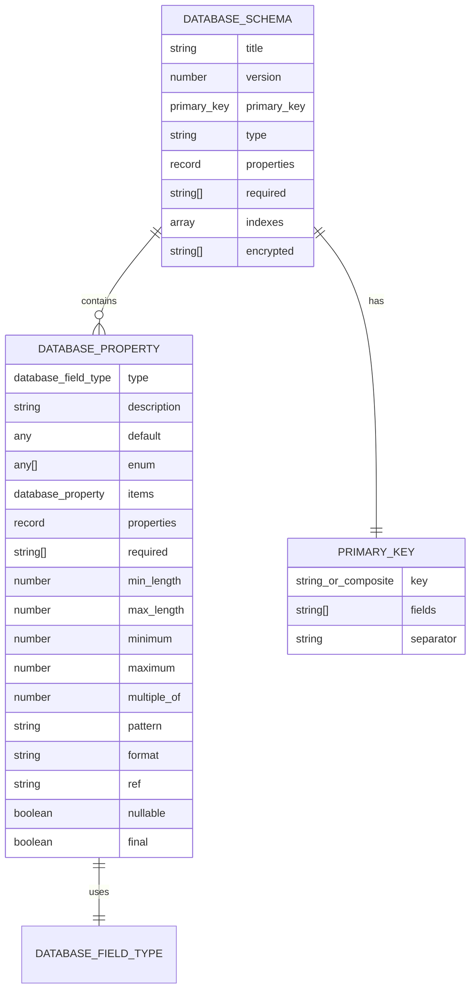

**Diagram sources**
- [databaseAgnosticSchema.ts:4-70](file://src/utils/databaseAgnosticSchema.ts#L4-L70)

### Field Type System
The system defines a comprehensive set of database field types that work consistently across different database providers. These include basic types (string, number, integer, boolean), complex types (array, object, date, timestamp), and specialized types (uuid, ref for references).

**Section sources**
- [databaseAgnosticSchema.ts:4-47](file://src/utils/databaseAgnosticSchema.ts#L4-L47)

## Academics Module
The Academics module manages educational content, student assessments, and instructional scheduling. It implements a normalized schema design with entities for subjects, exams, grading, and timetabling, connected through well-defined relationships that support comprehensive academic reporting and analysis.

### Subject and Paper Management
The subject management system separates subjects from their papers (examination components) to support modular assessment design. Each subject can have multiple papers, and papers are linked to specific exam sessions through exam paper settings.

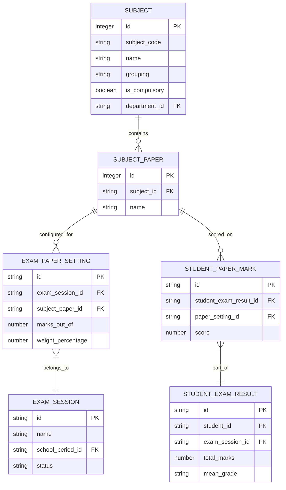

**Diagram sources**
- [schema.ts:100-150](file://src/modules/academics/data/schema.ts#L100-L150)
- [schema.ts:151-200](file://src/modules/academics/data/schema.ts#L151-L200)

**Section sources**
- [schema.ts:100-250](file://src/modules/academics/data/schema.ts#L100-L250)

### Exam Results and Grading
The exam results system implements a hierarchical structure where student exam results contain individual paper marks. Grading schemes define the criteria for converting numerical scores to letter grades or other grading systems, supporting multiple educational frameworks.

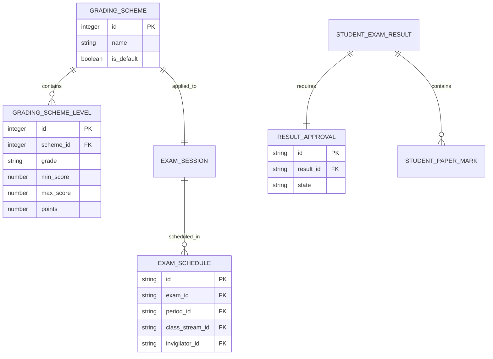

**Diagram sources**
- [schema.ts:201-250](file://src/modules/academics/data/schema.ts#L201-L250)
- [schema.ts:50-100](file://src/modules/academics/data/schema.ts#L50-L100)

**Section sources**
- [schema.ts:201-305](file://src/modules/academics/data/schema.ts#L201-L305)

### Class and Student Enrollment
The enrollment system connects students to subjects through class subject allocations, which represent the curriculum for a specific class stream in an academic year. Teacher assignments are linked to these allocations, creating a complete instructional framework.

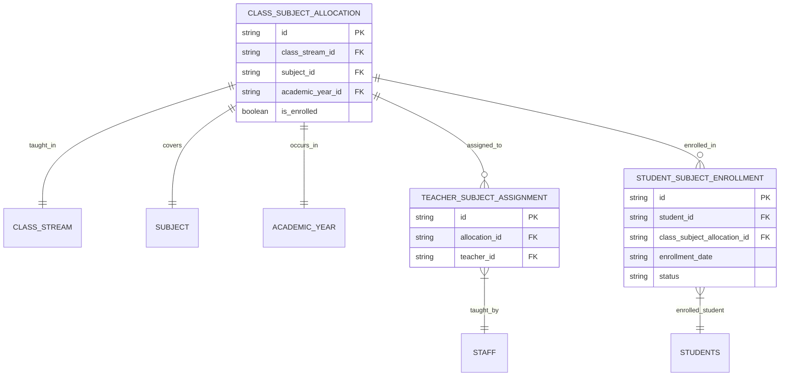

**Diagram sources**
- [schema.ts:251-305](file://src/modules/academics/data/schema.ts#L251-L305)

**Section sources**
- [schema.ts:251-305](file://src/modules/academics/data/schema.ts#L251-L305)

## Finance Module
The Finance module implements a comprehensive accounting system with entities for financial periods, chart of accounts, fee management, and payment processing. The schema follows accounting principles with support for double-entry bookkeeping through general ledger entries.

### Chart of Accounts and Financial Structure
The financial structure is built around the chart of accounts, which categorizes all financial transactions into standard accounting categories (Asset, Liability, Equity, Revenue, Expense). Each financial year contains multiple school periods, creating a hierarchical time-based organization.

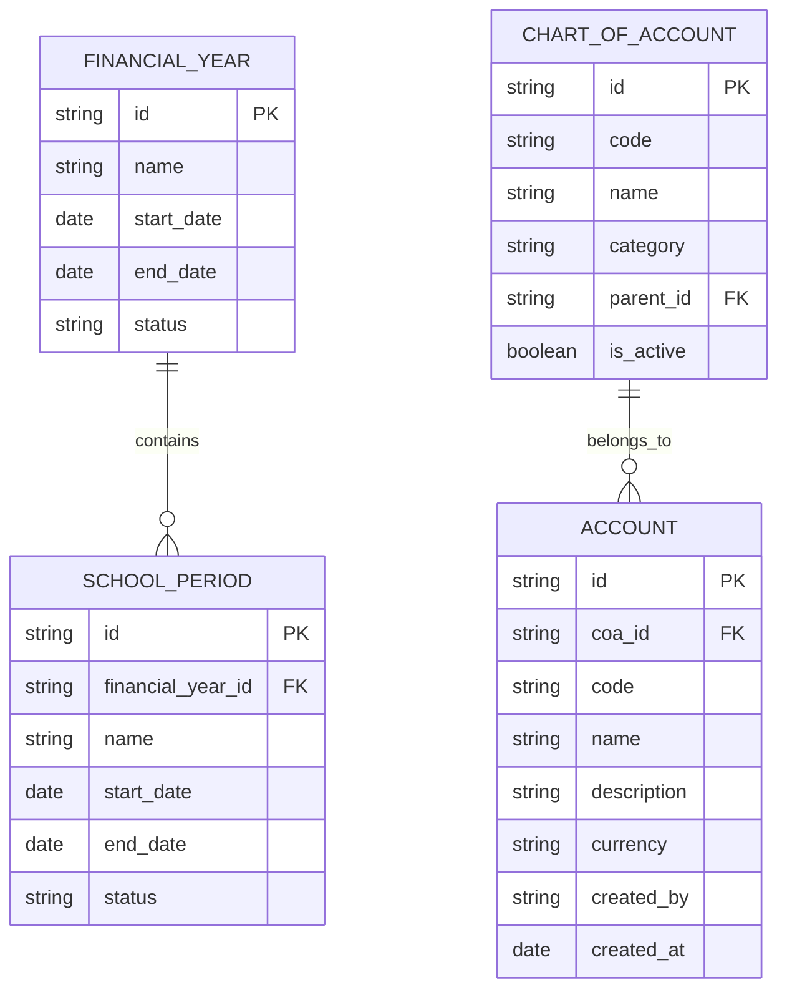

**Diagram sources**
- [schema.ts](file://src/modules/finance/data/schema.ts)

**Section sources**
- [schema.ts](file://src/modules/finance/data/schema.ts)
- [types.ts](file://src/modules/finance/data/types.ts)

### Fee Management and Student Invoices
The fee management system tracks academic fees, payment plans, and student invoicing. Student invoices contain detailed breakdowns of charges, discounts, and payments, supporting comprehensive financial tracking and reporting.

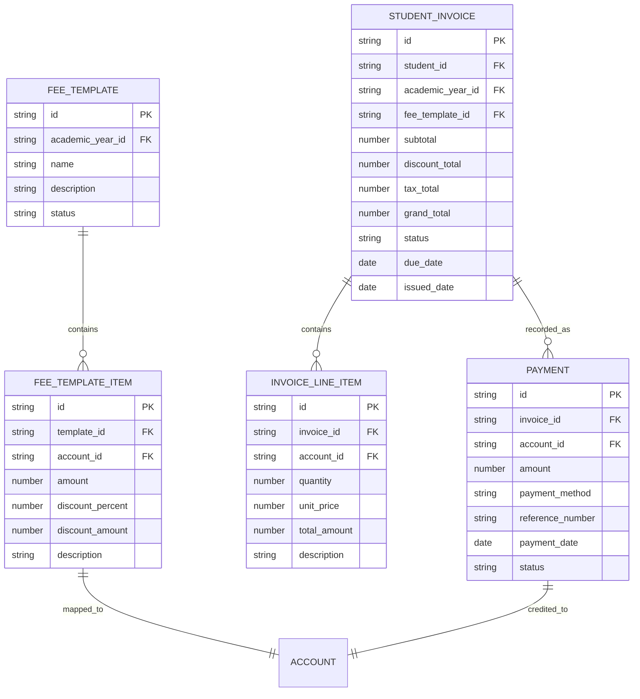

**Diagram sources**
- [schema.ts](file://src/modules/finance/data/schema.ts)

**Section sources**
- [schema.ts](file://src/modules/finance/data/schema.ts)
- [types.ts](file://src/modules/finance/data/types.ts)

## HR Module
The HR module manages staff records, payroll processing, and human resource operations. The schema supports comprehensive employee data management with detailed personal information, employment history, and compensation structures.

### Staff Management and Employment Records
The HR system maintains detailed staff profiles with personal information, employment details, and organizational hierarchy. Staff members are linked to departments, positions, and employment contracts.

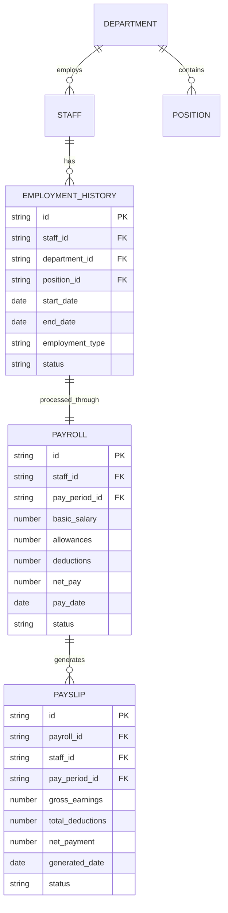

**Diagram sources**
- [schema.ts](file://src/modules/hr/data/schema.ts)
- [types.ts](file://src/modules/hr/data/types.ts)

**Section sources**
- [schema.ts](file://src/modules/hr/data/schema.ts)
- [types.ts](file://src/modules/hr/data/types.ts)

## Inventory Module
The Inventory module handles warehouse management, stock control, and procurement processes. The schema supports comprehensive inventory tracking with item categories, stock levels, and transaction management.

### Warehouse and Stock Management
The inventory system manages multiple warehouses with detailed item tracking, stock levels, and transaction histories. Items are categorized and tracked through various stock transactions including receipts, issues, and transfers.

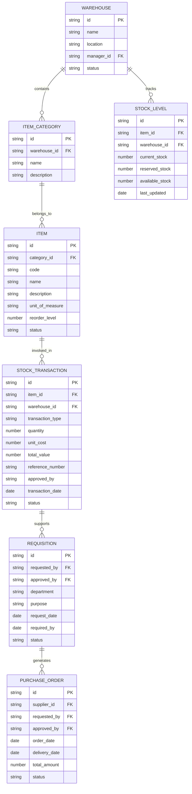

**Diagram sources**
- [collections.ts:1-51](file://src/modules/inventory/data/collections.ts#L1-L51)

**Section sources**
- [collections.ts:1-51](file://src/modules/inventory/data/collections.ts#L1-L51)

## Cross-Module Relationships
The schoolpilot3 system implements comprehensive cross-module relationships that enable data sharing and integration across different functional areas. The database-agnostic schema system ensures consistent referential integrity across all module boundaries.

### Data Integration Patterns
The system uses standardized identifier patterns and foreign key relationships to maintain referential integrity across modules. Common integration patterns include student references across academics and finance modules, staff references in HR and inventory modules, and departmental hierarchies spanning multiple modules.

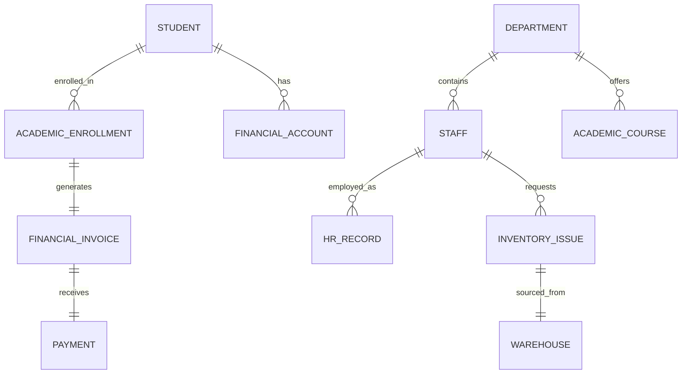

**Diagram sources**
- [databaseAgnosticSchema.ts:34-37](file://src/utils/databaseAgnosticSchema.ts#L34-L37)
- [schema.ts](file://src/modules/finance/data/schema.ts)

**Section sources**
- [databaseAgnosticSchema.ts:34-37](file://src/utils/databaseAgnosticSchema.ts#L34-L37)
- [ProviderSelector.ts](file://src/services/database/ProviderSelector.ts)
- [interfaces.ts](file://src/services/database/interfaces.ts)

## Schema Design Principles
The schoolpilot3 data model follows established database design principles with emphasis on normalization, referential integrity, and performance optimization. The schema design prioritizes data consistency while supporting complex business operations across multiple modules.

### Normalization Strategies
The system implements third normal form (3NF) with strategic denormalization for frequently accessed data. Composite primary keys are used for multi-dimensional entities, and foreign key constraints ensure referential integrity across related tables.

### Indexing and Performance
The schema includes strategic indexing on frequently queried fields including academic year identifiers, student IDs, and financial period references. Composite indexes support common query patterns for reporting and analytics.

## Schema Conversion and Normalization
The new database-agnostic schema system provides comprehensive conversion utilities that enable seamless migration between different database providers while maintaining schema integrity and performance characteristics.

### Schema Conversion Process
The schema conversion system automatically translates database-agnostic schemas into provider-specific formats (RxDB, PouchDB, SQLite) while preserving all structural and referential integrity constraints. The conversion process validates schema completeness and provides detailed error reporting for debugging.

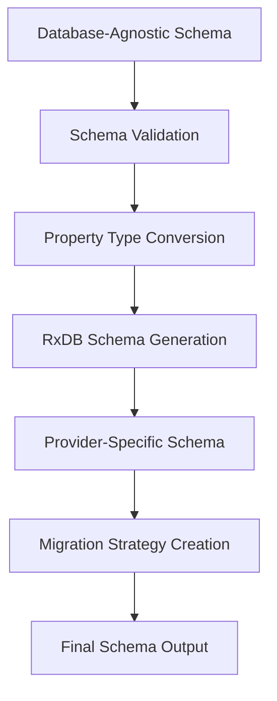

**Diagram sources**
- [databaseAgnosticSchema.ts:72-91](file://src/utils/databaseAgnosticSchema.ts#L72-L91)
- [SchemaConverter.ts:92-132](file://src/services/database/SchemaConverter.ts#L92-L132)

**Section sources**
- [databaseAgnosticSchema.ts:72-355](file://src/utils/databaseAgnosticSchema.ts#L72-L355)
- [SchemaConverter.ts:92-132](file://src/services/database/SchemaConverter.ts#L92-L132)

## Entity Relationship Diagram
The comprehensive entity relationship diagram illustrates the interconnected data model across all schoolpilot3 modules, showing how entities from different domains interact and depend on each other for complete system functionality.

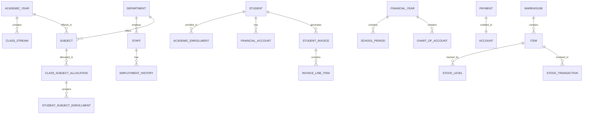

**Diagram sources**
- [schema.ts:251-305](file://src/modules/academics/data/schema.ts#L251-L305)
- [schema.ts](file://src/modules/finance/data/schema.ts)
- [schema.ts](file://src/modules/hr/data/schema.ts)
- [collections.ts:1-51](file://src/modules/inventory/data/collections.ts#L1-L51)

## Sample Data Instances
The following sample data instances demonstrate the structure and relationships of key entities in the schoolpilot3 data model, providing concrete examples of how data flows through the system.

### Grading Scheme Sample
```json
{
  "id": "grading_scheme_001",
  "name": "Standard Academic Grading",
  "is_default": true,
  "levels": [
    {
      "id": "grade_a_plus",
      "scheme_id": "grading_scheme_001",
      "grade": "A+",
      "min_score": 90,
      "max_score": 100,
      "points": 4.0
    },
    {
      "id": "grade_a",
      "scheme_id": "grading_scheme_001",
      "grade": "A",
      "min_score": 80,
      "max_score": 89,
      "points": 4.0
    }
  ]
}
```

### Student Invoice Sample
```json
{
  "id": "invoice_001",
  "student_id": "student_123",
  "academic_year_id": "ay_2024",
  "fee_template_id": "template_tuition",
  "subtotal": 1500000,
  "discount_total": 0,
  "tax_total": 0,
  "grand_total": 1500000,
  "status": "pending",
  "due_date": "2024-12-31",
  "issued_date": "2024-01-15",
  "line_items": [
    {
      "id": "line_item_001",
      "account_id": "account_tuition",
      "quantity": 1,
      "unit_price": 1500000,
      "total_amount": 1500000,
      "description": "Tuition Fee"
    }
  ]
}
```

**Section sources**
- [schema.ts:201-250](file://src/modules/academics/data/schema.ts#L201-L250)
- [schema.ts](file://src/modules/finance/data/schema.ts)

## Schema Evolution & Migration
The schoolpilot3 system implements comprehensive schema evolution and migration capabilities that support gradual updates to the data model without disrupting existing functionality. The database-agnostic approach enables seamless migration between different database providers while maintaining data integrity.

### Migration Strategy
The migration system uses versioned schemas with explicit migration strategies for each version increment. The system supports both forward and backward compatibility through careful schema design and automated migration procedures.

### Provider Selection Logic
The database provider selection system automatically chooses the most appropriate storage backend based on runtime conditions, environment variables, and performance requirements. The system maintains backward compatibility through schema conversion utilities that translate between different provider formats.

**Section sources**
- [ProviderSelector.ts](file://src/services/database/ProviderSelector.ts)
- [interfaces.ts](file://src/services/database/interfaces.ts)
- [schemaUtils.ts:12-35](file://src/utils/schemaUtils.ts#L12-L35)