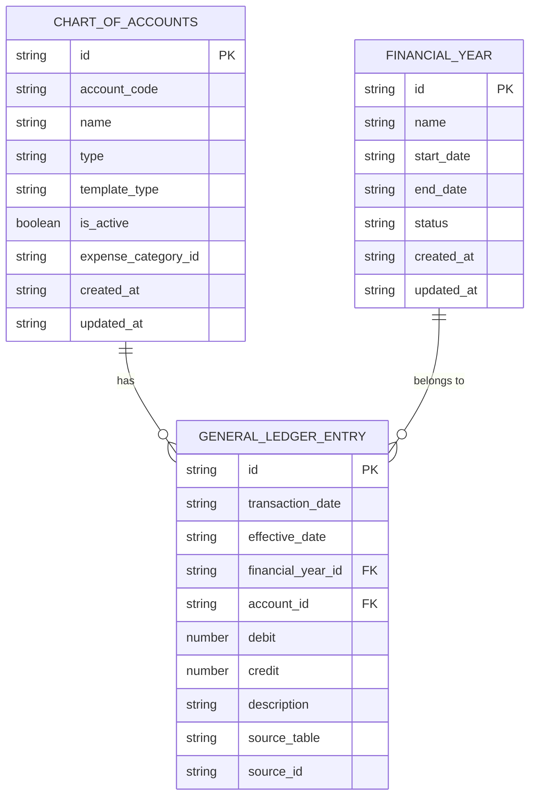
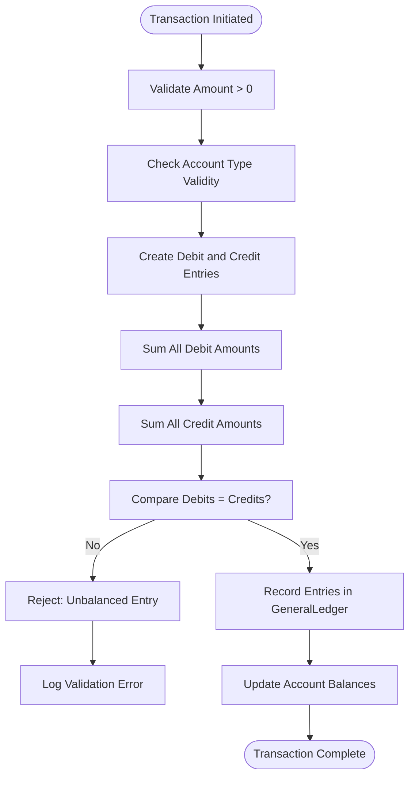
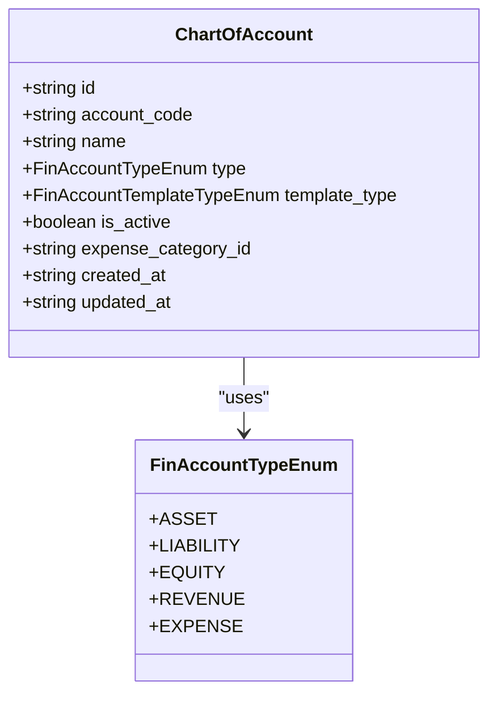
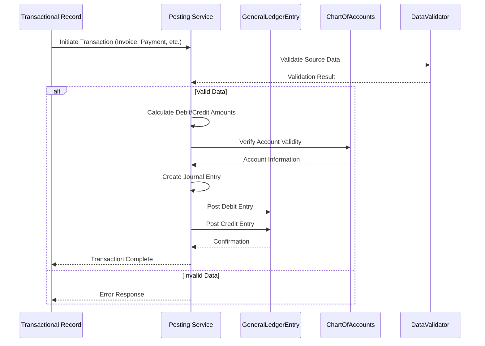
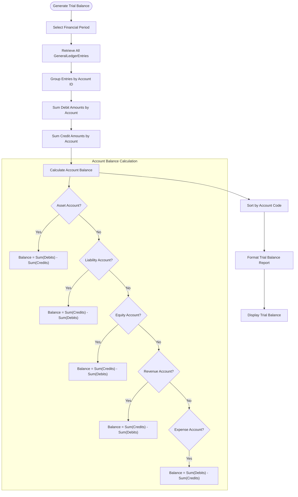
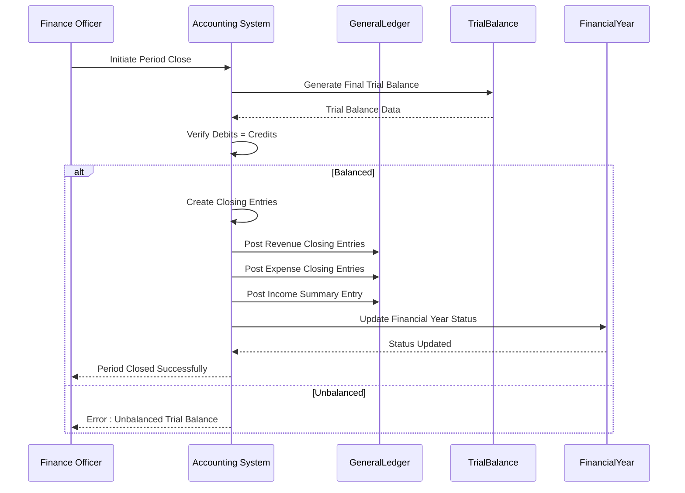
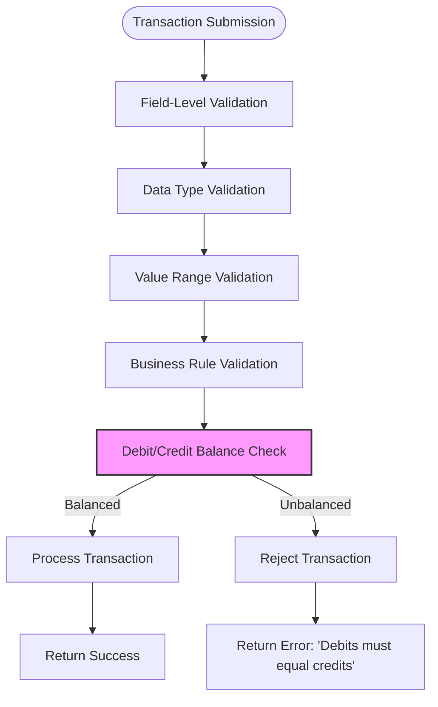

# Double-Entry Accounting System

<cite>
**Referenced Files in This Document**   
- [mockData.ts](file://src/modules/finance/data/mockData.ts)
- [schema.ts](file://src/modules/finance/data/schema.ts)
- [types.ts](file://src/modules/finance/data/types.ts)
- [useGeneralLedgerEntryData.ts](file://src/modules/finance/data/useGeneralLedgerEntryData.ts)
- [dataValidation.ts](file://src/utils/dataValidation.ts)
- [validationSchemas.ts](file://src/utils/validationSchemas.ts)
</cite>

## Table of Contents
1. [Introduction](#introduction)
2. [General Ledger and Chart of Accounts Structure](#general-ledger-and-chart-of-accounts-structure)
3. [Double-Entry Accounting Implementation](#double-entry-accounting-implementation)
4. [Account Type Validation and Hierarchy](#account-type-validation-and-hierarchy)
5. [Transaction Posting Workflow](#transaction-posting-workflow)
6. [Sample Journal Entries](#sample-journal-entries)
7. [Reconciliation and Trial Balance](#reconciliation-and-trial-balance)
8. [Period Closing Procedures](#period-closing-procedures)
9. [Error Handling and Data Validation](#error-handling-and-data-validation)

## Introduction
The Double-Entry Accounting System in schoolpilot3's Finance module implements a comprehensive accounting framework that ensures financial integrity through the fundamental principle that every financial transaction affects at least two accounts, with total debits equaling total credits. This documentation details the implementation of the GeneralLedgerEntry collection, its relationship with the ChartOfAccounts, and the complete workflow from transactional records to ledger entries. The system enforces accounting rules through data validation, maintains hierarchical account structures, and provides mechanisms for reconciliation, trial balance generation, and period closing.

**Section sources**
- [mockData.ts](file://src/modules/finance/data/mockData.ts)
- [schema.ts](file://src/modules/finance/data/schema.ts)

## General Ledger and Chart of Accounts Structure

The accounting system is built around two core entities: the GeneralLedgerEntry and the ChartOfAccounts. The ChartOfAccounts defines the structure of all financial accounts, while the GeneralLedgerEntry records all financial transactions.



**Diagram sources**
- [schema.ts](file://src/modules/finance/data/schema.ts#L100-L150)
- [types.ts](file://src/modules/finance/data/types.ts#L10-L50)

### Chart of Accounts Structure
The ChartOfAccounts entity defines the complete set of financial accounts available for recording transactions. Each account has a unique identifier, account code, name, type, and active status. The account type determines how the account behaves in the accounting system and includes five fundamental categories:

- **Asset**: Resources owned by the institution (e.g., bank accounts, accounts receivable)
- **Liability**: Obligations owed to external parties (e.g., accounts payable, accrued expenses)
- **Equity**: Owner's interest in the institution (e.g., retained earnings, capital reserves)
- **Revenue**: Income generated from operations (e.g., tuition fees, grants)
- **Expense**: Costs incurred in operations (e.g., salaries, utilities)

The chart of accounts also includes a template_type field that distinguishes between core accounts (predefined system accounts) and custom accounts (user-defined accounts).

**Section sources**
- [schema.ts](file://src/modules/finance/data/schema.ts#L100-L150)
- [types.ts](file://src/modules/finance/data/types.ts#L10-L20)

### General Ledger Entry Structure
The GeneralLedgerEntry entity records individual accounting entries with essential transaction details. Each entry represents either a debit or credit to a specific account, but not both in the same record. The key fields include:

- **transaction_date**: Timestamp of when the transaction was recorded
- **effective_date**: Business date of the transaction
- **financial_year_id**: Reference to the financial year
- **account_id**: Reference to the ChartOfAccounts entry
- **debit**: Amount recorded as a debit (positive value)
- **credit**: Amount recorded as a credit (positive value)
- **description**: Narrative description of the transaction
- **source_table** and **source_id**: References to the originating transaction record

**Section sources**
- [schema.ts](file://src/modules/finance/data/schema.ts#L350-L377)
- [types.ts](file://src/modules/finance/data/types.ts#L250-L270)

## Double-Entry Accounting Implementation

The system enforces double-entry accounting principles by requiring that for every financial transaction, there are corresponding debit and credit entries that balance each other. This is implemented through the GeneralLedgerEntry collection, where each transaction is represented by multiple entries.

### Debit/Credit Balance Rules
The accounting system enforces the fundamental accounting equation: Assets = Liabilities + Equity. This is maintained through strict validation rules:

1. Every transaction must have at least one debit entry and one credit entry
2. The sum of all debits must equal the sum of all credits for each transaction
3. Account types determine normal balance behavior:
   - Asset and Expense accounts normally carry debit balances
   - Liability, Equity, and Revenue accounts normally carry credit balances

The system uses the following validation rules to enforce these principles:



**Diagram sources**
- [schema.ts](file://src/modules/finance/data/schema.ts#L350-L377)
- [dataValidation.ts](file://src/utils/dataValidation.ts#L86-L133)

### Accounting Integrity Enforcement
The system maintains accounting integrity through several mechanisms:

1. **Data Validation**: The schema enforces data type constraints and value ranges
2. **Referential Integrity**: Foreign key relationships ensure valid account references
3. **Business Rules**: Custom validation rules enforce accounting principles
4. **Audit Trail**: Created and updated timestamps provide transaction history

The GeneralLedgerEntry schema includes validation rules that ensure:
- Debit and credit amounts are positive values (minimum 0.01)
- Transaction dates are properly formatted timestamps
- Required fields are present (id, transaction_date, effective_date, etc.)
- Account references point to valid ChartOfAccounts entries

**Section sources**
- [schema.ts](file://src/modules/finance/data/schema.ts#L350-L377)
- [dataValidation.ts](file://src/utils/dataValidation.ts#L86-L133)

## Account Type Validation and Hierarchy

The accounting system implements a hierarchical structure for accounts through the ChartOfAccounts, with validation rules that ensure proper account classification and usage.

### Account Type Validation
The system uses an enumeration to define valid account types, ensuring consistency across the application:

```typescript
export enum FinAccountTypeEnum { 
  ASSET = 'Asset', 
  LIABILITY = 'Liability', 
  EQUITY = 'Equity', 
  REVENUE = 'Revenue', 
  EXPENSE = 'Expense' 
}
```

This enumeration is used in the schema validation to ensure that only valid account types can be assigned to chart of account entries:



**Diagram sources**
- [types.ts](file://src/modules/finance/data/types.ts#L10-L20)
- [schema.ts](file://src/modules/finance/data/schema.ts#L100-L150)

### Hierarchical Account Structure
The chart of accounts implements a hierarchical structure through account codes and grouping. The system uses a four-digit account code system where the first digit represents the account type:

- **1xxx**: Asset accounts
- **2xxx**: Liability accounts  
- **3xxx**: Equity accounts
- **4xxx**: Revenue accounts
- **5xxx**: Expense accounts

This hierarchical structure allows for:
- Logical grouping of related accounts
- Easy identification of account types by code
- Simplified financial statement generation
- Efficient account searching and filtering

The system also supports a template_type distinction between core accounts (predefined system accounts) and custom accounts (user-defined accounts), allowing institutions to extend the chart of accounts while maintaining standard core accounts.

**Section sources**
- [mockData.ts](file://src/modules/finance/data/mockData.ts#L50-L150)
- [types.ts](file://src/modules/finance/data/types.ts#L15-L20)

## Transaction Posting Workflow

The system implements a comprehensive workflow for posting financial transactions from source records to the general ledger. This process ensures that all financial activities are properly recorded with appropriate double-entry accounting.

### Posting Process Overview
The transaction posting workflow follows these steps:



**Diagram sources**
- [useGeneralLedgerEntryData.ts](file://src/modules/finance/data/useGeneralLedgerEntryData.ts#L36-L56)
- [schema.ts](file://src/modules/finance/data/schema.ts#L350-L377)

### Source to Ledger Mapping
Transactional records from various modules are converted to general ledger entries through a standardized process:

1. **Student Invoices**: When a student invoice is created or paid, corresponding ledger entries are generated
2. **Supplier Invoices**: Payments to suppliers create expense and bank account entries
3. **Student Payments**: Receipt of student payments creates bank and revenue entries
4. **Expense Claims**: Approved expense claims create expense and liability entries

The posting service ensures that each transaction is represented by at least two ledger entries (one debit, one credit) that balance each other. The source_table and source_id fields in the GeneralLedgerEntry maintain the audit trail back to the originating transaction.

**Section sources**
- [useGeneralLedgerEntryData.ts](file://src/modules/finance/data/useGeneralLedgerEntryData.ts)
- [mockData.ts](file://src/modules/finance/data/mockData.ts#L190-L200)

## Sample Journal Entries

The following examples demonstrate balanced journal entries for common financial operations in the schoolpilot3 system.

### Opening Balance Entry
When initializing the accounting system, opening balances are recorded to establish the starting financial position:

```json
[
  {
    "id": "GLE001",
    "transaction_date": "2024-07-01T00:00:00.000Z",
    "effective_date": "2024-07-01",
    "financial_year_id": 1,
    "account_id": 101,
    "debit": 500000,
    "description": "Opening balance - July 2024",
    "source_table": "system_init",
    "source_id": "init_001"
  },
  {
    "id": "GLE002",
    "transaction_date": "2024-07-01T00:00:00.000Z",
    "effective_date": "2024-07-01",
    "financial_year_id": 1,
    "account_id": 301,
    "credit": 500000,
    "description": "Opening balance - July 2024",
    "source_table": "system_init",
    "source_id": "init_001"
  }
]
```

This entry establishes an opening balance of 500,000 by debiting the bank account (Asset) and crediting retained earnings (Equity).

### Student Fees Collection
When student fees are collected, the transaction is recorded as follows:

```json
[
  {
    "id": "GLE003",
    "transaction_date": "2024-07-05T10:30:00.000Z",
    "effective_date": "2024-07-05",
    "financial_year_id": 1,
    "account_id": 101,
    "debit": 250000,
    "description": "Student fees collection - Term 3",
    "source_table": "student_payments",
    "source_id": "SPAY001"
  },
  {
    "id": "GLE004",
    "transaction_date": "2024-07-05T10:30:00.000Z",
    "effective_date": "2024-07-05",
    "financial_year_id": 1,
    "account_id": 401,
    "credit": 250000,
    "description": "Student fees collection - Term 3",
    "source_table": "student_payments",
    "source_id": "SPAY001"
  }
]
```

This entry records the receipt of 250,000 in student fees by debiting the bank account and crediting tuition fees revenue.

### Expense Payment
When paying for expenses, such as textbooks, the transaction is recorded as:

```json
[
  {
    "id": "GLE005",
    "transaction_date": "2024-07-10T14:15:00.000Z",
    "effective_date": "2024-07-10",
    "financial_year_id": 1,
    "account_id": 504,
    "debit": 85000,
    "description": "Payment to Text Book Centre",
    "source_table": "supplier_invoices",
    "source_id": "SINV001"
  },
  {
    "id": "GLE006",
    "transaction_date": "2024-07-10T14:15:00.000Z",
    "effective_date": "2024-07-10",
    "financial_year_id": 1,
    "account_id": 101,
    "credit": 85000,
    "description": "Payment to Text Book Centre",
    "source_table": "supplier_invoices",
    "source_id": "SINV001"
  }
]
```

This entry records the payment of 85,000 for teaching materials by debiting the teaching materials expense account and crediting the bank account.

**Section sources**
- [mockData.ts](file://src/modules/finance/data/mockData.ts#L190-L200)
- [schema.ts](file://src/modules/finance/data/schema.ts#L350-L377)

## Reconciliation and Trial Balance

The accounting system provides mechanisms for reconciliation and trial balance generation to ensure the accuracy and integrity of financial records.

### Trial Balance Generation
The trial balance is generated by summarizing all general ledger entries by account, showing the total debits and credits for each account:



**Diagram sources**
- [mockData.ts](file://src/modules/finance/data/mockData.ts)
- [useGeneralLedgerEntryData.ts](file://src/modules/finance/data/useGeneralLedgerEntryData.ts)

### Reconciliation Process
The reconciliation process ensures that the general ledger balances match external records:

1. **Bank Reconciliation**: Compare general ledger bank account balances with bank statements
2. **Accounts Receivable**: Verify student receivables against invoice records
3. **Accounts Payable**: Confirm supplier payables against outstanding invoices
4. **Inventory**: Match inventory asset values with physical counts

The system supports reconciliation through:
- Detailed transaction histories in the GeneralLedgerEntry
- Source references that link to original documents
- Date filtering to isolate specific periods
- Export capabilities for external verification

**Section sources**
- [mockData.ts](file://src/modules/finance/data/mockData.ts)
- [useGeneralLedgerEntryData.ts](file://src/modules/finance/data/useGeneralLedgerEntryData.ts)

## Period Closing Procedures

The system implements a structured period closing process to finalize financial records for a specific accounting period.

### Closing Workflow
The period closing procedure follows these steps:



**Diagram sources**
- [schema.ts](file://src/modules/finance/data/schema.ts#L350-L377)
- [types.ts](file://src/modules/finance/data/types.ts#L10-L20)

### Closing Entries
The period closing process creates special journal entries to transfer temporary account balances (revenue and expense) to permanent accounts (equity):

1. **Revenue Closing**: Debit each revenue account and credit income summary
2. **Expense Closing**: Credit each expense account and debit income summary
3. **Income Summary**: Transfer the net income/loss to retained earnings

These entries ensure that revenue and expense accounts start the new period with zero balances, while the net result is captured in the equity section.

**Section sources**
- [mockData.ts](file://src/modules/finance/data/mockData.ts)
- [schema.ts](file://src/modules/finance/data/schema.ts)

## Error Handling and Data Validation

The accounting system implements comprehensive error handling and data validation to prevent unbalanced entries and maintain data integrity.

### Unbalanced Entry Prevention
The system prevents unbalanced entries through multiple validation layers:



**Diagram sources**
- [dataValidation.ts](file://src/utils/dataValidation.ts#L86-L133)
- [schema.ts](file://src/modules/finance/data/schema.ts#L350-L377)

### Data Validation Safeguards
The system implements several data validation safeguards:

1. **Schema Validation**: Ensures all required fields are present and correctly typed
2. **Value Constraints**: Enforces minimum and maximum values for monetary amounts
3. **Referential Integrity**: Validates that account references exist in the ChartOfAccounts
4. **Temporal Validation**: Ensures transaction dates fall within the current financial year
5. **Balance Verification**: Confirms that debits equal credits for each transaction

The validation system returns detailed error messages that help users correct issues, such as:
- "Debit amount must be positive"
- "Credit amount must be positive"
- "Account ID does not exist in Chart of Accounts"
- "Transaction date outside financial year range"
- "Debits (X) do not equal credits (Y) - transaction unbalanced"

**Section sources**
- [dataValidation.ts](file://src/utils/dataValidation.ts)
- [validationSchemas.ts](file://src/utils/validationSchemas.ts)
- [schema.ts](file://src/modules/finance/data/schema.ts)