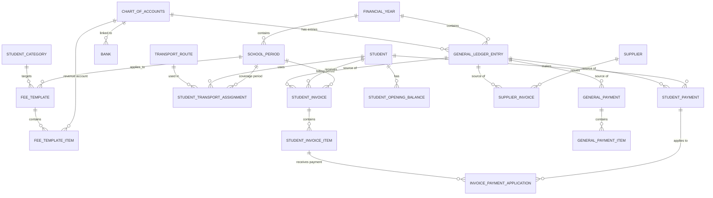
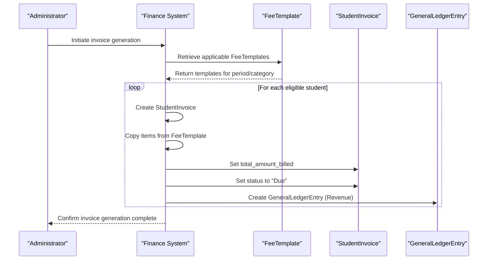
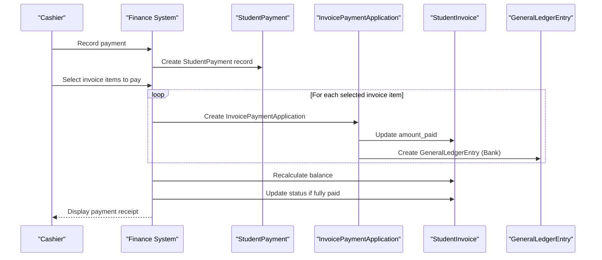
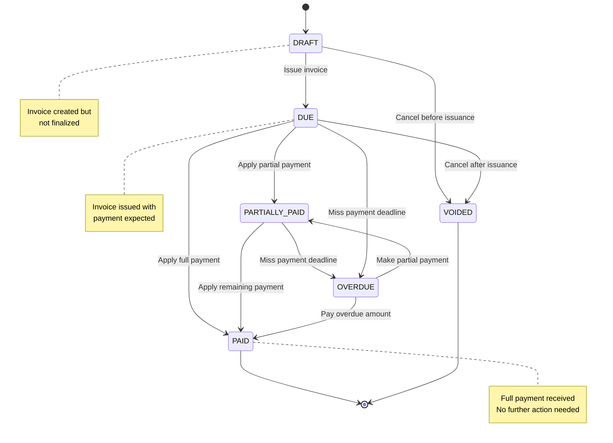
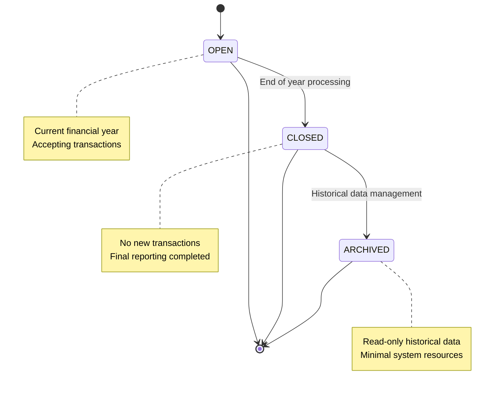

# Finance Collections Overview

<cite>
**Referenced Files in This Document**   
- [schema.ts](file://src/modules/finance/data/schema.ts#L1-L383)
- [types.ts](file://src/modules/finance/data/types.ts#L1-L279)
- [collections.ts](file://src/modules/finance/data/collections.ts#L1-L72)
- [core/types.ts](file://src/core/types.ts#L380-L860)
- [FeeTemplatesPage.tsx](file://src/modules/finance/pages/FeeTemplatesPage.tsx)
</cite>

## Table of Contents
1. [Introduction](#introduction)
2. [Core Financial Collections](#core-financial-collections)
3. [Collection Relationships and Data Flow](#collection-relationships-and-data-flow)
4. [Field-Level Documentation](#field-level-documentation)
5. [Data Consistency and Referential Integrity](#data-consistency-and-referential-integrity)
6. [Indexing and Query Performance](#indexing-and-query-performance)
7. [Status Transitions and Lifecycle Management](#status-transitions-and-lifecycle-management)
8. [Audit and Metadata Fields](#audit-and-metadata-fields)
9. [Configuration Examples](#configuration-examples)
10. [Conclusion](#conclusion)

## Introduction
The Finance module in schoolpilot3 provides a comprehensive financial management system for educational institutions. This document details the data collections that form the backbone of the financial system, including StudentInvoice, FeeTemplate, GeneralLedgerEntry, Bank, Supplier, FinancialYear, ChartOfAccounts, and related entities. The collections are designed to support fee management, payment processing, accounting, and financial reporting. The system uses a database-agnostic schema approach with RxDB for local data storage and synchronization.

**Section sources**
- [schema.ts](file://src/modules/finance/data/schema.ts#L1-L383)
- [collections.ts](file://src/modules/finance/data/collections.ts#L1-L72)

## Core Financial Collections

### StudentInvoice Collection
The **StudentInvoice** collection represents billing documents issued to students for fees and other charges. Each invoice contains multiple line items and tracks payment status.

**Key fields:**
- **id**: Unique identifier for the invoice
- **student_id**: Reference to the student being billed
- **invoice_number**: Human-readable invoice identifier
- **school_period_id**: Academic period for which the invoice is created
- **issue_date**: Date when the invoice was generated
- **due_date**: Payment deadline
- **total_amount_billed**: Sum of all invoice items
- **amount_paid**: Running total of payments applied
- **status**: Current state of the invoice (Draft, Due, Paid, etc.)

**Section sources**
- [schema.ts](file://src/modules/finance/data/schema.ts#L150-L175)
- [types.ts](file://src/modules/finance/data/types.ts#L150-L162)

### FeeTemplate Collection
The **FeeTemplate** collection defines standardized fee structures that can be applied to students based on school period and student category. Templates contain multiple fee items and are used to generate student invoices.

**Key fields:**
- **id**: Unique identifier for the fee template
- **name**: Descriptive name of the template
- **school_period_id**: Academic period to which the template applies
- **student_category_id**: Student category (e.g., day student, boarding student)
- **items**: Array of fee template items defining specific charges
- **created_at**: Timestamp of template creation
- **updated_at**: Timestamp of last modification

**Section sources**
- [schema.ts](file://src/modules/finance/data/schema.ts#L80-L100)
- [types.ts](file://src/modules/finance/data/types.ts#L100-L110)

### GeneralLedgerEntry Collection
The **GeneralLedgerEntry** collection records all financial transactions in the double-entry accounting system. Each entry represents a debit or credit to a specific account.

**Key fields:**
- **id**: Unique identifier for the ledger entry
- **transaction_date**: Date and time of the transaction
- **effective_date**: Accounting date for the transaction
- **financial_year_id**: Financial year to which the entry belongs
- **account_id**: Reference to the Chart of Accounts entry
- **debit**: Amount recorded as a debit (positive value)
- **credit**: Amount recorded as a credit (positive value)
- **description**: Narrative description of the transaction
- **source_table**: Originating table (e.g., student_invoice, supplier_invoice)
- **source_id**: ID of the originating record

**Section sources**
- [schema.ts](file://src/modules/finance/data/schema.ts#L350-L365)
- [types.ts](file://src/modules/finance/data/types.ts#L250-L260)

### Bank Collection
The **Bank** collection stores information about bank accounts used by the institution. Each bank account is linked to a general ledger account.

**Key fields:**
- **id**: Unique identifier for the bank record
- **name**: Name of the bank or account
- **account_no**: Bank account number
- **gl_account_id**: Reference to the corresponding general ledger account
- **created_at**: Timestamp of record creation
- **updated_at**: Timestamp of last modification
- **gl_account_name**: Denormalized field for display purposes

**Section sources**
- [schema.ts](file://src/modules/finance/data/schema.ts#L60-L75)
- [types.ts](file://src/modules/finance/data/types.ts#L80-L90)

### Supplier Collection
The **Supplier** collection maintains information about vendors and service providers. This data is used for accounts payable management.

**Key fields:**
- **id**: Unique identifier for the supplier
- **name**: Legal name of the supplier
- **phone**: Contact phone number
- **email**: Contact email address
- **address**: Physical address
- **contact_person**: Primary contact person
- **kra_pin**: Tax identification number
- **contract_expiry_date**: Date when the contract expires
- **created_at**: Timestamp of record creation
- **updated_at**: Timestamp of last modification

**Section sources**
- [schema.ts](file://src/modules/finance/data/schema.ts#L105-L130)
- [types.ts](file://src/modules/finance/data/types.ts#L90-L100)

### FinancialYear Collection
The **FinancialYear** collection defines accounting periods for financial reporting. Each financial year has a start and end date and a status.

**Key fields:**
- **id**: Unique identifier for the financial year
- **name**: Descriptive name (e.g., "2023-2024")
- **start_date**: First day of the financial year
- **end_date**: Last day of the financial year
- **status**: Current state (Open, Closed, Archived)
- **created_at**: Timestamp of record creation
- **updated_at**: Timestamp of last modification

**Section sources**
- [schema.ts](file://src/modules/finance/data/schema.ts#L10-L25)
- [types.ts](file://src/modules/finance/data/types.ts#L10-L15)

### ChartOfAccounts Collection
The **ChartOfAccounts** collection defines the institution's accounting structure with various account types for tracking financial activity.

**Key fields:**
- **id**: Unique identifier for the account
- **account_code**: Standardized code for the account
- **name**: Descriptive name of the account
- **type**: Account category (Asset, Liability, Equity, Revenue, Expense)
- **template_type**: Classification (Core, Custom)
- **is_active**: Flag indicating if the account is currently usable
- **expense_category_id**: Optional link to an expense category
- **created_at**: Timestamp of record creation
- **updated_at**: Timestamp of last modification
- **expense_category_name**: Denormalized field for display purposes

**Section sources**
- [schema.ts](file://src/modules/finance/data/schema.ts#L30-L55)
- [types.ts](file://src/modules/finance/data/types.ts#L15-L25)

## Collection Relationships and Data Flow



**Diagram sources**
- [schema.ts](file://src/modules/finance/data/schema.ts#L1-L383)
- [collections.ts](file://src/modules/finance/data/collections.ts#L1-L72)

### Invoice Generation Process
The system uses FeeTemplates to automatically generate StudentInvoices for students. This process occurs at the beginning of each school period.



**Diagram sources**
- [schema.ts](file://src/modules/finance/data/schema.ts#L80-L100)
- [schema.ts](file://src/modules/finance/data/schema.ts#L150-L175)

### Payment Application Process
Payments are linked to invoice items through the InvoicePaymentApplication collection, which ensures accurate allocation of funds.



**Diagram sources**
- [schema.ts](file://src/modules/finance/data/schema.ts#L250-L265)
- [schema.ts](file://src/modules/finance/data/schema.ts#L300-L315)

## Field-Level Documentation

### Financial Amount Fields
The financial collections use standardized field patterns for monetary values with validation constraints.

**Amount Field Specifications:**
- **amount**: Generic monetary value with minimum of 0.01 and maximum of 999,999.99
- **total_amount_billed**: Total of all invoice items, required field
- **amount_paid**: Running total of payments applied to an invoice
- **balance**: Derived field (total_amount_billed - amount_paid)
- **debit**: Positive value representing a debit entry
- **credit**: Positive value representing a credit entry

**Validation Rules:**
- All monetary values are stored as numbers with two decimal places
- Negative values are not allowed for most amount fields
- The system enforces that amount_paid cannot exceed total_amount_billed

**Section sources**
- [schema.ts](file://src/modules/finance/data/schema.ts#L150-L175)
- [schema.ts](file://src/modules/finance/data/schema.ts#L350-L365)

### Status Fields and Enumerations
Status fields use predefined enumerations to ensure data consistency across collections.

**FinInvoiceStatusEnum:**
- **DRAFT**: Invoice created but not finalized
- **DUE**: Invoice issued and awaiting payment
- **PAID**: Invoice fully paid
- **PARTIALLY_PAID**: Partial payment received
- **OVERDUE**: Payment deadline passed with outstanding balance
- **VOIDED**: Invoice canceled and no longer valid

**FinFinancialYearStatusEnum:**
- **OPEN**: Current financial year accepting transactions
- **CLOSED**: Financial year closed to new transactions
- **ARCHIVED**: Historical financial year

**FinAccountTypeEnum:**
- **ASSET**: Resources owned by the institution
- **LIABILITY**: Obligations to external parties
- **EQUITY**: Owner's interest in the institution
- **REVENUE**: Income from operations
- **EXPENSE**: Costs incurred in operations

**Section sources**
- [types.ts](file://src/modules/finance/data/types.ts#L30-L70)

### Audit and Metadata Fields
All financial collections include standardized audit fields for tracking record lifecycle.

**Common Metadata Fields:**
- **created_at**: Timestamp when the record was first created (required)
- **updated_at**: Timestamp of the last modification (required)
- **deleted_at**: Timestamp when the record was soft-deleted (optional)
- **id**: Unique identifier, typically a string with maximum length of 100 characters

**Audit Principles:**
- created_at is set once upon record creation
- updated_at is automatically updated on every modification
- The system uses soft deletion (deleted_at) rather than permanent deletion
- All timestamps use ISO 8601 format in UTC timezone

**Section sources**
- [schema.ts](file://src/modules/finance/data/schema.ts#L1-L383)

## Data Consistency and Referential Integrity

### Referential Integrity Mechanisms
The finance system implements referential integrity through application-level constraints rather than database foreign keys, as the underlying RxDB/PouchDB system has limited support for foreign key constraints.

**Integrity Enforcement Strategies:**
- **Pre-insert validation**: Before creating a record, the system verifies referenced entities exist
- **Cascade checks**: When a parent record is deleted, child records are either deleted or marked as orphaned
- **Background reconciliation**: Periodic jobs verify referential integrity across collections
- **UI-level constraints**: User interfaces prevent creation of invalid references

**Critical Reference Relationships:**
- StudentInvoice references existing Student records
- FeeTemplate references valid SchoolPeriod and StudentCategory records
- GeneralLedgerEntry references active ChartOfAccounts entries
- InvoicePaymentApplication references existing StudentPayment and StudentInvoiceItem records

**Section sources**
- [schema.ts](file://src/modules/finance/data/schema.ts#L1-L383)
- [collections.ts](file://src/modules/finance/data/collections.ts#L1-L72)

### Data Validation Rules
The system implements comprehensive validation rules to ensure data quality and consistency.

**Validation Layers:**
1. **Schema-level validation**: Built into the database schema using SchemaHelpers
2. **Application-level validation**: Business logic validation in service layers
3. **UI-level validation**: Real-time validation in user interfaces

**Example Validation Rules:**
- FeeTemplate items must have positive amounts
- StudentInvoice due_date must be after issue_date
- GeneralLedgerEntry must have either debit or credit (not both null)
- Bank account_no must be unique within the institution
- FinancialYear start_date must be before end_date

**Section sources**
- [schema.ts](file://src/modules/finance/data/schema.ts#L1-L383)

## Indexing and Query Performance

### Indexing Strategy
The finance collections use strategic indexing to optimize common query patterns.

**Primary Indexes:**
- All collections have a primary index on the **id** field
- Most collections have secondary indexes on **created_at** and **updated_at** for temporal queries

**Collection-Specific Indexes:**
- **StudentInvoice**: Index on (student_id, school_period_id, status) for student billing history
- **StudentPayment**: Index on (student_id, transaction_date) for payment history
- **GeneralLedgerEntry**: Composite index on (account_id, transaction_date, financial_year_id) for financial reporting
- **FeeTemplate**: Index on (school_period_id, student_category_id) for template lookup
- **SupplierInvoice**: Index on (supplier_id, status) for accounts payable management

**Section sources**
- [collections.ts](file://src/modules/finance/data/collections.ts#L1-L72)

### Query Optimization Examples
The system is designed to support efficient queries for common financial operations.

**Common Query Patterns:**
- Retrieve all unpaid invoices for a student
- Find all payments made within a date range
- Generate financial statements by account and period
- Identify overdue invoices for collection activities
- Calculate fee collections by template and period

**Performance Considerations:**
- Use of denormalized fields (e.g., student_name, school_period_name) to avoid joins
- Pagination for large result sets
- Caching of frequently accessed reference data
- Batch operations for bulk updates

**Section sources**
- [schema.ts](file://src/modules/finance/data/schema.ts#L1-L383)

## Status Transitions and Lifecycle Management

### Invoice Status Lifecycle
Student invoices follow a defined state transition pattern throughout their lifecycle.



**Diagram sources**
- [types.ts](file://src/modules/finance/data/types.ts#L50-L55)
- [schema.ts](file://src/modules/finance/data/schema.ts#L150-L175)

### Financial Year Lifecycle
Financial years progress through a controlled lifecycle to ensure accounting integrity.



**Diagram sources**
- [types.ts](file://src/modules/finance/data/types.ts#L10-L15)
- [schema.ts](file://src/modules/finance/data/schema.ts#L10-L25)

## Audit and Metadata Fields
All financial collections include comprehensive audit and metadata fields to support accountability and data governance.

**Standard Metadata Fields:**
- **created_at**: ISO 8601 timestamp of record creation
- **updated_at**: ISO 8601 timestamp of last modification
- **deleted_at**: ISO 8601 timestamp of soft deletion (when applicable)
- **id**: Unique string identifier with maximum length of 100 characters

**Audit Principles:**
- Immutable creation timestamp
- Automatic update of modification timestamp on every change
- Soft deletion preserves audit trail while removing from active views
- All timestamps stored in UTC to avoid timezone issues

**Section sources**
- [schema.ts](file://src/modules/finance/data/schema.ts#L1-L383)

## Configuration Examples

### FeeTemplate Configuration
Example configuration of a fee template for day students in a specific academic period.

```typescript
const dayStudentTemplate = {
  id: "FT2023-DAY",
  name: "Day Student Fees 2023",
  school_period_id: "SP2023-T1",
  student_category_id: "SC-DAY",
  items: [
    {
      id: "FTI-TUITION",
      description: "Term Tuition Fee",
      amount: 50000.00,
      revenue_account_id: "GL-REV-TUITION"
    },
    {
      id: "FTI-MATERIALS",
      description: "Learning Materials",
      amount: 5000.00,
      revenue_account_id: "GL-REV-MATERIALS"
    },
    {
      id: "FTI-EXAMS",
      description: "Examination Fees",
      amount: 3000.00,
      revenue_account_id: "GL-REV-EXAMS"
    }
  ],
  created_at: "2023-01-15T10:30:00Z",
  updated_at: "2023-01-15T10:30:00Z"
};
```

**Section sources**
- [schema.ts](file://src/modules/finance/data/schema.ts#L80-L100)

### GeneralLedgerEntry Configuration
Example configuration of a general ledger entry for a tuition payment.

```typescript
const tuitionPaymentEntry = {
  id: "GLE-2023-001",
  transaction_date: "2023-01-20T14:30:00Z",
  effective_date: "2023-01-20",
  financial_year_id: "FY2023",
  account_id: "GL-REV-TUITION",
  debit: null,
  credit: 50000.00,
  description: "Tuition payment for student S12345",
  source_table: "student_payment",
  source_id: "SP-2023-001"
};
```

**Section sources**
- [schema.ts](file://src/modules/finance/data/schema.ts#L350-L365)

## Conclusion
The Finance module in schoolpilot3 provides a robust and comprehensive financial management system with well-defined collections for all aspects of school finance operations. The data model supports the complete lifecycle of financial transactions from fee structuring to payment processing and accounting. Key strengths include the use of standardized templates for invoice generation, a double-entry general ledger system for accounting integrity, and comprehensive audit trails for all financial records. The collections are designed with performance in mind, using strategic indexing and denormalization to support efficient queries. The system enforces data consistency through application-level referential integrity and comprehensive validation rules. This documentation provides a foundation for understanding, maintaining, and extending the financial data model in schoolpilot3.