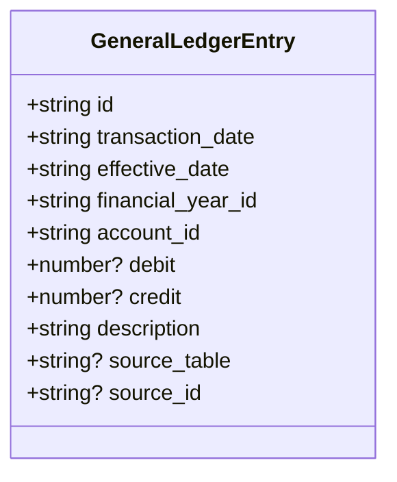
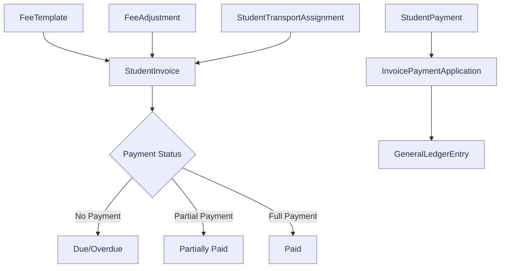
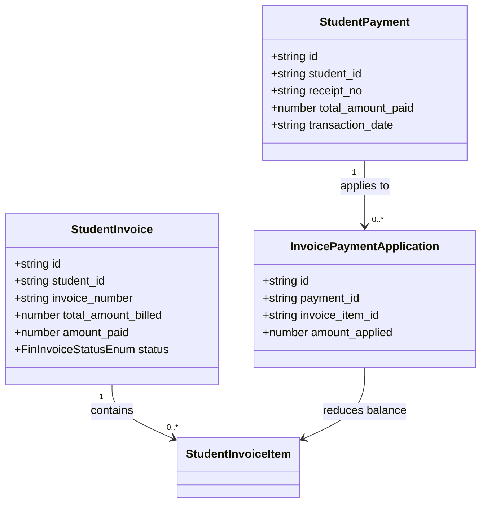
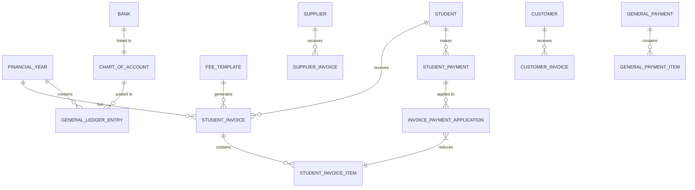
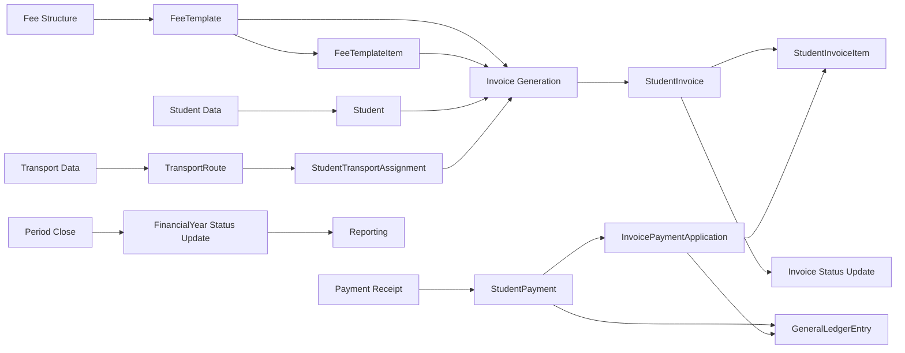

# Finance Data Model

<cite>
**Referenced Files in This Document**   
- [types.ts](file://src/modules/finance/data/types.ts)
- [schema.ts](file://src/modules/finance/data/schema.ts)
- [collections.ts](file://src/modules/finance/data/collections.ts)
- [useStudentInvoiceData.ts](file://src/modules/finance/data/useStudentInvoiceData.ts)
- [useGeneralLedgerEntryData.ts](file://src/modules/finance/data/useGeneralLedgerEntryData.ts)
- [useFeeTemplateData.ts](file://src/modules/finance/data/useFeeTemplateData.ts)
- [useStudentPaymentData.ts](file://src/modules/finance/data/useStudentPaymentData.ts)
- [useInvoicePaymentApplicationData.ts](file://src/modules/finance/data/useInvoicePaymentApplicationData.ts)
- [core/types.ts](file://src/core/types.ts)
</cite>

## Table of Contents
1. [Introduction](#introduction)
2. [Core Data Collections](#core-data-collections)
3. [Double-Entry Accounting Implementation](#double-entry-accounting-implementation)
4. [Invoice Lifecycle and Billing Flow](#invoice-lifecycle-and-billing-flow)
5. [Critical Financial Properties](#critical-financial-properties)
6. [Sample Data Instances](#sample-data-instances)
7. [Referential Integrity and Relationships](#referential-integrity-and-relationships)
8. [Data Flow and Reconciliation](#data-flow-and-reconciliation)

## Introduction

The Finance module in schoolpilot3 implements a comprehensive financial management system for educational institutions. This document details the data model architecture, focusing on 25+ financial collections that support student billing, general accounting, supplier management, and payment processing. The system is built on a double-entry accounting foundation, ensuring financial accuracy and auditability. The data model supports complex workflows from fee structuring to invoice generation, payment application, and ledger posting, with strong referential integrity across financial periods, accounts, and transactions.

**Section sources**
- [types.ts](file://src/modules/finance/data/types.ts#L1-L279)
- [schema.ts](file://src/modules/finance/data/schema.ts#L1-L383)

## Core Data Collections

The Finance module defines a comprehensive set of collections for managing all financial operations. These collections are organized in the `collections.ts` file and mapped to database-agnostic schemas in `schema.ts`. The primary collections include:

- **FinancialYear**: Represents an academic financial year with start/end dates and status (Open, Closed, Archived)
- **ChartOfAccount**: Defines the chart of accounts with account codes, names, and types (Asset, Liability, Equity, Revenue, Expense)
- **StudentInvoice**: Tracks student billing with invoice status, amounts, and line items
- **GeneralLedgerEntry**: Implements double-entry accounting with debit/credit entries
- **Bank**: Manages bank accounts linked to general ledger accounts
- **Supplier**: Stores supplier information for accounts payable
- **FeeTemplate**: Defines fee structures for different student categories and school periods

Additional collections support specialized financial operations:
- **StudentOpeningBalance**: Captures opening balances for students
- **FeeAdjustment**: Manages scholarships, discounts, and fines
- **ExpenseClaim**: Tracks staff and student expense claims
- **TransportRoute**: Defines transportation routes and associated costs
- **StudentTransportAssignment**: Links students to transportation routes
- **CustomerInvoice**: Handles non-student customer invoicing
- **SupplierInvoice**: Manages supplier invoices and payments
- **GeneralPayment**: Processes miscellaneous payments from various payers

The collection structure follows a modular design, with nested items (like invoice line items) embedded within parent documents rather than stored in separate collections, optimizing read performance for financial statements.

**Section sources**
- [collections.ts](file://src/modules/finance/data/collections.ts#L1-L72)
- [schema.ts](file://src/modules/finance/data/schema.ts#L1-L383)

## Double-Entry Accounting Implementation

The Finance module implements a robust double-entry accounting system through the **GeneralLedgerEntry** collection. Each financial transaction is recorded as one or more ledger entries that maintain the fundamental accounting equation: Assets = Liabilities + Equity.

### GeneralLedgerEntry Structure



**Diagram sources**
- [types.ts](file://src/modules/finance/data/types.ts#L270-L279)
- [schema.ts](file://src/modules/finance/data/schema.ts#L365-L383)

### Debit/Credit Balancing Mechanism

Each **GeneralLedgerEntry** record contains either a debit amount or a credit amount, but not both. Transactions are balanced by creating multiple entries that sum to zero. For example, when a student payment is received:

1. **Debit**: Cash/Bank account (increasing asset)
2. **Credit**: Accounts Receivable (decreasing asset)

This ensures that every transaction maintains accounting balance. The system validates that for any given transaction (grouped by source_id), the sum of debits equals the sum of credits.

### Financial Period Control

The **financial_year_id** field ensures that all ledger entries are properly categorized within the correct financial period. Combined with **effective_date**, this enables accurate period-end closing and financial reporting. The **transaction_date** captures when the transaction was recorded, while **effective_date** represents the business date of the transaction, supporting accrual accounting.

### Source Tracking

The **source_table** and **source_id** fields provide critical audit trail functionality, linking each ledger entry back to its originating transaction (e.g., "student_payment", "SPAY12345"). This enables full traceability from financial statements to source documents.

**Section sources**
- [types.ts](file://src/modules/finance/data/types.ts#L270-L279)
- [schema.ts](file://src/modules/finance/data/schema.ts#L365-L383)
- [useGeneralLedgerEntryData.ts](file://src/modules/finance/data/useGeneralLedgerEntryData.ts#L1-L56)

## Invoice Lifecycle and Billing Flow

The Finance module implements a comprehensive invoice lifecycle that transforms fee templates into student invoices, processes payments, and updates the general ledger. This flow ensures accurate billing and proper financial accounting.

### Invoice Lifecycle Stages



**Diagram sources**
- [types.ts](file://src/modules/finance/data/types.ts#L100-L150)
- [schema.ts](file://src/modules/finance/data/schema.ts#L150-L250)

### Lifecycle Components

#### 1. FeeTemplate → StudentInvoice

The billing process begins with **FeeTemplate**, which defines the fee structure for a specific school period and student category. When invoices are generated, the system:

- Creates a **StudentInvoice** record with status "Draft"
- Populates **StudentInvoiceItem** entries based on the fee template items
- Applies any relevant **FeeAdjustment** records (scholarships, discounts)
- Incorporates transportation fees from **StudentTransportAssignment**
- Finalizes the invoice with status "Due" and sets the due date

#### 2. StudentInvoice → InvoicePaymentApplication

When payments are received, the **InvoicePaymentApplication** collection links payments to specific invoice items:



**Diagram sources**
- [types.ts](file://src/modules/finance/data/types.ts#L100-L150)
- [useStudentInvoiceData.ts](file://src/modules/finance/data/useStudentInvoiceData.ts#L1-L56)
- [useStudentPaymentData.ts](file://src/modules/finance/data/useStudentPaymentData.ts#L1-L56)
- [useInvoicePaymentApplicationData.ts](file://src/modules/finance/data/useInvoicePaymentApplicationData.ts#L1-L56)

#### 3. Payment Processing → GeneralReceipt

The **GeneralReceipt** equivalent in this system is the **StudentPayment** collection, which records all incoming payments. Each payment triggers the creation of **GeneralLedgerEntry** records to update the accounting system.

**Section sources**
- [types.ts](file://src/modules/finance/data/types.ts#L100-L150)
- [schema.ts](file://src/modules/finance/data/schema.ts#L150-L250)
- [useStudentInvoiceData.ts](file://src/modules/finance/data/useStudentInvoiceData.ts#L1-L56)
- [useStudentPaymentData.ts](file://src/modules/finance/data/useStudentPaymentData.ts#L1-L56)

## Critical Financial Properties

The Finance data model includes several critical properties that ensure financial accuracy, compliance, and reporting capability.

### taxRate

While not explicitly shown in the current schema, tax handling is implemented through the **FeeTemplateItem** and **StudentInvoiceItem** structures. Tax rates would be applied at the item level, with separate ledger entries for tax amounts. The system supports tax-inclusive and tax-exclusive pricing models through configuration.

### discountPercentage

Discounts are managed through the **FeeAdjustment** collection with type "Discount". The **amount** field represents the absolute discount value rather than a percentage. Percentage-based discounts would be calculated at the application level and stored as absolute amounts in the database to ensure auditability and prevent recalculation errors.

```typescript
export interface FinFeeAdjustmentType {
  id: string;
  student_id: string;
  school_period_id: number;
  adjustment_type: FinFeeAdjustmentTypeEnum; // Includes DISCOUNT
  amount: number; // Absolute amount, positive for discounts
  reason?: string;
  applied_invoice_id?: string;
}
```

### postingStatus

The **postingStatus** is implemented through the **status** fields in various collections and the **deleted_at** timestamp for soft deletion. Key status implementations include:

- **StudentInvoice.status**: Draft, Due, Paid, Partially Paid, Overdue, Voided
- **GeneralLedgerEntry**: Implied as posted (cannot be modified once created)
- **FinancialYear.status**: Open, Closed, Archived (controls posting period)

The **deleted_at** field in **StudentInvoice** enables soft deletion, preserving audit trails while removing invoices from active processing.

### Validation Rules

The schema enforces critical financial constraints:
- **Amount fields**: Minimum values (0.01) prevent zero-value transactions
- **Required fields**: Ensures complete audit trails
- **Enum constraints**: Prevents invalid status values
- **Timestamps**: Automatic creation and update timestamps for auditability

**Section sources**
- [types.ts](file://src/modules/finance/data/types.ts#L50-L150)
- [schema.ts](file://src/modules/finance/data/schema.ts#L50-L250)

## Sample Data Instances

### StudentInvoice with Line Items

```json
{
  "id": "INV2023001",
  "student_id": "STU001",
  "invoice_number": "INV-2023-001",
  "school_period_id": "SP2023T1",
  "issue_date": "2023-08-01",
  "due_date": "2023-08-15",
  "total_amount_billed": 1250.00,
  "amount_paid": 0.00,
  "status": "Due",
  "student_name": "John Doe",
  "school_period_name": "2023 Term 1",
  "created_at": "2023-08-01T10:00:00Z",
  "updated_at": "2023-08-01T10:00:00Z",
  "items": [
    {
      "id": "ITEM001",
      "invoice_id": "INV2023001",
      "description": "Tuition Fee",
      "amount": 1000.00,
      "fee_template_item_id": "FTI001"
    },
    {
      "id": "ITEM002",
      "invoice_id": "INV2023001",
      "description": "Transportation Fee",
      "amount": 200.00,
      "student_transport_assignment_id": "STA001"
    },
    {
      "id": "ITEM003",
      "invoice_id": "INV2023001",
      "description": "Textbook Fee",
      "amount": 50.00
    }
  ]
}
```

### GeneralLedgerEntry with Account References

```json
{
  "id": "GLE2023001",
  "transaction_date": "2023-08-15T14:30:00Z",
  "effective_date": "2023-08-15",
  "financial_year_id": "FY2023",
  "account_id": "ACC1010", // Cash/Bank account
  "debit": 1250.00,
  "credit": null,
  "description": "Payment received for invoice INV-2023-001",
  "source_table": "student_payment",
  "source_id": "SPAY2023001",
  "created_at": "2023-08-15T14:30:00Z",
  "updated_at": "2023-08-15T14:30:00Z"
}
```

```json
{
  "id": "GLE2023002",
  "transaction_date": "2023-08-15T14:30:00Z",
  "effective_date": "2023-08-15",
  "financial_year_id": "FY2023",
  "account_id": "ACC1200", // Accounts Receivable
  "debit": null,
  "credit": 1250.00,
  "description": "Payment received for invoice INV-2023-001",
  "source_table": "student_payment",
  "source_id": "SPAY2023001",
  "created_at": "2023-08-15T14:30:00Z",
  "updated_at": "2023-08-15T14:30:00Z"
}
```

**Section sources**
- [types.ts](file://src/modules/finance/data/types.ts#L100-L150)
- [schema.ts](file://src/modules/finance/data/schema.ts#L150-L250)

## Referential Integrity and Relationships

The Finance data model maintains strong referential integrity through explicit foreign key relationships and denormalized data for performance.

### Primary Relationships



**Diagram sources**
- [types.ts](file://src/modules/finance/data/types.ts#L1-L279)
- [schema.ts](file://src/modules/finance/data/schema.ts#L1-L383)

### Referential Integrity Mechanisms

1. **Foreign Key Fields**: Each collection includes explicit ID references (e.g., student_id, account_id, financial_year_id)
2. **Denormalized Data**: Critical display fields are denormalized (e.g., student_name, account_name) to reduce join operations
3. **Soft Deletion**: The **deleted_at** field preserves relationships while removing records from active processing
4. **Status Constraints**: FinancialYear status prevents posting to closed periods
5. **Validation Rules**: Schema-level constraints prevent invalid data entry

### Cross-Collection Dependencies

The system ensures data consistency through application-level validation:
- **StudentInvoice** creation validates active **FinancialYear** and **SchoolPeriod**
- **GeneralLedgerEntry** posting validates account existence and period status
- **InvoicePaymentApplication** ensures payment amounts do not exceed invoice balances
- **FeeAdjustment** application respects student and period constraints

**Section sources**
- [types.ts](file://src/modules/finance/data/types.ts#L1-L279)
- [schema.ts](file://src/modules/finance/data/schema.ts#L1-L383)

## Data Flow and Reconciliation

The Finance module implements a comprehensive data flow from fee structures to financial reporting, with multiple reconciliation points to ensure accuracy.

### End-to-End Data Flow



**Diagram sources**
- [types.ts](file://src/modules/finance/data/types.ts#L1-L279)
- [schema.ts](file://src/modules/finance/data/schema.ts#L1-L383)

### Reconciliation Points

The system includes multiple reconciliation points to ensure financial accuracy:

1. **Invoice Generation Reconciliation**: After batch invoice creation, the system verifies that:
   - Total billed amounts match expected fee structures
   - All eligible students have been invoiced
   - Adjustments have been properly applied

2. **Payment Application Reconciliation**: When payments are processed:
   - Applied amounts are validated against invoice balances
   - Payment totals are reconciled with bank deposits
   - Ledger entries are balanced (debits = credits)

3. **Period-End Reconciliation**: At financial period close:
   - Trial balance is generated to verify ledger integrity
   - Accounts receivable aging is calculated
   - Bank reconciliation is performed against external statements

4. **Audit Trail Reconciliation**: The **source_table** and **source_id** fields enable:
   - Tracing from financial statements to source documents
   - Verifying that all transactions are properly accounted for
   - Identifying any orphaned ledger entries

### Data Consistency Guarantees

The system ensures data consistency through:
- **Atomic Operations**: Related updates (e.g., payment application and invoice status) are processed together
- **Validation Hooks**: Data services validate constraints before persistence
- **Audit Logging**: All changes are timestamped and traceable
- **Period Controls**: Prevents posting to closed financial periods

This comprehensive data flow and reconciliation framework ensures the financial integrity of the schoolpilot3 system, providing accurate, auditable, and reliable financial management for educational institutions.

**Section sources**
- [types.ts](file://src/modules/finance/data/types.ts#L1-L279)
- [schema.ts](file://src/modules/finance/data/schema.ts#L1-L383)
- [collections.ts](file://src/modules/finance/data/collections.ts#L1-L72)