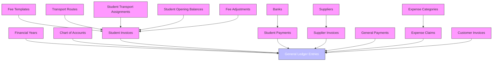
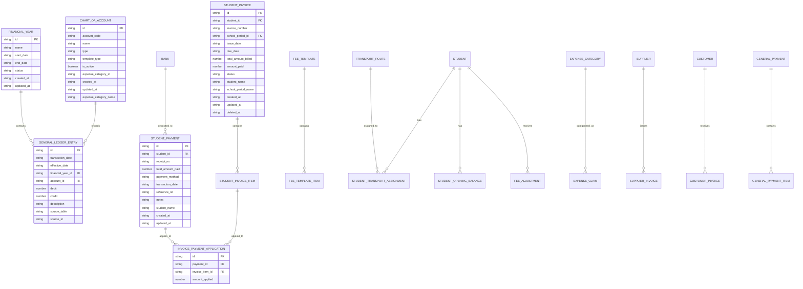
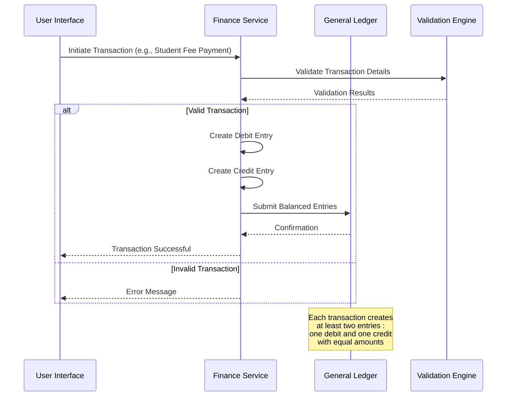
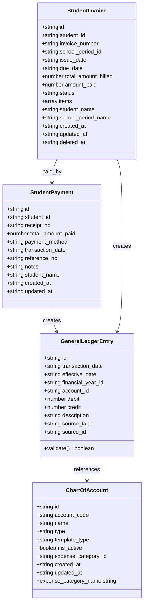
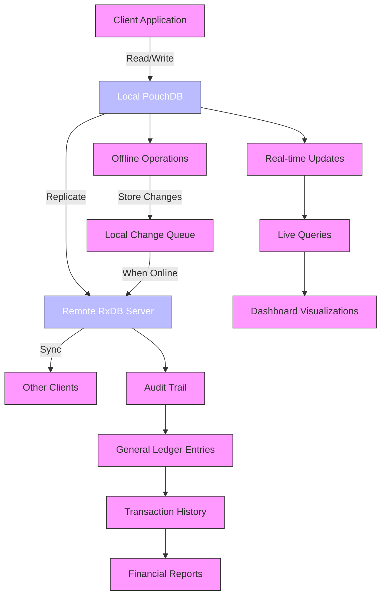

# Finance Schema Architecture

<cite>
**Referenced Files in This Document**   
- [schema.ts](file://src/modules/finance/data/schema.ts)
- [types.ts](file://src/modules/finance/data/types.ts)
- [mockData.ts](file://src/modules/finance/data/mockData.ts)
- [validationSchemas.ts](file://src/utils/validationSchemas.ts)
- [dataValidation.ts](file://src/utils/dataValidation.ts)
</cite>

## Table of Contents
1. [Introduction](#introduction)
2. [High-Level Data Model Structure](#high-level-data-model-structure)
3. [Entity Relationships and Normalization Strategy](#entity-relationships-and-normalization-strategy)
4. [Double-Entry Accounting Implementation](#double-entry-accounting-implementation)
5. [Schema Validation Rules and Constraints](#schema-validation-rules-and-constraints)
6. [Data Access Patterns and Synchronization](#data-access-patterns-and-synchronization)
7. [Schema Versioning and Migration Strategy](#schema-versioning-and-migration-strategy)
8. [Conclusion](#conclusion)

## Introduction
The Finance module in schoolpilot3 implements a comprehensive financial management system designed specifically for educational institutions. This document details the architectural design of the financial data model, focusing on its integration with the global RxDB/PouchDB database system, implementation of double-entry accounting principles, and support for real-time synchronization and offline-first operations. The schema is designed to handle various financial operations including student billing, expense management, supplier payments, and general ledger accounting, while maintaining data integrity and auditability.

**Section sources**
- [schema.ts](file://src/modules/finance/data/schema.ts)
- [types.ts](file://src/modules/finance/data/types.ts)

## High-Level Data Model Structure
The financial data model is organized around a core set of entities that represent the fundamental financial operations of an educational institution. The architecture follows a normalized design pattern to minimize data redundancy and ensure data integrity. At the center of the model is the General Ledger, which records all financial transactions using the double-entry accounting system.

The primary entities in the financial data model include:
- **Financial Years**: Represent accounting periods with defined start and end dates
- **Chart of Accounts**: Define the accounting categories for tracking financial activities
- **Student Invoices and Payments**: Manage tuition and other student-related billing
- **Supplier Invoices and Payments**: Handle vendor transactions
- **General Ledger Entries**: Record all financial transactions with proper debit/credit balancing
- **Expense Claims**: Track staff and student expense reimbursements
- **Fee Templates**: Define standard fee structures for different student categories

Each entity is implemented as a separate collection in the RxDB/PouchDB database, allowing for efficient querying and data management. The collections are designed to be database-agnostic, enabling seamless integration with both RxDB and PouchDB services.

**Diagram sources**
- [schema.ts](file://src/modules/finance/data/schema.ts#L10-L377)

**Section sources**
- [schema.ts](file://src/modules/finance/data/schema.ts)
- [types.ts](file://src/modules/finance/data/types.ts)

## Entity Relationships and Normalization Strategy
The financial data model employs a highly normalized structure to ensure data consistency and minimize redundancy. Each entity has a well-defined primary key and relationships with other entities are established through foreign key references. The normalization strategy follows third normal form (3NF) principles, where each attribute depends only on the primary key, there are no transitive dependencies, and all non-key attributes are functionally dependent on the primary key.

Key entity relationships include:
- **Financial Years** have a one-to-many relationship with **General Ledger Entries**, as each financial year contains multiple transactions
- **Chart of Accounts** have a one-to-many relationship with **General Ledger Entries**, as each account can have multiple entries
- **Student Invoices** have a one-to-many relationship with **Student Invoice Items**, allowing for detailed breakdown of invoice amounts
- **Student Payments** are linked to **Student Invoices** through **Invoice Payment Applications**, which track how payments are applied to specific invoice items
- **General Payments** contain multiple **General Payment Items**, enabling detailed recording of payment distributions

The model uses referential integrity constraints to maintain consistency across related entities. For example, when a student invoice is created, it must reference an existing student and financial year. Similarly, general ledger entries must reference valid accounts from the chart of accounts.

**Diagram sources**
- [schema.ts](file://src/modules/finance/data/schema.ts#L10-L377)
- [types.ts](file://src/modules/finance/data/types.ts#L1-L280)

**Section sources**
- [schema.ts](file://src/modules/finance/data/schema.ts)
- [types.ts](file://src/modules/finance/data/types.ts)

## Double-Entry Accounting Implementation
The Finance module implements double-entry accounting principles through the GeneralLedgerEntry schema, which ensures that every financial transaction maintains the fundamental accounting equation: Assets = Liabilities + Equity. Each transaction is recorded as at least two entries: one debit and one corresponding credit, with equal amounts.

The GeneralLedgerEntry schema enforces this principle by requiring either a debit or credit value (but not both) for each entry, while ensuring that the sum of debits equals the sum of credits for any given transaction. The schema includes the following key fields:
- **transaction_date**: The date when the transaction occurred
- **effective_date**: The date when the transaction takes effect
- **financial_year_id**: Reference to the financial year in which the transaction is recorded
- **account_id**: Reference to the chart of account being affected
- **debit**: The amount debited to the account (positive value)
- **credit**: The amount credited to the account (positive value)
- **description**: Narrative description of the transaction
- **source_table**: Reference to the originating transaction table
- **source_id**: Reference to the originating transaction record

The mock data demonstrates several examples of double-entry accounting transactions:
- Opening balances are recorded with a debit to a bank account and a corresponding credit to retained earnings
- Student fee collections are recorded with a debit to a bank account and a credit to tuition fees revenue
- Expense payments are recorded with a debit to an expense account and a credit to a bank account
- Cross-module integrations, such as canteen sales, are recorded with a debit to student advance payments and a credit to canteen sales revenue

Although the current schema does not include explicit validation rules to enforce the balancing of debits and credits at the database level, the application logic ensures that transactions are properly balanced before being recorded in the general ledger. This approach allows for flexibility in handling complex transactions while maintaining the integrity of the double-entry system.

**Diagram sources**
- [schema.ts](file://src/modules/finance/data/schema.ts#L352-L377)
- [mockData.ts](file://src/modules/finance/data/mockData.ts#L190-L261)

**Section sources**
- [schema.ts](file://src/modules/finance/data/schema.ts)
- [mockData.ts](file://src/modules/finance/data/mockData.ts)
- [types.ts](file://src/modules/finance/data/types.ts)

## Schema Validation Rules and Constraints
The financial schema implements comprehensive validation rules to ensure data integrity and accuracy. These rules are applied at multiple levels, including field-level constraints, entity-level validation, and cross-entity consistency checks.

Field-level constraints are defined in the schema.ts file using the SchemaHelpers utility, which provides type-specific validation functions. Key constraints include:
- **String fields**: Maximum length restrictions (e.g., 100 characters for IDs, 200 for names)
- **Numeric fields**: Minimum and maximum value constraints (e.g., amounts between 0.01 and 999,999.99)
- **Date fields**: Proper date formatting and validation
- **Required fields**: Mandatory fields that must be present for valid records
- **Enumeration fields**: Restricted to predefined values from corresponding enums

The types.ts file defines TypeScript interfaces and enums that provide compile-time type checking and ensure consistency across the application. Key enums include:
- **FinFinancialYearStatusEnum**: OPEN, CLOSED, ARCHIVED
- **FinAccountTypeEnum**: ASSET, LIABILITY, EQUITY, REVENUE, EXPENSE
- **FinInvoiceStatusEnum**: DRAFT, DUE, PAID, PARTIALLY_PAID, OVERDUE, VOIDED
- **FinPaymentMethodEnum**: CASH, BANK_TRANSFER, MOBILE_MONEY, CHEQUE, CREDIT_CARD

While the current implementation includes field-level validation and required field constraints, it appears that more complex business rules specific to double-entry accounting (such as ensuring that the sum of debits equals the sum of credits for a transaction) are not explicitly defined in the validation schemas. These rules are likely enforced at the application logic level rather than the schema level.

**Diagram sources**
- [schema.ts](file://src/modules/finance/data/schema.ts#L10-L377)
- [types.ts](file://src/modules/finance/data/types.ts#L1-L280)

**Section sources**
- [schema.ts](file://src/modules/finance/data/schema.ts)
- [types.ts](file://src/modules/finance/data/types.ts)

## Data Access Patterns and Synchronization
The financial schema is designed to support multiple data access patterns, including real-time synchronization, offline-first operations, and audit trail preservation. The integration with RxDB/PouchDB enables these capabilities through its built-in features for data replication, conflict resolution, and local storage.

Real-time synchronization is achieved through the RxDB replication system, which continuously syncs data between the client and server databases. This ensures that financial data is always up-to-date across all devices and users. The schema includes timestamp fields (created_at, updated_at) for all entities, which are used by the replication system to track changes and resolve conflicts.

Offline-first operations are supported by storing all financial data locally in the PouchDB instance. Users can create, read, update, and delete financial records even when disconnected from the network. When connectivity is restored, all changes are automatically synchronized with the server database. This is particularly important for financial operations in educational institutions that may have unreliable internet connectivity.

Audit trail preservation is implemented through several mechanisms:
- All entities include created_at and updated_at timestamps
- The GeneralLedgerEntry schema maintains a complete record of all financial transactions
- Soft deletion is supported through the deleted_at field in entities like StudentInvoice
- The source_table and source_id fields in GeneralLedgerEntry provide traceability to originating transactions

The schema also supports various query patterns for financial reporting and analysis:
- Time-based queries using transaction_date and effective_date
- Account-based queries using account_id
- Status-based queries using status fields
- Amount-based queries with range filters
- Relationship-based queries using foreign key references

**Diagram sources**
- [schema.ts](file://src/modules/finance/data/schema.ts#L10-L377)
- [dataValidation.ts](file://src/utils/dataValidation.ts#L44-L90)

**Section sources**
- [schema.ts](file://src/modules/finance/data/schema.ts)
- [dataValidation.ts](file://src/utils/dataValidation.ts)

## Schema Versioning and Migration Strategy
The financial schema employs a versioning and migration strategy to support the evolution of financial data over time. While the current implementation does not explicitly show versioning metadata in the schema definitions, the architecture is designed to accommodate schema changes through the use of database migration scripts and backward compatibility considerations.

The migration strategy includes the following components:
- **Schema Evolution**: New fields can be added to existing entities without breaking existing functionality, as the database system supports dynamic schema changes
- **Data Migration**: When structural changes are required, migration scripts are used to transform existing data to the new format
- **Backward Compatibility**: The system maintains compatibility with older data formats to ensure uninterrupted service during upgrades
- **Audit Preservation**: Historical financial data is preserved during migrations to maintain audit trails and financial reporting accuracy

The project structure reveals a dedicated migration directory with scripts for data extraction, transformation, and loading, indicating a comprehensive approach to data migration. These scripts handle complex operations such as:
- Extracting data from legacy systems
- Transforming data to match the new schema
- Loading data into the target database
- Verifying data integrity after migration

The use of TypeScript interfaces and enums in the types.ts file provides a strong contract for data structure, making it easier to detect and handle schema changes. When changes are made to the financial schema, corresponding updates are made to these type definitions to ensure consistency across the application.

Although the current schema definitions do not include explicit version numbers, the modular structure of the finance module allows for incremental updates and testing of schema changes in isolation before deployment to production.

**Section sources**
- [schema.ts](file://src/modules/finance/data/schema.ts)
- [types.ts](file://src/modules/finance/data/types.ts)
- [migration](file://scripts/migration)

## Conclusion
The Finance module in schoolpilot3 implements a robust and comprehensive financial data model designed for educational institutions. The schema architecture follows best practices in database design, with a normalized structure that ensures data integrity and minimizes redundancy. The implementation of double-entry accounting principles through the GeneralLedgerEntry schema provides a solid foundation for accurate financial reporting and auditing.

Key strengths of the financial schema include:
- Comprehensive entity relationships that model real-world financial operations
- Strong validation rules and constraints that ensure data quality
- Integration with RxDB/PouchDB for real-time synchronization and offline-first operations
- Support for audit trail preservation through detailed transaction recording
- Flexible design that accommodates the evolution of financial data over time

While the current implementation effectively supports the core financial operations of an educational institution, there are opportunities for enhancement, particularly in the area of validation rules for double-entry accounting. Implementing explicit validation to ensure that debits equal credits for each transaction would strengthen the integrity of the financial system.

The modular design and use of database-agnostic schemas position the Finance module well for future enhancements and integration with other systems, ensuring that it can continue to meet the evolving needs of educational institutions.