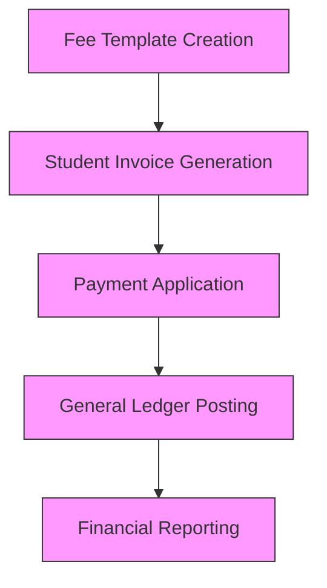
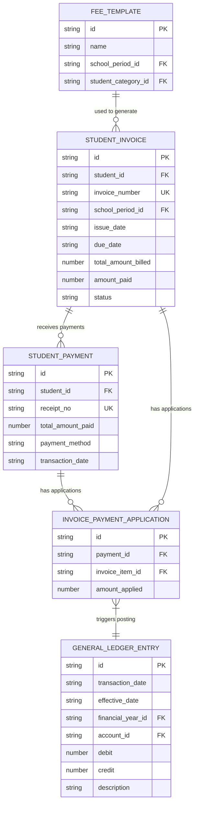
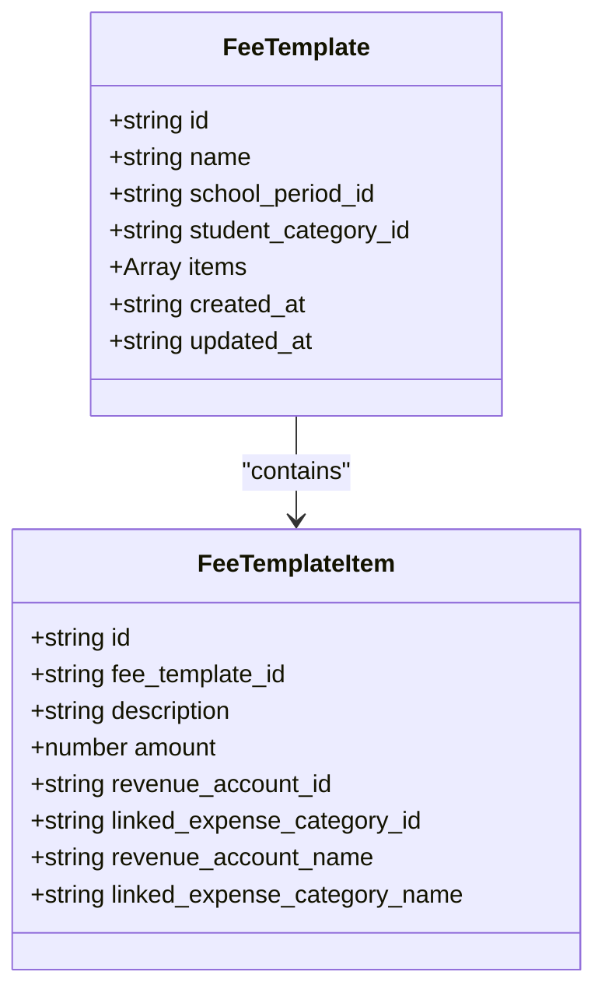
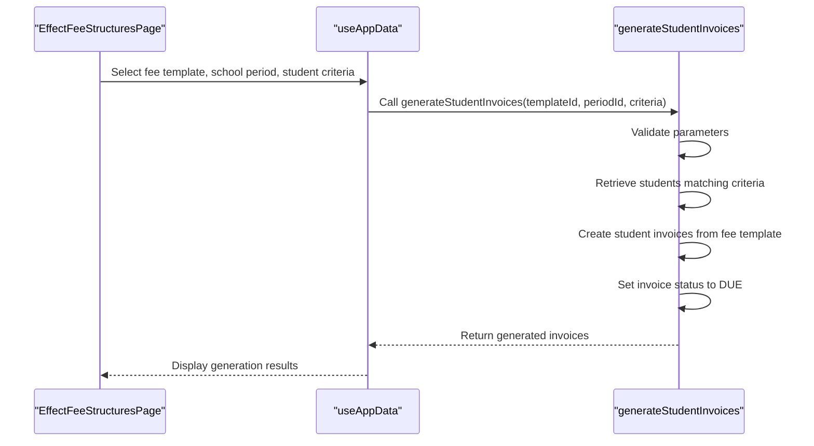
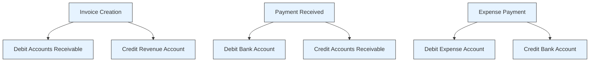

# Invoice Lifecycle Management

<cite>
**Referenced Files in This Document**   
- [mockData.ts](file://src/modules/finance/data/mockData.ts)
- [schema.ts](file://src/modules/finance/data/schema.ts)
- [collections.ts](file://src/modules/finance/data/collections.ts)
- [index.ts](file://src/modules/finance/data/index.ts)
- [types.ts](file://src/modules/finance/data/types.ts)
- [useFeeTemplateData.ts](file://src/modules/finance/data/useFeeTemplateData.ts)
- [useStudentInvoiceData.ts](file://src/modules/finance/data/useStudentInvoiceData.ts)
- [EffectFeeStructuresPage.tsx](file://src/modules/finance/pages/EffectFeeStructuresPage.tsx)
- [FeeTemplatesPage.tsx](file://src/modules/finance/pages/FeeTemplatesPage.tsx)
- [useGeneralLedgerEntryData.ts](file://src/modules/finance/data/useGeneralLedgerEntryData.ts)
</cite>

## Table of Contents
1. [Introduction](#introduction)
2. [Invoice Lifecycle Overview](#invoice-lifecycle-overview)
3. [Data Model and Collections](#data-model-and-collections)
4. [Fee Structure Definition](#fee-structure-definition)
5. [Student Invoice Generation](#student-invoice-generation)
6. [Payment Application and Reconciliation](#payment-application-and-reconciliation)
7. [General Ledger Posting](#general-ledger-posting)
8. [Business Rules and Edge Cases](#business-rules-and-edge-cases)
9. [Conclusion](#conclusion)

## Introduction
This document provides a comprehensive overview of the invoice lifecycle within the Finance module of schoolpilot3. The system manages the complete financial workflow from fee structure definition to final payment reconciliation and general ledger posting. The documentation covers the data model, business rules, and implementation details for each stage of the invoice lifecycle, with a focus on the interactions between key components such as fee templates, student invoices, payments, and accounting entries.

**Section sources**
- [mockData.ts](file://src/modules/finance/data/mockData.ts)
- [schema.ts](file://src/modules/finance/data/schema.ts)

## Invoice Lifecycle Overview
The invoice lifecycle in schoolpilot3 follows a structured end-to-end process that begins with fee structure definition and concludes with general ledger posting. The lifecycle consists of four primary stages: fee structure definition, student invoice generation, payment application, and general ledger posting. Each stage represents a distinct phase in the financial management process, with specific data models, business rules, and status transitions.

The process begins with the creation of fee templates that define the fee structure for different student categories and school periods. These templates are then used to generate individual student invoices, which represent the financial obligations of students. When payments are received, they are applied to outstanding invoices, updating the payment status and creating reconciliation records. Finally, all financial transactions are posted to the general ledger, ensuring accurate accounting records.

**Diagram sources**
- [mockData.ts](file://src/modules/finance/data/mockData.ts)
- [schema.ts](file://src/modules/finance/data/schema.ts)

**Section sources**
- [mockData.ts](file://src/modules/finance/data/mockData.ts)
- [schema.ts](file://src/modules/finance/data/schema.ts)

## Data Model and Collections
The invoice lifecycle is supported by a comprehensive data model that defines the relationships between financial entities. The data model is implemented using RxDB collections, with each collection representing a specific financial entity. The collections are defined in the collections.ts file and use schemas from the schema.ts file to ensure data consistency and integrity.

The primary collections involved in the invoice lifecycle include fee_templates, student_invoices, student_payments, invoice_payment_applications, and general_ledger_entries. These collections are interconnected through foreign key relationships, creating a complete financial transaction trail. The data model also includes supporting collections for financial years, chart of accounts, and expense categories, which provide the context for financial transactions.

**Diagram sources**
- [collections.ts](file://src/modules/finance/data/collections.ts)
- [schema.ts](file://src/modules/finance/data/schema.ts)

**Section sources**
- [collections.ts](file://src/modules/finance/data/collections.ts)
- [schema.ts](file://src/modules/finance/data/schema.ts)

## Fee Structure Definition
The fee structure definition stage involves creating fee templates that specify the fees for different student categories and school periods. Fee templates are defined using the fee_templates collection, which contains information about the template name, associated school period, and student category. Each fee template consists of multiple fee template items that represent individual fee components such as tuition fees, transport fees, and meal program fees.

The fee template data model includes key fields such as id, name, school_period_id, student_category_id, and items. The items field is an array of fee template items, each containing a description, amount, and revenue account ID. The revenue account ID links each fee component to a specific revenue account in the chart of accounts, ensuring proper accounting classification. Fee templates can be created, updated, and deleted using the useFeeTemplateData hook, which provides CRUD operations for fee template management.

**Diagram sources**
- [types.ts](file://src/modules/finance/data/types.ts)
- [schema.ts](file://src/modules/finance/data/schema.ts)

**Section sources**
- [types.ts](file://src/modules/finance/data/types.ts)
- [useFeeTemplateData.ts](file://src/modules/finance/data/useFeeTemplateData.ts)

## Student Invoice Generation
Student invoice generation is the process of creating individual invoices for students based on fee templates. This process is initiated through the EffectFeeStructuresPage component, which allows users to select a fee template, school period, and student criteria to generate invoices. The generateStudentInvoices function is called with the selected parameters, creating student invoices for all students matching the criteria.

The student invoice data model includes key fields such as id, student_id, invoice_number, school_period_id, issue_date, due_date, total_amount_billed, amount_paid, and status. The status field tracks the invoice lifecycle with values such as DRAFT, DUE, PAID, PARTIALLY_PAID, OVERDUE, and VOIDED. Each student invoice contains a collection of student invoice items that represent the individual fee components from the fee template. The useStudentInvoiceData hook provides CRUD operations for managing student invoices, allowing for creation, updating, and deletion of invoices.

**Diagram sources**
- [EffectFeeStructuresPage.tsx](file://src/modules/finance/pages/EffectFeeStructuresPage.tsx)
- [useStudentInvoiceData.ts](file://src/modules/finance/data/useStudentInvoiceData.ts)

**Section sources**
- [EffectFeeStructuresPage.tsx](file://src/modules/finance/pages/EffectFeeStructuresPage.tsx)
- [useStudentInvoiceData.ts](file://src/modules/finance/data/useStudentInvoiceData.ts)

## Payment Application and Reconciliation
Payment application and reconciliation involve applying student payments to outstanding invoices and updating the payment status. When a payment is received, it is recorded in the student_payments collection with details such as the payment amount, method, and transaction date. The payment is then applied to one or more invoice items through the invoice_payment_applications collection, which tracks the specific allocation of payment amounts to invoice items.

The payment application process ensures that payments are properly allocated to outstanding invoices, reducing the amount due and updating the invoice status accordingly. When a payment fully covers an invoice, the invoice status is updated to PAID. For partial payments, the status is updated to PARTIALLY_PAID. The system maintains a complete audit trail of payment applications, allowing for reconciliation and financial reporting. The useStudentPaymentData and useInvoicePaymentApplicationData hooks provide the necessary functionality for managing payments and their applications.

**Section sources**
- [mockData.ts](file://src/modules/finance/data/mockData.ts)
- [schema.ts](file://src/modules/finance/data/schema.ts)

## General Ledger Posting
General ledger posting is the final stage of the invoice lifecycle, where financial transactions are recorded in the accounting system. Every financial event, including invoice creation, payment application, and fee adjustments, triggers the creation of general ledger entries. These entries follow the double-entry accounting principle, with each transaction recorded as a debit and credit to appropriate accounts.

The general_ledger_entries collection contains records with fields such as transaction_date, effective_date, financial_year_id, account_id, debit, credit, and description. The posting process ensures that all financial activities are properly accounted for and that the general ledger maintains an accurate record of the school's financial position. The useGeneralLedgerEntryData hook provides CRUD operations for managing general ledger entries, allowing for the creation, updating, and deletion of accounting records.

**Diagram sources**
- [mockData.ts](file://src/modules/finance/data/mockData.ts)
- [useGeneralLedgerEntryData.ts](file://src/modules/finance/data/useGeneralLedgerEntryData.ts)

**Section sources**
- [mockData.ts](file://src/modules/finance/data/mockData.ts)
- [useGeneralLedgerEntryData.ts](file://src/modules/finance/data/useGeneralLedgerEntryData.ts)

## Business Rules and Edge Cases
The invoice lifecycle system handles various business rules and edge cases to ensure accurate financial management. These include tax calculation, discount application, partial payments, invoice adjustments, refunds, and write-offs. The system uses specific data models and business logic to manage these scenarios effectively.

For tax calculation, the system applies tax rates to fee components based on configuration settings. Discounts and scholarships are handled through the fee_adjustments collection, which contains records with adjustment_type values such as SCHOLARSHIP, DISCOUNT, or EXEMPTION. Partial payments are supported through the invoice_payment_applications collection, which allows payments to be applied to specific invoice items.

Invoice adjustments, refunds, and write-offs are represented in the data model through specific status values and transaction types. The FinInvoiceStatusEnum includes values such as VOIDED for cancelled invoices, while the FinFeeAdjustmentTypeEnum includes FINE and PENALTY for additional charges. Refunds are handled as negative payments, creating credit entries in the general ledger.

**Section sources**
- [types.ts](file://src/modules/finance/data/types.ts)
- [mockData.ts](file://src/modules/finance/data/mockData.ts)

## Conclusion
The invoice lifecycle management system in schoolpilot3 provides a comprehensive solution for financial management in educational institutions. The system follows a structured end-to-end process from fee structure definition to general ledger posting, ensuring accurate and reliable financial records. The data model is designed to support complex financial scenarios, including tax calculation, discount application, partial payments, and various edge cases.

The implementation leverages modern web technologies and best practices, with a clear separation of concerns between data management, business logic, and user interface components. The use of hooks such as useFeeTemplateData and useStudentInvoiceData provides a consistent and reusable pattern for data access and manipulation. The system's architecture supports scalability and maintainability, making it suitable for institutions of various sizes.