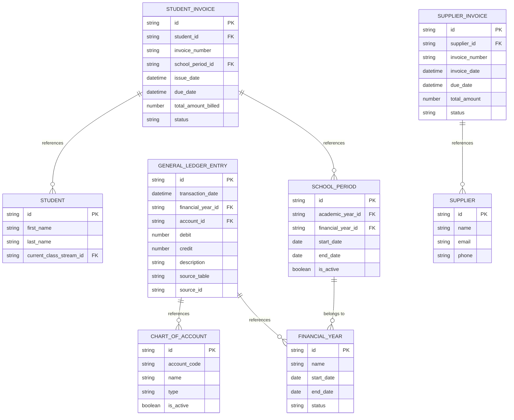
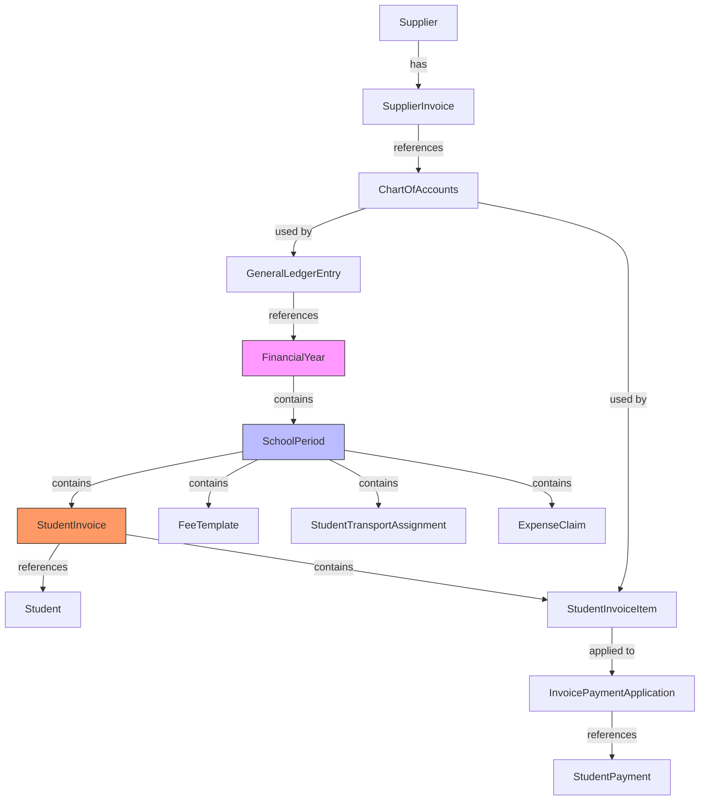
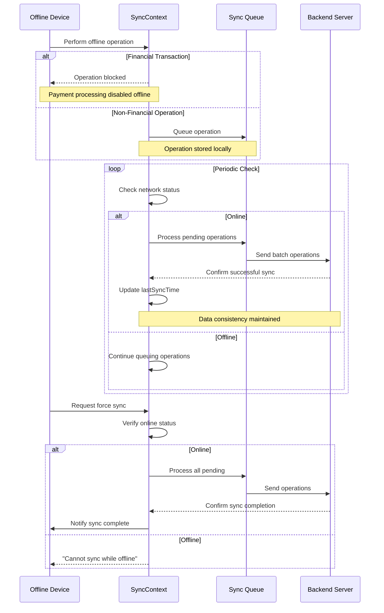
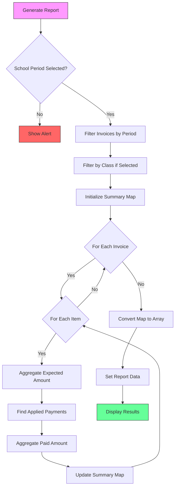

# Referential Integrity & Data Relationships

<cite>
**Referenced Files in This Document**   
- [schema.ts](file://src/modules/finance/data/schema.ts#L0-L383)
- [types.ts](file://src/modules/finance/data/types.ts#L0-L279)
- [FeeCollectionSummaryPage.tsx](file://src/modules/finance/pages/FeeCollectionSummaryPage.tsx#L0-L225)
- [SyncContext.tsx](file://src/contexts/SyncContext.tsx#L0-L197)
- [schoolPeriodSchema.ts](file://src/modules/administration/data/schema.ts#L0-L50)
- [studentSchema.ts](file://src/modules/administration/data/schema.ts#L51-L100)
</cite>

## Table of Contents
1. [Introduction](#introduction)
2. [Core Foreign Key Relationships](#core-foreign-key-relationships)
3. [Cascade Behaviors and Constraint Enforcement](#cascade-behaviors-and-constraint-enforcement)
4. [Financial Year and Period Relationships](#financial-year-and-period-relationships)
5. [Data Integrity During Offline Synchronization](#data-integrity-during-offline-synchronization)
6. [Financial Reporting Queries and Join Patterns](#financial-reporting-queries-and-join-patterns)
7. [Orphaned Record Handling and Data Cleanup](#orphaned-record-handling-and-data-cleanup)
8. [Conclusion](#conclusion)

## Introduction
This document provides a comprehensive analysis of the referential integrity mechanisms within the Finance module of schoolpilot3. It details how foreign key relationships are enforced between financial entities, the cascade behaviors implemented, and strategies for maintaining data consistency. The document also covers the relationship between FinancialYear, SchoolPeriods, and transactional records, data integrity during offline synchronization, example queries used in financial reporting, and procedures for handling orphaned records.

**Section sources**
- [schema.ts](file://src/modules/finance/data/schema.ts#L0-L383)
- [types.ts](file://src/modules/finance/data/types.ts#L0-L279)

## Core Foreign Key Relationships

The Finance module implements a robust relational data model with well-defined foreign key constraints to maintain referential integrity. The primary relationships are established through string-based foreign keys that reference primary keys across related entities.

### StudentInvoice → Student Relationship
The `studentInvoicesSchema` maintains referential integrity with the Student entity through the `student_id` property:
```json
"student_id": SchemaHelpers.string({ maxLength: 100 })
```
This relationship enables tracking of all financial transactions associated with individual students. The corresponding TypeScript interface `FinStudentInvoiceType` defines this relationship with proper typing:
```typescript
export interface FinStudentInvoiceType {
  id: string;
  student_id: string;
  // ... other properties
}
```

### GeneralLedgerEntry → ChartOfAccounts Relationship
The `generalLedgerEntriesSchema` establishes a critical financial accounting relationship with the Chart of Accounts through the `account_id` property:
```json
"account_id": SchemaHelpers.string({ maxLength: 100 })
```
This foreign key ensures that all ledger entries are properly categorized within the accounting system. The relationship is further strengthened by the `financial_year_id` field, which links entries to their appropriate financial period.

### SupplierInvoice → Supplier Relationship
The `supplierInvoicesSchema` maintains referential integrity with suppliers through the `supplier_id` property:
```json
"supplier_id": SchemaHelpers.string({ maxLength: 100 })
```
This relationship allows for comprehensive tracking of accounts payable and supplier transactions. The corresponding `FinSupplierInvoiceType` interface ensures type safety:
```typescript
export interface FinSupplierInvoiceType {
  id: string;
  supplier_id: number;
  // ... other properties
}
```



**Diagram sources**
- [schema.ts](file://src/modules/finance/data/schema.ts#L0-L383)
- [types.ts](file://src/modules/finance/data/types.ts#L0-L279)

**Section sources**
- [schema.ts](file://src/modules/finance/data/schema.ts#L0-L383)
- [types.ts](file://src/modules/finance/data/types.ts#L0-L279)

## Cascade Behaviors and Constraint Enforcement

The Finance module implements constraint enforcement through application-level validation rather than database-level cascade operations. This approach provides greater control over data integrity while maintaining flexibility for business logic requirements.

### Required Field Constraints
Each schema definition includes a `required` array that specifies mandatory fields, ensuring data completeness:
```typescript
required: ['id', 'student_id', 'invoice_number', 'school_period_id', 'issue_date', 'status', 'created_at', 'updated_at']
```
This pattern is consistently applied across all financial entities, preventing the creation of incomplete records.

### Enum-based Validation
The system uses TypeScript enums to enforce domain-specific constraints on field values:
```typescript
status: SchemaHelpers.string({ enum: Object.values(types.FinInvoiceStatusEnum) })
```
This ensures that fields like invoice status can only contain valid values (Draft, Due, Paid, Partially Paid, Overdue, Voided), preventing data inconsistency.

### Data Type and Range Validation
The schema employs comprehensive validation rules for data types and value ranges:
```typescript
amount: SchemaHelpers.number({ minimum: 0.01, maximum: 999999.99 })
```
These constraints prevent invalid financial data such as negative amounts for positive-only fields and ensure monetary values remain within reasonable bounds.

**Section sources**
- [schema.ts](file://src/modules/finance/data/schema.ts#L0-L383)
- [types.ts](file://src/modules/finance/data/types.ts#L0-L279)

## Financial Year and Period Relationships

The financial data model establishes a hierarchical relationship between FinancialYear, SchoolPeriods, and transactional records, creating a structured temporal framework for financial operations.

### FinancialYear Schema
The `financialYearsSchema` defines the top-level financial period:
```typescript
export const financialYearsSchema: DatabaseSchema = createDatabaseSchema({
  title: 'financial_years',
  primaryKey: 'id',
  properties: {
    id: SchemaHelpers.string({ maxLength: 100 }),
    name: SchemaHelpers.string({ maxLength: 100 }),
    start_date: SchemaHelpers.date(),
    end_date: SchemaHelpers.date(),
    status: SchemaHelpers.string({ enum: Object.values(types.FinFinancialYearStatusEnum) }),
    // ... other properties
  }
});
```
The `FinFinancialYearStatusEnum` enforces state transitions with valid values: Open, Closed, and Archived.

### SchoolPeriod Integration
The `schoolPeriodSchema` creates the critical link between academic and financial periods:
```typescript
export const schoolPeriodSchema: DatabaseSchema = createDatabaseSchema({
    title: 'school_period',
    primaryKey: 'id',
    properties: {
        id: SchemaHelpers.string({ maxLength: 100 }),
        academic_year_id: SchemaHelpers.string({ maxLength: 100 }),
        financial_year_id: SchemaHelpers.string({ maxLength: 100 }),
        // ... other properties
    }
});
```
This dual relationship allows financial transactions to be associated with both academic terms and financial years, enabling comprehensive reporting across both dimensions.

### Transactional Record Linking
All financial transactions reference school periods, creating a complete audit trail:
- Student invoices reference `school_period_id`
- Fee templates reference `school_period_id`
- Student transport assignments reference `school_period_id`

This structure ensures that all financial activities are properly contextualized within the appropriate academic and financial periods.



**Diagram sources**
- [schema.ts](file://src/modules/finance/data/schema.ts#L0-L383)
- [types.ts](file://src/modules/finance/data/types.ts#L0-L279)

**Section sources**
- [schema.ts](file://src/modules/finance/data/schema.ts#L0-L383)
- [types.ts](file://src/modules/finance/data/types.ts#L0-L279)

## Data Integrity During Offline Synchronization

The system maintains data integrity during offline synchronization through the SyncContext implementation, which manages the synchronization process and ensures consistency across devices.

### SyncContext Implementation
The `SyncContext` provides a comprehensive state management solution for data synchronization:
```typescript
export interface SyncContextType {
  syncStatus: SyncStatus;
  pendingSyncCount: number;
  lastSyncTime: Date | null;
  forceSync: () => Promise<void>;
  pauseSync: () => void;
  resumeSync: () => void;
  getQueueStatus: () => QueueStatus;
  clearQueue: () => void;
  clearSyncQueue: () => void;
  getSyncSettings: () => SyncSettings;
  updateSyncSettings: (settings: Partial<SyncSettings>) => void;
  offlineCapabilities: OfflineCapability[];
  disabledFeatures: string[];
}
```

### Offline Capabilities Management
The system explicitly defines which features are available offline:
```typescript
const offlineCapabilities = useMemo((): OfflineCapability[] => [
  { feature: 'student-registration', available: true, alternativeAction: 'Data will sync when online' },
  { feature: 'grade-entry', available: true, alternativeAction: 'Grades will sync when online' },
  { feature: 'attendance-tracking', available: true, alternativeAction: 'Attendance will sync when online' }
], []);
```
Conversely, financial transactions are restricted offline:
```typescript
const disabledFeatures = useMemo(() => [
  'payment-processing',
  'invoice-generation',
  'real-time-notifications'
], []);
```

### Synchronization Workflow
The synchronization process follows a controlled workflow:
1. When online, the system automatically syncs according to the configured interval
2. Users can force synchronization with `forceSync()`
3. Sync can be paused and resumed with `pauseSync()` and `resumeSync()`
4. The system maintains a queue of pending operations
5. Conflict resolution is tracked through the `conflictsCount` in `SyncStatus`

This approach ensures that financial data remains consistent while allowing necessary academic operations to continue offline.



**Diagram sources**
- [SyncContext.tsx](file://src/contexts/SyncContext.tsx#L0-L197)

**Section sources**
- [SyncContext.tsx](file://src/contexts/SyncContext.tsx#L0-L197)

## Financial Reporting Queries and Join Patterns

The system implements financial reporting through client-side data processing, as demonstrated in the FeeCollectionSummaryPage component.

### Fee Collection Summary Implementation
The `FeeCollectionSummaryPage` generates financial reports by joining multiple data sets:
```typescript
const FeeCollectionSummaryPage: React.FC = () => {
  const { 
    schoolPeriods, 
    classes, 
    studentInvoices,
    invoicePaymentApplications,
    students, 
    classStreams, 
    loading 
  } = useAppData();
  // ... component logic
};
```

### Data Join Patterns
The reporting logic implements several key join patterns:

#### School Period and Class Filtering
```typescript
const invoicesForPeriod = (studentInvoices || []).filter(inv =>
  inv.school_period_id === selectedSchoolPeriodId &&
  inv.status !== FinInvoiceStatusEnum.VOIDED &&
  (!selectedClassId || (students || []).find(s => s.id === inv.student_id)?.current_class_stream_id && (classStreams || []).find(cs => cs.id === (students || []).find(s => s.id === inv.student_id)?.current_class_stream_id)?.class_id === selectedClassId)
);
```

#### Invoice Item Aggregation
```typescript
const summaryMap = new Map<string, { expected: number; paid: number }>();

invoicesForPeriod.forEach(invoice => {
  (invoice.items || []).forEach(item => {
    const votehead = item.description;
    const current = summaryMap.get(votehead) || { expected: 0, paid: 0 };
    current.expected += item.amount;

    const paymentsForItem = (invoicePaymentApplications || [])
      .filter(ipa => ipa.invoice_item_id === item.id)
      .reduce((sum, ipa) => sum + ipa.amount_applied, 0);
    current.paid += paymentsForItem;
    
    summaryMap.set(votehead, current);
  });
});
```

### Reporting Data Structure
The resulting report data structure provides a comprehensive view of fee collections:
```typescript
interface FeeCollectionSummaryRow {
  votehead: string;
  expectedAmount: number;
  paidAmount: number;
  arrears: number;
}
```

### Export Functionality
The system supports data export with proper CSV formatting:
```typescript
const handleExportCSV = () => {
  const headers = columns.map(col => col.header).join(',');
  const rows = reportData.map(row => {
    return columns.map(col => {
      // ... formatting logic
    }).join(',');
  }).join('\n');
  // ... CSV creation and download
};
```

This client-side reporting approach allows for flexible data aggregation while maintaining referential integrity through the use of properly joined data sets.



**Diagram sources**
- [FeeCollectionSummaryPage.tsx](file://src/modules/finance/pages/FeeCollectionSummaryPage.tsx#L0-L225)

**Section sources**
- [FeeCollectionSummaryPage.tsx](file://src/modules/finance/pages/FeeCollectionSummaryPage.tsx#L0-L225)

## Orphaned Record Handling and Data Cleanup

The system addresses orphaned record prevention and data cleanup through a combination of referential integrity constraints and application-level safeguards.

### Preventive Measures
The primary strategy for preventing orphaned records is the enforcement of required relationships:
```typescript
required: ['id', 'student_id', 'invoice_number', 'school_period_id', 'issue_date', 'status', 'created_at', 'updated_at']
```
By making foreign keys like `student_id` and `school_period_id` required fields, the system prevents the creation of financial records without proper parent references.

### Soft Deletion Pattern
The system implements soft deletion for student invoices through the `deleted_at` timestamp:
```typescript
deleted_at: SchemaHelpers.timestamp()
```
This approach preserves referential integrity while allowing for record deactivation, preventing the creation of orphaned payment applications that reference deleted invoices.

### Data Cleanup Procedures
While the codebase does not explicitly show automated cleanup procedures, the system provides manual controls:
```typescript
const clearQueue = useCallback(() => {
  console.log('Queue cleared');
}, []);

const clearSyncQueue = useCallback(() => {
  console.log('Sync queue cleared');
}, []);
```
These functions allow administrators to clear synchronization queues, which may contain stale or invalid operations.

### Integrity Verification
The system could implement data integrity checks by:
1. Querying for records with invalid foreign key references
2. Identifying payments without corresponding invoice items
3. Detecting ledger entries with invalid account references
4. Finding fee adjustments without associated invoices

These checks could be performed periodically to identify and resolve potential integrity issues.

**Section sources**
- [schema.ts](file://src/modules/finance/data/schema.ts#L0-L383)
- [types.ts](file://src/modules/finance/data/types.ts#L0-L279)
- [SyncContext.tsx](file://src/contexts/SyncContext.tsx#L0-L197)

## Conclusion
The Finance module in schoolpilot3 implements a comprehensive referential integrity system through well-defined foreign key relationships, constraint enforcement, and data validation. The system establishes critical relationships between financial entities such as StudentInvoice → Student, GeneralLedgerEntry → ChartOfAccounts, and SupplierInvoice → Supplier, ensuring data consistency across the financial data model.

The integration between FinancialYear, SchoolPeriods, and transactional records creates a robust temporal framework for financial operations, enabling accurate period-based reporting and audit trails. While the system relies on application-level constraints rather than database-level cascades, this approach provides greater flexibility for business logic implementation.

Data integrity during offline synchronization is maintained through the SyncContext, which manages synchronization state and restricts sensitive financial operations when offline. The reporting system demonstrates effective join patterns for financial analysis, aggregating data from multiple related entities to generate meaningful insights.

For optimal data quality, the system could benefit from enhanced orphaned record detection and automated cleanup procedures, particularly for soft-deleted entities. Overall, the referential integrity mechanisms in place provide a solid foundation for reliable financial data management in the schoolpilot3 application.

**Section sources**
- [schema.ts](file://src/modules/finance/data/schema.ts#L0-L383)
- [types.ts](file://src/modules/finance/data/types.ts#L0-L279)
- [FeeCollectionSummaryPage.tsx](file://src/modules/finance/pages/FeeCollectionSummaryPage.tsx#L0-L225)
- [SyncContext.tsx](file://src/contexts/SyncContext.tsx#L0-L197)