# HR Data Model

<cite>
**Referenced Files in This Document**   
- [rxdbService.ts](file://src/services/rxdbService.ts)
- [useStaffSalarySettingData.ts](file://src/modules/hr/data/useStaffSalarySettingData.ts)
- [usePayrollItemTypeData.ts](file://src/modules/hr/data/usePayrollItemTypeData.ts)
- [usePayrollPeriodData.ts](file://src/modules/hr/data/usePayrollPeriodData.ts)
- [usePayslipData.ts](file://src/modules/hr/data/usePayslipData.ts)
- [mockData.ts](file://src/modules/hr/data/mockData.ts)
- [types.ts](file://src/core/types.ts)
- [schema.ts](file://src/modules/hr/data/schema.ts)
- [types.ts](file://src/modules/hr/data/types.ts)
</cite>

## Table of Contents
1. [Introduction](#introduction)
2. [HR Collections Overview](#hr-collections-overview)
3. [Core HR Entities](#core-hr-entities)
4. [Payroll Calculation Engine](#payroll-calculation-engine)
5. [Temporal Data Management](#temporal-data-management)
6. [Field-Level Documentation](#field-level-documentation)
7. [Sample Data Instances](#sample-data-instances)
8. [Data Flow and Relationships](#data-flow-and-relationships)
9. [Conclusion](#conclusion)

## Introduction
The HR data model in schoolpilot3 is designed to manage comprehensive human resource information for educational institutions. This document details the schema design for the HR module, focusing on 11+ collections including Staff, PayrollPeriod, PayrollItemType, Payslip, and StaffSalarySetting. The model supports complex payroll calculations, temporal data management, and comprehensive staff record keeping. The system is built on a RxDB/PouchDB foundation with database-agnostic schema definitions, enabling flexible data storage and synchronization.

## HR Collections Overview
The HR module in schoolpilot3 consists of several interconnected collections that manage staff information, payroll configurations, and compensation records. These collections are defined in the RxDB service and follow a consistent schema pattern across the application.

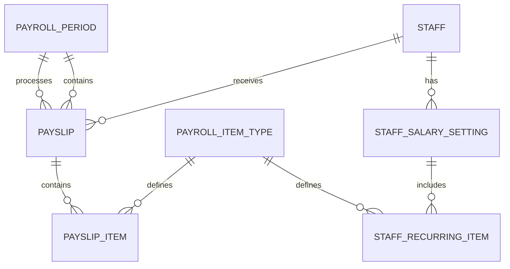

**Diagram sources**
- [rxdbService.ts](file://src/services/rxdbService.ts)
- [schema.ts](file://src/modules/hr/data/schema.ts)

**Section sources**
- [rxdbService.ts](file://src/services/rxdbService.ts#L90-L289)
- [schema.ts](file://src/modules/hr/data/schema.ts#L0-L109)

## Core HR Entities

### Staff Collection
The Staff collection represents employees within the educational institution. It contains basic identification and contact information, along with organizational affiliations.

**Section sources**
- [rxdbService.ts](file://src/services/rxdbService.ts#L90-L289)

### PayrollPeriod Collection
The PayrollPeriod collection defines time intervals during which payroll processing occurs. Each period has a start and end date, financial year association, and status.

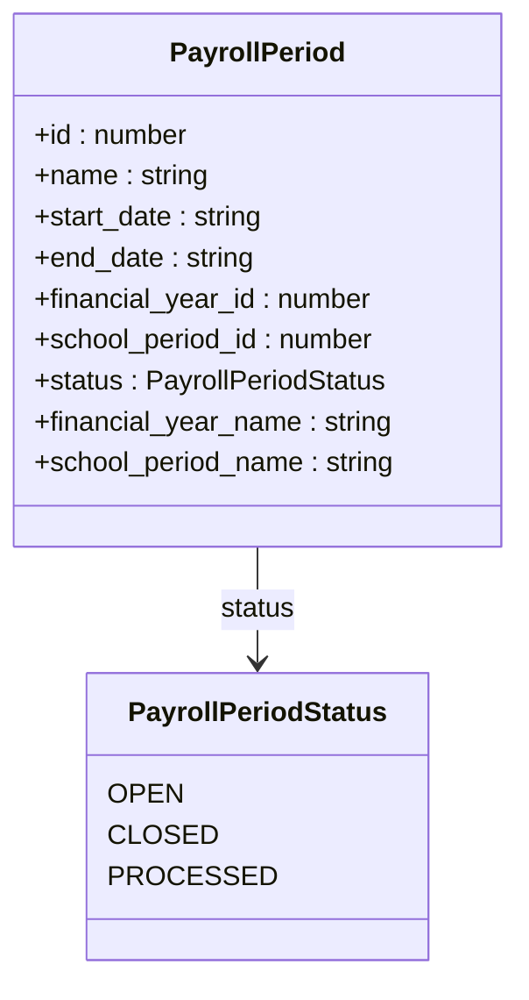

**Diagram sources**
- [types.ts](file://src/core/types.ts#L0-L799)
- [schema.ts](file://src/modules/hr/data/schema.ts#L0-L109)

**Section sources**
- [types.ts](file://src/core/types.ts#L0-L799)
- [schema.ts](file://src/modules/hr/data/schema.ts#L0-L109)
- [mockData.ts](file://src/modules/hr/data/mockData.ts#L0-L292)

### PayrollItemType Collection
The PayrollItemType collection defines the various components that make up employee compensation, categorized as earnings or deductions with specific tax implications.

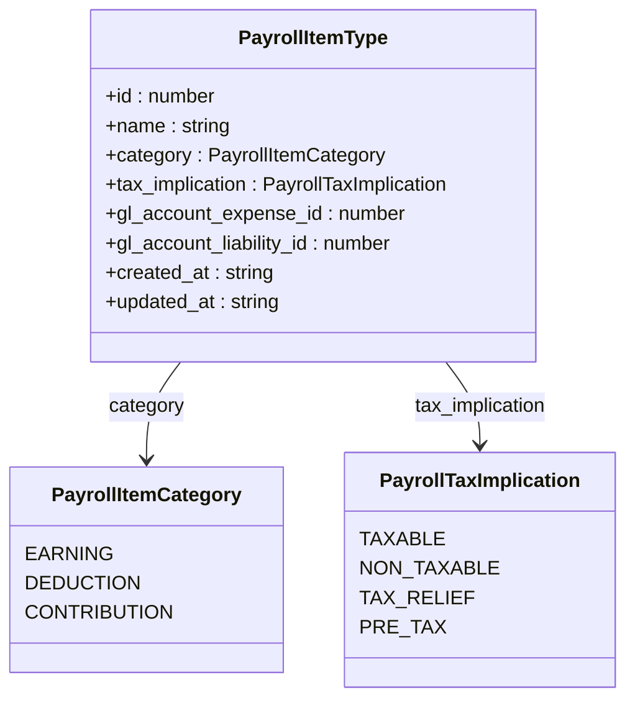

**Diagram sources**
- [types.ts](file://src/core/types.ts#L0-L799)
- [schema.ts](file://src/modules/hr/data/schema.ts#L0-L109)

**Section sources**
- [types.ts](file://src/core/types.ts#L0-L799)
- [schema.ts](file://src/modules/hr/data/schema.ts#L0-L109)
- [mockData.ts](file://src/modules/hr/data/mockData.ts#L0-L292)

### Payslip Collection
The Payslip collection represents the final payroll calculation for a staff member for a specific period, including gross salary, deductions, and net pay.

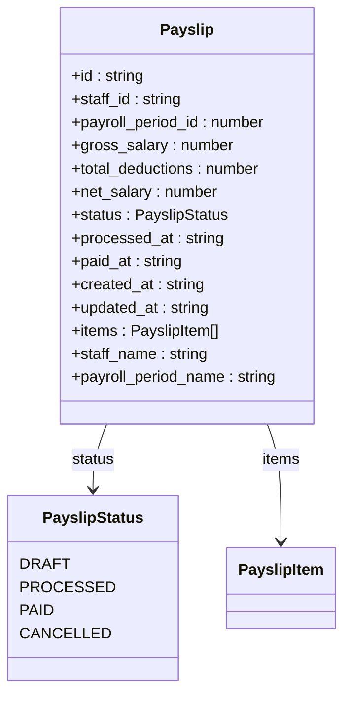

**Diagram sources**
- [types.ts](file://src/core/types.ts#L0-L799)
- [schema.ts](file://src/modules/hr/data/schema.ts#L0-L109)

**Section sources**
- [types.ts](file://src/core/types.ts#L0-L799)
- [schema.ts](file://src/modules/hr/data/schema.ts#L0-L109)
- [mockData.ts](file://src/modules/hr/data/mockData.ts#L0-L292)

### StaffSalarySetting Collection
The StaffSalarySetting collection stores the salary configuration for individual staff members, including basic salary and recurring compensation components.

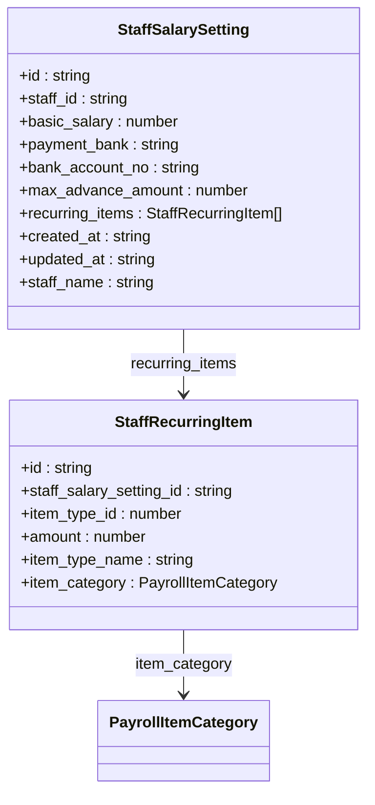

**Diagram sources**
- [types.ts](file://src/core/types.ts#L0-L799)
- [schema.ts](file://src/modules/hr/data/schema.ts#L0-L109)

**Section sources**
- [types.ts](file://src/core/types.ts#L0-L799)
- [schema.ts](file://src/modules/hr/data/schema.ts#L0-L109)
- [mockData.ts](file://src/modules/hr/data/mockData.ts#L0-L292)

## Payroll Calculation Engine
The payroll calculation engine in schoolpilot3 follows a structured data model that connects staff records to their compensation through multiple intermediate entities. This design enables flexible payroll processing with support for both recurring and one-time adjustments.

### Data Model Relationships
The payroll calculation flow follows this path: Staff → StaffSalarySetting → PayrollItemType → Payslip → PayslipItem. This chain ensures that payroll calculations are based on configured salary settings and standardized payroll item types.

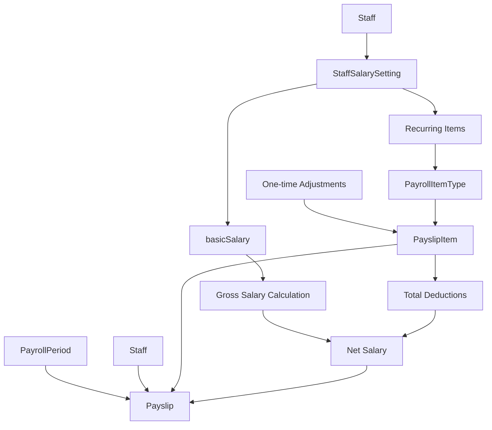

**Diagram sources**
- [schema.ts](file://src/modules/hr/data/schema.ts#L0-L109)
- [mockData.ts](file://src/modules/hr/data/mockData.ts#L0-L292)

**Section sources**
- [schema.ts](file://src/modules/hr/data/schema.ts#L0-L109)
- [mockData.ts](file://src/modules/hr/data/mockData.ts#L0-L292)

### Calculation Process
The payroll calculation process involves several steps:
1. Retrieve the StaffSalarySetting for the employee
2. Calculate base earnings from basicSalary and recurring items
3. Apply one-time adjustments for the specific payroll period
4. Calculate deductions based on configured PayrollItemType rules
5. Generate the final Payslip with gross, deductions, and net pay

## Temporal Data Management
The HR data model incorporates temporal aspects through effective date patterns and status tracking for various entities.

### Effective Date Patterns
Salary settings and contract terms use start and end dates to manage temporal validity. This allows for historical tracking of salary changes and contract renewals.

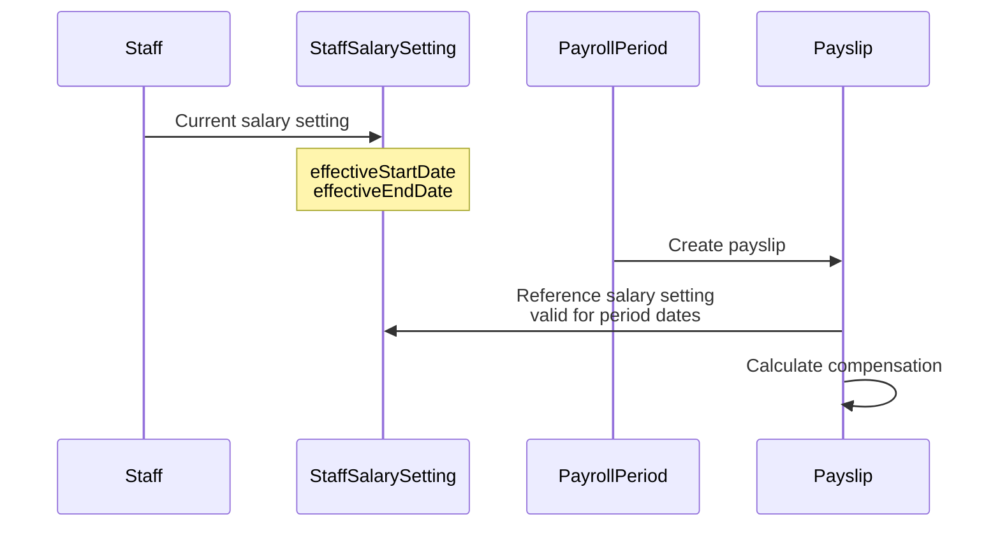

**Section sources**
- [schema.ts](file://src/modules/hr/data/schema.ts#L0-L109)
- [mockData.ts](file://src/modules/hr/data/mockData.ts#L0-L292)

### Status Tracking
Payroll periods and payslips have status fields that track their processing state, enabling workflow management and preventing duplicate processing.

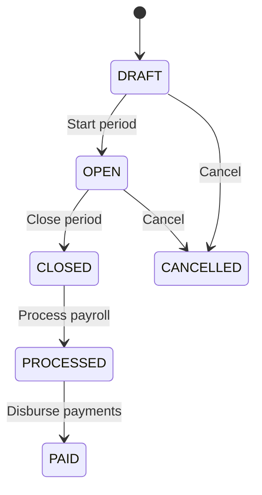

**Section sources**
- [types.ts](file://src/core/types.ts#L0-L799)
- [schema.ts](file://src/modules/hr/data/schema.ts#L0-L109)

## Field-Level Documentation

### Critical Properties

**basicSalary**: The base compensation amount for a staff member, stored as a number with two decimal places for currency precision. This field is required in the StaffSalarySetting collection and forms the foundation of payroll calculations.

**taxDeduction**: While not a direct field, tax implications are managed through the tax_implication property in PayrollItemType, which determines how each payroll item is treated for tax purposes (TAXABLE, NON_TAXABLE, PRE_TAX).

**payslipStatus**: An enumeration field in the Payslip collection that tracks the processing state of a payslip. Valid values are DRAFT, PROCESSED, PAID, and CANCELLED, enabling workflow management and preventing duplicate processing.

### Validation Rules
- **basicSalary**: Must be a positive number with maximum value of 999,999.99
- **amount fields**: All monetary values use multipleOf: 0.01 to ensure proper currency precision
- **date fields**: Use ISO 8601 format (YYYY-MM-DD) for consistency
- **ID fields**: Use string type with maxLength: 100 for flexibility across database systems

**Section sources**
- [schema.ts](file://src/modules/hr/data/schema.ts#L0-L109)
- [types.ts](file://src/core/types.ts#L0-L799)

## Sample Data Instances

### Payslip with Earnings and Deductions
The following JSON represents a complete payslip for a staff member, showing the calculation of gross pay, deductions, and net pay:

```json
{
  "id": "PSLP001",
  "staff_id": "STF001",
  "payroll_period_id": 3,
  "gross_salary": 185000,
  "total_deductions": 42060,
  "net_salary": 142940,
  "status": "PAID",
  "processed_at": "2024-06-28T14:00:00Z",
  "paid_at": "2024-06-30T09:00:00Z",
  "created_at": "2024-06-25T10:00:00Z",
  "updated_at": "2024-06-30T09:00:00Z",
  "items": [
    {
      "id": "PSLI001",
      "payslip_id": "PSLP001",
      "item_type_id": 1,
      "description": "Basic Salary",
      "amount": 150000,
      "item_type_name": "Basic Salary",
      "item_category": "Earning"
    },
    {
      "id": "PSLI002",
      "payslip_id": "PSLP001",
      "item_type_id": 2,
      "description": "House Allowance",
      "amount": 30000,
      "item_type_name": "House Allowance",
      "item_category": "Earning"
    },
    {
      "id": "PSLI003",
      "payslip_id": "PSLP001",
      "item_type_id": 3,
      "description": "Commuter Allowance",
      "amount": 5000,
      "item_type_name": "Commuter Allowance",
      "item_category": "Earning"
    },
    {
      "id": "PSLI004",
      "payslip_id": "PSLP001",
      "item_type_id": 4,
      "description": "PAYE",
      "amount": -40000,
      "item_type_name": "PAYE",
      "item_category": "Deduction"
    },
    {
      "id": "PSLI005",
      "payslip_id": "PSLP001",
      "item_type_id": 5,
      "description": "NHIF",
      "amount": -1700,
      "item_type_name": "NHIF",
      "item_category": "Deduction"
    },
    {
      "id": "PSLI006",
      "payslip_id": "PSLP001",
      "item_type_id": 6,
      "description": "NSSF",
      "amount": -360,
      "item_type_name": "NSSF (Tier I)",
      "item_category": "Deduction"
    }
  ],
  "staff_name": "Michael Scott",
  "payroll_period_name": "June 2024 Payroll"
}
```

**Section sources**
- [mockData.ts](file://src/modules/hr/data/mockData.ts#L0-L292)

## Data Flow and Relationships

### Staff Records and Payroll Items
The relationship between staff records and payroll items is managed through the StaffSalarySetting collection, which links a staff member to their compensation configuration.

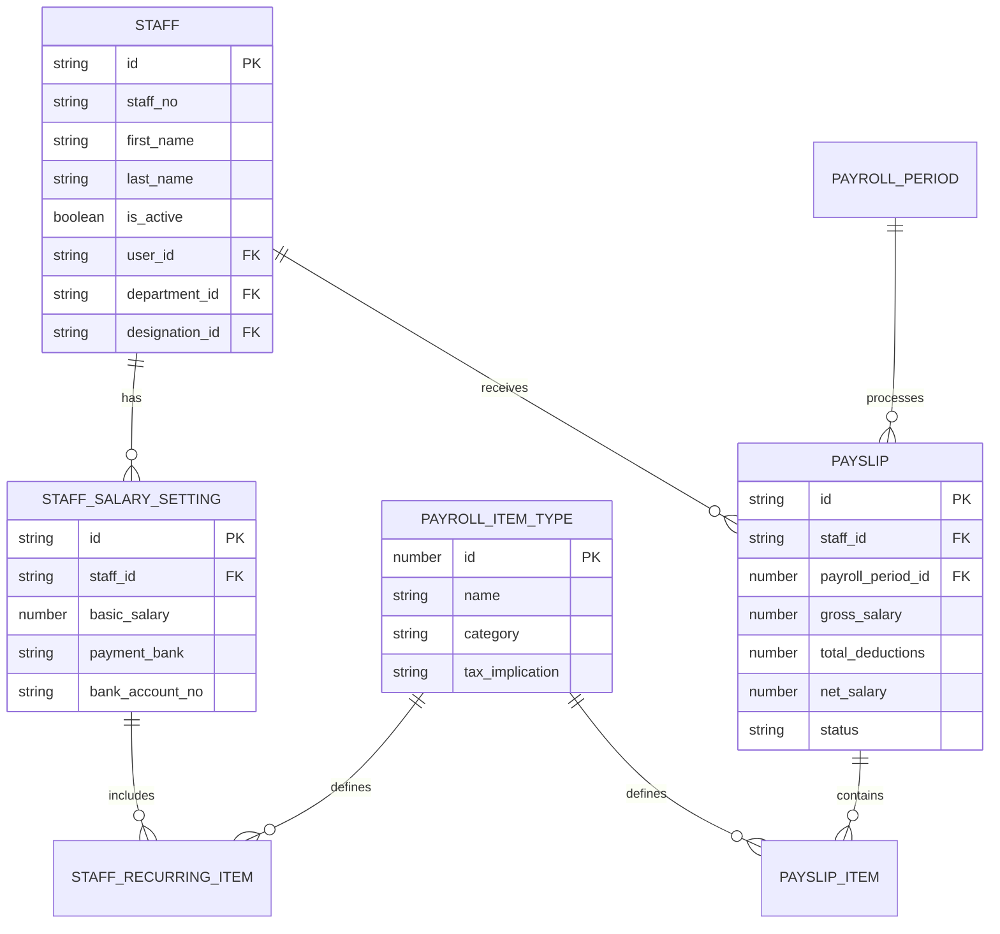

**Diagram sources**
- [schema.ts](file://src/modules/hr/data/schema.ts#L0-L109)
- [mockData.ts](file://src/modules/hr/data/mockData.ts#L0-L292)

**Section sources**
- [schema.ts](file://src/modules/hr/data/schema.ts#L0-L109)
- [mockData.ts](file://src/modules/hr/data/mockData.ts#L0-L292)

### Recurring vs. One-Time Adjustments
The system distinguishes between recurring payroll items (defined in StaffSalarySetting) and one-time adjustments (added directly to PayslipItem). This separation allows for both stable compensation structures and flexible, period-specific modifications.

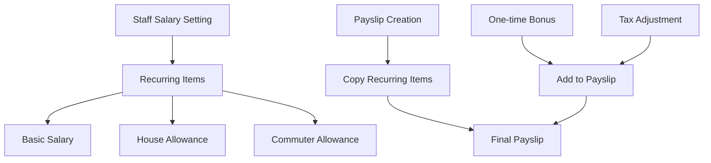

**Section sources**
- [schema.ts](file://src/modules/hr/data/schema.ts#L0-L109)
- [mockData.ts](file://src/modules/hr/data/mockData.ts#L0-L292)

### Data Flow from Configuration to Distribution
The complete data flow from salary configuration through payroll processing to payslip generation and distribution follows a structured process:

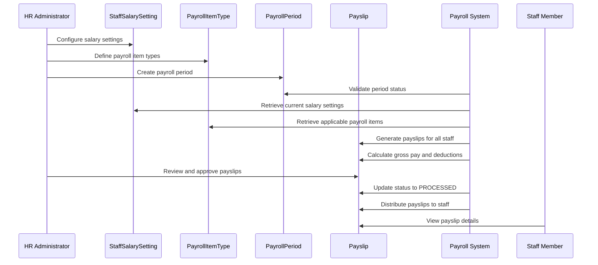

**Section sources**
- [useStaffSalarySettingData.ts](file://src/modules/hr/data/useStaffSalarySettingData.ts#L0-L56)
- [usePayrollItemTypeData.ts](file://src/modules/hr/data/usePayrollItemTypeData.ts#L0-L40)
- [usePayrollPeriodData.ts](file://src/modules/hr/data/usePayrollPeriodData.ts#L0-L40)
- [usePayslipData.ts](file://src/modules/hr/data/usePayslipData.ts#L0-L56)

## Conclusion
The HR data model in schoolpilot3 provides a comprehensive and flexible framework for managing staff information and payroll processing in educational institutions. The model's strength lies in its clear separation of concerns, with distinct collections for staff records, payroll configurations, and compensation records. The temporal aspects of HR data are well-handled through effective date patterns and status tracking, enabling historical analysis and workflow management. The payroll calculation engine follows a logical data flow from salary configuration to payslip generation, supporting both recurring compensation components and one-time adjustments. This well-structured data model ensures data integrity while providing the flexibility needed for complex payroll scenarios in educational settings.