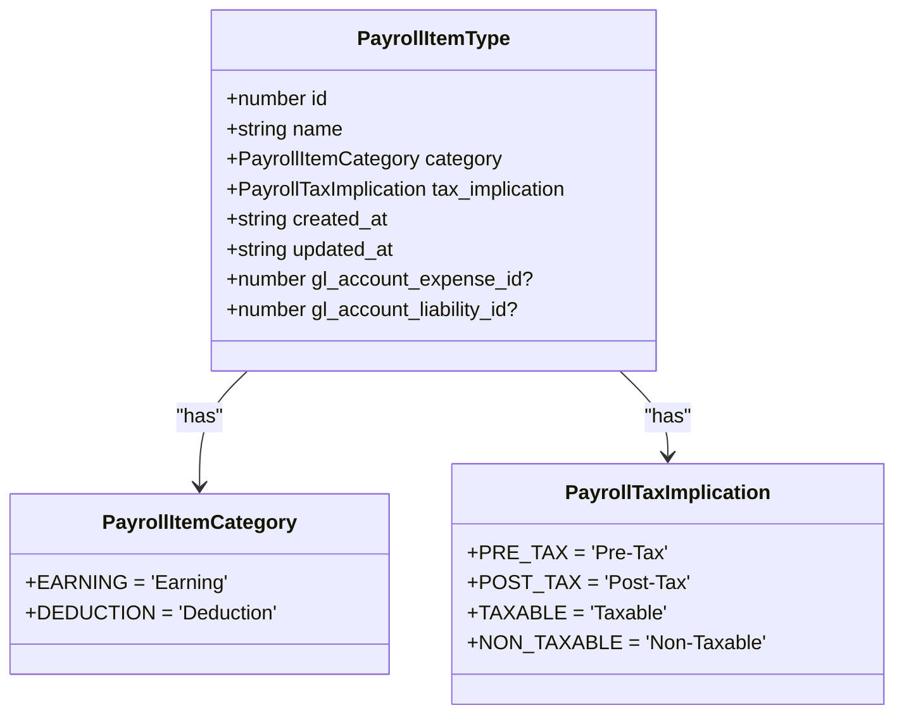
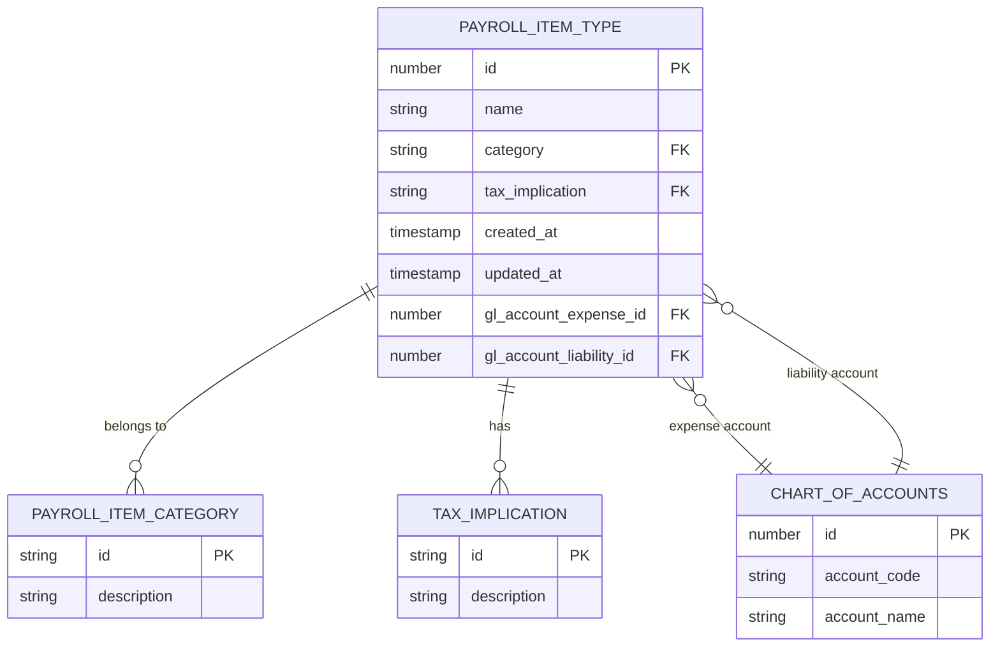
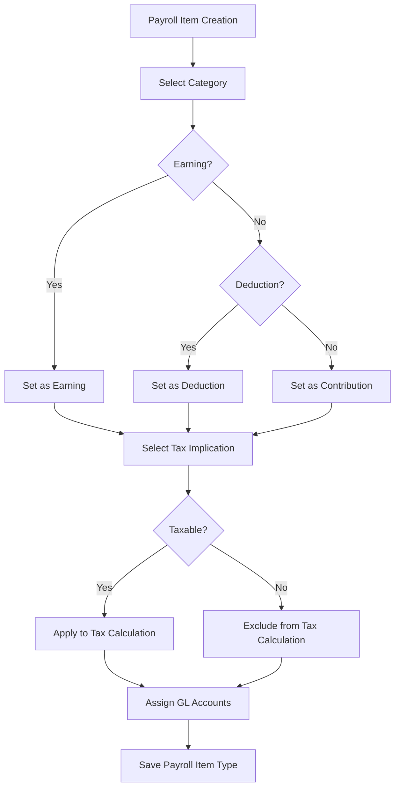
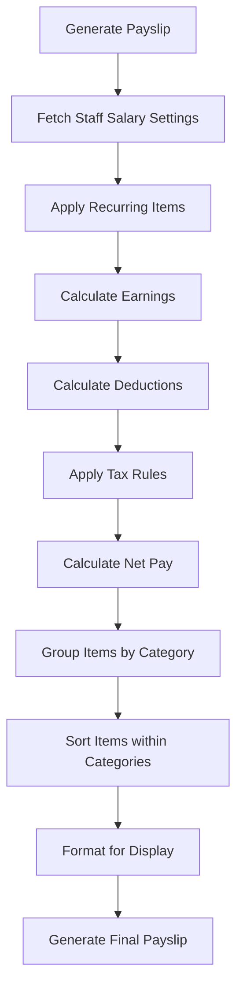
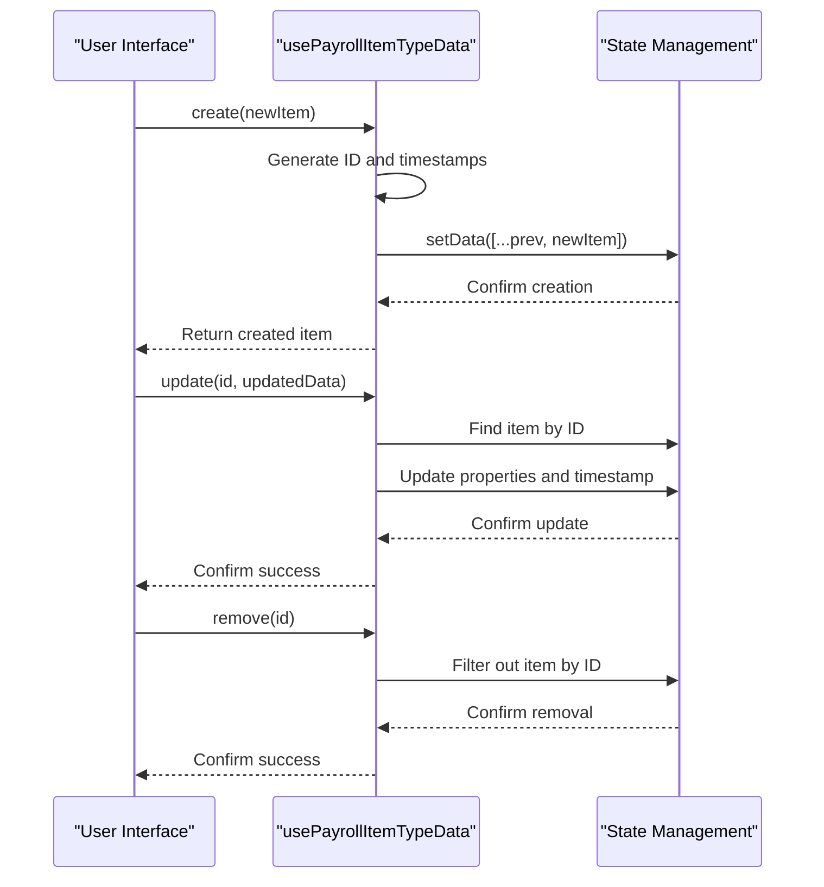

# Payroll Item Type Model

<cite>
**Referenced Files in This Document**   
- [PayrollItemType](file://src/core/types.ts#L963-L970)
- [PayrollItemCategory](file://src/core/types.ts#L208-L211)
- [PayrollTaxImplication](file://src/core/types.ts#L213-L218)
- [payrollItemTypesSchema](file://src/modules/hr/data/schema.ts#L17-L34)
- [usePayrollItemTypeData.ts](file://src/modules/hr/data/usePayrollItemTypeData.ts#L0-L39)
- [mockData.ts](file://src/modules/hr/data/mockData.ts#L0-L292)
- [PayrollItemTypesPage.tsx](file://src/modules/hr/pages/PayrollItemTypesPage.tsx#L0-L245)
</cite>

## Table of Contents
1. [Introduction](#introduction)
2. [Payroll Item Type Data Model](#payroll-item-type-data-model)
3. [Classification of Payroll Items](#classification-of-payroll-items)
4. [Configuration Properties](#configuration-properties)
5. [General Ledger Account Integration](#general-ledger-account-integration)
6. [Payslip Display and Hierarchy](#payslip-display-and-hierarchy)
7. [Data Management and CRUD Operations](#data-management-and-crud-operations)
8. [User Interface and Administration](#user-interface-and-administration)
9. [Versioning and Historical Accuracy](#versioning-and-historical-accuracy)
10. [Examples and Use Cases](#examples-and-use-cases)

## Introduction
The Payroll Item Type model is a core component of the Human Resources (HR) module in the school management system. It defines the structure and behavior of various payroll components such as earnings, deductions, and employer contributions. This model enables flexible payroll configuration, supports statutory compliance, and ensures accurate financial reporting. The model is designed to accommodate different payroll calculation methods, tax treatments, and accounting integrations while maintaining historical accuracy for past payroll records.

**Section sources**
- [PayrollItemType](file://src/core/types.ts#L963-L970)

## Payroll Item Type Data Model
The Payroll Item Type model defines the fundamental structure for all payroll components in the system. Each payroll item type represents a category of payment or deduction that can be applied to staff members' compensation.



**Diagram sources**
- [PayrollItemType](file://src/core/types.ts#L963-L970)
- [PayrollItemCategory](file://src/core/types.ts#L208-L211)
- [PayrollTaxImplication](file://src/core/types.ts#L213-L218)

**Section sources**
- [PayrollItemType](file://src/core/types.ts#L963-L970)

## Classification of Payroll Items
Payroll items are classified into different categories based on their nature and purpose in the compensation structure.

### Earnings
Earnings represent positive components of staff compensation. The system supports various types of earnings:

- **Basic Salary**: The fundamental compensation for employment
- **Allowances**: Additional payments for specific purposes (e.g., housing, transportation)
- **Bonuses**: Performance-based or discretionary payments
- **Overtime**: Compensation for work beyond standard hours

### Deductions
Deductions represent amounts subtracted from gross pay. These include:

- **Statutory Deductions**: Mandatory government-mandated deductions (e.g., income tax, social security)
- **Voluntary Deductions**: Employee-elected deductions (e.g., union dues, charitable contributions)
- **Loan Repayments**: Installments for staff loans or advances

### Employer Contributions
Employer contributions represent costs borne by the institution on behalf of staff:

- **Social Security**: Employer portion of social insurance programs
- **Health Insurance**: Employer-paid health coverage
- **Retirement Plans**: Employer contributions to pension or retirement savings



**Diagram sources**
- [payrollItemTypesSchema](file://src/modules/hr/data/schema.ts#L17-L34)

**Section sources**
- [mockData.ts](file://src/modules/hr/data/mockData.ts#L0-L292)

## Configuration Properties
The Payroll Item Type model includes several configuration properties that determine how payroll items are processed and reported.

### Category
The category property classifies payroll items into major types:

- **Earning**: Positive compensation components
- **Deduction**: Amounts subtracted from gross pay
- **Contribution (Employer)**: Employer-paid benefits

### Tax Implication
The tax implication property defines how payroll items are treated for tax purposes:

- **Taxable**: Subject to income tax calculation
- **Non-Taxable**: Exempt from income tax
- **Pre-Tax**: Deducted before tax calculation
- **Post-Tax**: Deducted after tax calculation

### General Ledger Integration
Payroll items are integrated with the accounting system through General Ledger (GL) accounts:

- **Expense Account**: GL account for recording payroll expenses
- **Liability Account**: GL account for tracking payroll liabilities



**Diagram sources**
- [payrollItemTypesSchema](file://src/modules/hr/data/schema.ts#L17-L34)

**Section sources**
- [payrollItemTypesSchema](file://src/modules/hr/data/schema.ts#L17-L34)

## General Ledger Account Integration
The Payroll Item Type model integrates with the financial accounting system through General Ledger (GL) account references. This ensures proper financial reporting and audit trails.

### Expense Account
The `gl_account_expense_id` field references the GL account used to record payroll expenses. When a payroll item is processed, the system creates journal entries that debit the appropriate expense account.

### Liability Account
The `gl_account_liability_id` field references the GL account used to track payroll liabilities. For deductions and employer contributions, the system creates credit entries in the liability account, which are later cleared when payments are made to third parties.

### Accounting Treatment Examples
- **Basic Salary**: Debit Salary Expense, Credit Salary Payable
- **PAYE Tax**: Debit PAYE Receivable, Credit PAYE Payable
- **Employer Pension**: Debit Pension Expense, Credit Pension Payable

**Section sources**
- [payrollItemTypesSchema](file://src/modules/hr/data/schema.ts#L17-L34)

## Payslip Display and Hierarchy
Payroll items are organized in a structured hierarchy for clear presentation on payslips.

### Grouping by Category
Payslips display items grouped by category:
- **Earnings Section**: Lists all positive components
- **Deductions Section**: Lists all subtractions
- **Employer Contributions Section**: Shows institution-paid benefits

### Ordering and Presentation
Items within each category are ordered by importance and convention:
1. Basic Salary
2. Allowances
3. Bonuses
4. Statutory Deductions
5. Voluntary Deductions

The UI implementation uses visual indicators to distinguish categories, with color-coded badges for easy identification.



**Diagram sources**
- [usePayrollItemTypeData.ts](file://src/modules/hr/data/usePayrollItemTypeData.ts#L0-L39)

**Section sources**
- [PayrollItemTypesPage.tsx](file://src/modules/hr/pages/PayrollItemTypesPage.tsx#L0-L245)

## Data Management and CRUD Operations
The system provides comprehensive data management capabilities for payroll item types through a dedicated hook.

### Create Operation
When creating a new payroll item type:
- The system generates a unique ID
- Sets creation and update timestamps
- Validates required fields (name, category, tax implication)

### Update Operation
When updating an existing payroll item type:
- The system preserves the original creation timestamp
- Updates the modification timestamp
- Maintains referential integrity with related records

### Delete Operation
Deletion is protected by validation:
- The system checks for existing references in staff salary settings
- Warns users if deletion might affect active payroll configurations
- Prevents deletion of items used in processed payslips



**Diagram sources**
- [usePayrollItemTypeData.ts](file://src/modules/hr/data/usePayrollItemTypeData.ts#L0-L39)

**Section sources**
- [usePayrollItemTypeData.ts](file://src/modules/hr/data/usePayrollItemTypeData.ts#L0-L39)

## User Interface and Administration
The Payroll Item Types Page provides a user-friendly interface for managing payroll configurations.

### Form Fields
The administration form includes:
- **Item Name**: Descriptive name of the payroll component
- **Category**: Selection between Earning, Deduction, or Contribution
- **Tax Implication**: Selection of tax treatment

### Validation Rules
The interface enforces validation:
- All fields are required
- Prevents duplicate names within the same category
- Validates GL account references

### User Experience Features
- Color-coded category badges for visual distinction
- Confirmation dialog for deletions
- Loading states during data operations
- Empty state guidance for new implementations

**Section sources**
- [PayrollItemTypesPage.tsx](file://src/modules/hr/pages/PayrollItemTypesPage.tsx#L0-L245)

## Versioning and Historical Accuracy
The system maintains historical accuracy for payroll calculations while allowing configuration updates.

### Immutable Past Records
- Processed payslips preserve the exact configuration at the time of processing
- Changes to payroll item types do not affect historical payslips
- Each payslip item stores computed values, not references to calculation rules

### Forward-Looking Changes
- New payroll periods use the current configuration
- Staff salary settings can be updated to reflect new item types
- Recurring items are automatically updated when their parent types change

### Audit Trail
- Creation and modification timestamps track configuration history
- The system logs all changes to payroll item types
- Administrators can review the evolution of payroll configurations

**Section sources**
- [mockData.ts](file://src/modules/hr/data/mockData.ts#L0-L292)

## Examples and Use Cases
The following examples illustrate common payroll item type configurations.

### Basic Salary Configuration
```json
{
  "id": 1,
  "name": "Basic Salary",
  "category": "Earning",
  "tax_implication": "Taxable",
  "gl_account_expense_id": 5010,
  "gl_account_liability_id": 2010,
  "created_at": "2024-01-01T00:00:00Z",
  "updated_at": "2024-01-01T00:00:00Z"
}
```

### House Allowance Configuration
```json
{
  "id": 2,
  "name": "House Allowance",
  "category": "Earning",
  "tax_implication": "Taxable",
  "gl_account_expense_id": 5020,
  "gl_account_liability_id": 2010,
  "created_at": "2024-01-01T00:00:00Z",
  "updated_at": "2024-01-01T00:00:00Z"
}
```

### PAYE Tax Configuration
```json
{
  "id": 4,
  "name": "PAYE",
  "category": "Deduction",
  "tax_implication": "Taxable",
  "gl_account_expense_id": 1030,
  "gl_account_liability_id": 2030,
  "created_at": "2024-01-01T00:00:00Z",
  "updated_at": "2024-01-01T00:00:00Z"
}
```

### NHIF Deduction Configuration
```json
{
  "id": 5,
  "name": "NHIF",
  "category": "Deduction",
  "tax_implication": "Pre-Tax",
  "gl_account_expense_id": 1040,
  "gl_account_liability_id": 2040,
  "created_at": "2024-01-01T00:00:00Z",
  "updated_at": "2024-01-01T00:00:00Z"
}
```

**Section sources**
- [mockData.ts](file://src/modules/hr/data/mockData.ts#L0-L292)