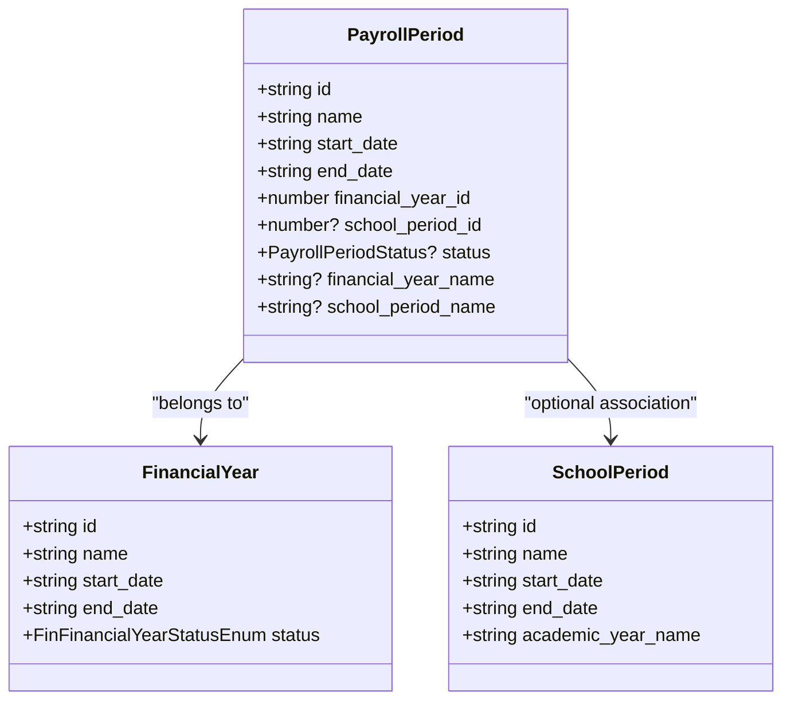
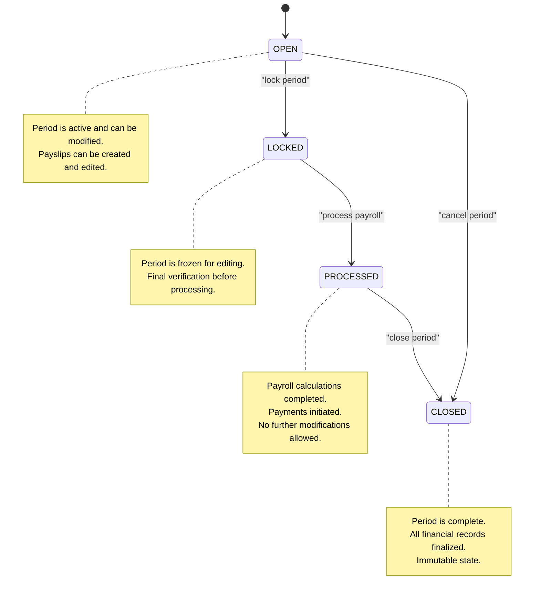
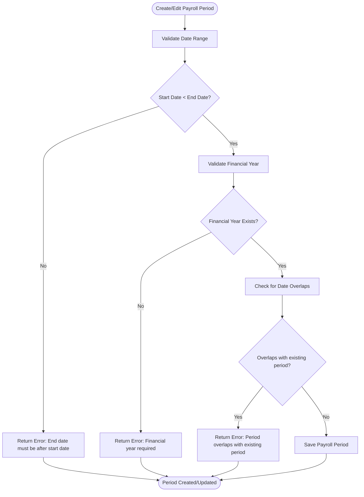

# Payroll Period Model

<cite>
**Referenced Files in This Document**   
- [PayrollPeriodsPage.tsx](file://src/modules/hr/pages/PayrollPeriodsPage.tsx)
- [schema.ts](file://src/modules/hr/data/schema.ts)
- [mockData.ts](file://src/modules/hr/data/mockData.ts)
- [usePayrollPeriodData.ts](file://src/modules/hr/data/usePayrollPeriodData.ts)
- [types.ts](file://src/core/types.ts)
- [financialYearsSchema.ts](file://src/modules/finance/data/schema.ts)
- [useFinancialYearData.ts](file://src/modules/finance/data/useFinancialYearData.ts)
- [validationSchemas.ts](file://src/utils/validationSchemas.ts)
</cite>

## Table of Contents
1. [Introduction](#introduction)
2. [Temporal Structure of Payroll Cycles](#temporal-structure-of-payroll-cycles)
3. [Payroll Period Lifecycle State Machine](#payroll-period-lifecycle-state-machine)
4. [Entity Relationships](#entity-relationships)
5. [Field Constraints and Validation Rules](#field-constraints-and-validation-rules)
6. [Sample Configurations and Payroll Frequencies](#sample-configurations-and-payroll-frequencies)
7. [Financial and Tax Coordination](#financial-and-tax-coordination)
8. [Conclusion](#conclusion)

## Introduction
The Payroll Period model in schoolpilot3 serves as the foundational temporal framework for managing staff compensation cycles within educational institutions. This model defines discrete time intervals during which payroll processing occurs, enabling systematic calculation, approval, and disbursement of salaries. The PayrollPeriod entity acts as a container for all payroll-related activities within a specific timeframe, linking together staff, compensation components, and financial accounting systems. This documentation provides a comprehensive analysis of the PayrollPeriod data model, covering its temporal structure, lifecycle management, relationships with other entities, validation constraints, and integration with financial systems.

**Section sources**
- [PayrollPeriodsPage.tsx](file://src/modules/hr/pages/PayrollPeriodsPage.tsx)
- [schema.ts](file://src/modules/hr/data/schema.ts)

## Temporal Structure of Payroll Cycles

The PayrollPeriod model implements a comprehensive temporal structure that defines the boundaries and characteristics of each payroll cycle. The model supports various payroll frequencies through flexible date configurations, allowing institutions to align payroll processing with their specific operational requirements.

### Core Temporal Fields
The PayrollPeriod entity contains several key temporal fields that define the cycle:

- **name**: A descriptive identifier for the payroll period (e.g., "July 2024 Payroll")
- **start_date**: The beginning date of the payroll period
- **end_date**: The ending date of the payroll period  
- **financial_year_id**: Reference to the financial year in which the period falls
- **school_period_id**: Optional reference to an academic/school period



**Diagram sources**
- [schema.ts](file://src/modules/hr/data/schema.ts#L0-L34)
- [types.ts](file://src/core/types.ts#L952-L1004)

**Section sources**
- [schema.ts](file://src/modules/hr/data/schema.ts#L0-L34)
- [types.ts](file://src/core/types.ts#L952-L1004)

### Payroll Frequency Types
The system supports multiple payroll frequencies through appropriate configuration of start and end dates:

- **Monthly**: Periods typically spanning calendar months (e.g., July 1 - July 31)
- **Bi-weekly**: Periods spanning two weeks (e.g., June 15 - June 28)
- **Weekly**: Periods spanning one week
- **Semi-monthly**: Periods spanning half-month intervals (e.g., 1st-15th, 16th-end)

The model does not enforce a specific frequency pattern, allowing institutions to define custom payroll schedules based on their policies and requirements.

## Payroll Period Lifecycle State Machine

The PayrollPeriod entity implements a state machine that governs the progression of a payroll cycle from creation to closure. This lifecycle ensures proper workflow management and prevents unauthorized modifications to processed payroll data.

### State Transitions
The PayrollPeriodStatus enum defines the possible states in the lifecycle:



**Diagram sources**
- [PayrollPeriodsPage.tsx](file://src/modules/hr/pages/PayrollPeriodsPage.tsx#L266-L307)
- [schema.ts](file://src/modules/hr/data/schema.ts#L0-L17)

**Section sources**
- [PayrollPeriodsPage.tsx](file://src/modules/hr/pages/PayrollPeriodsPage.tsx#L266-L307)
- [schema.ts](file://src/modules/hr/data/schema.ts#L0-L17)

### State Descriptions
- **OPEN**: The initial state where the payroll period is active and can be modified. Payslips can be created, edited, and deleted during this phase.
- **LOCKED**: The period has been locked to prevent further modifications while final verification is conducted. This state ensures data integrity before processing.
- **PROCESSED**: Payroll calculations have been completed, and payments have been initiated. The period is no longer editable.
- **CLOSED**: The final state indicating that all activities for the period are complete, including financial reconciliation.

## Entity Relationships

The PayrollPeriod model serves as a central hub that connects various HR and financial entities within the system, creating a cohesive payroll processing ecosystem.

### Primary Relationships
The PayrollPeriod entity maintains relationships with several key entities:

```mermaid
erDiagram
PAYROLL_PERIOD {
string id PK
string name
string start_date
string end_date
number financial_year_id FK
number? school_period_id FK
string status
}
PAYSLIP {
string id PK
string staff_id FK
number payroll_period_id FK
number? gross_salary
number? total_deductions
number? net_salary
string? status
}
PAYROLL_ITEM_TYPE {
number id PK
string name
string category
string tax_implication
}
STAFF {
string id PK
string staff_no
string first_name
string last_name
string? department_id
string? designation_id
}
FINANCIAL_YEAR {
number id PK
string name
string start_date
string end_date
string status
}
PAYROLL_PERIOD ||--o{ PAYSLIP : "contains"
PAYROLL_PERIOD }|--|| FINANCIAL_YEAR : "belongs to"
PAYSLIP }|--|| STAFF : "for staff"
PAYSLIP }o--|| PAYROLL_ITEM_TYPE : "has items"
```

**Diagram sources**
- [schema.ts](file://src/modules/hr/data/schema.ts#L69-L90)
- [types.ts](file://src/core/types.ts#L952-L1004)
- [types.ts](file://src/core/types.ts#L1008-L1022)

**Section sources**
- [schema.ts](file://src/modules/hr/data/schema.ts#L69-L90)
- [types.ts](file://src/core/types.ts#L952-L1004)
- [types.ts](file://src/core/types.ts#L1008-L1022)

### Relationship Details
- **Payslip**: One-to-many relationship where a PayrollPeriod contains multiple Payslips, one for each staff member paid during that period.
- **FinancialYear**: Each PayrollPeriod belongs to a specific FinancialYear, ensuring alignment with the organization's fiscal calendar.
- **SchoolPeriod**: Optional relationship that links the payroll period to an academic term or semester.
- **Staff**: Indirect relationship through Payslips, connecting the payroll period to the staff members who received compensation.

## Field Constraints and Validation Rules

The PayrollPeriod model implements several constraints and validation rules to ensure data integrity and prevent common errors in payroll processing.

### Required Fields
The following fields are required for all PayrollPeriod records:
- **id**: Unique identifier
- **name**: Descriptive name for the period
- **start_date**: Beginning date of the period
- **end_date**: Ending date of the period
- **financial_year_id**: Reference to the financial year

### Date Validation
The system enforces several date-related constraints:



**Diagram sources**
- [PayrollPeriodsPage.tsx](file://src/modules/hr/pages/PayrollPeriodsPage.tsx#L67-L106)
- [validationSchemas.ts](file://src/utils/validationSchemas.ts#L199-L241)

**Section sources**
- [PayrollPeriodsPage.tsx](file://src/modules/hr/pages/PayrollPeriodsPage.tsx#L67-L106)
- [validationSchemas.ts](file://src/utils/validationSchemas.ts#L199-L241)

### Immutability Rules
Once a payroll period reaches certain states, it becomes immutable:
- **PROCESSED**: No modifications allowed to the period or associated payslips
- **CLOSED**: Complete immutability for audit and compliance purposes
- **LOCKED**: Modifications prevented except by administrators with special permissions

## Sample Configurations and Payroll Frequencies

The PayrollPeriod model supports various payroll frequency configurations, allowing institutions to align payroll processing with their operational needs and fiscal calendars.

### Monthly Payroll Configuration
A typical monthly payroll configuration aligns with calendar months:

```typescript
const monthlyPeriods = [
  {
    id: 1,
    name: 'January 2024 Payroll',
    start_date: '2024-01-01',
    end_date: '2024-01-31',
    financial_year_id: 2,
    school_period_id: 2,
    status: PayrollPeriodStatus.OPEN,
    financial_year_name: 'FY 2024',
    school_period_name: 'Term 2 - AY 2023/2024'
  },
  {
    id: 2,
    name: 'February 2024 Payroll',
    start_date: '2024-02-01',
    end_date: '2024-02-29',
    financial_year_id: 2,
    school_period_id: 2,
    status: PayrollPeriodStatus.OPEN,
    financial_year_name: 'FY 2024',
    school_period_name: 'Term 2 - AY 2023/2024'
  }
];
```

**Section sources**
- [mockData.ts](file://src/modules/hr/data/mockData.ts#L0-L22)

### Bi-weekly Payroll Configuration
For institutions using a bi-weekly payroll schedule:

```typescript
const biWeeklyPeriods = [
  {
    id: 1,
    name: 'Pay Period 1 - Jan 2024',
    start_date: '2024-01-01',
    end_date: '2024-01-14',
    financial_year_id: 2,
    status: PayrollPeriodStatus.OPEN,
    financial_year_name: 'FY 2024'
  },
  {
    id: 2,
    name: 'Pay Period 2 - Jan 2024',
    start_date: '2024-01-15',
    end_date: '2024-01-28',
    financial_year_id: 2,
    status: PayrollPeriodStatus.OPEN,
    financial_year_name: 'FY 2024'
  }
];
```

### Fiscal Year Alignment
The model supports alignment with financial accounting periods:

```mermaid
graph TD
subgraph "Financial Year FY 2024"
direction LR
FY_Start["Jan 1, 2024"] --> PP1["Payroll Period 1"]
PP1 --> PP2["Payroll Period 2"]
PP2 --> PP3["Payroll Period 3"]
PP3 --> PP4["Payroll Period 4"]
PP4 --> PP5["Payroll Period 5"]
PP5 --> PP6["Payroll Period 6"]
PP6 --> PP7["Payroll Period 7"]
PP7 --> PP8["Payroll Period 8"]
PP8 --> PP9["Payroll Period 9"]
PP9 --> PP10["Payroll Period 10"]
PP10 --> PP11["Payroll Period 11"]
PP11 --> PP12["Payroll Period 12"]
PP12 --> FY_End["Dec 31, 2024"]
end
style FY_Start fill:#f9f,stroke:#333
style FY_End fill:#f9f,stroke:#333
style PP1 fill:#bbf,stroke:#333
style PP12 fill:#bbf,stroke:#333
```



**Diagram sources**
- [financialYearsSchema.ts](file://src/modules/finance/data/schema.ts#L0-L33)
- [useFinancialYearData.ts](file://src/modules/finance/data/useFinancialYearData.ts#L0-L39)

**Section sources**
- [financialYearsSchema.ts](file://src/modules/finance/data/schema.ts#L0-L33)
- [useFinancialYearData.ts](file://src/modules/finance/data/useFinancialYearData.ts#L0-L39)

## Financial and Tax Coordination

The PayrollPeriod model integrates closely with financial accounting systems and tax reporting requirements, ensuring compliance and accurate financial reporting.

### Financial Year Integration
Each PayrollPeriod is linked to a FinancialYear, ensuring that payroll expenses are properly allocated to the correct accounting period:

```typescript
interface FinancialYear {
  id: string;
  name: string;
  start_date: string;
  end_date: string;
  status: FinFinancialYearStatusEnum;
  created_at: string;
  updated_at: string;
}
```

This integration enables:
- Accurate expense reporting by financial period
- Proper budget allocation and tracking
- Compliance with financial auditing requirements
- Generation of financial statements that include payroll expenses

### Tax Reporting Alignment
The temporal structure of PayrollPeriods facilitates tax reporting by:
- Defining clear boundaries for tax calculation periods
- Enabling generation of tax reports for specific periods
- Supporting year-to-date calculations for tax forms
- Facilitating reconciliation with tax payment schedules

The system ensures that payroll periods do not overlap with financial years, maintaining data integrity across the financial and HR systems.

**Section sources**
- [financialYearsSchema.ts](file://src/modules/finance/data/schema.ts#L0-L33)
- [validationSchemas.ts](file://src/utils/validationSchemas.ts#L161-L206)

## Conclusion
The PayrollPeriod model in schoolpilot3 provides a robust framework for managing payroll cycles in educational institutions. By implementing a comprehensive temporal structure, state machine lifecycle, and integration with financial systems, the model ensures accurate, compliant, and efficient payroll processing. The flexibility to support various payroll frequencies and alignment with fiscal calendars makes it adaptable to diverse institutional requirements. The validation rules and immutability constraints protect data integrity, while the relationships with Payslip, Staff, and financial entities create a cohesive ecosystem for compensation management. This model serves as the cornerstone of the payroll processing system, enabling reliable and auditable compensation cycles.