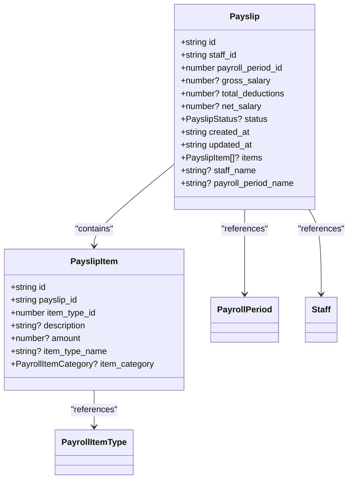
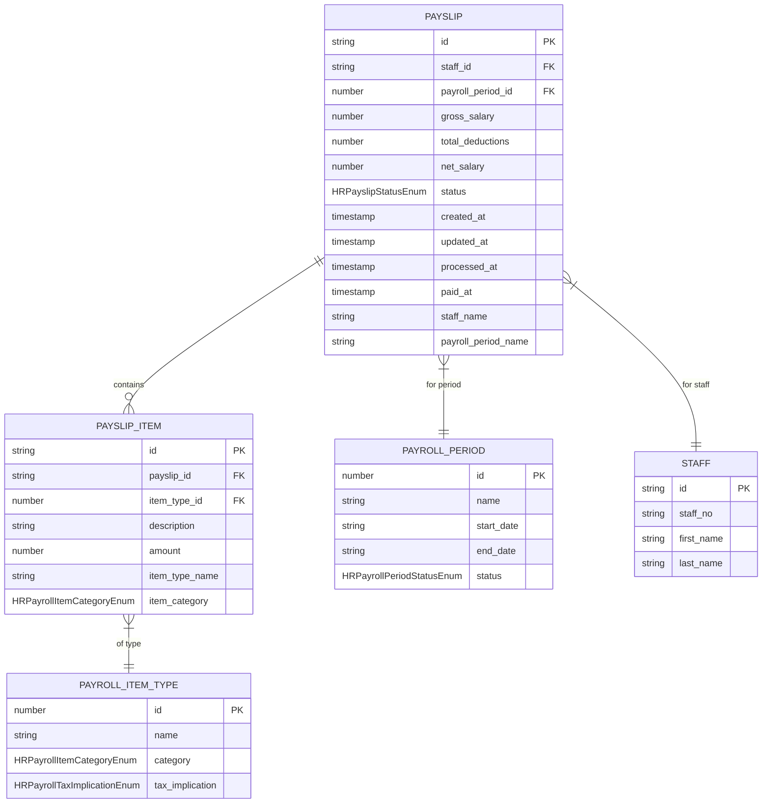
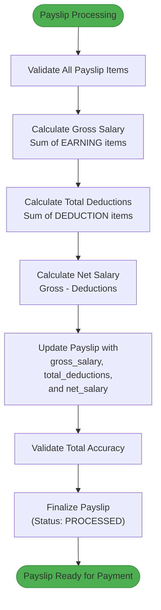
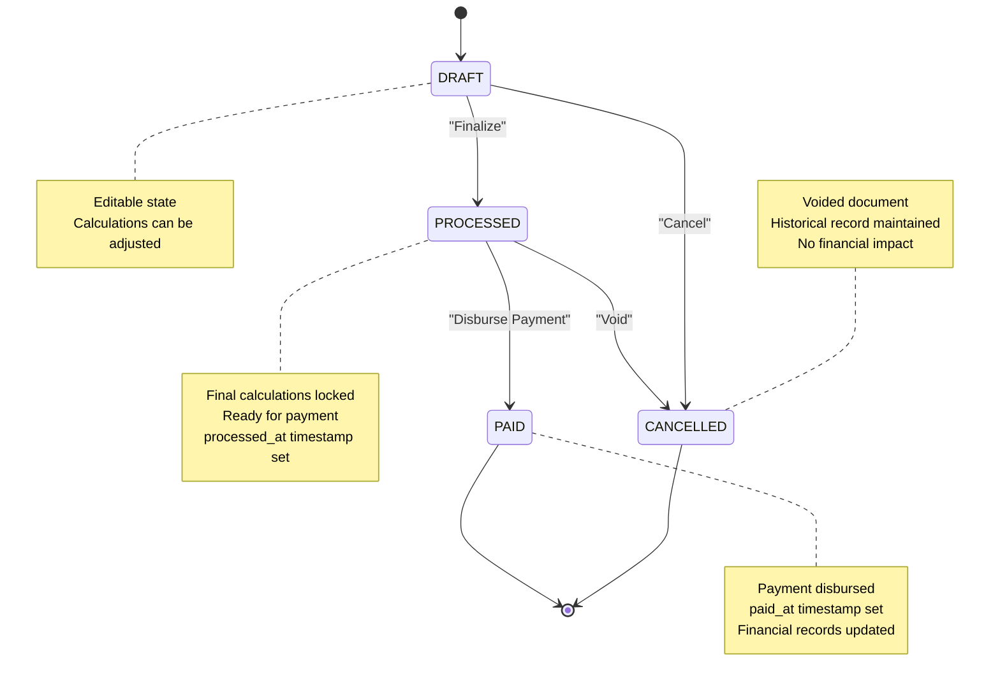
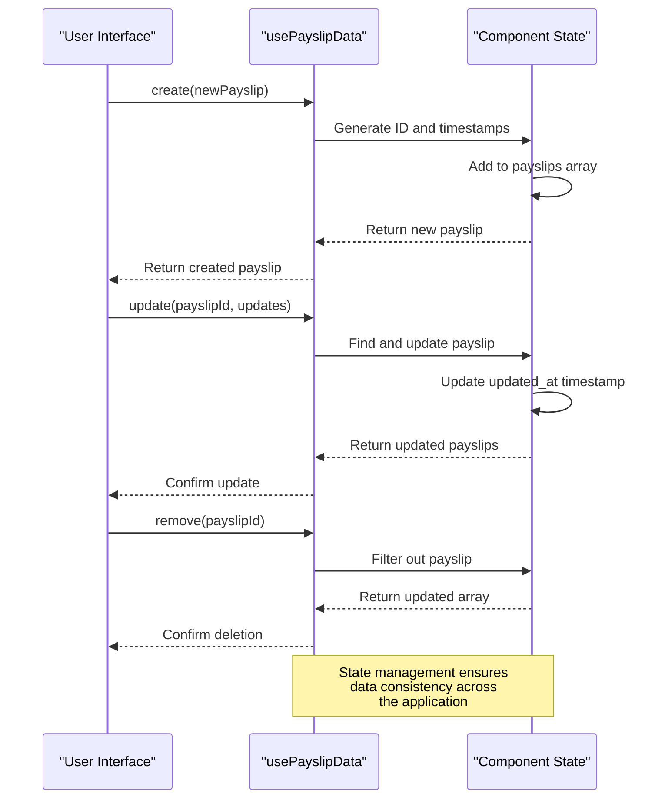

# Payslip Data Model

<cite>
**Referenced Files in This Document**   
- [types.ts](file://src\modules\hr\data\types.ts)
- [schema.ts](file://src\modules\hr\data\schema.ts)
- [usePayslipData.ts](file://src\modules\hr\data\usePayslipData.ts)
- [usePayslipItemData.ts](file://src\modules\hr\data\usePayslipItemData.ts)
- [types.ts](file://src\core\types.ts)
</cite>

## Table of Contents
1. [Introduction](#introduction)
2. [Payslip and PayslipItem Data Structures](#payslip-and-payslipitem-data-structures)
3. [Field-Level Specifications](#field-level-specifications)
4. [Relationships and Aggregation Rules](#relationships-and-aggregation-rules)
5. [Status Lifecycle and Data Integrity](#status-lifecycle-and-data-integrity)
6. [Sample JSON Structures](#sample-json-structures)
7. [Audit Trail and Data Management](#audit-trail-and-data-management)

## Introduction
The Payslip data model represents a comprehensive payroll system for staff compensation within an educational institution. This documentation details the structure, relationships, and functionality of the Payslip and PayslipItem entities, which work together to calculate and record employee earnings, deductions, and net pay for specific payroll periods. The model supports complex payroll scenarios with multiple earning and deduction types while maintaining data integrity through proper status management and audit trails.

**Section sources**
- [types.ts](file://src\modules\hr\data\types.ts#L1-L85)
- [types.ts](file://src\core\types.ts#L900-L1100)

## Payslip and PayslipItem Data Structures
The Payslip and PayslipItem data models are defined as TypeScript interfaces that represent the core payroll entities. These models follow a parent-child relationship where a single Payslip contains multiple PayslipItem records representing individual components of the payroll calculation.



**Diagram sources**
- [types.ts](file://src\core\types.ts#L900-L1100)
- [types.ts](file://src\modules\hr\data\types.ts#L1-L85)

**Section sources**
- [types.ts](file://src\core\types.ts#L900-L1100)
- [types.ts](file://src\modules\hr\data\types.ts#L1-L85)

## Field-Level Specifications
The Payslip and PayslipItem models contain several critical fields that define the payroll calculation and tracking functionality. Each field serves a specific purpose in the payroll processing workflow.

### Payslip Critical Fields
- **gross_salary**: The total earnings before any deductions are applied. This value is calculated by summing all earning-type PayslipItems.
- **total_deductions**: The sum of all deduction-type PayslipItems, representing amounts withheld from the gross salary.
- **net_salary**: The final amount paid to the employee, calculated as gross_salary minus total_deductions.
- **status**: The current state of the payslip in its lifecycle, with values from the HRPayslipStatusEnum.
- **processed_at**: Timestamp indicating when the payslip was processed and finalized.
- **paid_at**: Timestamp indicating when the net salary was disbursed to the employee.

### PayslipItem Critical Fields
- **item_type_id**: Reference to the PayrollItemType that defines the nature of this payroll item (e.g., basic salary, tax, pension).
- **amount**: The monetary value of this specific payroll component.
- **item_category**: The classification of the payroll item (EARNING, DEDUCTION, or CONTRIBUTION).
- **description**: Optional explanatory text for the payroll item.



**Diagram sources**
- [schema.ts](file://src\modules\hr\data\schema.ts#L1-L110)
- [types.ts](file://src\core\types.ts#L900-L1100)

**Section sources**
- [schema.ts](file://src\modules\hr\data\schema.ts#L1-L110)
- [types.ts](file://src\modules\hr\data\types.ts#L1-L85)

## Relationships and Aggregation Rules
The Payslip and PayslipItem models follow a strict parent-child relationship with specific aggregation rules that ensure data consistency and accurate payroll calculations.

### Parent-Child Relationship
A Payslip serves as the parent entity that aggregates multiple PayslipItem child records. Each PayslipItem must reference its parent Payslip through the payslip_id field. This relationship enables the system to:
- Group all payroll components for a specific employee and period
- Calculate aggregate values (gross pay, total deductions, net pay)
- Maintain referential integrity between related records

### Aggregation Rules
The system enforces several aggregation rules to ensure payroll accuracy:
- **Gross Pay Calculation**: The gross_salary field in Payslip is the sum of all PayslipItem records with item_category = EARNING
- **Total Deductions Calculation**: The total_deductions field is the sum of all PayslipItem records with item_category = DEDUCTION
- **Net Pay Calculation**: The net_salary field is calculated as gross_salary minus total_deductions
- **Data Consistency**: When any PayslipItem is created, updated, or deleted, the parent Payslip's aggregate fields are automatically recalculated



**Diagram sources**
- [usePayslipData.ts](file://src\modules\hr\data\usePayslipData.ts#L1-L57)
- [types.ts](file://src\core\types.ts#L900-L1100)

**Section sources**
- [usePayslipData.ts](file://src\modules\hr\data\usePayslipData.ts#L1-L57)
- [usePayslipItemData.ts](file://src\modules\hr\data\usePayslipItemData.ts#L1-L57)

## Status Lifecycle and Data Integrity
The Payslip model implements a state machine through the status field, which tracks the lifecycle of a payslip from creation to payment. This ensures proper workflow management and prevents unauthorized modifications.

### Status Enumerations
The HRPayslipStatusEnum defines the possible states:
- **DRAFT**: Initial state where the payslip is being prepared and can be modified
- **PROCESSED**: Finalized state where calculations are complete and the payslip is approved
- **PAID**: Payment has been disbursed to the employee
- **CANCELLED**: The payslip has been voided and should not be processed

### Data Integrity Rules
The system enforces several data integrity rules:
- Only DRAFT payslips can be modified
- Transition from DRAFT to PROCESSED triggers final calculations and locks the document
- PAID status requires a valid paid_at timestamp
- CANCELLED payslips maintain historical record but cannot be processed



**Diagram sources**
- [types.ts](file://src\modules\hr\data\types.ts#L1-L85)
- [types.ts](file://src\core\types.ts#L900-L1100)

**Section sources**
- [types.ts](file://src\modules\hr\data\types.ts#L1-L85)
- [types.ts](file://src\core\types.ts#L900-L1100)

## Sample JSON Structures
The following examples demonstrate complex payslip scenarios with multiple earnings and deduction types.

### Complete Payslip with Multiple Components
```json
{
  "id": "ps-2023-001",
  "staff_id": "st-1001",
  "payroll_period_id": 202306,
  "gross_salary": 85000.00,
  "total_deductions": 23500.00,
  "net_salary": 61500.00,
  "status": "PROCESSED",
  "processed_at": "2023-07-01T10:30:00Z",
  "paid_at": "2023-07-05T09:15:00Z",
  "created_at": "2023-06-25T14:20:00Z",
  "updated_at": "2023-07-01T10:30:00Z",
  "staff_name": "John Doe",
  "payroll_period_name": "June 2023",
  "items": [
    {
      "id": "psi-001",
      "payslip_id": "ps-2023-001",
      "item_type_id": 101,
      "description": "Basic Salary",
      "amount": 75000.00,
      "item_type_name": "Basic Salary",
      "item_category": "EARNING"
    },
    {
      "id": "psi-002",
      "payslip_id": "ps-2023-001",
      "item_type_id": 102,
      "description": "Housing Allowance",
      "amount": 10000.00,
      "item_type_name": "Housing Allowance",
      "item_category": "EARNING"
    },
    {
      "id": "psi-003",
      "payslip_id": "ps-2023-001",
      "item_type_id": 201,
      "description": "PAYE Tax",
      "amount": 18500.00,
      "item_type_name": "PAYE Tax",
      "item_category": "DEDUCTION"
    },
    {
      "id": "psi-004",
      "payslip_id": "ps-2023-001",
      "item_type_id": 202,
      "description": "NSSF Contribution",
      "amount": 3500.00,
      "item_type_name": "NSSF Contribution",
      "item_category": "DEDUCTION"
    },
    {
      "id": "psi-005",
      "payslip_id": "ps-2023-001",
      "item_type_id": 301,
      "description": "Employer Pension",
      "amount": 7500.00,
      "item_type_name": "Employer Pension",
      "item_category": "CONTRIBUTION"
    }
  ]
}
```

### Draft Payslip with Partial Data
```json
{
  "id": "ps-2023-002",
  "staff_id": "st-1002",
  "payroll_period_id": 202306,
  "gross_salary": 65000.00,
  "total_deductions": 15200.00,
  "net_salary": 49800.00,
  "status": "DRAFT",
  "created_at": "2023-06-28T09:15:00Z",
  "updated_at": "2023-06-28T11:45:00Z",
  "staff_name": "Jane Smith",
  "payroll_period_name": "June 2023",
  "items": [
    {
      "id": "psi-006",
      "payslip_id": "ps-2023-002",
      "item_type_id": 101,
      "description": "Basic Salary",
      "amount": 60000.00,
      "item_type_name": "Basic Salary",
      "item_category": "EARNING"
    },
    {
      "id": "psi-007",
      "payslip_id": "ps-2023-002",
      "item_type_id": 103,
      "description": "Transport Allowance",
      "amount": 5000.00,
      "item_type_name": "Transport Allowance",
      "item_category": "EARNING"
    },
    {
      "id": "psi-008",
      "payslip_id": "ps-2023-002",
      "item_type_id": 201,
      "description": "PAYE Tax",
      "amount": 13200.00,
      "item_type_name": "PAYE Tax",
      "item_category": "DEDUCTION"
    },
    {
      "id": "psi-009",
      "payslip_id": "ps-2023-002",
      "item_type_id": 203,
      "description": "Sacco Deduction",
      "amount": 2000.00,
      "item_type_name": "Sacco Deduction",
      "item_category": "DEDUCTION"
    }
  ]
}
```

**Section sources**
- [types.ts](file://src\core\types.ts#L900-L1100)
- [schema.ts](file://src\modules\hr\data\schema.ts#L1-L110)

## Audit Trail and Data Management
The Payslip system maintains comprehensive audit trails and provides data management capabilities through dedicated hooks and services.

### Audit Trail Requirements
Each payslip maintains a complete history of changes through:
- **created_at**: Timestamp when the payslip was initially created
- **updated_at**: Timestamp of the last modification
- **processed_at**: Timestamp when the payslip was finalized
- **paid_at**: Timestamp when payment was disbursed
- Change tracking: The system should log all modifications to payslip data

### Data Management Hooks
The system provides React hooks for data management:
- **usePayslipData**: Manages CRUD operations for Payslip records
- **usePayslipItemData**: Manages CRUD operations for PayslipItem records
- Both hooks maintain state, handle loading states, and provide error handling



**Diagram sources**
- [usePayslipData.ts](file://src\modules\hr\data\usePayslipData.ts#L1-L57)
- [usePayslipItemData.ts](file://src\modules\hr\data\usePayslipItemData.ts#L1-L57)

**Section sources**
- [usePayslipData.ts](file://src\modules\hr\data\usePayslipData.ts#L1-L57)
- [usePayslipItemData.ts](file://src\modules\hr\data\usePayslipItemData.ts#L1-L57)