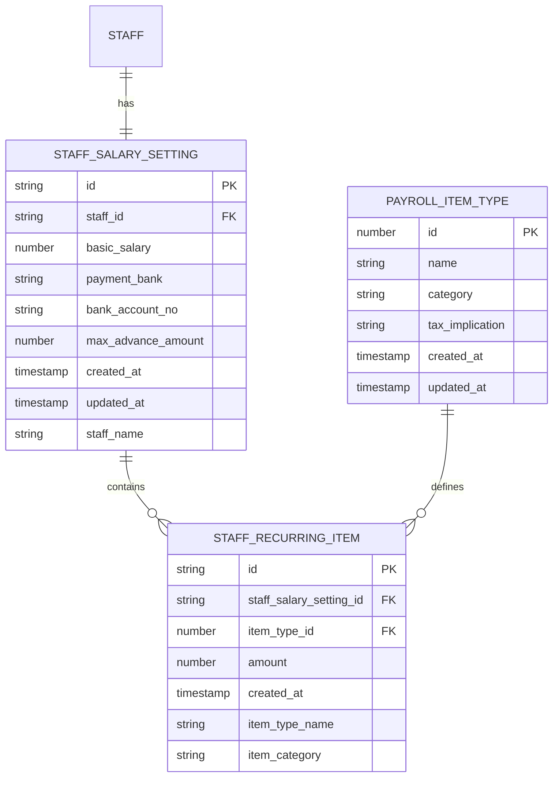

# Salary Setting Model

<cite>
**Referenced Files in This Document**   
- [useStaffSalarySettingData.ts](file://src/modules/hr/data/useStaffSalarySettingData.ts)
- [schema.ts](file://src/modules/hr/data/schema.ts)
- [StaffSalarySettingsPage.tsx](file://src/modules/hr/pages/StaffSalarySettingsPage.tsx)
- [mockData.ts](file://src/modules/hr/data/mockData.ts)
- [usePayrollItemTypeData.ts](file://src/modules/hr/data/usePayrollItemTypeData.ts)
- [usePayslipData.ts](file://src/modules/hr/data/usePayslipData.ts)
</cite>

## Table of Contents
1. [Introduction](#introduction)
2. [Core Data Model](#core-data-model)
3. [Staff to Salary Relationship](#staff-to-salary-relationship)
4. [Recurring Payroll Items](#recurring-payroll-items)
5. [Salary Configuration Interface](#salary-configuration-interface)
6. [Payslip Generation Process](#payslip-generation-process)
7. [Data Structure and Schema](#data-structure-and-schema)
8. [Implementation Analysis](#implementation-analysis)
9. [Conclusion](#conclusion)

## Introduction
This document provides a comprehensive overview of the salary setting model within the HR module of the educational system. The model is designed to manage staff compensation through a structured approach that includes base salary components, recurring payroll items, and integration with payslip generation. The system supports the definition of recurring compensation elements and their application to staff members, enabling accurate payroll processing. While the current implementation provides a foundation for salary management, it lacks explicit support for effective dating and historical tracking of salary changes, which limits its ability to perform accurate historical payroll calculations.

## Core Data Model
The salary setting model centers around the StaffSalarySetting entity, which stores the base compensation information for staff members. This entity contains the basic salary amount, payment bank details, bank account number, and maximum advance amount. Each StaffSalarySetting record is linked to a specific staff member through the staff_id field, establishing a one-to-one relationship between staff and their salary settings. The model also includes metadata fields such as created_at and updated_at timestamps to track when salary settings were created or modified.

The current implementation does not include effective dating capabilities, meaning there is no mechanism to track salary changes over time or to specify when a particular salary setting becomes effective. This limitation prevents the system from accurately calculating historical payroll, as it cannot determine what salary a staff member was earning during a specific past period. Without start_date and end_date fields or similar effective dating mechanisms, the system can only maintain the current salary setting for each staff member.

**Section sources**
- [schema.ts](file://src/modules/hr/data/schema.ts#L50-L73)
- [useStaffSalarySettingData.ts](file://src/modules/hr/data/useStaffSalarySettingData.ts#L0-L37)

## Staff to Salary Relationship
The relationship between Staff and StaffSalarySetting is established through a direct reference from the StaffSalarySetting entity to the Staff entity via the staff_id field. This creates a one-to-one relationship where each staff member can have one salary setting record. The relationship is implemented as a foreign key reference in the database schema, with staff_id serving as the reference to the staff collection.

The system retrieves salary settings for staff members by querying the StaffSalarySetting collection using the staff_id as a filter. This is evident in the StaffSalarySettingsPage component, where the staffSalarySettings are accessed from the application data context and filtered by staff_id to find the appropriate salary setting for a given staff member. The staff_name field in the StaffSalarySetting entity is a computed field that likely contains the staff member's name for display purposes, avoiding the need for a join operation when presenting salary information.

This relationship enables the system to associate specific compensation details with individual staff members, allowing for personalized salary configurations. However, the one-to-one nature of this relationship means that historical salary changes are overwritten rather than preserved, as each update to a staff member's salary replaces their existing salary setting rather than creating a new version with a specific effective date.

**Section sources**
- [schema.ts](file://src/modules/hr/data/schema.ts#L50-L73)
- [StaffSalarySettingsPage.tsx](file://src/modules/hr/pages/StaffSalarySettingsPage.tsx#L26-L46)

## Recurring Payroll Items
Recurring payroll items are managed through a nested structure within the StaffSalarySetting entity. The recurring_items field is defined as an array of objects, each representing a specific recurring compensation element. These items are linked to predefined payroll item types through the item_type_id field, which references the payroll_item_types collection. Each recurring item includes an amount field that specifies the monetary value of that particular compensation element.

The relationship between StaffSalarySetting and PayrollItemType is established through this item_type_id reference, creating a many-to-one relationship where multiple recurring items can reference the same payroll item type. The PayrollItemType entity defines the characteristics of different compensation elements, including their name, category (such as earning or deduction), and tax implications. This design allows for consistent application of payroll rules across multiple staff members while enabling individual customization of amounts.

When configuring salary settings, users can add, edit, or remove recurring items through a modal interface that provides access to all available payroll item types. The system maintains denormalized information about the payroll item type (item_type_name and item_category) within each recurring item to optimize display performance and avoid the need for additional queries when rendering salary information.

**Section sources**
- [schema.ts](file://src/modules/hr/data/schema.ts#L34-L53)
- [StaffSalarySettingsPage.tsx](file://src/modules/hr/pages/StaffSalarySettingsPage.tsx#L104-L133)

## Salary Configuration Interface
The salary configuration interface is implemented in the StaffSalarySettingsPage component, which provides a user-friendly way to manage staff salary settings. The interface displays a list of all staff members and allows administrators to configure salary details for each individual. When a staff member is selected, a modal dialog opens, presenting fields for basic salary, payment bank, bank account number, and maximum advance amount.

The interface also includes functionality for managing recurring payroll items through a secondary modal. Users can add new recurring items by selecting from a list of available payroll item types and specifying the appropriate amount. Existing recurring items can be edited or removed, with changes being tracked in local component state before being submitted to the backend. The interface uses local state management (useState hooks) to maintain form data and recurring items during the editing process, ensuring a responsive user experience.

Form validation is implemented to ensure that required fields are completed before saving changes. The basic salary field is marked as required, and appropriate alerts are displayed if validation fails. The interface integrates with the application's data layer through the useAppData hook, which provides access to staff, salary settings, and payroll item types, as well as the updateStaffSalarySetting function for persisting changes.

**Section sources**
- [StaffSalarySettingsPage.tsx](file://src/modules/hr/pages/StaffSalarySettingsPage.tsx#L0-L27)
- [StaffSalarySettingsPage.tsx](file://src/modules/hr/pages/StaffSalarySettingsPage.tsx#L257-L288)

## Payslip Generation Process
The payslip generation process is supported by the Payslip entity and its associated data access hook. The usePayslipData hook provides CRUD operations for managing payslip records, including creation, updating, and deletion. Each payslip likely represents a specific payroll period for a staff member and contains details of earnings, deductions, and net pay.

The current implementation of the payslip system appears to be based on mock data, with the usePayslipData hook initializing payslip data from initialMockUsers. This suggests that the payslip generation logic may not yet be fully integrated with the salary setting model. The relationship between salary settings and payslips is implied but not explicitly defined in the available code, indicating that the system may need additional logic to automatically generate payslips based on current salary settings and payroll periods.

One-time adjustments to compensation are not explicitly addressed in the current model. The system focuses on recurring compensation elements, but there is no clear mechanism for handling one-time bonuses, deductions, or other non-recurring adjustments. Such adjustments would likely need to be processed separately from the standard salary settings, potentially through a different interface or data model that supports temporary changes to payroll calculations.

**Section sources**
- [usePayslipData.ts](file://src/modules/hr/data/usePayslipData.ts#L0-L56)
- [mockData.ts](file://src/modules/hr/data/mockData.ts#L257-L291)

## Data Structure and Schema
The data structure for the salary setting model is defined in the schema.ts file using a database schema definition. The staffSalarySettingsSchema defines the structure of the staff_salary_setting collection, specifying field types, constraints, and relationships. Key fields include:

- **id**: Unique identifier for the salary setting
- **staff_id**: Reference to the associated staff member
- **basic_salary**: Numeric field for the base salary amount
- **payment_bank**: String field for the payment bank name
- **bank_account_no**: String field for the bank account number
- **max_advance_amount**: Numeric field for the maximum allowable advance
- **created_at**: Timestamp for record creation
- **updated_at**: Timestamp for last modification
- **recurring_items**: Array of recurring payroll items
- **staff_name**: Computed field containing the staff member's name

The schema also defines the structure of recurring items through the staffRecurringItemProperties object, which includes fields for item_type_id (referencing payroll item types), amount, and computed fields for item_type_name and item_category. The schema enforces required fields and establishes indexes on staff_id for efficient querying.

**Diagram sources**
- [schema.ts](file://src/modules/hr/data/schema.ts#L34-L73)

## Implementation Analysis
The implementation of the salary setting model demonstrates a clean separation of concerns between data access, business logic, and user interface components. The useStaffSalarySettingData hook provides a self-contained data management solution that encapsulates CRUD operations for salary settings, while the StaffSalarySettingsPage component focuses on presentation and user interaction.

The system leverages React's useState and useEffect hooks for local state management and side effects, following established patterns for component-based development. Form handling is implemented using controlled components, with form data maintained in component state and updated through event handlers. The interface provides a modal-based workflow for editing salary settings, which helps maintain context and prevents users from navigating away during the editing process.

However, the implementation has significant limitations regarding historical payroll calculations. The absence of effective dating fields (such as start_date and end_date) in the StaffSalarySetting entity means that the system cannot track salary changes over time. Each update to a staff member's salary overwrites the previous setting, making it impossible to determine what salary was in effect during a specific historical period. This limitation would prevent accurate recalculation of past payslips or payroll reports.

Additionally, the system does not appear to have explicit support for prorated salaries for mid-period hires or terminations. Without start and end dates for salary settings, the system cannot calculate partial payments based on the portion of a payroll period worked. Payment frequencies are also not explicitly configured in the current model, which would be necessary to convert annual salaries to periodic amounts for bi-weekly or monthly payroll processing.

**Section sources**
- [useStaffSalarySettingData.ts](file://src/modules/hr/data/useStaffSalarySettingData.ts#L0-L56)
- [StaffSalarySettingsPage.tsx](file://src/modules/hr/pages/StaffSalarySettingsPage.tsx#L79-L106)

## Conclusion
The salary setting model provides a functional foundation for managing staff compensation with recurring payroll items. The data model establishes clear relationships between staff members, salary settings, and payroll item types, enabling the configuration of personalized compensation packages. The user interface offers an intuitive way to manage these settings through a modal-based workflow.

However, the model has critical limitations that affect its ability to support comprehensive payroll processing. The lack of effective dating prevents historical payroll calculations and limits the system's ability to handle salary changes over time. Without start and end dates for salary settings, the system cannot support prorated payments for mid-period hires or terminations, nor can it accurately recalculate past payroll periods.

To enhance the model, future development should focus on implementing effective dating for salary settings, adding support for payment frequencies and their conversion to periodic amounts, and creating mechanisms for one-time adjustments that can interact with recurring salary settings. These improvements would enable more sophisticated payroll processing and ensure accurate payslip generation for both current and historical periods.