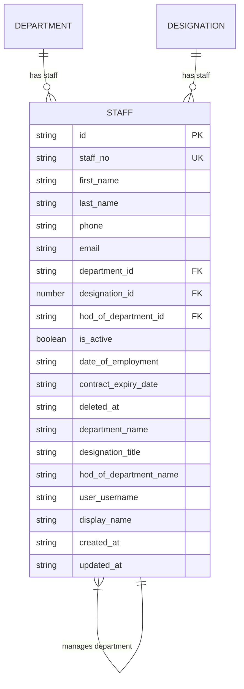
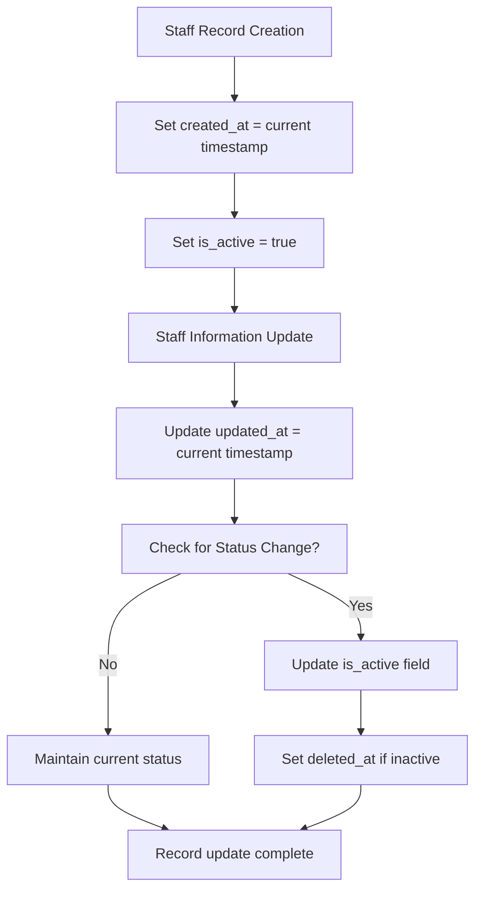
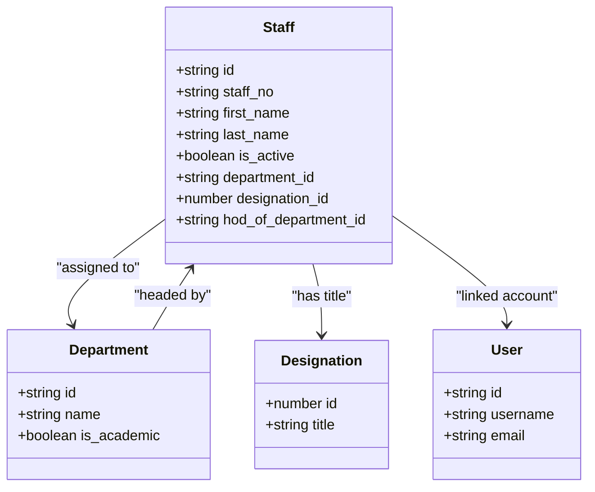
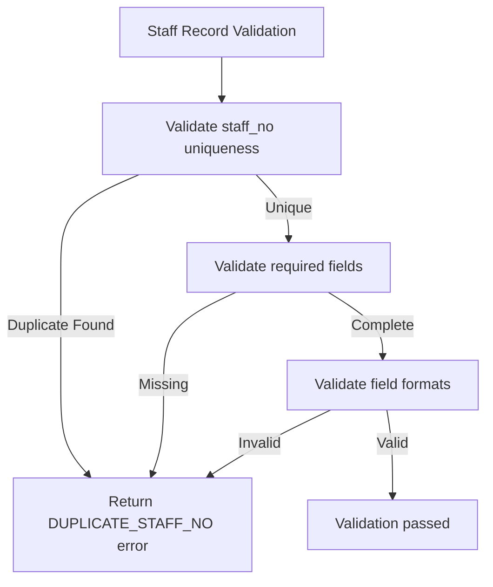
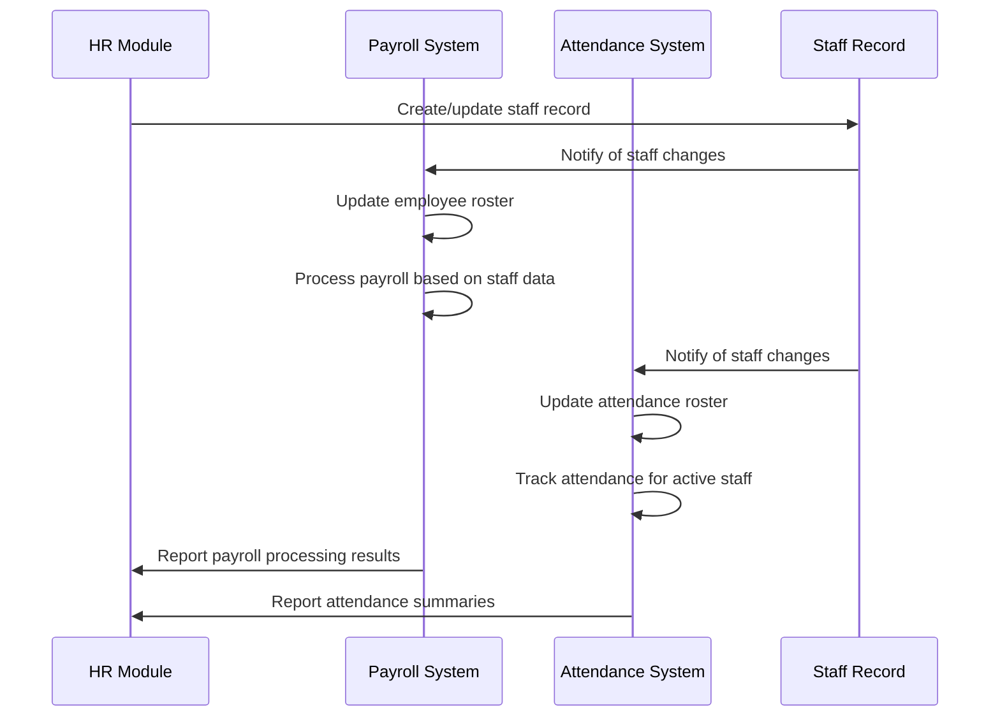

# Staff Data Model

<cite>
**Referenced Files in This Document**   
- [types.ts](file://src/core/types.ts#L456-L477)
- [schema.ts](file://src/modules/administration/data/schema.ts)
- [rxdbService.ts](file://src/services/rxdbService.ts#L91-L91)
- [validationSchemas.ts](file://src/utils/validationSchemas.ts#L120-L175)
- [useStaffData.ts](file://src/modules/administration/data/useStaffData.ts#L7-L61)
- [collections.ts](file://src/modules/administration/data/collections.ts#L0-L56)
</cite>

## Table of Contents
1. [Introduction](#introduction)
2. [Schema Structure](#schema-structure)
3. [Personal Information](#personal-information)
4. [Employment Details](#employment-details)
5. [Contract Terms](#contract-terms)
6. [Organizational Assignments](#organizational-assignments)
7. [Historical Tracking with effectiveStartDate and effectiveEndDate](#historical-tracking-with-effectivestartdate-and-effectiveenddate)
8. [Relationships with Related Entities](#relationships-with-related-entities)
9. [Field-Level Documentation](#field-level-documentation)
10. [Sample JSON Instances](#sample-json-instances)
11. [Data Validation Rules](#data-validation-rules)
12. [Integration with Payroll and Attendance Systems](#integration-with-payroll-and-attendance-systems)

## Introduction
The Staff entity is a core component of the HR module, serving as the central data structure for managing employee information across the organization. This document provides comprehensive documentation of the Staff data model, detailing its schema structure, relationships, validation rules, and integration points. The model supports full lifecycle management of staff records from hiring through employment changes to termination, with robust historical tracking capabilities.

**Section sources**
- [types.ts](file://src/core/types.ts#L456-L477)
- [schema.ts](file://src/modules/administration/data/schema.ts)

## Schema Structure
The Staff entity schema is defined as a database-agnostic structure that can be used across different database providers. It includes personal information, employment details, organizational assignments, and system metadata fields.



**Diagram sources**
- [types.ts](file://src/core/types.ts#L456-L477)
- [schema.ts](file://src/modules/administration/data/schema.ts)

**Section sources**
- [types.ts](file://src/core/types.ts#L456-L477)
- [schema.ts](file://src/modules/administration/data/schema.ts)

## Personal Information
The personal information section of the Staff entity captures essential identifying details about employees.

### Personal Information Fields
- **id**: Unique identifier for the staff member (required, string)
- **staff_no**: Employee identification number (required, string, max 50 characters)
- **first_name**: Given name of the staff member (required, string, max 100 characters)
- **last_name**: Family name of the staff member (required, string, max 100 characters)
- **phone**: Contact telephone number (optional, string, max 50 characters)
- **email**: Official email address (optional, string, email format, max 255 characters)
- **display_name**: Full name for display purposes (optional, string, max 200 characters)
- **user_id**: Reference to associated user account (optional, string, references users collection)

**Section sources**
- [types.ts](file://src/core/types.ts#L456-L477)
- [schema.ts](file://src/modules/administration/data/schema.ts)

## Employment Details
The employment details section captures key information about the staff member's employment status and timeline.

### Employment Details Fields
- **is_active**: Employment status indicator (required, boolean)
- **date_of_employment**: Start date of employment (optional, date format)
- **created_at**: Record creation timestamp (required, date-time format)
- **updated_at**: Record last update timestamp (required, date-time format)
- **deleted_at**: Soft delete timestamp (optional, date-time format)

The `is_active` field serves as the primary indicator of current employment status, with `true` indicating active employment and `false` indicating inactive or terminated status.

**Section sources**
- [types.ts](file://src/core/types.ts#L456-L477)
- [schema.ts](file://src/modules/administration/data/schema.ts)

## Contract Terms
The contract terms section captures information related to the staff member's employment contract.

### Contract Terms Fields
- **contract_expiry_date**: End date of current employment contract (optional, date format)
- **date_of_employment**: Start date of employment (optional, date format)

These fields enable the system to track the duration of employment contracts and provide alerts for upcoming contract expirations.

**Section sources**
- [types.ts](file://src/core/types.ts#L456-L477)
- [schema.ts](file://src/modules/administration/data/schema.ts)

## Organizational Assignments
The organizational assignments section captures the staff member's position within the organizational hierarchy.

### Organizational Assignment Fields
- **department_id**: Reference to assigned department (optional, string, references departments collection)
- **designation_id**: Reference to job title/position (optional, number, references designations collection)
- **hod_of_department_id**: Reference to department this staff member heads (optional, string, references departments collection)
- **department_name**: Denormalized department name for display (optional, string, max 200 characters)
- **designation_title**: Denormalized designation title for display (optional, string, max 200 characters)
- **hod_of_department_name**: Denormalized name of department headed (optional, string, max 200 characters)

The denormalized fields (department_name, designation_title, etc.) improve query performance by avoiding joins when displaying staff information.

**Section sources**
- [types.ts](file://src/core/types.ts#L456-L477)
- [schema.ts](file://src/modules/administration/data/schema.ts)

## Historical Tracking with effectiveStartDate and effectiveEndDate
While the current schema does not explicitly include effectiveStartDate and effectiveEndDate fields, the system supports historical tracking of staff role and compensation changes through a combination of other mechanisms.

### Historical Tracking Implementation
The system tracks historical changes through:
- **Soft deletion**: Using the deleted_at field to mark records without permanent removal
- **Timestamp tracking**: Using created_at and updated_at fields to track record modifications
- **State-based queries**: Querying staff records based on is_active status and date ranges



**Diagram sources**
- [useStaffData.ts](file://src/modules/administration/data/useStaffData.ts#L7-L61)
- [types.ts](file://src/core/types.ts#L456-L477)

**Section sources**
- [useStaffData.ts](file://src/modules/administration/data/useStaffData.ts#L7-L61)
- [types.ts](file://src/core/types.ts#L456-L477)

## Relationships with Related Entities
The Staff entity maintains relationships with several other entities in the system, forming the organizational structure.

### Entity Relationships


**Diagram sources**
- [types.ts](file://src/core/types.ts#L456-L477)
- [schema.ts](file://src/modules/administration/data/schema.ts)

**Section sources**
- [types.ts](file://src/core/types.ts#L456-L477)
- [schema.ts](file://src/modules/administration/data/schema.ts)

## Field-Level Documentation
Detailed documentation for critical properties in the Staff entity.

### employmentStatus
The `is_active` field serves as the employment status indicator:
- **Type**: boolean
- **Required**: Yes
- **Values**: true (active), false (inactive)
- **Usage**: Determines visibility in active staff lists and eligibility for assignments

### hireDate
The `date_of_employment` field captures the start date:
- **Type**: string (date format)
- **Required**: No
- **Format**: YYYY-MM-DD
- **Usage**: Used for service anniversary calculations and seniority determination

### reportingManager
While not explicitly modeled, reporting relationships are inferred through:
- Departmental hierarchy
- HOD (Head of Department) assignments
- Organizational structure in the Department entity

**Section sources**
- [types.ts](file://src/core/types.ts#L456-L477)
- [schema.ts](file://src/modules/administration/data/schema.ts)

## Sample JSON Instances
Sample JSON instances showing both active and inactive staff records.

### Active Staff Record
```json
{
  "id": "STF001",
  "staff_no": "EMP001",
  "first_name": "John",
  "last_name": "Doe",
  "phone": "+254700000000",
  "email": "john.doe@school.edu",
  "department_id": "DEP001",
  "designation_id": 101,
  "hod_of_department_id": null,
  "is_active": true,
  "date_of_employment": "2020-01-15",
  "contract_expiry_date": "2025-01-14",
  "department_name": "Mathematics",
  "designation_title": "Senior Teacher",
  "user_username": "jdoe",
  "display_name": "John Doe",
  "created_at": "2020-01-10T08:30:00Z",
  "updated_at": "2023-01-15T10:45:00Z"
}
```

### Inactive Staff Record
```json
{
  "id": "STF002",
  "staff_no": "EMP002",
  "first_name": "Jane",
  "last_name": "Smith",
  "phone": "+254711111111",
  "email": "jane.smith@school.edu",
  "department_id": "DEP002",
  "designation_id": 102,
  "hod_of_department_id": null,
  "is_active": false,
  "date_of_employment": "2018-06-01",
  "contract_expiry_date": "2023-05-31",
  "department_name": "English",
  "designation_title": "Teacher",
  "user_username": "jsmith",
  "display_name": "Jane Smith",
  "created_at": "2018-05-25T09:15:00Z",
  "updated_at": "2023-06-01T14:20:00Z",
  "deleted_at": "2023-06-01T14:20:00Z"
}
```

**Section sources**
- [useStaffData.ts](file://src/modules/administration/data/useStaffData.ts#L7-L61)
- [types.ts](file://src/core/types.ts#L456-L477)

## Data Validation Rules
The Staff entity enforces several validation rules to ensure data integrity.

### Mandatory Fields
The following fields are required:
- id
- staff_no
- first_name
- last_name
- is_active
- created_at
- updated_at

### Field Constraints
- **staff_no**: Must be unique across all staff records, minimum 1 character, maximum 50 characters
- **first_name**: Minimum 1 character, maximum 100 characters
- **last_name**: Minimum 1 character, maximum 100 characters
- **email**: Must be valid email format, maximum 255 characters
- **phone**: Custom validation using CommonValidations.phone()

### Business Rules


The unique_staff_number business rule ensures that no two staff members can have the same staff number, preventing duplicate records.

**Diagram sources**
- [validationSchemas.ts](file://src/utils/validationSchemas.ts#L120-L175)

**Section sources**
- [validationSchemas.ts](file://src/utils/validationSchemas.ts#L120-L175)
- [rxdbService.ts](file://src/services/rxdbService.ts#L91-L91)

## Integration with Payroll and Attendance Systems
The Staff entity serves as the foundation for integration with payroll processing and attendance systems.

### Integration Points


**Diagram sources**
- [useStaffData.ts](file://src/modules/administration/data/useStaffData.ts#L7-L61)
- [collections.ts](file://src/modules/administration/data/collections.ts#L0-L56)

**Section sources**
- [useStaffData.ts](file://src/modules/administration/data/useStaffData.ts#L7-L61)
- [collections.ts](file://src/modules/administration/data/collections.ts#L0-L56)