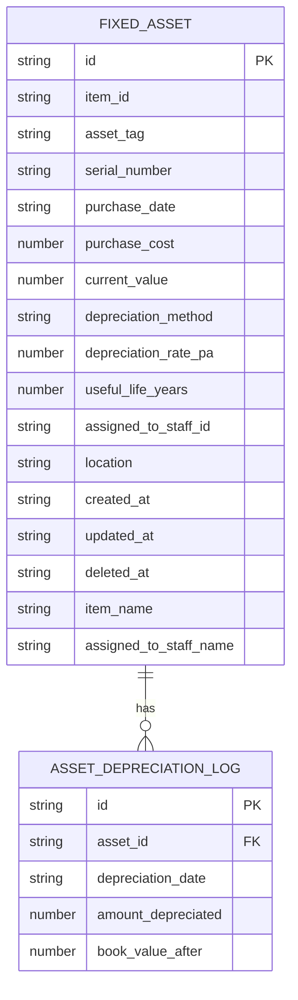

# Fixed Asset Management

<cite>
**Referenced Files in This Document**   
- [types.ts](file://src\modules\inventory\data\types.ts)
- [useFixedAssetData.ts](file://src\modules\inventory\data\useFixedAssetData.ts)
- [useAssetDepreciationLogData.ts](file://src\modules\inventory\data\useAssetDepreciationLogData.ts)
- [mockData.ts](file://src\modules\inventory\data\mockData.ts)
- [types.ts](file://src\core\types.ts)
</cite>

## Table of Contents
1. [Data Model Overview](#data-model-overview)
2. [FixedAsset Entity](#fixedasset-entity)
3. [AssetDepreciationLog Entity](#assetdepreciationlog-entity)
4. [Relationship Between Assets and Depreciation Logs](#relationship-between-assets-and-depreciation-logs)
5. [Hooks for Data Interaction](#hooks-for-data-interaction)
6. [Business Rules for Asset Lifecycle Management](#business-rules-for-asset-lifecycle-management)
7. [Integration with Financial Reporting and Compliance](#integration-with-financial-reporting-and-compliance)

## Data Model Overview

The fixed asset management system in schoolpilot3 is designed to track and manage physical assets owned by educational institutions. The system revolves around two primary entities: `FixedAsset` and `AssetDepreciationLog`. These entities are defined in the `types.ts` file within the inventory module and are used to store information about assets and their depreciation over time.

**Section sources**
- [types.ts](file://src\modules\inventory\data\types.ts#L99-L298)

## FixedAsset Entity

The `FixedAsset` entity represents a physical asset owned by the institution. It contains detailed information about the asset, including its acquisition cost, useful life, salvage value, and depreciation method. The entity is defined as follows:

```typescript
export interface InvFixedAssetType {
  id: string;
  item_id: string;
  asset_tag: string;
  serial_number?: string;
  purchase_date?: string;
  purchase_cost?: number;
  current_value?: number;
  depreciation_method?: InvDepreciationMethod;
  depreciation_rate_pa?: number;
  useful_life_years?: number;
  assigned_to_staff_id?: string;
  location?: string;
  created_at: string;
  updated_at: string;
  deleted_at?: string;
  item_name?: string;
  assigned_to_staff_name?: string;
}
```

### Field Definitions

- **id**: A unique identifier for the asset.
- **item_id**: The ID of the item associated with the asset.
- **asset_tag**: A unique tag assigned to the asset for identification.
- **serial_number**: The serial number of the asset, if applicable.
- **purchase_date**: The date when the asset was purchased.
- **purchase_cost**: The cost at which the asset was acquired.
- **current_value**: The current book value of the asset after depreciation.
- **depreciation_method**: The method used to calculate depreciation (e.g., Straight Line, Reducing Balance).
- **depreciation_rate_pa**: The annual depreciation rate as a percentage.
- **useful_life_years**: The estimated useful life of the asset in years.
- **assigned_to_staff_id**: The ID of the staff member to whom the asset is assigned.
- **location**: The physical location of the asset.
- **created_at**: The timestamp when the asset record was created.
- **updated_at**: The timestamp when the asset record was last updated.
- **deleted_at**: The timestamp when the asset record was deleted (soft delete).
- **item_name**: The name of the item associated with the asset.
- **assigned_to_staff_name**: The name of the staff member to whom the asset is assigned.

**Section sources**
- [types.ts](file://src\modules\inventory\data\types.ts#L99-L298)

## AssetDepreciationLog Entity

The `AssetDepreciationLog` entity tracks the periodic depreciation entries for each asset. It records the amount depreciated and the book value after each depreciation entry. The entity is defined as follows:

```typescript
export interface InvAssetDepreciationLogType {
    id: string;
    asset_id: string;
    depreciation_date: string;
    amount_depreciated: number;
    book_value_after: number;
}
```

### Field Definitions

- **id**: A unique identifier for the depreciation log entry.
- **asset_id**: The ID of the asset to which the depreciation log entry belongs.
- **depreciation_date**: The date when the depreciation was recorded.
- **amount_depreciated**: The amount of depreciation applied to the asset.
- **book_value_after**: The book value of the asset after the depreciation entry.

**Section sources**
- [types.ts](file://src\modules\inventory\data\types.ts#L99-L298)

## Relationship Between Assets and Depreciation Logs

The relationship between `FixedAsset` and `AssetDepreciationLog` is a one-to-many relationship, where one asset can have multiple depreciation log entries. This relationship is established through the `asset_id` field in the `AssetDepreciationLog` entity, which references the `id` field in the `FixedAsset` entity.

The system generates periodic depreciation entries based on the depreciation method and rate specified for each asset. For example, if an asset uses the Straight Line method with a 10% annual depreciation rate, the system will calculate the depreciation amount as 10% of the purchase cost each year and update the `current_value` of the asset accordingly.



**Diagram sources**
- [types.ts](file://src\modules\inventory\data\types.ts#L99-L298)

**Section sources**
- [types.ts](file://src\modules\inventory\data\types.ts#L99-L298)

## Hooks for Data Interaction

The system provides two custom hooks, `useFixedAssetData` and `useAssetDepreciationLogData`, to interact with the `FixedAsset` and `AssetDepreciationLog` entities, respectively. These hooks abstract the CRUD operations for the entities and provide a simple interface for managing asset data.

### useFixedAssetData Hook

The `useFixedAssetData` hook provides CRUD operations for the `FixedAsset` entity. It allows creating, updating, and removing fixed asset records. The hook is defined as follows:

```typescript
export const useFixedAssetData = () => {
  const [data, setData] = useState<FixedAsset[]>(initialMockFixedAssets);

  const create = async (newItem: Partial<FixedAsset>) => {
    const newDataItem: FixedAsset = {
      ...newItem,
      id: Date.now(),
      created_at: new Date().toISOString(),
      updated_at: new Date().toISOString()
    } as FixedAsset;
    setData((prev: FixedAsset[]) => [...prev, newDataItem]);
    return newDataItem;
  };

  const update = async (id: number, updatedData: Partial<FixedAsset>) => {
    setData((prev: FixedAsset[]) => prev.map((item: FixedAsset) => 
      item.id === id 
        ? { ...item, ...updatedData, updated_at: new Date().toISOString() }
        : item
    ));
  };

  const remove = async (id: number) => {
    setData((prev: FixedAsset[]) => prev.filter((item: FixedAsset) => item.id !== id));
  };

  return {
    data,
    create,
    update,
    remove
  };
};
```

### useAssetDepreciationLogData Hook

The `useAssetDepreciationLogData` hook provides CRUD operations for the `AssetDepreciationLog` entity. It allows creating, updating, and removing depreciation log entries. The hook is defined as follows:

```typescript
const useAssetDepreciationLogData = () => {
  const [assetDepreciationLogs, setAssetDepreciationLogs] = useState<any[]>([]);
  const [isLoading, setIsLoading] = useState<boolean>(true);
  const [error, setError] = useState<string | null>(null);

  useEffect(() => {
    try {
      // Simulate fetching data from a mock source
      setAssetDepreciationLogs(initialMockUsers);
      setIsLoading(false);
    } catch (e) {
      setError('Failed to fetch asset depreciation logs');
      setIsLoading(false);
    }
  }, []);

  const create = async (newItem: Partial<any>) => {
    const newDataItem: any = {
      ...newItem,
      id: Date.now(),
      created_at: new Date().toISOString(),
      updated_at: new Date().toISOString()
    } as any;
    setAssetDepreciationLogs((prev: any[]) => [...prev, newDataItem]);
    return newDataItem;
  };

  const update = async (id: number, updatedData: Partial<any>) => {
    setAssetDepreciationLogs((prev: any[]) => prev.map((item: any) =>
      item.id === id
        ? { ...item, ...updatedData, updated_at: new Date().toISOString() }
        : item
    ));
  };

  const remove = async (id: number) => {
    setAssetDepreciationLogs((prev: any[]) => prev.filter((item: any) => item.id !== id));
  };

  return {
    data: assetDepreciationLogs,
    isLoading,
    error,
    create,
    update,
    remove
  };
};
```

**Section sources**
- [useFixedAssetData.ts](file://src\modules\inventory\data\useFixedAssetData.ts#L0-L40)
- [useAssetDepreciationLogData.ts](file://src\modules\inventory\data\useAssetDepreciationLogData.ts#L0-L56)

## Business Rules for Asset Lifecycle Management

The fixed asset management system enforces several business rules to ensure proper management of assets throughout their lifecycle. These rules include:

1. **Acquisition**: When a new asset is acquired, it must be recorded in the system with its purchase cost, purchase date, and other relevant details. The asset's depreciation method and rate must be specified at the time of acquisition.

2. **Transfer**: Assets can be transferred between staff members or locations. The system updates the `assigned_to_staff_id` and `location` fields accordingly.

3. **Maintenance**: The system does not explicitly track maintenance activities, but it allows for updates to the asset's details, such as its location or assigned staff member.

4. **Disposal**: When an asset is disposed of, its record is soft-deleted by setting the `deleted_at` timestamp. The system retains the asset's history, including its depreciation logs, for auditing purposes.

**Section sources**
- [types.ts](file://src\modules\inventory\data\types.ts#L99-L298)

## Integration with Financial Reporting and Compliance

The fixed asset management system integrates with financial reporting and compliance requirements by maintaining accurate records of asset values and depreciation. The system supports the following financial reporting and compliance features:

1. **Depreciation Methods**: The system supports two depreciation methods: Straight Line and Reducing Balance. These methods are defined in the `DepreciationMethod` enum in the `types.ts` file.

```typescript
export enum DepreciationMethod {
    STRAIGHT_LINE = 'Straight Line',
    REDUCING_BALANCE = 'Reducing Balance',
}
```

2. **Financial Reporting**: The system generates periodic depreciation entries that are used to calculate the book value of assets. These entries are stored in the `AssetDepreciationLog` entity and can be used to generate financial reports, such as balance sheets and income statements.

3. **Compliance**: The system ensures compliance with accounting standards by maintaining accurate records of asset values and depreciation. The system also supports audit trails by recording the creation and update timestamps for each asset and depreciation log entry.

**Section sources**
- [types.ts](file://src\core\types.ts#L243-L246)
- [types.ts](file://src\modules\inventory\data\types.ts#L99-L298)