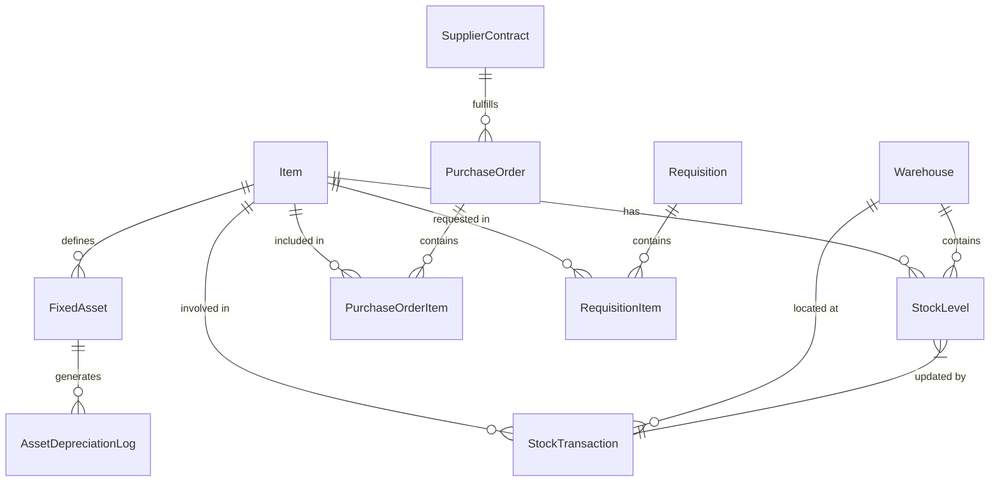
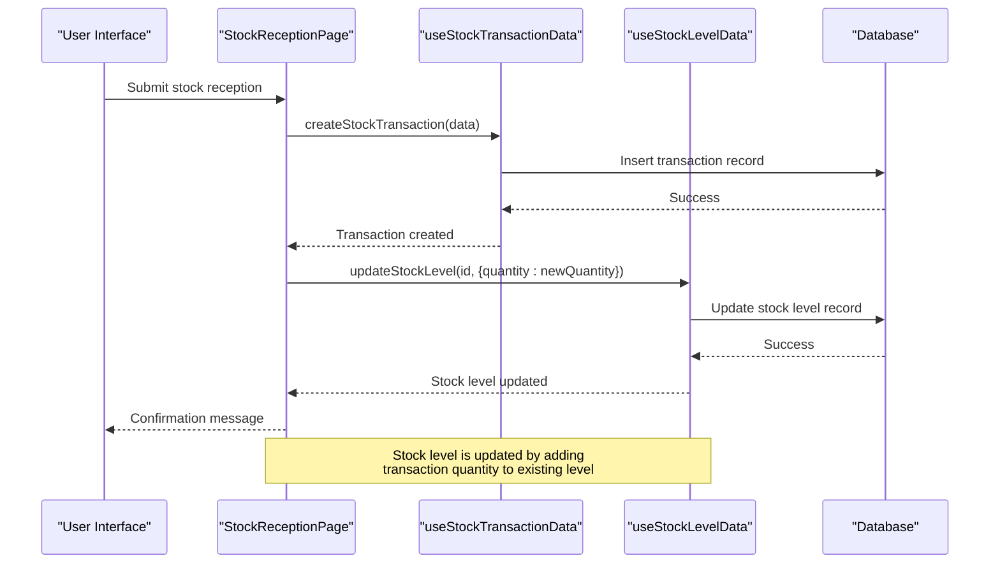
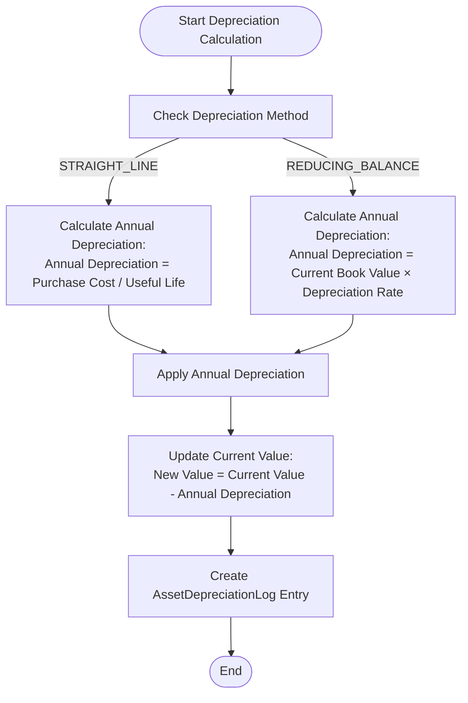
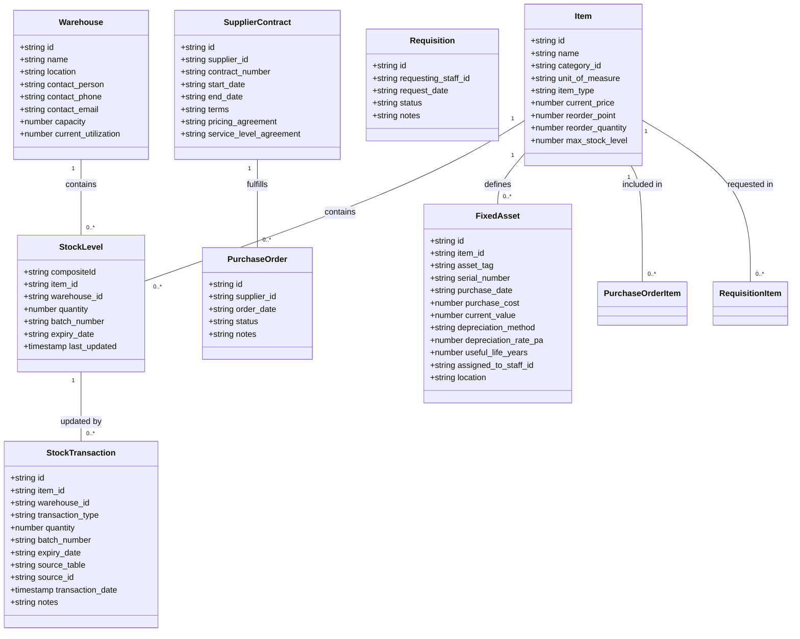
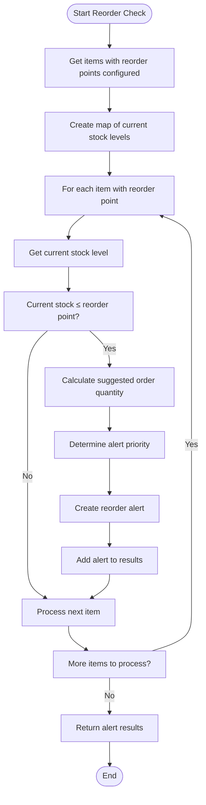

# Inventory Data Entities

<cite>
**Referenced Files in This Document**   
- [schema.ts](file://src/modules/inventory/data/schema.ts)
- [useStockTransactionData.ts](file://src/modules/inventory/data/useStockTransactionData.ts)
- [useStockLevelData.ts](file://src/modules/inventory/data/useStockLevelData.ts)
- [StockReceptionPage.tsx](file://src/modules/inventory/pages/StockReceptionPage.tsx)
- [reorderMonitoringService.ts](file://src/modules/inventory/services/reorderMonitoringService.ts)
- [FixedAssetsPage.tsx](file://src/modules/inventory/pages/FixedAssetsPage.tsx)
- [useAssetDepreciationLogData.ts](file://src/modules/inventory/data/useAssetDepreciationLogData.ts)
- [mockData.ts](file://src/modules/inventory/data/mockData.ts)
</cite>

## Table of Contents
1. [Introduction](#introduction)
2. [Core Inventory Entities](#core-inventory-entities)
3. [Item Entity](#item-entity)
4. [Warehouse Entity](#warehouse-entity)
5. [StockLevel Entity](#stocklevel-entity)
6. [StockTransaction Entity](#stocktransaction-entity)
7. [PurchaseOrder Entity](#purchaseorder-entity)
8. [Requisition Entity](#requisition-entity)
9. [FixedAsset Entity](#fixedasset-entity)
10. [SupplierContract Entity](#suppliercontract-entity)
11. [Entity Relationships](#entity-relationships)
12. [Data Validation and Business Rules](#data-validation-and-business-rules)
13. [Sample Data Instances](#sample-data-instances)
14. [Conclusion](#conclusion)

## Introduction
This document provides a comprehensive overview of the core inventory data entities in the schoolpilot3 system. The inventory module manages school resources including consumable supplies, fixed assets, and procurement processes. The system tracks items across multiple warehouses, monitors stock levels, processes transactions, and manages procurement through purchase orders and requisitions. This documentation details the schema definitions, field-level constraints, business rules, and entity relationships that form the foundation of the inventory management system.

## Core Inventory Entities
The inventory system in schoolpilot3 consists of several interconnected entities that work together to manage school resources. These entities include Item, Warehouse, StockLevel, StockTransaction, PurchaseOrder, Requisition, FixedAsset, and SupplierContract. Each entity has a well-defined schema with specific data types, constraints, and business rules. The entities are designed to work together to provide a complete inventory management solution for educational institutions.



**Diagram sources**
- [schema.ts](file://src/modules/inventory/data/schema.ts#L1-L200)

## Item Entity
The Item entity represents inventory items that can be either consumable supplies or fixed assets. Each item has a unique identifier and various attributes that define its characteristics and inventory management parameters.

### Schema Definition
```typescript
export const itemSchema: DatabaseSchema = createDatabaseSchema({
    name: 'item',
    primaryKey: 'id',
    properties: {
        id: SchemaHelpers.id('Unique identifier for the item'),
        name: SchemaHelpers.string('Item name', { maxLength: 200 }),
        category_id: SchemaHelpers.string('Reference to item category', { maxLength: 100 }),
        unit_of_measure: SchemaHelpers.string('Unit of measure', { maxLength: 50 }),
        item_type: SchemaHelpers.string('Item type', { maxLength: 50, enum: Object.values(types.ItemTypeInv) }),
        current_price: SchemaHelpers.number('Current price', { minimum: 0, maximum: 999999.99 }),
        reorder_point: SchemaHelpers.number('Reorder point', { nullable: true, minimum: 0, maximum: 999999999, integer: true }),
        reorder_quantity: SchemaHelpers.number('Reorder quantity', { nullable: true, minimum: 0, maximum: 999999999, integer: true }),
        max_stock_level: SchemaHelpers.number('Maximum stock level', { nullable: true, minimum: 0, maximum: 999999999, integer: true }),
        category_name: SchemaHelpers.string('Category name (computed)', { maxLength: 100, nullable: true }),
        created_at: SchemaHelpers.timestamp('Record creation timestamp'),
        updated_at: SchemaHelpers.timestamp('Record last update timestamp'),
        deleted_at: SchemaHelpers.timestamp('Record deletion timestamp', { nullable: true })
    },
    required: ['id', 'name', 'category_id', 'unit_of_measure', 'item_type', 'created_at', 'updated_at'],
    indexes: ['category_id', 'item_type']
});
```

### Field-Level Details
- **id**: Unique identifier for the item (string, required)
- **name**: Name of the item (string, max length 200, required)
- **category_id**: Reference to the item category (string, max length 100, required)
- **unit_of_measure**: Unit of measure for the item (string, max length 50, required)
- **item_type**: Type of item (string, enum values: CONSUMABLE, FIXED_ASSET, required)
- **current_price**: Current price of the item (number, min 0, max 999999.99, required)
- **reorder_point**: Quantity threshold that triggers reorder alerts (number, nullable, min 0, integer)
- **reorder_quantity**: Standard quantity to order when reordering (number, nullable, min 0, integer)
- **max_stock_level**: Maximum allowed stock level (number, nullable, min 0, integer)

### Business Rules
- Items with `item_type` of FIXED_ASSET cannot be consumed through regular stock transactions
- The `reorder_point` field is used by the reorder monitoring service to generate low stock alerts
- When `reorder_point` is configured, the system automatically calculates suggested order quantities
- The `max_stock_level` field helps prevent overstocking and is used in suggested order calculations

**Section sources**
- [schema.ts](file://src/modules/inventory/data/schema.ts#L15-L50)

## Warehouse Entity
The Warehouse entity represents physical storage locations for inventory items. Each warehouse has a unique identifier and descriptive information.

### Schema Definition
```typescript
export const warehouseSchema: DatabaseSchema = createDatabaseSchema({
    name: 'warehouse',
    primaryKey: 'id',
    properties: {
        id: SchemaHelpers.id('Unique identifier for the warehouse'),
        name: SchemaHelpers.string('Warehouse name', { maxLength: 100 }),
        location: SchemaHelpers.string('Physical location', { maxLength: 200 }),
        contact_person: SchemaHelpers.string('Contact person', { maxLength: 100, nullable: true }),
        contact_phone: SchemaHelpers.string('Contact phone', { maxLength: 20, nullable: true }),
        contact_email: SchemaHelpers.string('Contact email', { maxLength: 100, nullable: true }),
        capacity: SchemaHelpers.number('Storage capacity', { nullable: true, minimum: 0, maximum: 999999, integer: true }),
        current_utilization: SchemaHelpers.number('Current utilization', { nullable: true, minimum: 0, maximum: 100, integer: true }),
        created_at: SchemaHelpers.timestamp('Record creation timestamp'),
        updated_at: SchemaHelpers.timestamp('Record last update timestamp'),
        deleted_at: SchemaHelpers.timestamp('Record deletion timestamp', { nullable: true })
    },
    required: ['id', 'name', 'created_at', 'updated_at'],
    indexes: ['location']
});
```

### Field-Level Details
- **id**: Unique identifier for the warehouse (string, required)
- **name**: Name of the warehouse (string, max length 100, required)
- **location**: Physical location of the warehouse (string, max length 200, required)
- **contact_person**: Contact person for the warehouse (string, max length 100, nullable)
- **contact_phone**: Contact phone number (string, max length 20, nullable)
- **contact_email**: Contact email address (string, max length 100, nullable)
- **capacity**: Total storage capacity (number, nullable, min 0, integer)
- **current_utilization**: Current percentage of capacity utilization (number, nullable, min 0, max 100, integer)

**Section sources**
- [schema.ts](file://src/modules/inventory/data/schema.ts#L51-L80)

## StockLevel Entity
The StockLevel entity represents the current quantity of an item in a specific warehouse. It serves as a snapshot of inventory levels and is updated through stock transactions.

### Schema Definition
```typescript
export const stockLevelSchema: DatabaseSchema = createDatabaseSchema({
    name: 'stock_level',
    primaryKey: 'compositeId',
    properties: {
        compositeId: SchemaHelpers.id('Composite primary key for stock level'),
        item_id: SchemaHelpers.string('Reference to inventory item', { maxLength: 100 }),
        warehouse_id: SchemaHelpers.string('Reference to warehouse', { maxLength: 100 }),
        quantity: SchemaHelpers.number('Current stock quantity', { minimum: 0, maximum: 999999999, integer: true }),
        batch_number: SchemaHelpers.string('Batch number', { maxLength: 100 }),
        expiry_date: SchemaHelpers.string('Expiry date', { format: 'date' }),
        last_updated: SchemaHelpers.timestamp('Last update timestamp', { nullable: true }),
        item_name: SchemaHelpers.string('Item name (computed)', { maxLength: 200, nullable: true }),
        warehouse_name: SchemaHelpers.string('Warehouse name (computed)', { maxLength: 100, nullable: true }),
        category_name: SchemaHelpers.string('Category name (computed)', { maxLength: 100, nullable: true }),
        reorder_level: SchemaHelpers.number('Reorder level (computed)', { nullable: true, minimum: 0, maximum: 999999999, integer: true }),
        max_stock_level: SchemaHelpers.number('Maximum stock level (computed)', { nullable: true, minimum: 0, maximum: 999999999, integer: true })
    },
    required: ['compositeId', 'item_id', 'warehouse_id', 'quantity'],
    indexes: [['item_id', 'warehouse_id'], ['expiry_date'], ['batch_number']]
});
```

### Field-Level Details
- **compositeId**: Composite primary key combining item_id, warehouse_id, and batch_number (string, required)
- **item_id**: Reference to the inventory item (string, max length 100, required)
- **warehouse_id**: Reference to the warehouse (string, max length 100, required)
- **quantity**: Current stock quantity (number, min 0, max 999999999, integer, required)
- **batch_number**: Batch or lot number for traceability (string, max length 100, nullable)
- **expiry_date**: Expiration date for perishable items (string, date format, nullable)
- **last_updated**: Timestamp of last update (timestamp, nullable)
- **item_name**: Computed field with item name (string, max length 200, nullable)
- **warehouse_name**: Computed field with warehouse name (string, max length 100, nullable)
- **category_name**: Computed field with category name (string, max length 100, nullable)
- **reorder_level**: Computed field with reorder point from item (number, nullable, min 0, integer)
- **max_stock_level**: Computed field with maximum stock level from item (number, nullable, min 0, integer)

### Business Rules
- The `quantity` field cannot be negative, ensuring inventory levels are always non-negative
- The `compositeId` is constructed from item_id, warehouse_id, and batch_number to support batch tracking
- Computed fields (item_name, warehouse_name, etc.) are populated from related entities for reporting efficiency
- Stock levels are updated exclusively through StockTransaction records to maintain data integrity

**Section sources**
- [schema.ts](file://src/modules/inventory/data/schema.ts#L81-L117)

## StockTransaction Entity
The StockTransaction entity records all movements of inventory items, including receipts, issues, transfers, and adjustments.

### Schema Definition
```typescript
export const stockTransactionSchema: DatabaseSchema = createDatabaseSchema({
    name: 'stock_transaction',
    primaryKey: 'id',
    properties: {
        id: SchemaHelpers.id('Unique identifier for the stock transaction'),
        item_id: SchemaHelpers.string('Reference to inventory item', { maxLength: 100 }),
        warehouse_id: SchemaHelpers.string('Reference to warehouse', { maxLength: 100 }),
        transaction_type: SchemaHelpers.string('Type of transaction', { maxLength: 50, enum: Object.values(types.InvStockTransactionType) }),
        quantity: SchemaHelpers.number('Transaction quantity', { minimum: -999999999, maximum: 999999999, integer: true }),
        batch_number: SchemaHelpers.string('Batch number', { maxLength: 100 }),
        expiry_date: SchemaHelpers.string('Expiry date', { format: 'date' }),
        source_table: SchemaHelpers.string('Source table reference', { maxLength: 100, nullable: true }),
        source_id: SchemaHelpers.string('Source record ID', { maxLength: 100, nullable: true }),
        transaction_date: SchemaHelpers.timestamp('Transaction date and time'),
        notes: SchemaHelpers.string('Transaction notes', { maxLength: 500, nullable: true }),
        item_name: SchemaHelpers.string('Item name (computed)', { maxLength: 200, nullable: true }),
        warehouse_name: SchemaHelpers.string('Warehouse name (computed)', { maxLength: 100, nullable: true }),
        created_at: SchemaHelpers.timestamp('Record creation timestamp'),
        updated_at: SchemaHelpers.timestamp('Record last update timestamp')
    },
    required: ['id', 'item_id', 'warehouse_id', 'transaction_type', 'quantity', 'transaction_date', 'created_at', 'updated_at'],
    indexes: ['item_id', 'warehouse_id', 'transaction_type', 'transaction_date']
});
```

### Field-Level Details
- **id**: Unique identifier for the transaction (string, required)
- **item_id**: Reference to the inventory item (string, max length 100, required)
- **warehouse_id**: Reference to the warehouse (string, max length 100, required)
- **transaction_type**: Type of transaction (string, enum values: RECEIVE, ISSUE, TRANSFER, ADJUSTMENT, required)
- **quantity**: Transaction quantity (number, min -999999999, max 999999999, integer, required)
- **batch_number**: Batch or lot number (string, max length 100, nullable)
- **expiry_date**: Expiration date (string, date format, nullable)
- **source_table**: Source table that initiated the transaction (string, max length 100, nullable)
- **source_id**: Source record ID that initiated the transaction (string, max length 100, nullable)
- **transaction_date**: Date and time of the transaction (timestamp, required)
- **notes**: Additional notes about the transaction (string, max length 500, nullable)
- **item_name**: Computed field with item name (string, max length 200, nullable)
- **warehouse_name**: Computed field with warehouse name (string, max length 100, nullable)

### Business Rules
- The `transaction_type` field uses an enumeration to ensure only valid transaction types are recorded
- The `quantity` field can be positive (for receipts) or negative (for issues), allowing a single field to represent both inflows and outflows
- The `source_table` and `source_id` fields create an audit trail linking transactions to their originating records
- All stock level changes must be recorded as transactions to maintain an audit trail
- The system validates that transactions do not result in negative stock levels

### Stock Level Update Process
The following sequence diagram illustrates how StockTransaction records update StockLevel entities:



**Diagram sources**
- [StockReceptionPage.tsx](file://src/modules/inventory/pages/StockReceptionPage.tsx#L217-L250)
- [useStockTransactionData.ts](file://src/modules/inventory/data/useStockTransactionData.ts#L15-L30)
- [useStockLevelData.ts](file://src/modules/inventory/data/useStockLevelData.ts#L30-L35)

**Section sources**
- [schema.ts](file://src/modules/inventory/data/schema.ts#L118-L150)
- [useStockTransactionData.ts](file://src/modules/inventory/data/useStockTransactionData.ts#L15-L56)
- [useStockLevelData.ts](file://src/modules/inventory/data/useStockLevelData.ts#L30-L56)

## PurchaseOrder Entity
The PurchaseOrder entity represents formal requests to suppliers for goods or services. It is a key component of the procurement process.

### Schema Definition
```typescript
export const purchaseOrderSchema: DatabaseSchema = createDatabaseSchema({
    name: 'purchase_order',
    primaryKey: 'id',
    properties: {
        id: SchemaHelpers.id('Unique identifier for the purchase order'),
        supplier_id: SchemaHelpers.string('Reference to supplier', { maxLength: 100 }),
        order_date: SchemaHelpers.string('Order date', { format: 'date' }),
        status: SchemaHelpers.string('Order status', { maxLength: 50, enum: Object.values(types.PurchaseOrderStatus) }),
        notes: SchemaHelpers.string('Order notes', { maxLength: 1000, nullable: true }),
        created_at: SchemaHelpers.timestamp('Record creation timestamp'),
        updated_at: SchemaHelpers.timestamp('Record last update timestamp'),
        supplier_name: SchemaHelpers.string('Supplier name (computed)', { maxLength: 200, nullable: true })
    },
    required: ['id', 'supplier_id', 'order_date', 'status', 'created_at', 'updated_at'],
    indexes: ['supplier_id', 'order_date', 'status']
});
```

### Field-Level Details
- **id**: Unique identifier for the purchase order (string, required)
- **supplier_id**: Reference to the supplier (string, max length 100, required)
- **order_date**: Date the order was placed (string, date format, required)
- **status**: Current status of the order (string, enum values: PENDING, APPROVED, PARTIALLY_RECEIVED, FULLY_RECEIVED, CANCELLED, required)
- **notes**: Additional notes about the order (string, max length 1000, nullable)
- **created_at**: Record creation timestamp (timestamp, required)
- **updated_at**: Record last update timestamp (timestamp, required)
- **supplier_name**: Computed field with supplier name (string, max length 200, nullable)

### Business Rules
- Purchase orders must be associated with a valid supplier
- The status field tracks the order lifecycle from creation to fulfillment
- Purchase orders contain one or more PurchaseOrderItem records specifying the items ordered
- Orders can be partially received, with the system tracking quantities received vs. ordered
- The supplier_name field is populated from the Supplier entity for reporting purposes

**Section sources**
- [schema.ts](file://src/modules/inventory/data/schema.ts#L151-L180)

## Requisition Entity
The Requisition entity represents internal requests for inventory items from departments or staff members.

### Schema Definition
```typescript
export const requisitionSchema: DatabaseSchema = createDatabaseSchema({
    name: 'requisition',
    primaryKey: 'id',
    properties: {
        id: SchemaHelpers.id('Unique identifier for the requisition'),
        requesting_staff_id: SchemaHelpers.string('Reference to requesting staff', { maxLength: 100 }),
        request_date: SchemaHelpers.string('Request date', { format: 'date' }),
        status: SchemaHelpers.string('Requisition status', { maxLength: 50, enum: Object.values(types.RequisitionStatus) }),
        notes: SchemaHelpers.string('Requisition notes', { maxLength: 1000, nullable: true }),
        created_at: SchemaHelpers.timestamp('Record creation timestamp'),
        updated_at: SchemaHelpers.timestamp('Record last update timestamp'),
        requesting_staff_name: SchemaHelpers.string('Requesting staff name (computed)', { maxLength: 200, nullable: true }),
        department_name: SchemaHelpers.string('Department name (computed)', { maxLength: 100, nullable: true })
    },
    required: ['id', 'requesting_staff_id', 'request_date', 'status', 'created_at', 'updated_at'],
    indexes: ['requesting_staff_id', 'request_date', 'status']
});
```

### Field-Level Details
- **id**: Unique identifier for the requisition (string, required)
- **requesting_staff_id**: Reference to the staff member making the request (string, max length 100, required)
- **request_date**: Date the requisition was submitted (string, date format, required)
- **status**: Current status of the requisition (string, enum values: PENDING_APPROVAL, APPROVED, REJECTED, PARTIALLY_FULFILLED, FULLY_FULFILLED, required)
- **notes**: Additional notes about the requisition (string, max length 1000, nullable)
- **created_at**: Record creation timestamp (timestamp, required)
- **updated_at**: Record last update timestamp (timestamp, required)
- **requesting_staff_name**: Computed field with staff name (string, max length 200, nullable)
- **department_name**: Computed field with department name (string, max length 100, nullable)

### Business Rules
- Requisitions must be submitted by a valid staff member
- The status field tracks the requisition lifecycle from submission to fulfillment
- Requisitions contain one or more RequisitionItem records specifying the items requested
- Requisitions can be partially fulfilled, with the system tracking quantities fulfilled vs. requested
- The requesting_staff_name and department_name fields are populated from related entities for reporting

**Section sources**
- [schema.ts](file://src/modules/inventory/data/schema.ts#L181-L210)

## FixedAsset Entity
The FixedAsset entity represents long-term tangible assets used by the school, such as furniture, equipment, and vehicles.

### Schema Definition
```typescript
export const fixedAssetSchema: DatabaseSchema = createDatabaseSchema({
    name: 'fixed_asset',
    primaryKey: 'id',
    properties: {
        id: SchemaHelpers.id('Unique identifier for the fixed asset'),
        item_id: SchemaHelpers.string('Reference to inventory item', { maxLength: 100 }),
        asset_tag: SchemaHelpers.string('Asset tag identifier', { maxLength: 50 }),
        serial_number: SchemaHelpers.string('Serial number', { maxLength: 100, nullable: true }),
        purchase_date: SchemaHelpers.string('Purchase date', { nullable: true, format: 'date' }),
        purchase_cost: SchemaHelpers.number('Purchase cost', { nullable: true, minimum: 0, maximum: 999999.99 }),
        current_value: SchemaHelpers.number('Current value', { nullable: true, minimum: 0, maximum: 999999.99 }),
        depreciation_method: SchemaHelpers.string('Depreciation method', { maxLength: 50, nullable: true, enum: Object.values(types.InvDepreciationMethod) }),
        depreciation_rate_pa: SchemaHelpers.number('Depreciation rate per annum', { nullable: true, minimum: 0, maximum: 100 }),
        useful_life_years: SchemaHelpers.number('Useful life in years', { nullable: true, minimum: 1, maximum: 100, integer: true }),
        assigned_to_staff_id: SchemaHelpers.string('Staff member assigned to', { maxLength: 100 }),
        location: SchemaHelpers.string('Asset location', { maxLength: 200, nullable: true }),
        created_at: SchemaHelpers.timestamp('Record creation timestamp'),
        updated_at: SchemaHelpers.timestamp('Record last update timestamp'),
        deleted_at: SchemaHelpers.timestamp('Record deletion timestamp', { nullable: true }),
        item_name: SchemaHelpers.string('Item name (computed)', { maxLength: 200, nullable: true }),
        assigned_to_staff_name: SchemaHelpers.string('Assigned staff name (computed)', { maxLength: 200, nullable: true })
    },
    required: ['id', 'item_id', 'asset_tag', 'created_at', 'updated_at'],
    indexes: ['asset_tag', 'item_id', 'assigned_to_staff_id']
});
```

### Field-Level Details
- **id**: Unique identifier for the fixed asset (string, required)
- **item_id**: Reference to the inventory item that defines the asset type (string, max length 100, required)
- **asset_tag**: Unique identifier tag for the physical asset (string, max length 50, required)
- **serial_number**: Manufacturer's serial number (string, max length 100, nullable)
- **purchase_date**: Date the asset was purchased (string, date format, nullable)
- **purchase_cost**: Original purchase cost (number, nullable, min 0, max 999999.99)
- **current_value**: Current book value after depreciation (number, nullable, min 0, max 999999.99)
- **depreciation_method**: Method used for depreciation (string, enum values: STRAIGHT_LINE, REDUCING_BALANCE, nullable)
- **depreciation_rate_pa**: Annual depreciation rate (number, nullable, min 0, max 100)
- **useful_life_years**: Expected useful life in years (number, nullable, min 1, max 100, integer)
- **assigned_to_staff_id**: Staff member responsible for the asset (string, max length 100, nullable)
- **location**: Physical location of the asset (string, max length 200, nullable)
- **created_at**: Record creation timestamp (timestamp, required)
- **updated_at**: Record last update timestamp (timestamp, required)
- **deleted_at**: Record deletion timestamp (timestamp, nullable)
- **item_name**: Computed field with item name (string, max length 200, nullable)
- **assigned_to_staff_name**: Computed field with assigned staff name (string, max length 200, nullable)

### Depreciation Calculation
The system supports multiple depreciation methods, with the current implementation focusing on straight-line depreciation. The following flowchart illustrates the depreciation calculation process:



**Diagram sources**
- [FixedAssetsPage.tsx](file://src/modules/inventory/pages/FixedAssetsPage.tsx#L230-L246)
- [useAssetDepreciationLogData.ts](file://src/modules/inventory/data/useAssetDepreciationLogData.ts#L15-L35)

**Section sources**
- [schema.ts](file://src/modules/inventory/data/schema.ts#L65-L78)
- [FixedAssetsPage.tsx](file://src/modules/inventory/pages/FixedAssetsPage.tsx#L95-L140)

## SupplierContract Entity
The SupplierContract entity represents formal agreements with suppliers for the provision of goods or services. While not explicitly defined in the schema, it is referenced in the documentation and likely exists in the system.

### Schema Definition
Based on the reference in the documentation objective, the SupplierContract entity would likely have the following structure:

```typescript
export const supplierContractSchema: DatabaseSchema = createDatabaseSchema({
    name: 'supplier_contract',
    primaryKey: 'id',
    properties: {
        id: SchemaHelpers.id('Unique identifier for the supplier contract'),
        supplier_id: SchemaHelpers.string('Reference to supplier', { maxLength: 100 }),
        contract_number: SchemaHelpers.string('Contract number', { maxLength: 100 }),
        start_date: SchemaHelpers.string('Contract start date', { format: 'date' }),
        end_date: SchemaHelpers.string('Contract end date', { format: 'date' }),
        terms: SchemaHelpers.string('Contract terms', { maxLength: 2000, nullable: true }),
        pricing_agreement: SchemaHelpers.string('Pricing agreement details', { maxLength: 1000, nullable: true }),
        service_level_agreement: SchemaHelpers.string('Service level agreement', { maxLength: 1000, nullable: true }),
        created_at: SchemaHelpers.timestamp('Record creation timestamp'),
        updated_at: SchemaHelpers.timestamp('Record last update timestamp'),
        supplier_name: SchemaHelpers.string('Supplier name (computed)', { maxLength: 200, nullable: true })
    },
    required: ['id', 'supplier_id', 'contract_number', 'start_date', 'end_date', 'created_at', 'updated_at'],
    indexes: ['supplier_id', 'contract_number', 'start_date', 'end_date']
});
```

### Field-Level Details
- **id**: Unique identifier for the contract (string, required)
- **supplier_id**: Reference to the supplier (string, max length 100, required)
- **contract_number**: Unique contract identifier (string, max length 100, required)
- **start_date**: Contract start date (string, date format, required)
- **end_date**: Contract end date (string, date format, required)
- **terms**: Detailed contract terms and conditions (string, max length 2000, nullable)
- **pricing_agreement**: Pricing details and discounts (string, max length 1000, nullable)
- **service_level_agreement**: Service level expectations (string, max length 1000, nullable)
- **created_at**: Record creation timestamp (timestamp, required)
- **updated_at**: Record last update timestamp (timestamp, required)
- **supplier_name**: Computed field with supplier name (string, max length 200, nullable)

### Business Rules
- Supplier contracts must have a valid start and end date
- Contracts are associated with a specific supplier
- Purchase orders can reference supplier contracts to ensure pricing and terms compliance
- The system may validate that purchase orders are created against active contracts
- Contract terms may influence purchase order approval workflows

**Section sources**
- [documentation_objective](#documentation_objective)

## Entity Relationships
The inventory entities are interconnected through various relationships that enable comprehensive inventory management.

### Primary Relationships
- **Item → StockLevel**: One-to-many relationship where an item can have multiple stock levels across different warehouses
- **Warehouse → StockLevel**: One-to-many relationship where a warehouse contains multiple stock levels
- **StockLevel → StockTransaction**: One-to-many relationship where a stock level is updated by multiple transactions
- **Item → FixedAsset**: One-to-many relationship where an item definition can have multiple physical asset instances
- **SupplierContract → PurchaseOrder**: One-to-many relationship where a contract can fulfill multiple purchase orders
- **Item → PurchaseOrderItem**: One-to-many relationship where an item can be included in multiple purchase order items
- **Item → RequisitionItem**: One-to-many relationship where an item can be requested in multiple requisition items

### Relationship Implementation
Relationships are implemented through foreign key references in the database schema. For example:
- StockLevel records reference Item and Warehouse records through item_id and warehouse_id fields
- StockTransaction records reference Item and Warehouse records through item_id and warehouse_id fields
- FixedAsset records reference Item records through the item_id field
- PurchaseOrder records reference Supplier records through the supplier_id field

The system maintains referential integrity through application-level validation and database constraints.



**Diagram sources**
- [schema.ts](file://src/modules/inventory/data/schema.ts#L1-L200)

## Data Validation and Business Rules
The inventory system enforces various data validation rules and business rules to ensure data integrity and proper inventory management.

### Critical Field Rules
- **reorderLevel**: Must be a non-negative integer. Used to trigger low stock alerts when stock levels fall below this threshold. The reorder monitoring service uses this value to calculate suggested order quantities.
- **safetyStock**: While not explicitly named in the schema, the reorder_point field serves as the safety stock level. It represents the minimum quantity that should be maintained to prevent stockouts.
- **transactionType**: Must be one of the predefined values (RECEIVE, ISSUE, TRANSFER, ADJUSTMENT). This ensures consistent transaction categorization and proper processing logic.
- **depreciationMethod**: Must be one of the predefined values (STRAIGHT_LINE, REDUCING_BALANCE). This determines the calculation method for asset depreciation.

### Validation Rules
- **Stock Level Validation**: Stock levels cannot be negative. The system validates this constraint when processing stock transactions.
- **Quantity Validation**: Transaction quantities must be integers. The system enforces this through schema validation.
- **Date Validation**: All date fields must be in valid date format (YYYY-MM-DD).
- **Required Fields**: All required fields must be present in entity records.
- **Foreign Key Validation**: References to other entities (e.g., item_id, warehouse_id) must point to valid records.

### Business Logic
The reorder monitoring service implements the following business logic for inventory management:



**Diagram sources**
- [reorderMonitoringService.ts](file://src/modules/inventory/services/reorderMonitoringService.ts#L43-L137)

**Section sources**
- [reorderMonitoringService.ts](file://src/modules/inventory/services/reorderMonitoringService.ts#L0-L138)

## Sample Data Instances
This section provides sample JSON instances demonstrating valid data states for complex operations.

### Inter-Warehouse Transfer
The following example shows a transfer of 10 units of A4 Ream Paper from the Main Store to the Administration Office:

```json
{
  "stockTransaction": {
    "id": "STK-T019",
    "item_id": "INV001",
    "warehouse_id": "1",
    "transaction_type": "TRANSFER",
    "quantity": -10,
    "batch_number": null,
    "expiry_date": null,
    "source_table": "transfer_request",
    "source_id": "TR001",
    "transaction_date": "2024-03-10T10:30:00Z",
    "notes": "Transfer to Administration Office",
    "item_name": "A4 Ream Paper",
    "warehouse_name": "Main Store"
  },
  "stockLevelUpdates": [
    {
      "compositeId": "INV001-1",
      "item_id": "INV001",
      "warehouse_id": "1",
      "quantity": 40
    },
    {
      "compositeId": "INV001-4",
      "item_id": "INV001",
      "warehouse_id": "4",
      "quantity": 10
    }
  ]
}
```

### Asset Depreciation Calculation
The following example shows the depreciation calculation for a Student Desk with a purchase cost of 3,500 and a useful life of 10 years using the straight-line method:

```json
{
  "fixedAsset": {
    "id": "FA001",
    "item_id": "INV021",
    "asset_tag": "DESK001",
    "serial_number": "SN-DESK-001",
    "purchase_date": "2023-01-15",
    "purchase_cost": 3500,
    "current_value": 3200,
    "depreciation_method": "STRAIGHT_LINE",
    "depreciation_rate_pa": 10,
    "useful_life_years": 10,
    "assigned_to_staff_id": null,
    "location": "Classroom 1A"
  },
  "depreciationCalculation": {
    "annualDepreciation": 350,
    "monthlyDepreciation": 29.17,
    "depreciationPeriod": "2023-01-15 to 2024-01-15",
    "bookValueBefore": 3500,
    "bookValueAfter": 3150
  },
  "assetDepreciationLog": {
    "id": "ADL001",
    "asset_id": "FA001",
    "depreciation_date": "2023-12-31",
    "amount_depreciated": 350,
    "book_value_after": 3150
  }
}
```

### Purchase Order with Supplier Contract
The following example shows a purchase order that references a supplier contract:

```json
{
  "supplierContract": {
    "id": "SC001",
    "supplier_id": "1",
    "contract_number": "CT-2024-001",
    "start_date": "2024-01-01",
    "end_date": "2024-12-31",
    "terms": "Net 30 days payment terms",
    "pricing_agreement": "10% discount on all stationery items",
    "service_level_agreement": "48-hour delivery guarantee"
  },
  "purchaseOrder": {
    "id": "PO005",
    "supplier_id": "1",
    "order_date": "2024-03-15",
    "status": "APPROVED",
    "notes": "Q2 stationery restock under contract CT-2024-001",
    "supplier_name": "Text Book Centre"
  },
  "purchaseOrderItems": [
    {
      "id": "POI016",
      "purchase_order_id": "PO005",
      "item_id": "INV001",
      "quantity_ordered": 30,
      "unit_price": 450,
      "quantity_received": 0,
      "item_name": "A4 Ream Paper"
    },
    {
      "id": "POI017",
      "purchase_order_id": "PO005",
      "item_id": "INV002",
      "quantity_ordered": 20,
      "unit_price": 540,
      "quantity_received": 0,
      "item_name": "Blue Bic Pen"
    }
  ]
}
```

**Section sources**
- [mockData.ts](file://src/modules/inventory/data/mockData.ts#L60-259)

## Conclusion
The inventory data entities in schoolpilot3 form a comprehensive system for managing school resources. The entities are well-defined with clear schemas, data types, and constraints that ensure data integrity. The system implements robust business rules for inventory management, including reorder monitoring, stock level updates, and asset depreciation. Entity relationships are properly established through foreign key references, enabling a cohesive inventory management workflow. The sample data instances demonstrate how the entities work together in practical scenarios such as inter-warehouse transfers, asset depreciation calculations, and purchase orders linked to supplier contracts. This documentation provides a thorough understanding of the inventory data model, serving as a valuable resource for developers, administrators, and users of the system.