# Inventory Data Model

<cite>
**Referenced Files in This Document**   
- [types.ts](file://src\modules\inventory\data\types.ts#L0-L299)
- [mockData.ts](file://src\modules\inventory\data\mockData.ts#L0-L260)
- [useItemData.ts](file://src\modules\inventory\data\useItemData.ts#L0-L40)
- [usePurchaseOrderData.ts](file://src\modules\inventory\data\usePurchaseOrderData.ts#L0-L56)
- [useReorderMonitoring.ts](file://src\modules\inventory\hooks\useReorderMonitoring.ts#L0-L183)
- [reorderMonitoringService.ts](file://src\modules\inventory\services\reorderMonitoringService.ts#L0-L138)
- [ReorderAlertsPage.tsx](file://src\modules\inventory\pages\ReorderAlertsPage.tsx#L0-L272)
- [core/types.ts](file://src\core\types.ts#L0-L799)
</cite>

## Table of Contents
1. [Introduction](#introduction)
2. [Core Data Collections](#core-data-collections)
3. [Inventory Tracking System](#inventory-tracking-system)
4. [Procurement Workflow](#procurement-workflow)
5. [Critical Field Documentation](#critical-field-documentation)
6. [Sample JSON Instances](#sample-json-instances)
7. [Asset Management](#asset-management)
8. [Data Flow Processes](#data-flow-processes)
9. [Conclusion](#conclusion)

## Introduction
The Inventory module in schoolpilot3 provides a comprehensive system for managing school inventory, including consumables, fixed assets, and procurement processes. This documentation details the data model schema, inventory tracking mechanisms, procurement workflows, and key business logic implementations. The system is designed to support multiple warehouses, automated reorder alerts, and detailed stock transaction tracking.

**Section sources**
- [types.ts](file://src\modules\inventory\data\types.ts#L0-L299)

## Core Data Collections
The inventory system consists of 20+ collections that manage various aspects of inventory operations. These collections are defined with TypeScript interfaces and enums that ensure type safety and data consistency.

### Item Collection
The Item collection (ItemInv) represents all inventory items in the system, categorized as either consumables or fixed assets.

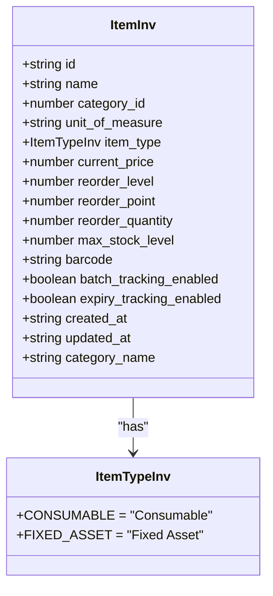

**Diagram sources**
- [types.ts](file://src\modules\inventory\data\types.ts#L200-L230)
- [core/types.ts](file://src\core\types.ts#L150-L155)

### Warehouse Collection
The Warehouse collection manages physical storage locations for inventory items.

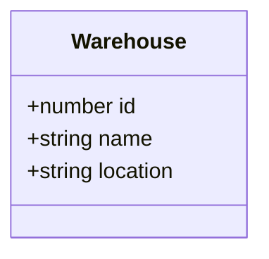

**Diagram sources**
- [types.ts](file://src\modules\inventory\data\types.ts#L175-L180)

### StockLevel Collection
The StockLevel collection tracks current inventory quantities for items in specific warehouses.

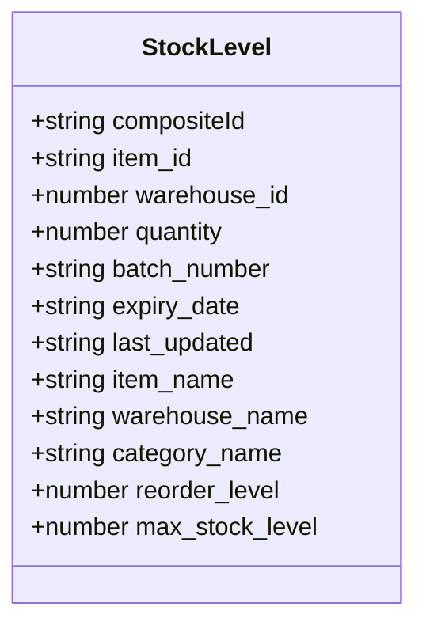

**Diagram sources**
- [types.ts](file://src\modules\inventory\data\types.ts#L255-L270)

### StockTransaction Collection
The StockTransaction collection records all movements of inventory items.

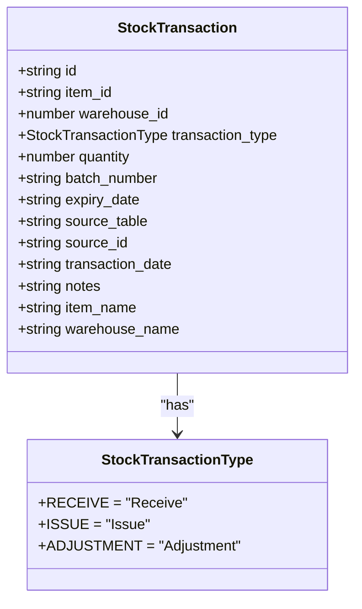

**Diagram sources**
- [types.ts](file://src\modules\inventory\data\types.ts#L272-L285)
- [core/types.ts](file://src\core\types.ts#L160-L165)

### PurchaseOrder Collection
The PurchaseOrder collection manages procurement from suppliers.

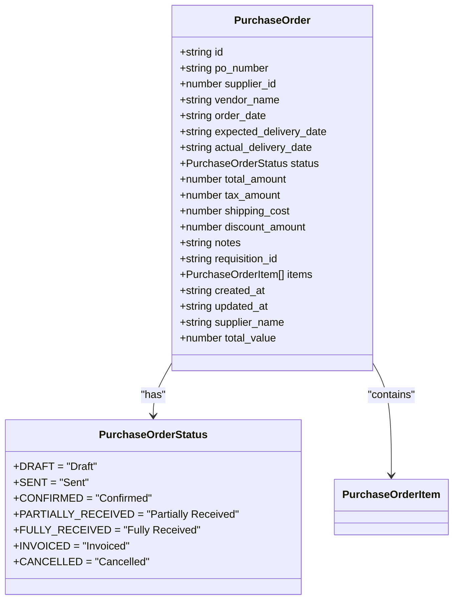

**Diagram sources**
- [types.ts](file://src\modules\inventory\data\types.ts#L330-L350)
- [core/types.ts](file://src\core\types.ts#L180-L185)

### Requisition Collection
The Requisition collection manages internal requests for inventory items.

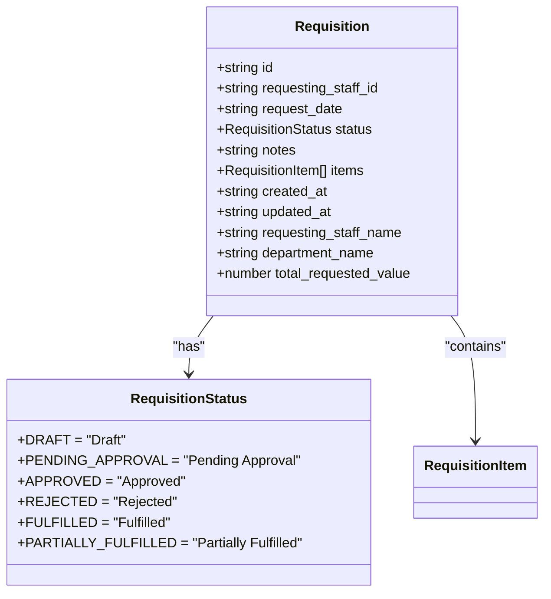

**Diagram sources**
- [types.ts](file://src\modules\inventory\data\types.ts#L310-L320)
- [core/types.ts](file://src\core\types.ts#L175-L180)

## Inventory Tracking System
The inventory tracking system maintains accurate stock levels through transaction-based updates. Stock levels are automatically updated when stock transactions are recorded.

### Stock Level Update Mechanism
Stock levels are updated through StockTransaction records, which serve as the source of truth for inventory movements. Each transaction type affects stock levels differently:

- **Receive**: Increases stock quantity
- **Issue**: Decreases stock quantity
- **Adjustment**: Modifies stock quantity (positive or negative)

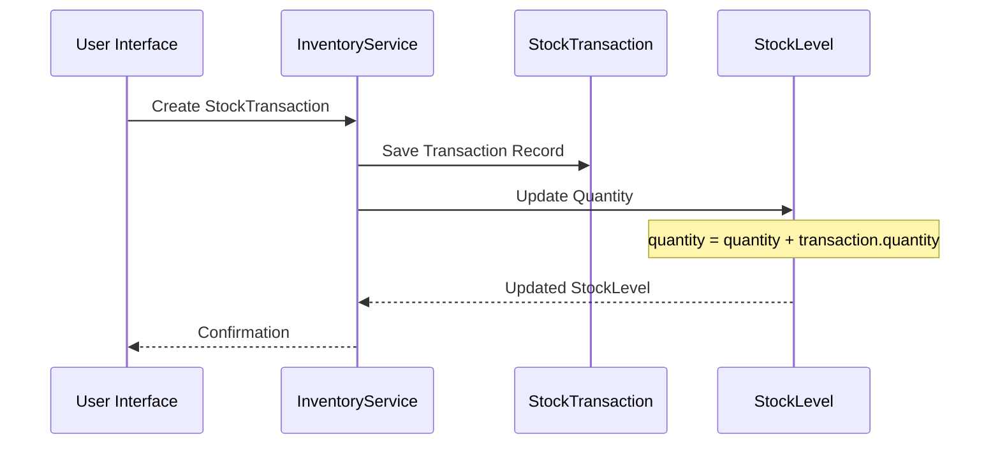

**Diagram sources**
- [mockData.ts](file://src\modules\inventory\data\mockData.ts#L180-L220)

### Stock Transaction Types
The system supports three primary transaction types that affect inventory levels:

**Receive**: Records inventory received from suppliers or other sources
**Issue**: Records inventory issued to departments or for consumption
**Adjustment**: Records manual adjustments for discrepancies, damage, or reconciliation

**Section sources**
- [types.ts](file://src\modules\inventory\data\types.ts#L272-L285)
- [mockData.ts](file://src\modules\inventory\data\mockData.ts#L180-L220)

## Procurement Workflow
The procurement workflow follows a structured process from requisition to stock issuance, ensuring proper authorization and tracking.

### Workflow Sequence
The procurement process follows this sequence:
1. Requisition → 2. PurchaseOrder → 3. StockReception → 4. StockIssuance

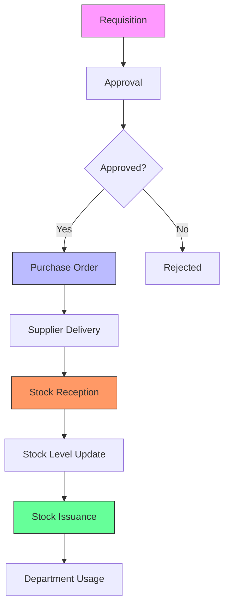

**Diagram sources**
- [mockData.ts](file://src\modules\inventory\data\mockData.ts#L220-L260)

### Requisition to Purchase Order
When a requisition is approved, it can be converted into a purchase order. The system maintains a reference between the requisition and purchase order through the requisition_id field.

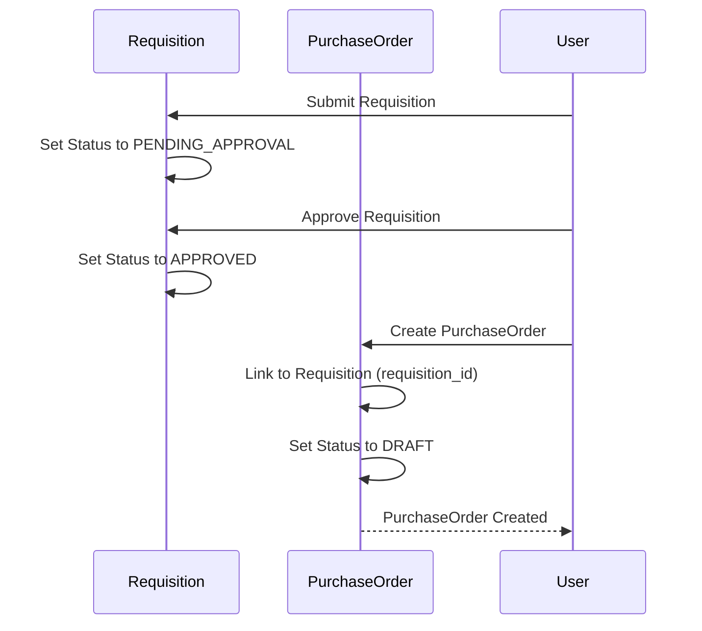

**Diagram sources**
- [mockData.ts](file://src\modules\inventory\data\mockData.ts#L220-L260)

## Critical Field Documentation
This section documents critical properties that drive inventory management decisions.

### reorderLevel and reorderPoint
These fields trigger automated reorder alerts when stock falls below specified thresholds.

**:reorderLevel** - The minimum stock level that should be maintained. When stock falls below this level, a low stock alert is generated.

**:reorderPoint** - The threshold that triggers a reorder requirement. When stock falls at or below this level, a reorder alert is generated with suggested order quantities.

```typescript
// Example from Item interface
interface InvItemType {
  reorder_level?: number;
  reorder_point?: number;
  reorder_quantity?: number;
  max_stock_level?: number;
}
```

**Section sources**
- [types.ts](file://src\modules\inventory\data\types.ts#L210-L220)

### safetyStock
While not explicitly named as safetyStock, the system implements safety stock concepts through the reorder_point field, which typically includes a buffer for unexpected demand.

### transactionType
The transactionType field in StockTransaction records determines how the transaction affects inventory levels.

**:RECEIVE** - Increases inventory (positive quantity)
**:ISSUE** - Decreases inventory (negative quantity)
**:ADJUSTMENT** - Modifies inventory (can be positive or negative)

**Section sources**
- [types.ts](file://src\modules\inventory\data\types.ts#L272-L285)

## Sample JSON Instances
This section provides sample JSON instances for complex entities.

### StockTransaction with Source/Destination Tracking
```json
{
  "id": "STK-T001",
  "item_id": "INV001",
  "warehouse_id": 1,
  "transaction_type": "RECEIVE",
  "quantity": 100,
  "transaction_date": "2024-01-10",
  "notes": "Initial stock from Text Book Centre",
  "source_table": "purchase_orders",
  "source_id": "PO001",
  "item_name": "A4 Ream Paper",
  "warehouse_name": "Main Store"
}
```

### PurchaseOrder with Supplier Contract References
```json
{
  "id": "PO001",
  "po_number": "PO-2024-001",
  "supplier_id": 1,
  "vendor_name": "Text Book Centre",
  "order_date": "2024-06-20",
  "expected_delivery_date": "2024-07-05",
  "status": "FULLY_RECEIVED",
  "total_amount": 45600,
  "tax_amount": 4560,
  "shipping_cost": 1500,
  "discount_amount": 0,
  "notes": "Q3 Stationery Restock",
  "requisition_id": "REQ001",
  "items": [
    {
      "id": "POI001",
      "purchase_order_id": "PO001",
      "item_id": "INV001",
      "quantity_ordered": 50,
      "unit_price": 480,
      "quantity_received": 50,
      "item_name": "A4 Ream Paper",
      "line_total": 24000
    }
  ],
  "created_at": "2024-06-20T10:30:00Z",
  "updated_at": "2024-07-06T14:20:00Z",
  "supplier_name": "Text Book Centre",
  "total_value": 45600
}
```

**Section sources**
- [mockData.ts](file://src\modules\inventory\data\mockData.ts#L180-L260)

## Asset Management
The inventory system includes comprehensive asset management capabilities for fixed assets.

### FixedAsset Entity
The FixedAsset collection manages non-consumable items with depreciation tracking.

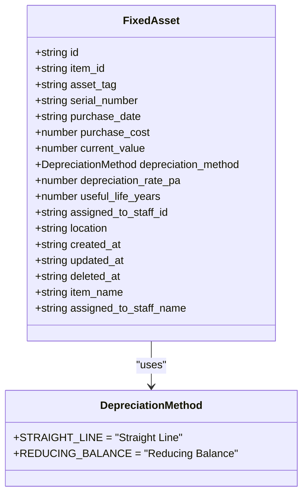

**Diagram sources**
- [types.ts](file://src\modules\inventory\data\types.ts#L235-L250)
- [core/types.ts](file://src\core\types.ts#L155-L160)

### AssetDepreciationLog Entity
The AssetDepreciationLog collection tracks depreciation history for fixed assets.

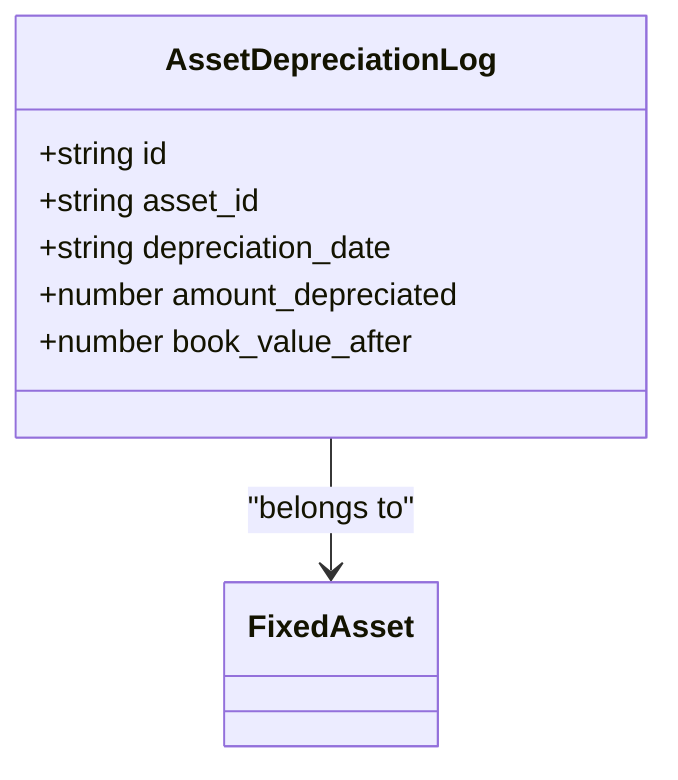

**Diagram sources**
- [types.ts](file://src\modules\inventory\data\types.ts#L252-L255)

### Asset Depreciation Process
The system calculates depreciation using either straight-line or reducing balance methods.

```mermaid
flowchart TD
A[Start Depreciation Calculation] --> B{Depreciation Method}
B --> |Straight Line| C[Annual Depreciation = (Cost - Salvage Value) / Useful Life]
B --> |Reducing Balance| D[Annual Depreciation = Book Value × Depreciation Rate]
C --> E[Update Current Value]
D --> E
E --> F[Create Depreciation Log]
F --> G[End]
style C fill:#f9f,stroke:#333
style D fill:#f9f,stroke:#333
```

**Diagram sources**
- [mockData.ts](file://src\modules\inventory\data\mockData.ts#L140-L160)

## Data Flow Processes
This section illustrates key data flow processes in the inventory system.

### Inventory Valuation
Inventory valuation is calculated based on current stock levels and item prices.

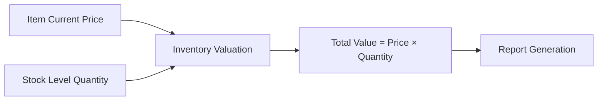

**Diagram sources**
- [mockData.ts](file://src\modules\inventory\data\mockData.ts#L100-L140)

### Stock Reconciliation
The system supports stock reconciliation through adjustment transactions.

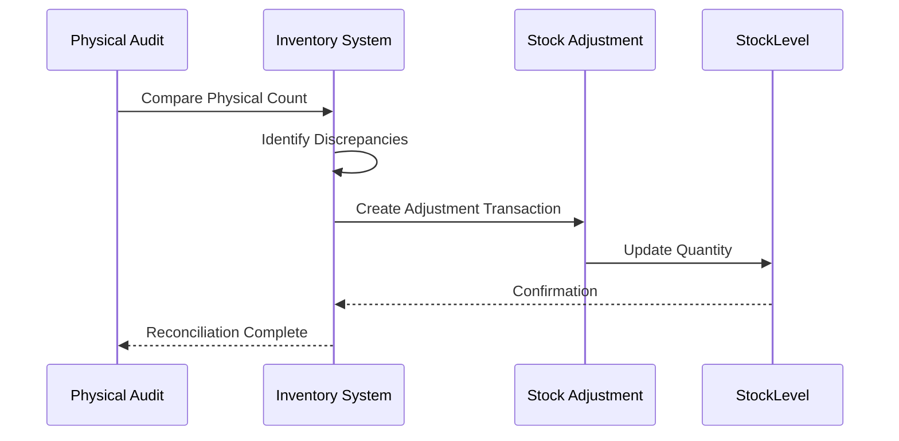

**Diagram sources**
- [mockData.ts](file://src\modules\inventory\data\mockData.ts#L200-L220)

### Reorder Alert Generation
Reorder alerts are generated based on consumption patterns and predefined thresholds.

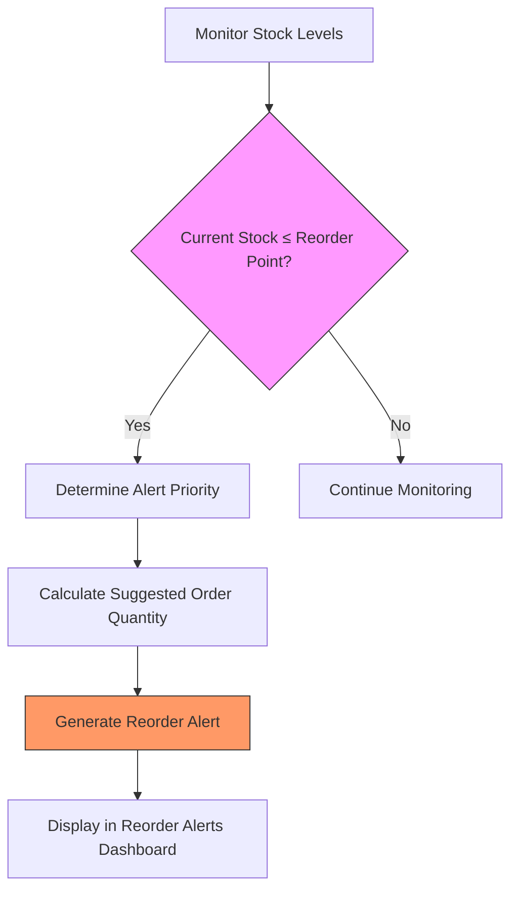

**Diagram sources**
- [reorderMonitoringService.ts](file://src\modules\inventory\services\reorderMonitoringService.ts#L0-L138)
- [useReorderMonitoring.ts](file://src\modules\inventory\hooks\useReorderMonitoring.ts#L0-L183)

### Reorder Monitoring Logic
The reorder monitoring service evaluates items against their reorder points and generates alerts accordingly.

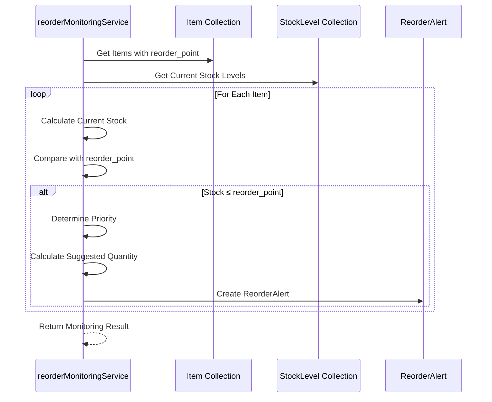

**Diagram sources**
- [reorderMonitoringService.ts](file://src\modules\inventory\services\reorderMonitoringService.ts#L0-L138)

## Conclusion
The Inventory module in schoolpilot3 provides a robust and comprehensive system for managing school inventory. The data model is designed with scalability and maintainability in mind, using TypeScript interfaces to ensure type safety across the application. Key features include automated reorder alerts, detailed stock transaction tracking, and comprehensive asset management with depreciation calculations. The procurement workflow is well-defined, following a clear path from requisition to stock issuance. The system supports multiple warehouses and provides detailed reporting capabilities through its well-structured data model.

The implementation leverages React hooks for data management, with self-contained hooks like useItemData and usePurchaseOrderData providing CRUD operations. The reorder alert system uses consumption patterns and predefined thresholds to generate timely alerts, helping prevent stockouts and ensuring smooth operations. Overall, the inventory system is well-architected to meet the needs of educational institutions with complex inventory management requirements.

**Section sources**
- [types.ts](file://src\modules\inventory\data\types.ts#L0-L299)
- [mockData.ts](file://src\modules\inventory\data\mockData.ts#L0-L260)