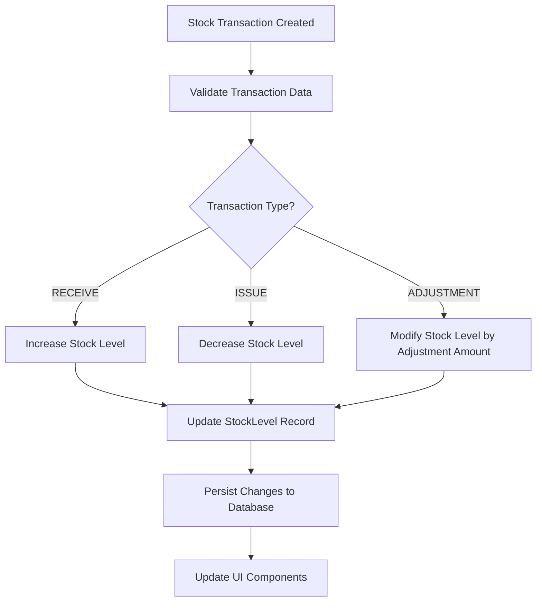
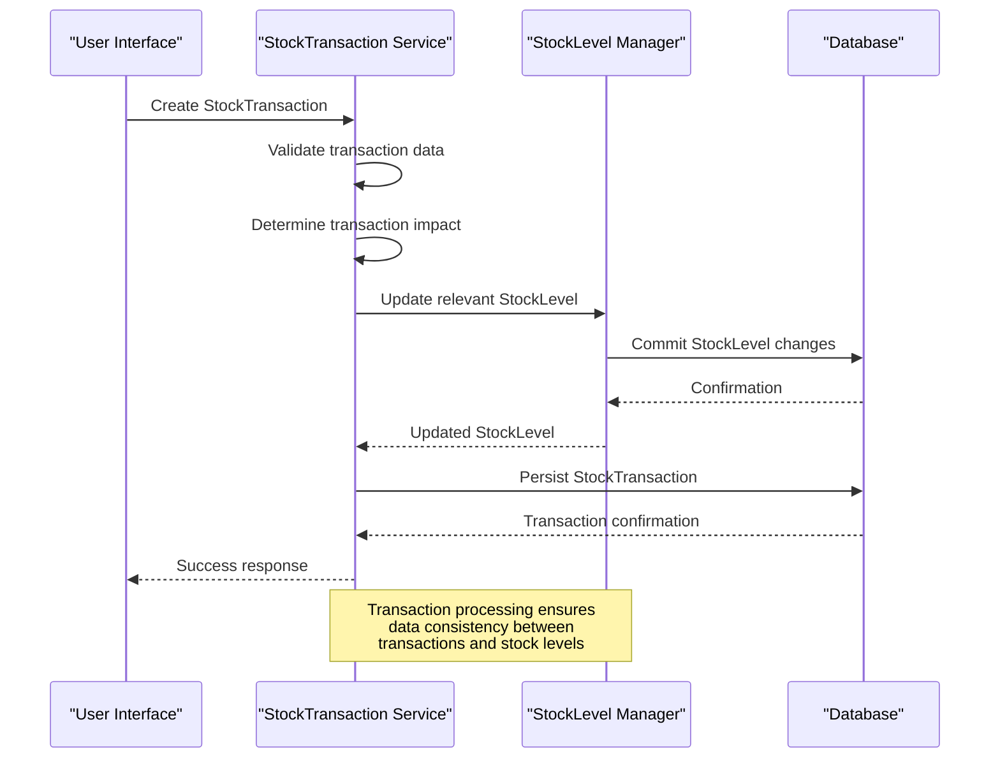
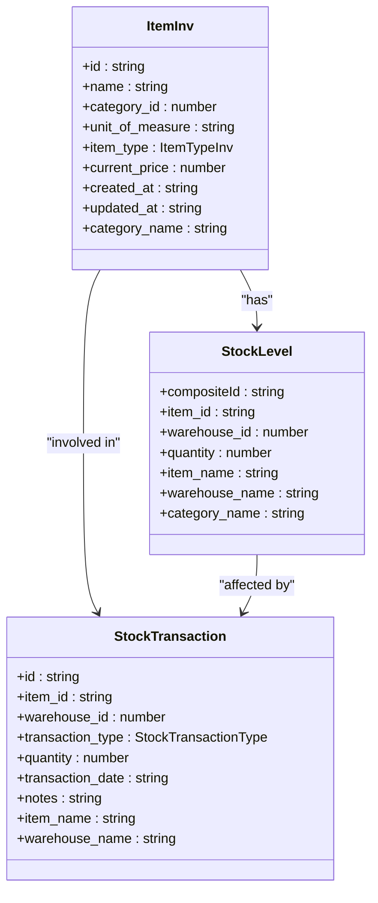
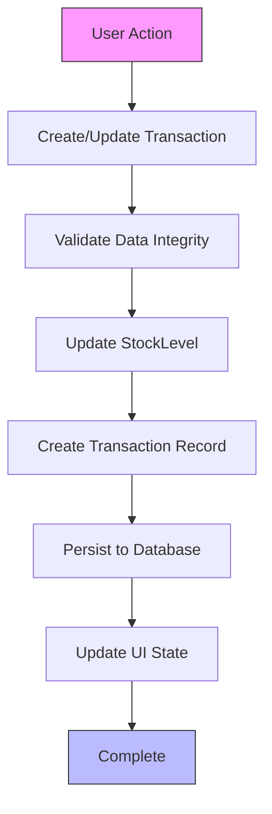
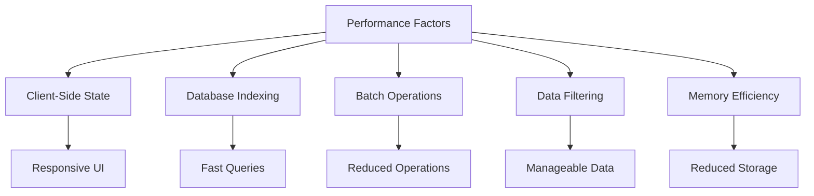

# Inventory Tracking and Valuation

<cite>
**Referenced Files in This Document**   
- [mockData.ts](file://src/modules/inventory/data/mockData.ts#L0-L259)
- [types.ts](file://src/modules/inventory/data/types.ts#L0-L41)
- [schema.ts](file://src/modules/inventory/data/schema.ts#L116-L135)
- [useStockTransactionData.ts](file://src/modules/inventory/data/useStockTransactionData.ts#L31-L56)
- [StockReceptionPage.tsx](file://src/modules/inventory/pages/StockReceptionPage.tsx#L217-L250)
- [StockIssuancePage.tsx](file://src/modules/inventory/pages/StockIssuancePage.tsx#L30-L67)
- [InventoryStatusReport.tsx](file://src/modules/reports/library/InventoryStatusReport.tsx#L33-L64)
</cite>

## Table of Contents
1. [Introduction](#introduction)
2. [Stock Level Management](#stock-level-management)
3. [Stock Transaction Processing](#stock-transaction-processing)
4. [Inventory Valuation Methods](#inventory-valuation-methods)
5. [Reconciliation Process](#reconciliation-process)
6. [Audit Trail and Data Consistency](#audit-trail-and-data-consistency)
7. [Data Hooks Implementation](#data-hooks-implementation)
8. [Performance Considerations](#performance-considerations)

## Introduction
The inventory tracking and valuation system in schoolpilot3 provides comprehensive management of school resources across multiple warehouses and categories. The system maintains accurate stock levels through transactional updates and supports various inventory operations including procurement, issuance, and adjustments. This document details the implementation of inventory tracking, valuation methods, reconciliation processes, and performance considerations within the system.

## Stock Level Management

The inventory system maintains stock levels through the StockLevel data model, which tracks the quantity of items in specific warehouses. Each stock level record contains a composite identifier that combines the item ID and warehouse ID, ensuring unique identification of inventory positions.

The system uses a reactive approach to maintain stock levels, where changes are triggered by stock transactions rather than direct manipulation of stock quantities. This ensures data consistency and provides a complete audit trail of all inventory movements.



**Diagram sources**
- [mockData.ts](file://src/modules/inventory/data/mockData.ts#L0-L259)
- [schema.ts](file://src/modules/inventory/data/schema.ts#L116-L135)

**Section sources**
- [mockData.ts](file://src/modules/inventory/data/mockData.ts#L0-L259)
- [schema.ts](file://src/modules/inventory/data/schema.ts#L116-L135)

## Stock Transaction Processing

The inventory system processes stock movements through StockTransaction records, which serve as the primary mechanism for updating stock levels. Each transaction includes essential information such as item reference, warehouse, transaction type, quantity, date, and optional notes.

The system supports multiple transaction types:
- **RECEIVE**: Increases stock levels when items are received
- **ISSUE**: Decreases stock levels when items are issued
- **RETURN_TO_STORE**: Increases stock levels when items are returned
- **RETURN_TO_SUPPLIER**: Decreases stock levels when items are returned to suppliers
- **STOCK_ADJUSTMENT**: Modifies stock levels for reconciliation purposes



**Diagram sources**
- [useStockTransactionData.ts](file://src/modules/inventory/data/useStockTransactionData.ts#L31-L56)
- [StockReceptionPage.tsx](file://src/modules/inventory/pages/StockReceptionPage.tsx#L217-L250)

**Section sources**
- [useStockTransactionData.ts](file://src/modules/inventory/data/useStockTransactionData.ts#L31-L56)
- [StockReceptionPage.tsx](file://src/modules/inventory/pages/StockReceptionPage.tsx#L217-L250)
- [StockIssuancePage.tsx](file://src/modules/inventory/pages/StockIssuancePage.tsx#L30-L67)

## Inventory Valuation Methods

The current implementation of the inventory system uses a simple valuation approach based on the current price of items. While the system does not explicitly implement FIFO (First-In, First-Out), LIFO (Last-In, First-Out), or Weighted Average methods in the provided code, the data model contains sufficient information to support these valuation methods.

The ItemInv data model includes a current_price field that represents the most recent cost of the item. Inventory valuation is calculated by multiplying the current stock quantity by the current price:

```
Total Inventory Value = Current Stock Quantity × Current Price
```

The system could be extended to support advanced valuation methods by:
1. **FIFO**: Tracking purchase dates and prices for each batch to value inventory based on the oldest costs
2. **LIFO**: Using the most recent purchase prices to value inventory
3. **Weighted Average**: Calculating an average cost based on all purchases



**Diagram sources**
- [mockData.ts](file://src/modules/inventory/data/mockData.ts#L0-L259)
- [types.ts](file://src/modules/inventory/data/types.ts#L0-L41)

**Section sources**
- [mockData.ts](file://src/modules/inventory/data/mockData.ts#L0-L259)
- [types.ts](file://src/modules/inventory/data/types.ts#L0-L41)

## Reconciliation Process

The inventory system supports reconciliation between physical counts and system records through adjustment transactions. When physical inventory counts differ from system records, users can create adjustment transactions to correct the discrepancies.

The reconciliation process involves:
1. Conducting a physical inventory count
2. Comparing physical counts with system records
3. Creating adjustment transactions for discrepancies
4. Documenting the reason for adjustments in transaction notes

Adjustment transactions can be positive (to increase stock levels) or negative (to decrease stock levels). Negative adjustments typically represent write-offs for damaged, lost, or expired items.

In the provided mock data, examples of adjustment transactions include:
- Write-off of 2 damaged exercise books (STK-T017)
- Adjustment to add 5 extra toilet paper rolls that were found during counting (STK-T018)

The system does not appear to have a dedicated reconciliation workflow, but relies on the general adjustment transaction type to handle inventory corrections.

**Section sources**
- [mockData.ts](file://src/modules/inventory/data/mockData.ts#L0-L259)

## Audit Trail and Data Consistency

The inventory system maintains an audit trail through transaction records and timestamp tracking. Each stock transaction serves as an audit record, documenting the type, quantity, date, and reason for inventory movements.

Key data consistency features include:
- **Timestamp tracking**: All records include created_at and updated_at timestamps
- **Transaction history**: Every stock movement is recorded as a transaction
- **Source tracking**: Transactions can reference their source (e.g., purchase orders, requisitions)
- **Data validation**: The schema enforces required fields and data types

The system uses a client-side state management approach with React hooks to ensure data consistency during user interactions. When transactions are created or modified, the system updates both the transaction records and the corresponding stock levels.



**Diagram sources**
- [useStockTransactionData.ts](file://src/modules/inventory/data/useStockTransactionData.ts#L31-L56)
- [mockData.ts](file://src/modules/inventory/data/mockData.ts#L0-L259)

**Section sources**
- [useStockTransactionData.ts](file://src/modules/inventory/data/useStockTransactionData.ts#L31-L56)
- [mockData.ts](file://src/modules/inventory/data/mockData.ts#L0-L259)

## Data Hooks Implementation

The inventory system implements data access through custom React hooks that provide a consistent interface for retrieving and updating inventory data. These hooks abstract the underlying data storage mechanism and provide loading states and error handling.

The useStockTransactionData hook provides CRUD operations for stock transactions:

```typescript
const { data: stockTransactions, isLoading, error, create, update, remove } = useStockTransactionData();
```

Key features of the hook implementation:
- **Reactive updates**: Changes to transaction data automatically update the component state
- **Error handling**: The hook exposes error states for error handling in components
- **Loading states**: Provides loading indicators during data operations
- **Data consistency**: Updates to transactions trigger corresponding stock level changes

The system appears to follow a pattern where data hooks manage state and provide data access methods, while UI components consume these hooks to display and modify inventory data.

**Section sources**
- [useStockTransactionData.ts](file://src/modules/inventory/data/useStockTransactionData.ts#L31-L56)

## Performance Considerations

The inventory system appears to be designed with performance considerations for typical school inventory operations. The data model and implementation suggest several performance characteristics:

1. **Client-side state management**: The use of React state for inventory data enables responsive user interfaces without constant server round-trips.

2. **Batch operations**: The system supports processing multiple items in a single transaction (e.g., stock reception with multiple items), reducing the number of individual operations.

3. **Indexing strategy**: The database schema includes indexes on key fields like item_id and warehouse_id, which should optimize query performance for common operations.

4. **Data filtering**: Reporting components implement filtering by warehouse and category, which helps manage data volume in UI displays.

5. **Memory efficiency**: The system uses composite identifiers for stock levels, which reduces data duplication and storage requirements.

For large-scale inventory operations, potential performance optimizations could include:
- Implementing server-side pagination for large transaction lists
- Adding caching mechanisms for frequently accessed data
- Optimizing database queries with additional indexes
- Implementing bulk import/export functionality

The current implementation appears suitable for school-sized inventory operations but might require optimization for larger institutions with thousands of inventory items and high transaction volumes.



**Diagram sources**
- [InventoryStatusReport.tsx](file://src/modules/reports/library/InventoryStatusReport.tsx#L33-L64)
- [schema.ts](file://src/modules/inventory/data/schema.ts#L116-L135)

**Section sources**
- [InventoryStatusReport.tsx](file://src/modules/reports/library/InventoryStatusReport.tsx#L33-L64)
- [schema.ts](file://src/modules/inventory/data/schema.ts#L116-L135)