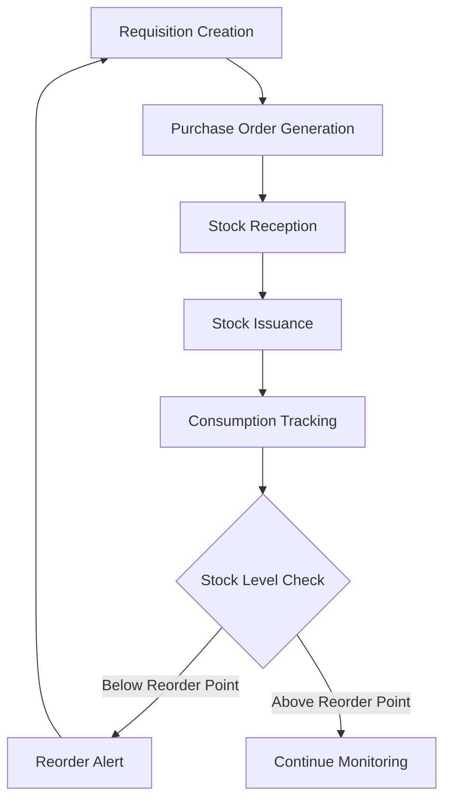
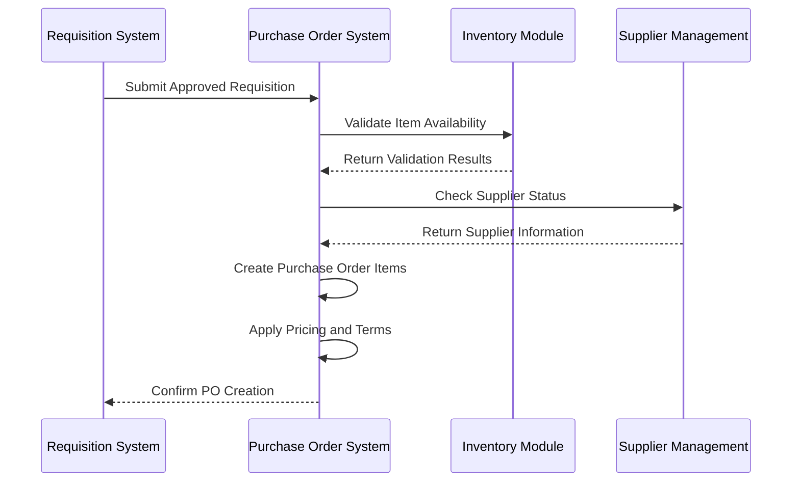
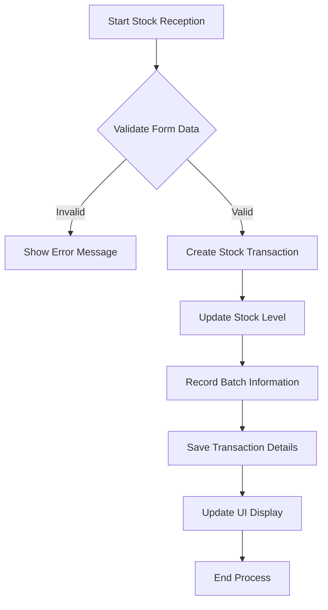
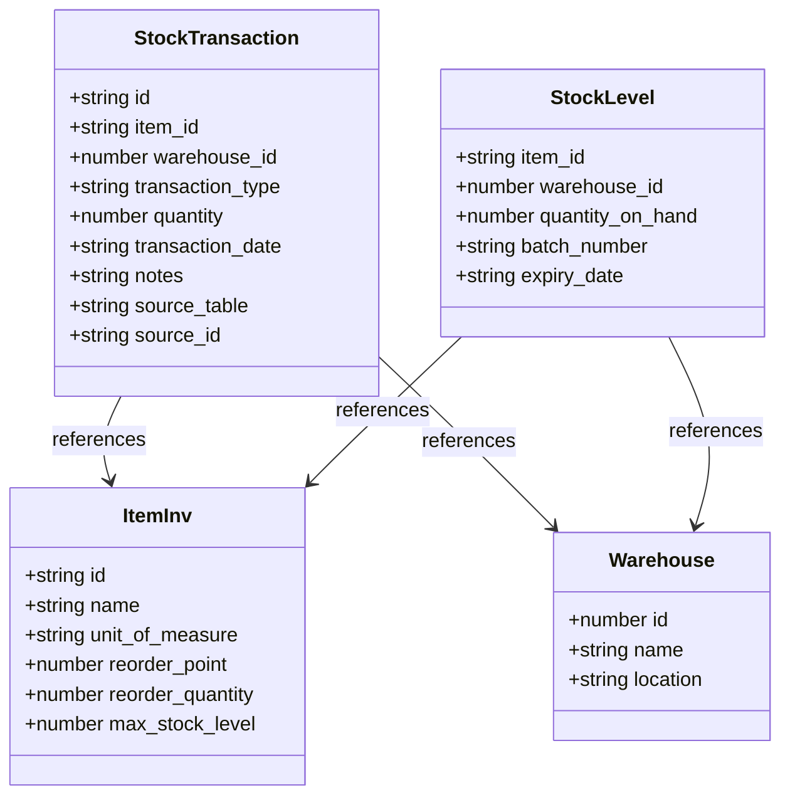
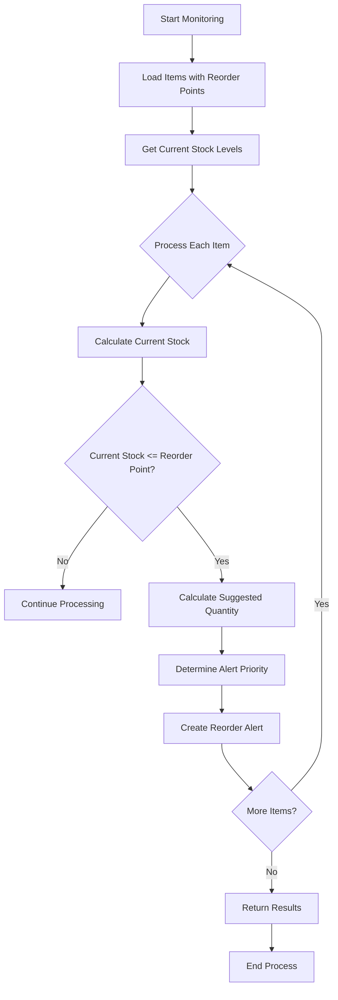
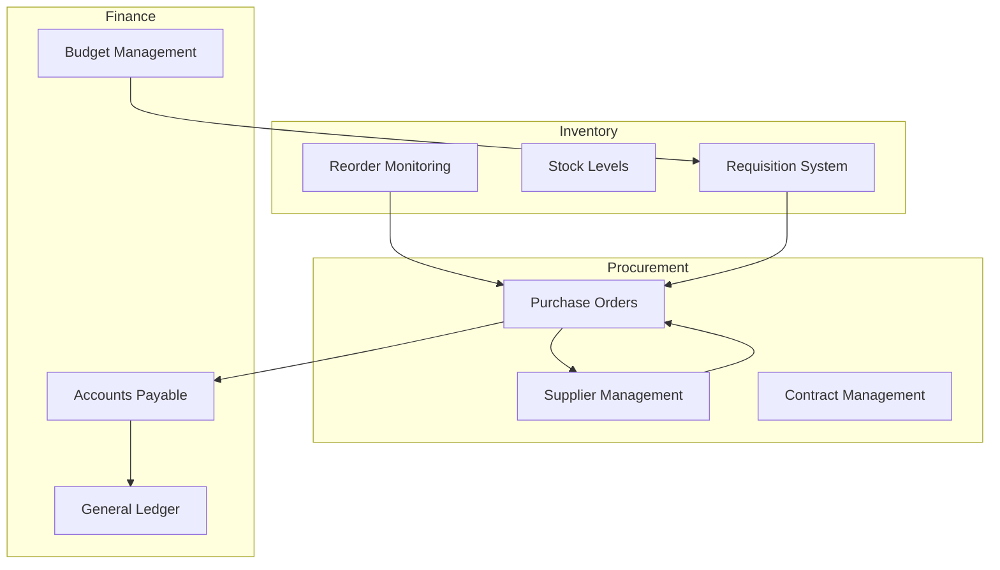

# Procurement Workflow System

<cite>
**Referenced Files in This Document**   
- [StockReceptionPage.tsx](file://src/modules/inventory/pages/StockReceptionPage.tsx)
- [StockIssuancePage.tsx](file://src/modules/inventory/pages/StockIssuancePage.tsx)
- [reorderMonitoringService.ts](file://src/modules/inventory/services/reorderMonitoringService.ts)
- [useReorderMonitoring.ts](file://src/modules/inventory/hooks/useReorderMonitoring.ts)
- [ReorderAlertsPage.tsx](file://src/modules/inventory/pages/ReorderAlertsPage.tsx)
- [PurchaseOrdersPage.tsx](file://src/modules/inventory/pages/PurchaseOrdersPage.tsx)
</cite>

## Table of Contents
1. [Introduction](#introduction)
2. [Procurement Workflow Overview](#procurement-workflow-overview)
3. [Requisition to Purchase Order Conversion](#requisition-to-purchase-order-conversion)
4. [Stock Reception Process](#stock-reception-process)
5. [Stock Issuance Management](#stock-issuance-management)
6. [Reorder Monitoring Service](#reorder-monitoring-service)
7. [Integration with Supplier and Financial Systems](#integration-with-supplier-and-financial-systems)
8. [Validation and Error Handling](#validation-and-error-handling)
9. [Conclusion](#conclusion)

## Introduction

The procurement workflow system in schoolpilot3 manages the complete inventory lifecycle from requisition to stock issuance. This document details the end-to-end process, focusing on data flow, state transitions, business logic, and integration points. The system automates reorder triggers based on consumption patterns and stock levels, ensuring timely replenishment while preventing stockouts.

**Section sources**
- [StockReceptionPage.tsx](file://src/modules/inventory/pages/StockReceptionPage.tsx#L1-L539)
- [StockIssuancePage.tsx](file://src/modules/inventory/pages/StockIssuancePage.tsx#L1-L188)

## Procurement Workflow Overview

The procurement workflow consists of four main stages: Requisition creation, Purchase Order generation, Stock Reception, and Stock Issuance. The system monitors inventory levels automatically and triggers reorder alerts when stock falls below predefined thresholds. This proactive approach ensures continuous supply of essential items while optimizing inventory costs.

**Diagram sources**
- [reorderMonitoringService.ts](file://src/modules/inventory/services/reorderMonitoringService.ts#L1-L139)
- [useReorderMonitoring.ts](file://src/modules/inventory/hooks/useReorderMonitoring.ts#L1-L184)

**Section sources**
- [reorderMonitoringService.ts](file://src/modules/inventory/services/reorderMonitoringService.ts#L1-L139)
- [useReorderMonitoring.ts](file://src/modules/inventory/hooks/useReorderMonitoring.ts#L1-L184)

## Requisition to Purchase Order Conversion

The system converts requisition items to purchase order items through a structured process that maintains data integrity and ensures proper authorization. When a requisition is approved, the system creates corresponding purchase order items with all necessary details including item specifications, quantities, and supplier information.

The conversion process validates that all required fields are populated and that the requested quantities align with budgetary constraints. Each purchase order item inherits key attributes from the requisition item while adding procurement-specific data such as pricing, delivery terms, and supplier details.

**Diagram sources**
- [PurchaseOrdersPage.tsx](file://src/modules/inventory/pages/PurchaseOrdersPage.tsx#L1-L300)
- [reorderMonitoringService.ts](file://src/modules/inventory/services/reorderMonitoringService.ts#L1-L139)

**Section sources**
- [PurchaseOrdersPage.tsx](file://src/modules/inventory/pages/PurchaseOrdersPage.tsx#L1-L300)

## Stock Reception Process

The stock reception process records incoming inventory and updates stock levels accordingly. The StockReceptionPage component provides a user interface for recording receipt details including reference numbers, supplier information, and item-specific data such as batch numbers and expiry dates.

When stock is received, the system creates stock transaction records of type "RECEIPT" and updates the corresponding stock levels. The process involves:

1. Creating a stock transaction for each received item
2. Updating the stock level by adding the received quantity
3. Recording batch-specific information when applicable
4. Maintaining audit trails for all transactions

**Diagram sources**
- [StockReceptionPage.tsx](file://src/modules/inventory/pages/StockReceptionPage.tsx#L1-L539)

**Section sources**
- [StockReceptionPage.tsx](file://src/modules/inventory/pages/StockReceptionPage.tsx#L1-L539)

## Stock Issuance Management

The stock issuance process tracks the distribution of inventory items from warehouses to various departments or users. The StockIssuancePage component allows users to record issuance transactions, specifying the item, quantity, warehouse, and purpose.

Key features of the stock issuance system include:
- Real-time validation of available stock quantities
- Automatic stock level updates upon issuance
- Comprehensive audit trails with user and timestamp information
- Integration with requisition systems for traceability

The system prevents over-issuance by validating that requested quantities do not exceed available stock levels. Each issuance transaction reduces the corresponding stock level and creates a record in the stock transaction history.

**Diagram sources**
- [StockIssuancePage.tsx](file://src/modules/inventory/pages/StockIssuancePage.tsx#L1-L188)
- [StockReceptionPage.tsx](file://src/modules/inventory/pages/StockReceptionPage.tsx#L1-L539)

**Section sources**
- [StockIssuancePage.tsx](file://src/modules/inventory/pages/StockIssuancePage.tsx#L1-L188)

## Reorder Monitoring Service

The reorder monitoring service analyzes inventory consumption patterns and current stock levels to identify items that require replenishment. The checkReorderRequirements function evaluates all items with configured reorder points and generates alerts when stock levels fall below thresholds.

The service calculates suggested order quantities based on several factors:
- Predefined reorder quantities
- Maximum stock levels
- Current stock position relative to reorder points

Alerts are prioritized based on urgency, with items at zero stock receiving high priority, while items slightly below reorder points receive lower priority ratings.

**Diagram sources**
- [reorderMonitoringService.ts](file://src/modules/inventory/services/reorderMonitoringService.ts#L1-L139)

**Section sources**
- [reorderMonitoringService.ts](file://src/modules/inventory/services/reorderMonitoringService.ts#L1-L139)

## Integration with Supplier and Financial Systems

The procurement workflow integrates with supplier management and financial systems to ensure seamless operations. When purchase orders are generated, supplier information is retrieved from the supplier management module, including pricing, delivery terms, and performance history.

Financial integration ensures that all procurement activities are properly accounted for, with purchase orders linked to budget allocations and invoices matched against purchase orders for payment processing. The system maintains a complete audit trail from requisition to payment, enabling accurate financial reporting and compliance.

The useReorderMonitoring hook provides a bridge between inventory data and the user interface, allowing real-time display of reorder alerts and facilitating quick response to stock requirements.

**Diagram sources**
- [useReorderMonitoring.ts](file://src/modules/inventory/hooks/useReorderMonitoring.ts#L1-L184)
- [PurchaseOrdersPage.tsx](file://src/modules/inventory/pages/PurchaseOrdersPage.tsx#L1-L300)

**Section sources**
- [useReorderMonitoring.ts](file://src/modules/inventory/hooks/useReorderMonitoring.ts#L1-L184)

## Validation and Error Handling

The procurement system implements comprehensive validation and error handling strategies at each stage of the workflow. Input validation occurs both at the user interface level and server-side to ensure data integrity.

Key validation rules include:
- Required fields validation for all forms
- Quantity validation to prevent negative or zero values
- Stock level validation to prevent over-issuance
- Date validation for transaction dates
- Reference number uniqueness

Error handling follows a consistent pattern across the system:
- User-friendly error messages displayed in context
- Detailed error logging for troubleshooting
- Graceful degradation when errors occur
- Transaction rollback to maintain data consistency

The system uses React error boundaries and try-catch blocks to handle exceptions, ensuring that errors in one component do not affect the entire application.

**Section sources**
- [StockReceptionPage.tsx](file://src/modules/inventory/pages/StockReceptionPage.tsx#L1-L539)
- [StockIssuancePage.tsx](file://src/modules/inventory/pages/StockIssuancePage.tsx#L1-L188)
- [reorderMonitoringService.ts](file://src/modules/inventory/services/reorderMonitoringService.ts#L1-L139)

## Conclusion

The procurement workflow system in schoolpilot3 provides a comprehensive solution for managing inventory from requisition to issuance. By automating reorder triggers based on actual consumption patterns and stock levels, the system optimizes inventory management while reducing manual intervention.

The integration of reorder monitoring, purchase order management, stock reception, and issuance processes creates a closed-loop system that ensures continuous supply of essential items. The use of consistent data models and validation rules across all components maintains data integrity throughout the procurement lifecycle.

Future enhancements could include predictive analytics for demand forecasting, supplier performance scoring, and integration with external market data to optimize purchasing decisions.