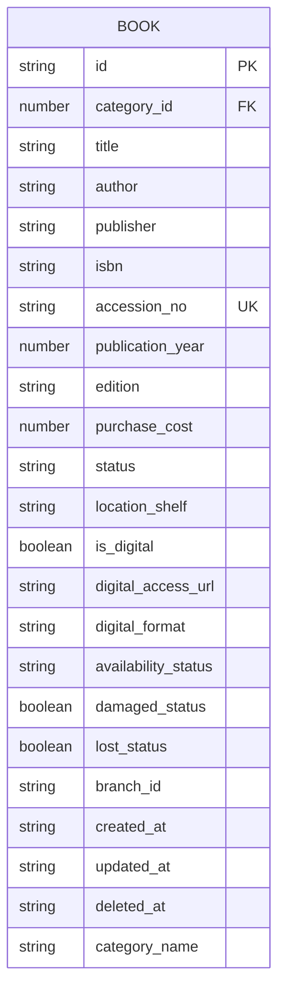
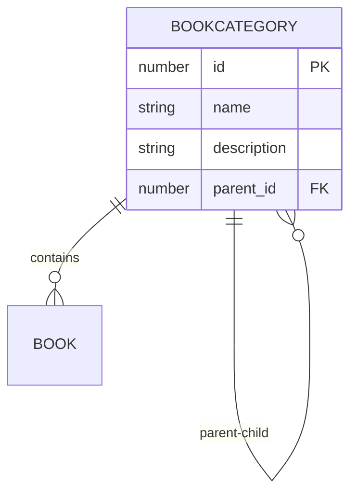
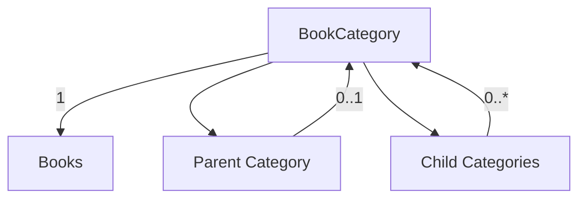
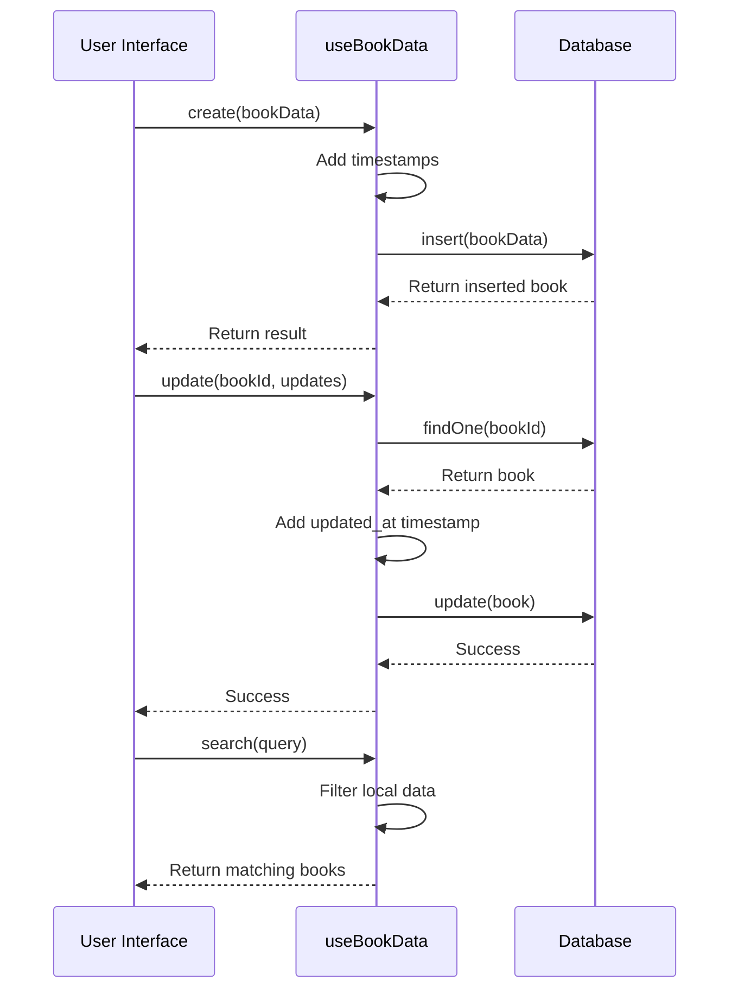

# Books and Categories Data Model

<cite>
**Referenced Files in This Document**   
- [types.ts](file://src/modules/library/data/types.ts)
- [schema.ts](file://src/modules/library/data/schema.ts)
- [useBookData.ts](file://src/modules/library/data/useBookData.ts)
- [useBookCategoryData.ts](file://src/modules/library/data/useBookCategoryData.ts)
- [types.ts](file://src/core/types.ts)
</cite>

## Table of Contents
1. [Introduction](#introduction)
2. [Book Entity Schema](#book-entity-schema)
3. [BookCategory Entity](#bookcategory-entity)
4. [Relationship Between Book and BookCategory](#relationship-between-book-and-bookcategory)
5. [CRUD Operations](#crud-operations)
6. [Validation Rules and Data Integrity](#validation-rules-and-data-integrity)
7. [Sample Data Structures](#sample-data-structures)
8. [Conclusion](#conclusion)

## Introduction
This document provides a comprehensive overview of the Books and Categories data model within the Library module of the SchoolPilot system. It details the structure, relationships, and functionality of book cataloging and category management systems. The design supports hierarchical categorization, digital and physical book tracking, and robust CRUD operations through dedicated hooks. This documentation is intended for developers, administrators, and technical stakeholders who need to understand or extend the library's data management capabilities.

## Book Entity Schema
The Book entity represents individual books in the library collection, capturing comprehensive metadata for both physical and digital resources. The schema is defined in the database-agnostic format and implemented through TypeScript interfaces.

### Core Fields
The Book entity contains the following fields:

**Basic Information**
- `id`: Unique identifier for the book (string)
- `title`: Book title (string, max 255 characters)
- `author`: Author name (string, max 200 characters)
- `publisher`: Publishing company (string, max 200 characters)
- `isbn`: International Standard Book Number (string, max 20 characters)
- `accession_no`: Unique accession number assigned by the library (string, max 50 characters)
- `publication_year`: Year of publication (number, 1000-9999 range)
- `edition`: Edition description (string, max 50 characters)

**Physical and Digital Attributes**
- `purchase_cost`: Acquisition cost in currency units (number, 0-999999.99)
- `location_shelf`: Physical shelf location (string, max 100 characters)
- `is_digital`: Flag indicating digital format (boolean)
- `digital_access_url`: URL for accessing digital content (string, max 500 characters)
- `digital_format`: Format type (e.g., PDF, EPUB) (string, max 20 characters)

**Status and Condition**
- `status`: Current status of the book (enum: Available, On Loan, Reserved, Lost, Damaged, Archived)
- `availability_status`: Availability state (enum: Available, On Loan, Reserved)
- `damaged_status`: Flag indicating damaged condition (boolean)
- `lost_status`: Flag indicating lost status (boolean)

**Administrative Metadata**
- `category_id`: Reference to the book category (number)
- `branch_id`: Association with a library branch (string, max 100 characters)
- `created_at`: Record creation timestamp (ISO string)
- `updated_at`: Last update timestamp (ISO string)
- `deleted_at`: Soft deletion timestamp (ISO string, optional)
- `category_name`: Denormalized category name for efficient querying (string, max 100 characters)

### Field Requirements
The following fields are required during book creation:
- `id`
- `title`
- `accession_no`
- `status`
- `created_at`
- `updated_at`

These requirements ensure that every book record has essential identifying and status information.



**Diagram sources**
- [schema.ts](file://src/modules/library/data/schema.ts#L20-L108)
- [types.ts](file://src/modules/library/data/types.ts#L30-L80)

**Section sources**
- [schema.ts](file://src/modules/library/data/schema.ts#L20-L108)
- [types.ts](file://src/modules/library/data/types.ts#L30-L80)

## BookCategory Entity
The BookCategory entity provides a hierarchical classification system for organizing books within the library. Categories support parent-child relationships, enabling multi-level organization of the collection.

### Category Structure
Each BookCategory contains the following fields:

- `id`: Unique identifier for the category (number)
- `name`: Category name (string, max 100 characters)
- `description`: Optional descriptive text for the category
- `parent_id`: Reference to parent category (number, optional for top-level categories)

The current implementation shows a simplified structure with only `id` and `name` fields, but the system is designed to support hierarchical relationships through the `parent_id` field pattern used in similar entities.

### Hierarchical Categorization Support
The data model supports hierarchical categorization through parent-child relationships between categories. This enables the creation of nested category structures such as:

- Fiction
  - Science Fiction
    - Dystopian
    - Space Opera
  - Mystery
    - Detective
    - Cozy Mystery
- Non-Fiction
  - Science
    - Physics
    - Biology
  - History
    - Ancient
    - Modern

This hierarchy allows for both broad and specific classification of books, improving discoverability and organization.



**Diagram sources**
- [types.ts](file://src/core/types.ts#L1159-L1162)
- [schema.ts](file://src/modules/library/data/schema.ts#L10-L18)

**Section sources**
- [types.ts](file://src/core/types.ts#L1159-L1162)
- [schema.ts](file://src/modules/library/data/schema.ts#L10-L18)

## Relationship Between Book and BookCategory
The Books and Categories data model implements a one-to-many relationship where each book belongs to one category, while each category can contain multiple books.

### Relationship Implementation
The relationship is established through the `category_id` field in the Book entity, which references the `id` field in the BookCategory entity. This foreign key relationship ensures data integrity and enables efficient querying.

### Data Integrity Constraints
The relationship enforces the following constraints:
- A book must have a valid `category_id` that references an existing category
- Deleting a category requires either reassigning its books to another category or preventing deletion if books are assigned
- The `category_name` field in the Book entity is denormalized for performance, meaning it's duplicated from the category for faster queries

### Example Category Hierarchy
The following example demonstrates a typical category hierarchy in the library system:

```
Fiction (id: 1)
├── Science Fiction (id: 2, parent_id: 1)
│   ├── Dystopian (id: 3, parent_id: 2)
│   └── Space Opera (id: 4, parent_id: 2)
└── Mystery (id: 5, parent_id: 1)
    ├── Detective (id: 6, parent_id: 5)
    └── Cozy Mystery (id: 7, parent_id: 5)
    
Non-Fiction (id: 8)
├── Science (id: 9, parent_id: 8)
│   ├── Physics (id: 10, parent_id: 9)
│   └── Biology (id: 11, parent_id: 9)
└── History (id: 12, parent_id: 8)
    ├── Ancient (id: 13, parent_id: 12)
    └── Modern (id: 14, parent_id: 12)
```

This hierarchical structure allows users to browse books at different levels of specificity, from broad genres to specialized sub-genres.



**Diagram sources**
- [types.ts](file://src/core/types.ts#L1159-L1162)
- [types.ts](file://src/modules/library/data/types.ts#L30-L80)

**Section sources**
- [types.ts](file://src/core/types.ts#L1159-L1162)
- [types.ts](file://src/modules/library/data/types.ts#L30-L80)

## CRUD Operations
The library system provides comprehensive CRUD (Create, Read, Update, Delete) operations for both books and categories through dedicated hooks that encapsulate database interactions.

### Book Data Management with useBookData Hook
The `useBookData` hook provides a complete interface for managing book records:

```typescript
export const useBookData = () => {
  const [data, setData] = useState<LibBookType[]>([]);
  const [isLoading, setIsLoading] = useState(true);
  const [error, setError] = useState<Error | null>(null);

  // Create a new book
  const create = async (newItem: Partial<LibBookType>) => { /* implementation */ };

  // Update an existing book
  const update = async (id: string, updatedData: Partial<LibBookType>) => { /* implementation */ };

  // Remove a book
  const remove = async (id: string) => { /* implementation */ };

  // Search books
  const search = async (query: string) => { /* implementation */ };

  // Additional utility methods
  const getDamagedBooks = async () => { /* implementation */ };
  const getLostBooks = async () => { /* implementation */ };
  const getDigitalBooks = async () => { /* implementation */ };
};
```

Key features of the `useBookData` hook:
- Real-time data synchronization through RxDB observables
- Comprehensive error handling with descriptive error messages
- Built-in timestamp management (automatically sets `created_at` and `updated_at`)
- Search functionality across multiple fields
- Utility methods for common operations like finding damaged or lost books

### Category Management with useBookCategoryData Hook
The `useBookCategoryData` hook provides similar functionality for category management:

```typescript
export const useBookCategoryData = () => {
  const [bookCategories, setBookCategories] = useState<BookCategory[]>([]);
  const [isLoading, setIsLoading] = useState<boolean>(true);
  const [error, setError] = useState<string | null>(null);

  // Create a new category
  const create = async (newItem: Partial<BookCategory>) => { /* implementation */ };

  // Update an existing category
  const update = async (id: number, updatedData: Partial<BookCategory>) => { /* implementation */ };

  // Remove a category
  const remove = async (id: number) => { /* implementation */ };
};
```

The category management system currently uses in-memory state with mock data, but follows the same pattern as the book management system for consistency.

### Operation Flow
The typical flow for CRUD operations is as follows:



**Diagram sources**
- [useBookData.ts](file://src/modules/library/data/useBookData.ts#L10-L168)
- [useBookCategoryData.ts](file://src/modules/library/data/useBookCategoryData.ts#L10-L57)

**Section sources**
- [useBookData.ts](file://src/modules/library/data/useBookData.ts#L10-L168)
- [useBookCategoryData.ts](file://src/modules/library/data/useBookCategoryData.ts#L10-L57)

## Validation Rules and Data Integrity
The Books and Categories data model implements several validation rules and data integrity constraints to ensure the quality and consistency of library records.

### ISBN Validation
While the current implementation does not show explicit ISBN validation logic, the data model is designed to support ISBN validation through the following constraints:
- The `isbn` field is limited to 20 characters, accommodating both ISBN-10 and ISBN-13 formats
- The field is indexed for efficient searching
- Business logic should validate ISBN format (10 or 13 digits with optional hyphens) before insertion

### Data Integrity Constraints
The system enforces data integrity through several mechanisms:

**Required Fields**
- Books require essential fields like `title`, `accession_no`, and `status` to prevent incomplete records
- Categories require `name` to ensure meaningful classification

**Type Safety**
- TypeScript interfaces ensure type consistency across the application
- Database schema definitions validate data types and constraints

**Referential Integrity**
- The `category_id` in books references valid categories
- The system should prevent deletion of categories that contain books

**Timestamp Management**
- Automatic management of `created_at` and `updated_at` timestamps ensures auditability
- Soft deletion through `deleted_at` field preserves historical data

### Indexing Strategy
The database schema includes strategic indexing to optimize query performance:

- `title`: For searching by book title
- `author`: For searching by author name
- `isbn`: For searching by ISBN
- `accession_no`: For searching by accession number
- `status`: For filtering by book status
- `category_id`: For filtering by category
- `branch_id`: For filtering by library branch
- `damaged_status` and `lost_status`: For identifying books with specific conditions
- `is_digital`: For filtering digital resources

These indexes support the most common query patterns in the library system, ensuring responsive performance even with large collections.

**Section sources**
- [schema.ts](file://src/modules/library/data/schema.ts#L20-L108)
- [types.ts](file://src/modules/library/data/types.ts#L30-L80)

## Sample Data Structures
This section provides examples of JSON structures for book creation and category tree representations.

### Sample Book Creation JSON
```json
{
  "id": "book_001",
  "category_id": 3,
  "title": "1984",
  "author": "George Orwell",
  "publisher": "Secker & Warburg",
  "isbn": "978-0-452-28423-4",
  "accession_no": "ACC00001",
  "publication_year": 1949,
  "edition": "First Edition",
  "purchase_cost": 15.99,
  "status": "Available",
  "location_shelf": "A3",
  "is_digital": false,
  "availability_status": "Available",
  "damaged_status": false,
  "lost_status": false,
  "branch_id": "main",
  "created_at": "2025-01-15T10:30:00Z",
  "updated_at": "2025-01-15T10:30:00Z",
  "category_name": "Dystopian"
}
```

### Sample Digital Book JSON
```json
{
  "id": "book_002",
  "category_id": 10,
  "title": "Introduction to Quantum Physics",
  "author": "Dr. Jane Smith",
  "publisher": "Academic Press",
  "isbn": "978-1-234-56789-0",
  "accession_no": "ACC00002",
  "publication_year": 2024,
  "edition": "2nd Edition",
  "purchase_cost": 49.99,
  "status": "Available",
  "is_digital": true,
  "digital_access_url": "https://library.example.com/books/quantum-physics",
  "digital_format": "PDF",
  "availability_status": "Available",
  "damaged_status": false,
  "lost_status": false,
  "branch_id": "main",
  "created_at": "2025-01-16T14:20:00Z",
  "updated_at": "2025-01-16T14:20:00Z",
  "category_name": "Physics"
}
```

### Category Tree Structure JSON
```json
[
  {
    "id": 1,
    "name": "Fiction",
    "children": [
      {
        "id": 2,
        "name": "Science Fiction",
        "children": [
          {
            "id": 3,
            "name": "Dystopian"
          },
          {
            "id": 4,
            "name": "Space Opera"
          }
        ]
      },
      {
        "id": 5,
        "name": "Mystery",
        "children": [
          {
            "id": 6,
            "name": "Detective"
          },
          {
            "id": 7,
            "name": "Cozy Mystery"
          }
        ]
      }
    ]
  },
  {
    "id": 8,
    "name": "Non-Fiction",
    "children": [
      {
        "id": 9,
        "name": "Science",
        "children": [
          {
            "id": 10,
            "name": "Physics"
          },
          {
            "id": 11,
            "name": "Biology"
          }
        ]
      },
      {
        "id": 12,
        "name": "History",
        "children": [
          {
            "id": 13,
            "name": "Ancient"
          },
          {
            "id": 14,
            "name": "Modern"
          }
        ]
      }
    ]
  }
]
```

### Category Hierarchy Example
The following example shows a category hierarchy for "Fiction → Science Fiction → Dystopian":

```json
{
  "id": 3,
  "name": "Dystopian",
  "description": "Books featuring oppressive societal control and bleak futures",
  "parent_id": 2
}
```

Where the parent category "Science Fiction" has:
```json
{
  "id": 2,
  "name": "Science Fiction",
  "description": "Speculative fiction based on imagined future scientific discoveries",
  "parent_id": 1
}
```

And the top-level category "Fiction" has:
```json
{
  "id": 1,
  "name": "Fiction",
  "description": "Imaginative literary works"
  // No parent_id (top-level category)
}
```

**Section sources**
- [useBookData.ts](file://src/modules/library/data/useBookData.ts#L50-L150)
- [useBookCategoryData.ts](file://src/modules/library/data/useBookCategoryData.ts#L30-L50)

## Conclusion
The Books and Categories data model in the Library module provides a robust foundation for managing a comprehensive library collection. The system supports both physical and digital resources with detailed metadata tracking, hierarchical categorization, and comprehensive CRUD operations.

Key strengths of the current implementation include:
- Well-defined data structures with appropriate field constraints
- Support for hierarchical category organization
- Dedicated hooks for encapsulated data management
- Comprehensive status tracking for books
- Efficient indexing for common query patterns

The model effectively supports the core requirements of a library system, enabling efficient cataloging, organization, and retrieval of books. Future enhancements could include more sophisticated validation rules, improved hierarchical category management, and expanded reporting capabilities.

This documentation provides a complete reference for developers and administrators working with the library data model, ensuring consistent understanding and implementation across the system.