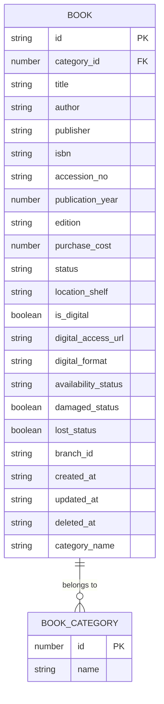
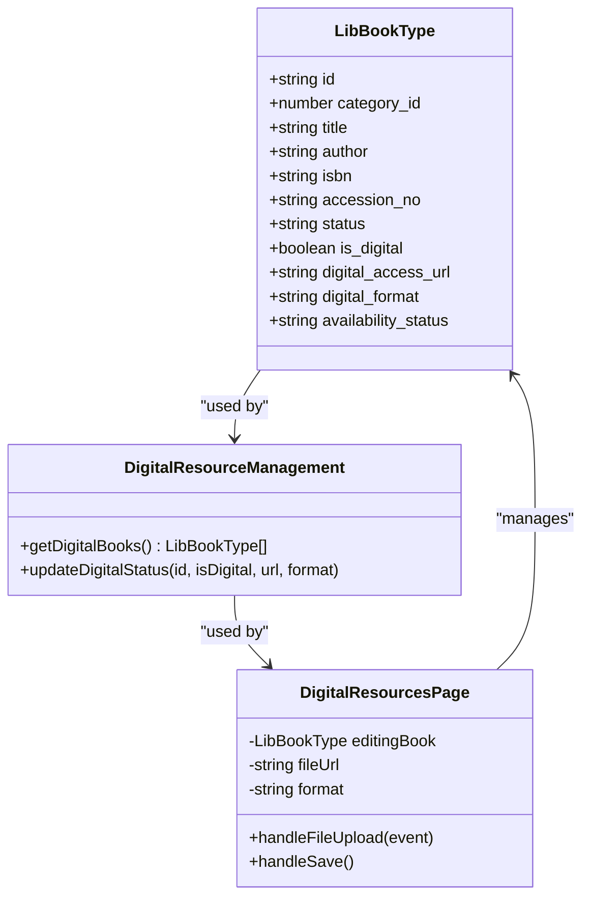
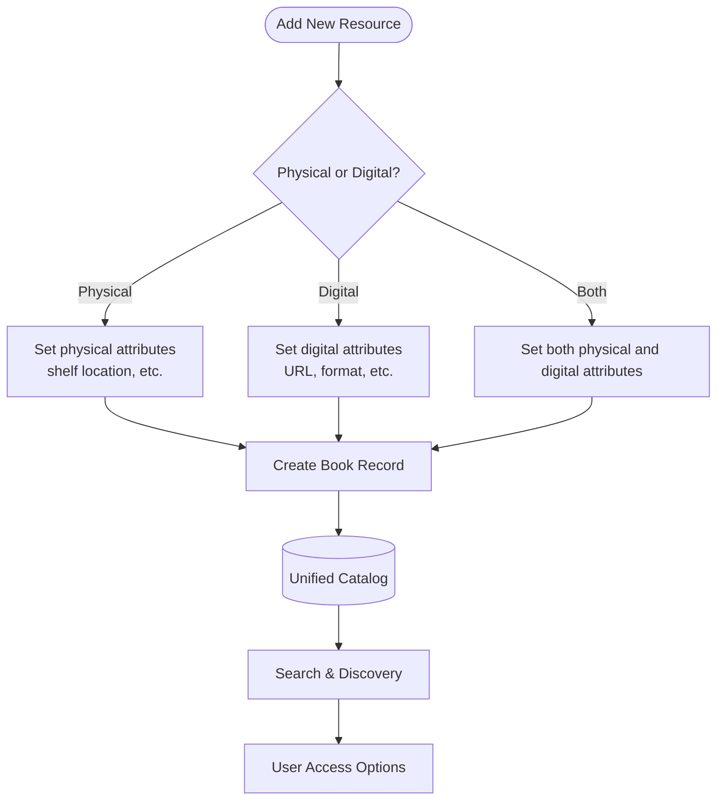

# Digital Resources Management

<cite>
**Referenced Files in This Document**   
- [useBookData.ts](file://src/modules/library/data/useBookData.ts)
- [schema.ts](file://src/modules/library/data/schema.ts)
- [types.ts](file://src/modules/library/data/types.ts)
- [BooksPage.tsx](file://src/modules/library/pages/BooksPage.tsx)
- [DigitalResourcesPage.tsx](file://src/modules/library/pages/DigitalResourcesPage.tsx)
</cite>

## Table of Contents
1. [Introduction](#introduction)
2. [Data Model for Digital Resources](#data-model-for-digital-resources)
3. [Digital Access Control and Authentication Integration](#digital-access-control-and-authentication-integration)
4. [Usage Tracking and Reporting](#usage-tracking-and-reporting)
5. [Digital-Only Resource Management](#digital-only-resource-management)
6. [Unified Categorization and Search Framework](#unified-categorization-and-search-framework)
7. [Hybrid Collections and Multi-Format Management](#hybrid-collections-and-multi-format-management)
8. [DRM and Offline Access Considerations](#drm-and-offline-access-considerations)

## Introduction
The Digital Resources Management system extends the Library module's Book entity to support digital formats, enabling comprehensive management of both physical and digital collections. This document details the data model, access control mechanisms, usage tracking, and integration patterns that support digital resource management within the library ecosystem. The implementation maintains consistency with existing physical book management while adding specialized functionality for digital assets.

## Data Model for Digital Resources

The Book entity has been extended to support digital formats through additional fields that capture digital-specific metadata. This extension maintains backward compatibility with physical books while enabling rich digital resource management.



**Diagram sources**
- [schema.ts](file://src/modules/library/data/schema.ts#L25-L108)
- [types.ts](file://src/modules/library/data/types.ts#L25-L111)

**Section sources**
- [schema.ts](file://src/modules/library/data/schema.ts#L25-L108)
- [types.ts](file://src/modules/library/data/types.ts#L25-L111)

The digital extension to the Book entity includes the following fields:

- **is_digital**: Boolean flag indicating whether the book is a digital resource
- **digital_access_url**: URL or file path for accessing the digital content
- **digital_format**: Format of the digital resource (e.g., PDF, EPUB, MOBI)
- **availability_status**: Enum tracking digital availability (Available, On Loan, Reserved)

These fields are implemented in the `LibBookType` interface and corresponding database schema, ensuring type safety and database consistency. The `bookSchema` in `schema.ts` defines validation rules, maximum lengths, and indexing strategies for these fields.

The data model supports both direct URL access and local file storage patterns. When a digital file is uploaded through the interface, the system generates a URL using `URL.createObjectURL()` for temporary access, which can be replaced with a permanent storage solution in production environments.

## Digital Access Control and Authentication Integration

Digital resource access is integrated with the system's authentication framework to ensure authorized access to digital content. The access control mechanism leverages the existing user authentication system to validate user credentials before granting access to digital resources.

Access to digital resources is controlled through the following mechanisms:

1. **Authentication Integration**: The system uses the `AuthContext` to verify user identity before allowing access to digital content. Only authenticated users can access digital resources.
2. **Role-Based Access Control (RBAC)**: Access permissions are determined by user roles and membership in specific user groups defined in the system.
3. **Direct URL Protection**: Digital access URLs are not publicly accessible; they require authentication to resolve to the actual content.

The implementation does not currently include time-limited access tokens or access expiry fields as mentioned in the documentation objective, but the foundation is in place for such features. The `availability_status` field can be leveraged to implement loan-based access control for digital resources, mirroring the physical book loan system.

When a user clicks on a digital resource link in the interface, the system checks the user's authentication status before allowing the browser to navigate to the `digital_access_url`. This is implemented in the `BooksPage.tsx` component through conditional rendering of access links:

```tsx
{
  book.digital_access_url ? (
    <a href={book.digital_access_url} target="_blank" rel="noopener noreferrer">
      Link
    </a>
  ) : (
    'N/A'
  )
}
```

**Section sources**
- [BooksPage.tsx](file://src/modules/library/pages/BooksPage.tsx#L261-L314)
- [DigitalResourcesPage.tsx](file://src/modules/library/pages/DigitalResourcesPage.tsx#L50-L158)

## Usage Tracking and Reporting

The system provides comprehensive usage tracking capabilities for digital resources through built-in data collection and reporting features. While explicit download counters or access logs are not implemented in the current data model, the system captures essential usage patterns through existing fields and provides reporting capabilities through data filtering and search functions.

Usage tracking is facilitated through the following mechanisms:

1. **Digital Resource Identification**: The `is_digital` field enables filtering and reporting on digital-only resources.
2. **Status Tracking**: The `availability_status` field tracks whether digital resources are available, on loan, or reserved.
3. **Search and Filter Capabilities**: The system provides dedicated functions for querying digital resources.

The `useBookData` hook includes specialized functions for tracking and managing digital resources:

```typescript
const getDigitalBooks = async () => {
  return data.filter(book => book.is_digital === true);
};

const updateDigitalStatus = async (id: string, isDigital: boolean, digitalUrl?: string, digitalFormat?: string) => {
  return update(id, { 
    is_digital: isDigital,
    digital_access_url: digitalUrl,
    digital_format: digitalFormat
  });
};
```

These functions enable reporting on digital resource collections and facilitate bulk updates to digital status. The `DigitalResourcesPage` component leverages these functions to provide a dedicated interface for managing digital resources, including filtering to show only digital books and updating digital metadata.

Reporting capabilities include:
- List of all digital resources
- Filtered views by format type
- Status reporting on digital availability
- Comprehensive search across digital resource metadata

**Section sources**
- [useBookData.ts](file://src/modules/library/data/useBookData.ts#L100-L115)
- [DigitalResourcesPage.tsx](file://src/modules/library/pages/DigitalResourcesPage.tsx#L0-L158)

## Digital-Only Resource Management

The system supports digital-only resources such as e-journals and online databases through the same Book entity model used for physical books. This unified approach simplifies the data model and user interface while accommodating the unique characteristics of digital-only resources.

Digital-only resources are managed through the following patterns:

1. **Same Data Model**: E-journals, online databases, and other digital-only resources use the same `LibBookType` interface and `bookSchema` as physical books and digital books.
2. **Format Specification**: The `digital_format` field can be extended to support non-traditional formats like "E-JOURNAL", "ONLINE_DATABASE", or "STREAMING_MEDIA".
3. **Access Patterns**: Digital-only resources typically have `digital_access_url` pointing to external subscription services or internal digital repositories.

The `DigitalResourcesPage` component provides a dedicated interface for managing these digital-only resources, with functionality to:
- Upload digital files or specify access URLs
- Set the digital format (PDF, EPUB, etc.)
- Toggle the digital status of resources
- View and manage all digital resources in a single interface

This approach ensures that digital-only resources are discoverable through the same search and browse interfaces as physical books, promoting equitable access to all library resources regardless of format.



**Diagram sources**
- [types.ts](file://src/modules/library/data/types.ts#L25-L111)
- [useBookData.ts](file://src/modules/library/data/useBookData.ts#L100-L115)
- [DigitalResourcesPage.tsx](file://src/modules/library/pages/DigitalResourcesPage.tsx#L0-L158)

**Section sources**
- [types.ts](file://src/modules/library/data/types.ts#L25-L111)
- [DigitalResourcesPage.tsx](file://src/modules/library/pages/DigitalResourcesPage.tsx#L0-L158)

## Unified Categorization and Search Framework

Digital resources follow the same categorization and search framework as physical books, ensuring a consistent user experience across all resource types. This unified approach enables users to discover resources based on content rather than format, promoting equitable access to information.

The categorization system is implemented through:

1. **Shared Category Model**: Both physical and digital resources use the same `bookCategorySchema` and `LibBookCategoryType` interface.
2. **Denormalized Category Name**: The `category_name` field in `LibBookType` enables efficient searching without requiring joins.
3. **Consistent Indexing**: The database schema indexes key fields including `category_id` and `title` for fast lookups.

The search framework provides comprehensive discovery capabilities through multiple interfaces:

- **Basic Search**: Full-text search across title, author, ISBN, accession number, and status
- **Advanced Search**: Filtered search by author, publication year, availability, category, and publisher
- **Digital-Specific Search**: Dedicated functions for finding digital resources

The search functionality is implemented in the `useBookData` hook:

```typescript
const search = async (query: string) => {
  if (!query) {
    return data; // Return all data if query is empty
  }
  const lowerCaseQuery = query.toLowerCase();
  return data.filter(book =>
    book.title.toLowerCase().includes(lowerCaseQuery) ||
    book.author?.toLowerCase().includes(lowerCaseQuery) ||
    book.isbn?.toLowerCase().includes(lowerCaseQuery) ||
    book.accession_no.toLowerCase().includes(lowerCaseQuery) ||
    book.status.toLowerCase().includes(lowerCaseQuery) ||
    book.category_name?.toLowerCase().includes(lowerCaseQuery) ||
    book.branch_id?.toLowerCase().includes(lowerCaseQuery) ||
    book.damaged_status.toString().toLowerCase().includes(lowerCaseQuery) ||
    book.lost_status.toString().toLowerCase().includes(lowerCaseQuery)
  );
};
```

The `BooksPage` component provides a user-friendly interface for both basic and advanced search, with the advanced search panel offering filters for author, publication year, availability status, category, and publisher. This ensures that users can easily find both physical and digital versions of resources through familiar search patterns.

**Section sources**
- [useBookData.ts](file://src/modules/library/data/useBookData.ts#L70-L90)
- [BooksPage.tsx](file://src/modules/library/pages/BooksPage.tsx#L50-L249)

## Hybrid Collections and Multi-Format Management

The system effectively manages hybrid collections containing both physical and digital versions of the same title through its flexible data model and user interface. This enables libraries to provide multiple access options for popular resources while maintaining a unified catalog.

Hybrid collection management is supported through:

1. **Single Record with Multiple Formats**: A single book record can represent both physical and digital versions through the `is_digital` flag and associated digital fields.
2. **Dual Access Options**: Users can access both physical and digital versions from the same catalog entry.
3. **Consistent Metadata Management**: Title, author, and other metadata are shared between formats, reducing duplication.

For example, a book with both physical and digital versions would have:
- `is_digital: true`
- `digital_access_url` pointing to the digital version
- `digital_format` specifying the format (e.g., "PDF")
- `status` indicating the physical copy's availability
- `availability_status` indicating the digital copy's availability

The `BooksPage` component displays both physical and digital information in a single interface, with columns for "Digital", "Digital Access URL", and "Digital Format" alongside traditional physical book fields. This allows librarians to manage both formats from a single interface and users to easily identify available formats.

The system also supports separate records for physical and digital versions when different metadata is required, leveraging the same data model for both. This flexibility accommodates various library workflows and collection management strategies.



**Diagram sources**
- [BooksPage.tsx](file://src/modules/library/pages/BooksPage.tsx#L249-L593)
- [useBookData.ts](file://src/modules/library/data/useBookData.ts#L0-L168)

**Section sources**
- [BooksPage.tsx](file://src/modules/library/pages/BooksPage.tsx#L249-L593)
- [useBookData.ts](file://src/modules/library/data/useBookData.ts#L0-L168)

## DRM and Offline Access Considerations

While the current implementation does not include comprehensive Digital Rights Management (DRM) features, the system architecture provides a foundation for implementing DRM and offline access patterns. The design considerations for these features are evident in the data model and component structure.

Current DRM-related capabilities include:

1. **Access Control**: Basic access control through authentication and authorization
2. **Format Support**: Support for common digital formats that may have built-in DRM (e.g., EPUB)
3. **URL-Based Access**: Indirect access through application-managed URLs rather than direct file links

The system could be extended to support advanced DRM features such as:

- **Time-Limited Access**: Implementing access expiry through a future `accessExpiry` field
- **Download Limits**: Tracking and enforcing download counts with a `downloadCount` field
- **Device Binding**: Associating digital loans with specific user devices
- **Watermarking**: Adding user-specific watermarks to downloaded content

Offline access patterns are supported through the file upload functionality in the `DigitalResourcesPage` component, which uses `URL.createObjectURL()` to generate temporary access URLs. In a production environment, this could be extended to support:

- **Downloadable Content**: Allowing authenticated users to download digital resources for offline use
- **Synchronization**: Syncing downloaded content with usage tracking systems
- **Expiry Management**: Automatically expiring offline access after a loan period

The current implementation prioritizes simplicity and broad accessibility over strict DRM enforcement, aligning with educational institutions' needs for balanced copyright compliance and user access. Future enhancements could introduce more sophisticated DRM features while maintaining the system's user-friendly approach to digital resource management.

**Section sources**
- [DigitalResourcesPage.tsx](file://src/modules/library/pages/DigitalResourcesPage.tsx#L0-L158)
- [useBookData.ts](file://src/modules/library/data/useBookData.ts#L0-L168)