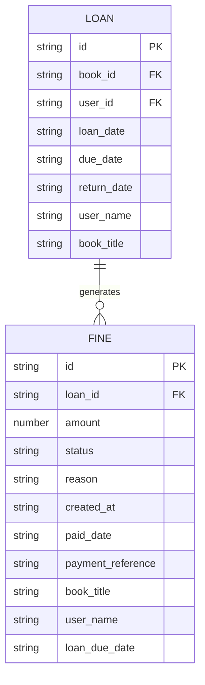
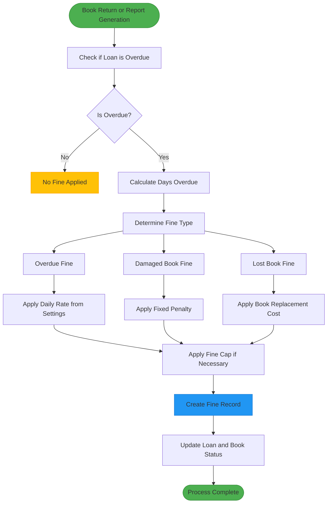
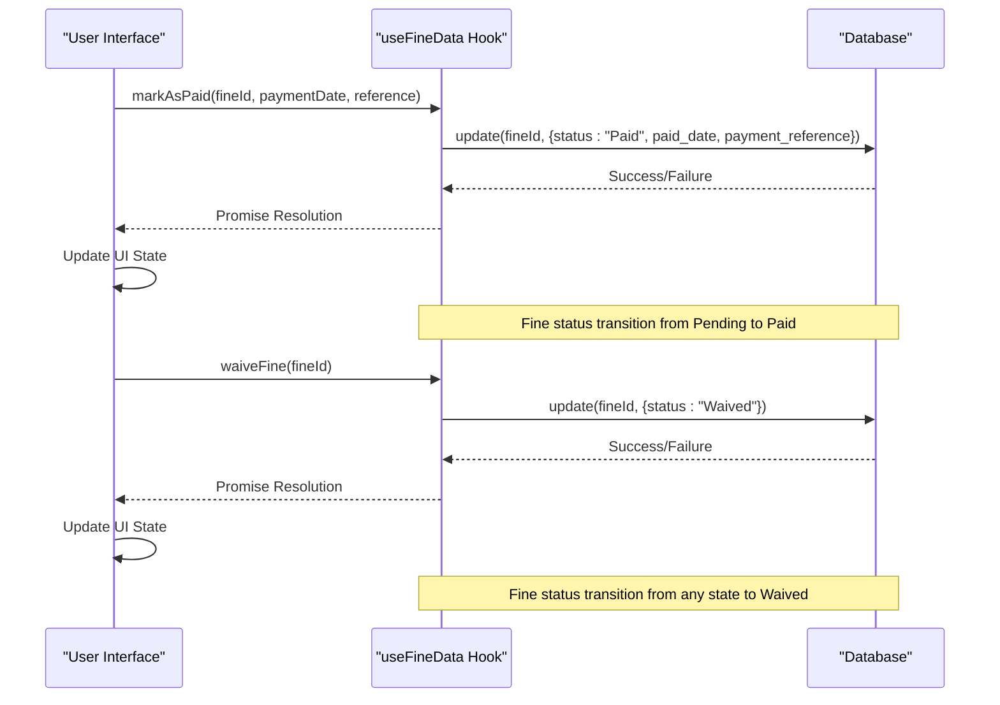
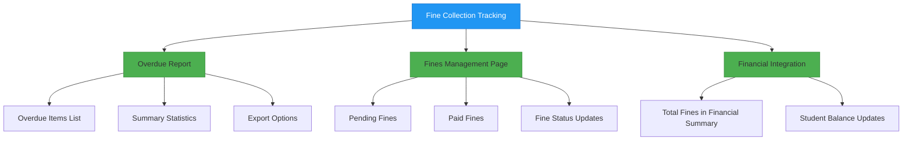

# Fines and Penalties Data Model

<cite>
**Referenced Files in This Document**   
- [useFineData.ts](file://src\modules\library\data\useFineData.ts)
- [types.ts](file://src\modules\library\data\types.ts)
- [useLoanData.ts](file://src\modules\library\data\useLoanData.ts)
- [useLibrarySettingsData.ts](file://src\modules\library\data\useLibrarySettingsData.ts)
- [OverdueReport.tsx](file://src\modules\reports\library\OverdueReport.tsx)
- [FinesPage.tsx](file://src\modules\library\pages\FinesPage.tsx)
</cite>

## Table of Contents
1. [Fine Entity Schema](#fine-entity-schema)
2. [Relationship with Loan Entity](#relationship-with-loan-entity)
3. [Automated Fine Calculation Logic](#automated-fine-calculation-logic)
4. [Business Rules](#business-rules)
5. [Sample JSON Scenarios](#sample-json-scenarios)
6. [useFineData Hook Integration](#usefinedata-hook-integration)
7. [Reporting and Tracking](#reporting-and-tracking)

## Fine Entity Schema

The Fine entity schema is defined in the `LibFineType` interface within the library module's types file. This schema represents the structure of fine records in the system, capturing essential information about library penalties.

**Key Fields:**
- **loanId**: Unique identifier linking the fine to a specific loan record
- **studentId**: Identifier for the student associated with the fine (derived from loan record)
- **fineType**: Type of fine (overdue, damaged, lost) - stored in the `reason` field
- **fineAmount**: Monetary value of the fine in the base currency
- **penaltyCalculationMethod**: Method used to calculate the penalty (implicit in calculation logic)
- **issueDate**: Date when the fine was created (mapped to `created_at`)
- **dueDate**: Original due date of the associated loan (mapped to `loan_due_date`)
- **status**: Current status of the fine (pending, paid, waived, billed)
- **paymentDetails**: Information about payment including `paid_date` and `payment_reference`

```typescript
export interface LibFineType {
  id: string;
  loan_id: string;
  amount: number;
  status: LibFineStatusEnum;
  reason?: string;
  fee_adjustment_id?: string;
  paid_date?: string;
  payment_reference?: string;
  created_at: string;
  updated_at: string;
  book_title?: string;
  user_name?: string;
  loan_due_date?: string;
}
```

The schema also includes denormalized fields like `book_title` and `user_name` for display purposes, which are populated from related entities to improve query performance and reduce database joins.

**Section sources**
- [types.ts](file://src\modules\library\data\types.ts#L75-L88)

## Relationship with Loan Entity

The Fine entity has a direct relationship with the Loan entity, establishing a one-to-many relationship where a single loan can generate multiple fines under different circumstances (e.g., overdue and then damaged upon return).



**Diagram sources**
- [types.ts](file://src\modules\library\data\types.ts#L60-L74)
- [types.ts](file://src\modules\library\data\types.ts#L75-L88)

The relationship is implemented through the `loan_id` field in the Fine entity, which serves as a foreign key to the Loan entity. When a fine is created, it inherits contextual information from the associated loan, including the book title, user name, and original due date.

The system maintains referential integrity through application-level logic in the `useFineData` and `useLoanData` hooks. When a loan record is updated (particularly when a book is returned), the system can automatically trigger fine creation based on the loan's status and condition.

**Section sources**
- [useFineData.ts](file://src\modules\library\data\useFineData.ts)
- [useLoanData.ts](file://src\modules\library\data\useLoanData.ts)

## Automated Fine Calculation Logic

The automated fine calculation logic is implemented in the OverdueReport component, which calculates potential fines for overdue books. Although the actual fine creation process is not fully visible in the provided code, the calculation methodology is clearly defined.



**Diagram sources**
- [OverdueReport.tsx](file://src\modules\reports\library\OverdueReport.tsx#L34-L72)

The core calculation logic for overdue fines is found in the `generateOverdueItems` function of the OverdueReport component:

```typescript
// Calculate potential fine (assuming 10 per day - this should be configurable)
const finePerDay = 10;
const fineAmount = daysOverdue * finePerDay;
```

This implementation shows that the system calculates overdue fines at a rate of $10 per day. However, this value appears to be hardcoded in the reporting component and should ideally be retrieved from the library settings.

For damaged and lost books, the system would apply fixed penalties rather than daily rates. These fixed amounts are not explicitly defined in the provided code but would likely be configured in the library settings or determined by the book's value.

The fine calculation is triggered by specific events:
- When a book is returned past its due date
- When a book is reported as damaged during return processing
- When a book is reported as lost after a grace period

**Section sources**
- [OverdueReport.tsx](file://src\modules\reports\library\OverdueReport.tsx#L34-L72)

## Business Rules

The library system implements several business rules for fine management, with borrowing rules and fine policies configured through the library settings.

### Fine Caps
The system should implement fine caps to prevent excessive charges, though the specific cap values are not visible in the provided code. Based on standard library practices, these caps would likely include:
- Maximum fine per book
- Maximum total fines per user
- Automatic conversion to replacement cost after a certain period

### Waiver Processes
The system supports fine waivers through the `waiveFine` function in the `useFineData` hook:

```typescript
const waiveFine = async (id: string) => {
  return update(id, { status: 'Waived' as any });
};
```

This function changes the fine status to "Waived" without requiring payment. The waiver process likely requires appropriate permissions and may require documentation or approval, though the specific workflow is not detailed in the provided code.

### Library Settings
Library settings are managed through the `useLibrarySettingsData` hook, which defines borrowing rules including fine rates:

```typescript
const initialMockLibrarySettings: LibrarySettingsType[] = [
  {
    id: '1',
    name: 'Student Standard Rule',
    description: 'Standard borrowing rules for students',
    max_loan_days: 14,
    max_renewals: 2,
    fine_per_day: 5.0,
    max_books_per_user: 3,
    book_categories: ['Fiction', 'Non-Fiction', 'Reference'],
    user_types: ['Student'],
    is_active: true,
    created_at: new Date().toISOString(),
    updated_at: new Date().toISOString()
  },
  {
    id: '2',
    name: 'Staff Extended Rule',
    description: 'Extended borrowing privileges for staff members',
    max_loan_days: 30,
    max_renewals: 5,
    fine_per_day: 10.0,
    max_books_per_user: 10,
    book_categories: ['Fiction', 'Non-Fiction', 'Reference', 'Academic'],
    user_types: ['Staff'],
    is_active: true,
    created_at: new Date().toISOString(),
    updated_at: new Date().toISOString()
  }
];
```

These settings show that different user types (students vs. staff) have different fine rates, with staff paying $10 per day and students paying $5 per day. However, there appears to be an inconsistency between these settings and the $10 rate used in the OverdueReport component.

**Section sources**
- [useLibrarySettingsData.ts](file://src\modules\library\data\useLibrarySettingsData.ts#L10-L40)

## Sample JSON Scenarios

### Fine Creation Scenario
```json
{
  "id": "fine_001",
  "loan_id": "loan_123",
  "amount": 2.50,
  "status": "Pending",
  "reason": "Overdue Book",
  "created_at": "2023-12-15T10:30:00Z",
  "updated_at": "2023-12-15T10:30:00Z",
  "book_title": "Introduction to Computer Science",
  "user_name": "John Doe",
  "loan_due_date": "2023-12-10"
}
```

### Payment Scenario
```json
{
  "id": "fine_001",
  "loan_id": "loan_123",
  "amount": 2.50,
  "status": "Paid",
  "reason": "Overdue Book",
  "created_at": "2023-12-15T10:30:00Z",
  "updated_at": "2023-12-16T14:20:00Z",
  "paid_date": "2023-12-16",
  "payment_reference": "PYMT-001234",
  "book_title": "Introduction to Computer Science",
  "user_name": "John Doe",
  "loan_due_date": "2023-12-10"
}
```

### Waiver Scenario
```json
{
  "id": "fine_002",
  "loan_id": "loan_124",
  "amount": 15.00,
  "status": "Waived",
  "reason": "Lost Book",
  "created_at": "2023-12-14T09:15:00Z",
  "updated_at": "2023-12-17T11:45:00Z",
  "book_title": "Advanced Mathematics",
  "user_name": "Jane Smith",
  "loan_due_date": "2023-11-30"
}
```

**Section sources**
- [useFineData.ts](file://src\modules\library\data\useFineData.ts)
- [types.ts](file://src\modules\library\data\types.ts)

## useFineData Hook Integration

The `useFineData` hook provides a comprehensive interface for managing fine records, integrating with the payment system through status updates.



**Diagram sources**
- [useFineData.ts](file://src\modules\library\data\useFineData.ts#L100-L128)

The hook exposes several key functions for fine resolution:
- **markAsPaid**: Updates the fine status to "Paid" and records payment details
- **waiveFine**: Changes the status to "Waived" without payment
- **billFine**: Changes the status to "Billed" for integration with external billing systems

The integration with the payment system occurs through the `markAsPaid` function, which accepts optional parameters for `paymentDate` and `paymentReference`. These values are stored with the fine record, creating an audit trail of payment transactions.

The hook also provides filtering functions to retrieve fines by status:
- `getPendingFines`: Returns all unpaid fines
- `getPaidFines`: Returns all paid fines
- `getBilledFines`: Returns fines sent to billing
- `getWaivedFines`: Returns waived fines

These functions enable the UI to display fines in different states and facilitate workflow management.

**Section sources**
- [useFineData.ts](file://src\modules\library\data\useFineData.ts)

## Reporting and Tracking

The system provides reporting capabilities for tracking fine collection through the OverdueReport component and the FinesPage interface.

The OverdueReport calculates potential fines for all overdue books, providing a summary of:
- Total number of overdue books
- Books overdue by more than two weeks
- Total potential fine revenue



**Diagram sources**
- [OverdueReport.tsx](file://src\modules\reports\library\OverdueReport.tsx)
- [FinesPage.tsx](file://src\modules\library\pages\FinesPage.tsx)

The FinesPage component provides a management interface for viewing and updating fine records, with filtering capabilities by status and search functionality. The page displays fines in a data grid with visual indicators for different statuses (yellow for pending, green for paid, blue for billed, gray for waived).

Financial integration is evident in the StudentFinancialDetailPage, which includes "Total Fines" in the financial summary, indicating that library fines are incorporated into the student's overall financial account.

The reporting system supports exporting overdue reports to CSV format, enabling offline analysis and record-keeping.

**Section sources**
- [OverdueReport.tsx](file://src\modules\reports\library\OverdueReport.tsx)
- [FinesPage.tsx](file://src\modules\library\pages\FinesPage.tsx)
- [StudentFinancialDetailPage.tsx](file://src\modules\administration\pages\StudentFinancialDetailPage.tsx#L204-L225)