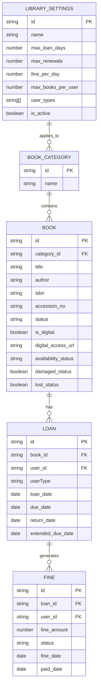
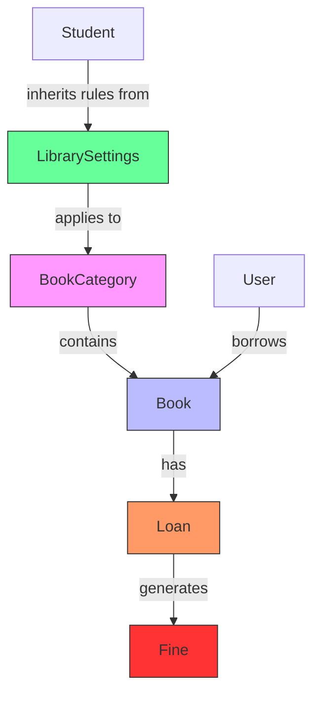
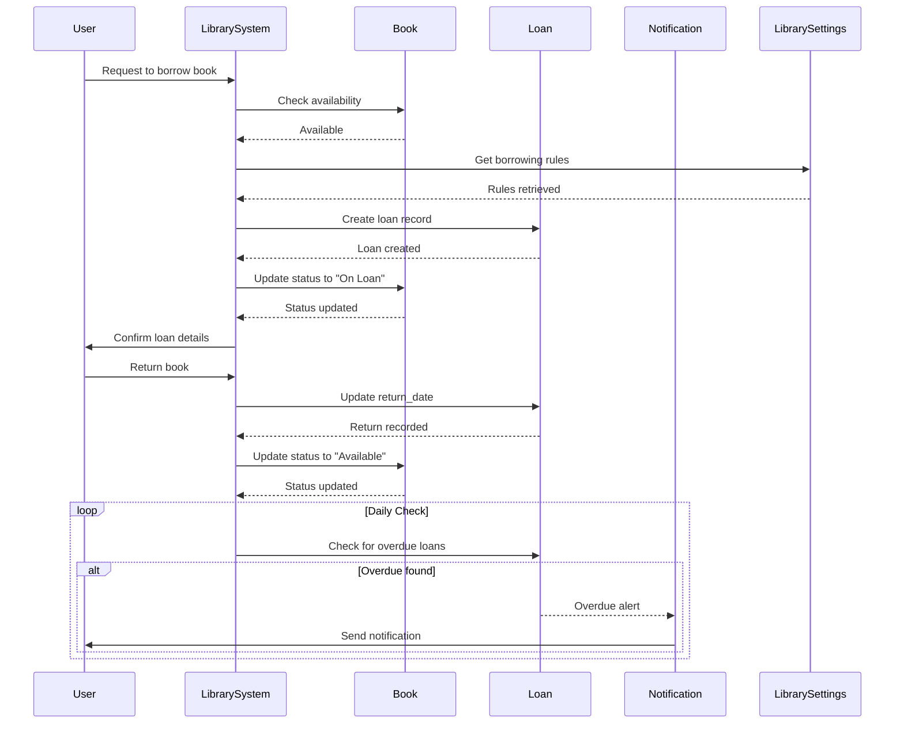
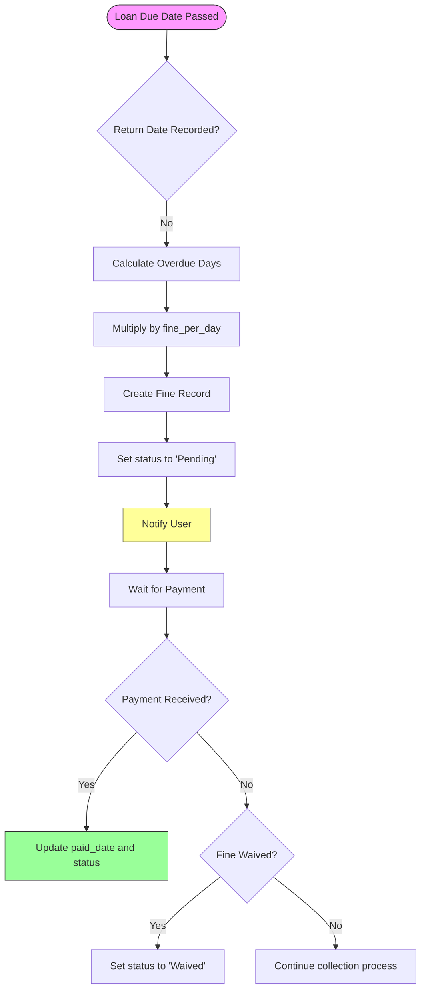
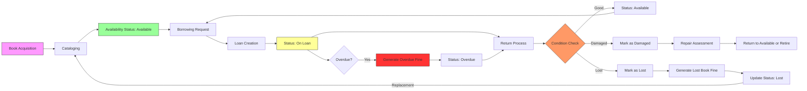

# Library Data Model

<cite>
**Referenced Files in This Document**   
- [schema.ts](file://src/modules/library/data/schema.ts)
- [types.ts](file://src/modules/library/data/types.ts)
- [collections.ts](file://src/modules/library/data/collections.ts)
- [useBookData.ts](file://src/modules/library/data/useBookData.ts)
- [useLoanData.ts](file://src/modules/library/data/useLoanData.ts)
- [useFineData.ts](file://src/modules/library/data/useFineData.ts)
- [useLibrarySettingsData.ts](file://src/modules/library/data/useLibrarySettingsData.ts)
- [useBookCategoryData.ts](file://src/modules/library/data/useBookCategoryData.ts)
- [mockData.ts](file://src/modules/library/data/mockData.ts)
</cite>

## Table of Contents
1. [Introduction](#introduction)
2. [Data Model Overview](#data-model-overview)
3. [Core Collections](#core-collections)
   - [BookCategory](#bookcategory)
   - [Book](#book)
   - [Loan](#loan)
   - [Fine](#fine)
   - [LibrarySettings](#librarysettings)
4. [Relationships and Hierarchies](#relationships-and-hierarchies)
5. [Borrowing System](#borrowing-system)
6. [Fine Management](#fine-management)
7. [Digital Resources Management](#digital-resources-management)
8. [Data Flow and Lifecycle](#data-flow-and-lifecycle)
9. [Sample Data Instances](#sample-data-instances)
10. [Conclusion](#conclusion)

## Introduction

The Library module in schoolpilot3 provides a comprehensive digital and physical book management system for educational institutions. This documentation details the data model architecture, focusing on the schema design, entity relationships, and operational workflows for book cataloging, borrowing, returns, and fine management. The system supports both physical and digital resources, with robust tracking capabilities and automated notifications for overdue items.

**Section sources**
- [schema.ts](file://src/modules/library/data/schema.ts)
- [types.ts](file://src/modules/library/data/types.ts)

## Data Model Overview

The library data model consists of five primary collections that work together to manage the complete lifecycle of library resources. These collections are designed with denormalization strategies to optimize query performance while maintaining referential integrity through reference fields.



**Diagram sources**
- [schema.ts](file://src/modules/library/data/schema.ts#L10-L108)
- [types.ts](file://src/modules/library/data/types.ts#L5-L125)

**Section sources**
- [schema.ts](file://src/modules/library/data/schema.ts)
- [types.ts](file://src/modules/library/data/types.ts)

## Core Collections

### BookCategory

The BookCategory collection represents the classification system for library books. Each category provides a hierarchical organization structure that helps in cataloging and searching books.

**Schema Definition**
```json
{
  "title": "book_category",
  "primaryKey": "id",
  "properties": {
    "id": { "type": "string", "description": "Unique identifier for the book category" },
    "name": { "type": "string", "description": "Category name", "maxLength": 100 }
  },
  "required": ["id", "name"],
  "indexes": ["name"]
}
```

**Section sources**
- [schema.ts](file://src/modules/library/data/schema.ts#L10-L18)
- [useBookCategoryData.ts](file://src/modules/library/data/useBookCategoryData.ts)

### Book

The Book collection represents both physical and digital library resources. It contains comprehensive metadata for cataloging and tracking purposes.

**Schema Definition**
```json
{
  "title": "book",
  "primaryKey": "id",
  "properties": {
    "id": { "type": "string", "description": "Unique identifier for the book" },
    "category_id": { "type": "string", "description": "Reference to book category" },
    "title": { "type": "string", "description": "Book title", "maxLength": 255 },
    "author": { "type": "string", "description": "Book author", "maxLength": 200 },
    "isbn": { "type": "string", "description": "ISBN number", "maxLength": 20 },
    "accession_no": { "type": "string", "description": "Accession number (often unique)", "maxLength": 50 },
    "status": { "type": "string", "description": "Book status", "enum": ["Available", "On Loan", "Reserved", "Lost", "Damaged", "Archived"] },
    "is_digital": { "type": "boolean", "description": "Whether book is digital" },
    "digital_access_url": { "type": "string", "description": "Digital access URL", "maxLength": 500 },
    "availability_status": { "type": "string", "description": "Availability status", "enum": ["Available", "On Loan", "Reserved"] },
    "damaged_status": { "type": "boolean", "description": "Whether book is damaged" },
    "lost_status": { "type": "boolean", "description": "Whether book is lost" }
  },
  "required": ["id", "title", "accession_no", "status", "created_at", "updated_at"]
}
```

**Key Properties**
- **status**: Enum field with values: Available, On Loan, Reserved, Lost, Damaged, Archived
- **availability_status**: Denormalized field for quick availability checks
- **is_digital**: Flag indicating if the book is a digital resource
- **accession_no**: Unique identifier assigned during book acquisition

**Section sources**
- [schema.ts](file://src/modules/library/data/schema.ts#L20-L75)
- [types.ts](file://src/modules/library/data/types.ts#L27-L54)
- [useBookData.ts](file://src/modules/library/data/useBookData.ts)

### Loan

The Loan collection tracks the circulation of books, recording when books are checked out, due dates, returns, and renewals.

**Schema Definition**
```json
{
  "title": "loan",
  "primaryKey": "id",
  "properties": {
    "id": { "type": "string", "description": "Unique identifier for the loan" },
    "book_id": { "type": "string", "description": "Reference to the book" },
    "user_id": { "type": "string", "description": "Reference to the user" },
    "userType": { "type": "string", "description": "Type of user", "enum": ["Staff", "Student", "Parent", "Supplier"] },
    "loan_date": { "type": "string", "format": "date", "description": "Date when book was loaned" },
    "due_date": { "type": "string", "format": "date", "description": "Date when book is due" },
    "return_date": { "type": "string", "format": "date", "description": "Date when book was returned" },
    "extended_due_date": { "type": "string", "format": "date", "description": "Extended due date if applicable" },
    "book_title": { "type": "string", "description": "Book title (denormalized)", "maxLength": 255 },
    "user_name": { "type": "string", "description": "User name (denormalized)", "maxLength": 200 }
  },
  "required": ["id", "book_id", "user_id", "loan_date", "due_date", "created_at", "updated_at"]
}
```

**Key Properties**
- **due_date**: Critical field determining when the book must be returned
- **return_date**: Null when book is still on loan
- **extended_due_date**: Stores the new due date after renewal
- **userType**: Categorizes the borrower (Student, Staff, etc.)

**Section sources**
- [schema.ts](file://src/modules/library/data/schema.ts#L77-L100)
- [types.ts](file://src/modules/library/data/types.ts#L56-L73)
- [useLoanData.ts](file://src/modules/library/data/useLoanData.ts)

### Fine

The Fine collection manages financial penalties for overdue, lost, or damaged books.

**Schema Definition**
```json
{
  "title": "fine",
  "primaryKey": "id",
  "properties": {
    "id": { "type": "string", "description": "Unique identifier for the fine" },
    "loan_id": { "type": "string", "description": "Reference to the loan" },
    "user_id": { "type": "string", "description": "Reference to the user" },
    "fine_amount": { "type": "number", "description": "Fine amount", "minimum": 0, "maximum": 999999.99 },
    "paid_amount": { "type": "number", "description": "Amount paid", "minimum": 0, "maximum": 999999.99 },
    "status": { "type": "string", "description": "Fine status", "enum": ["Pending", "Billed", "Paid", "Waived"] },
    "reason": { "type": "string", "description": "Reason for fine", "maxLength": 255 },
    "fine_date": { "type": "string", "format": "date", "description": "Date when fine was issued" },
    "paid_date": { "type": "string", "format": "date", "description": "Date when fine was paid" },
    "waived_date": { "type": "string", "format": "date", "description": "Date when fine was waived" },
    "waived_by": { "type": "string", "description": "Who waived the fine", "maxLength": 100 }
  },
  "required": ["id", "loan_id", "user_id", "fine_amount", "status", "fine_date", "created_at", "updated_at"]
}
```

**Key Properties**
- **fine_amount**: Monetary penalty amount
- **status**: Current state of the fine (Pending, Billed, Paid, Waived)
- **reason**: Explanation for the fine assessment
- **paid_date**: Date when payment was received

**Section sources**
- [schema.ts](file://src/modules/library/data/schema.ts#L102-L135)
- [types.ts](file://src/modules/library/data/types.ts#L75-L95)
- [useFineData.ts](file://src/modules/library/data/useFineData.ts)

### LibrarySettings

The LibrarySettings collection defines the borrowing rules and policies that govern the library system.

**Schema Definition**
```json
{
  "id": { "type": "string", "description": "Unique identifier" },
  "name": { "type": "string", "description": "Rule name" },
  "max_loan_days": { "type": "number", "description": "Maximum loan period in days" },
  "max_renewals": { "type": "number", "description": "Maximum number of renewals allowed" },
  "fine_per_day": { "type": "number", "description": "Fine amount per overdue day" },
  "max_books_per_user": { "type": "number", "description": "Maximum books a user can borrow" },
  "book_categories": { "type": "array", "items": { "type": "string" }, "description": "Categories this rule applies to" },
  "user_types": { "type": "array", "items": { "type": "string" }, "description": "User types this rule applies to" },
  "is_active": { "type": "boolean", "description": "Whether this rule is active" }
}
```

**Key Properties**
- **max_loan_days**: Determines the initial due date calculation
- **max_renewals**: Limits how many times a loan can be extended
- **fine_per_day**: Base rate for calculating overdue fines
- **user_types**: Specifies which user categories the rule affects

**Section sources**
- [types.ts](file://src/modules/library/data/types.ts#L97-L112)
- [useLibrarySettingsData.ts](file://src/modules/library/data/useLibrarySettingsData.ts)

## Relationships and Hierarchies

The library data model implements several hierarchical relationships that reflect the real-world organization of library resources.



**Diagram sources**
- [schema.ts](file://src/modules/library/data/schema.ts)
- [types.ts](file://src/modules/library/data/types.ts)

**Section sources**
- [schema.ts](file://src/modules/library/data/schema.ts)
- [types.ts](file://src/modules/library/data/types.ts)

### BookCategory → Book Hierarchy

The BookCategory to Book relationship establishes a one-to-many hierarchy where each category can contain multiple books. This structure enables:

- Organized browsing by subject area
- Targeted searches within specific categories
- Category-specific borrowing rules
- Collection development analysis by category

### Book → Loan → User Relationship

This chain of relationships tracks the complete borrowing history of each book:

1. **Book → Loan**: One book can have multiple loans over time (one-to-many)
2. **Loan → User**: Each loan is associated with a specific user (many-to-one)
3. **Book → User**: Through the loan entity, we can determine which users have borrowed a particular book

This relationship enables comprehensive circulation reporting and user borrowing history tracking.

**Section sources**
- [schema.ts](file://src/modules/library/data/schema.ts)
- [useLoanData.ts](file://src/modules/library/data/useLoanData.ts)

## Borrowing System

The borrowing system in schoolpilot3 manages the complete lifecycle of book loans, from check-out to return, with support for renewals and automated tracking.



**Diagram sources**
- [useLoanData.ts](file://src/modules/library/data/useLoanData.ts#L20-L169)
- [useBookData.ts](file://src/modules/library/data/useBookData.ts#L20-L168)

**Section sources**
- [useLoanData.ts](file://src/modules/library/data/useLoanData.ts)
- [useBookData.ts](file://src/modules/library/data/useBookData.ts)

### Key Functionality

The borrowing system provides several key operations through dedicated hooks:

- **Loan Creation**: When a book is checked out, a new Loan record is created with the current date as loan_date and a calculated due_date based on LibrarySettings
- **Return Processing**: When a book is returned, the return_date is recorded and the book status is updated
- **Renewals**: The extendLoan function updates the extended_due_date field, allowing for multiple renewals up to the max_renewals limit
- **Overdue Detection**: The system automatically checks for overdue loans and triggers notifications

### Critical Properties

- **dueDate**: Calculated as loan_date + max_loan_days from LibrarySettings
- **renewalCount**: Tracked implicitly through the extended_due_date field - each extension creates a new due date
- **activeLoans**: Determined by loans where return_date is null

**Section sources**
- [useLoanData.ts](file://src/modules/library/data/useLoanData.ts)
- [useLibrarySettingsData.ts](file://src/modules/library/data/useLibrarySettingsData.ts)

## Fine Management

The fine management system automatically calculates and tracks penalties for overdue, lost, or damaged books.



**Diagram sources**
- [useFineData.ts](file://src/modules/library/data/useFineData.ts#L20-L159)
- [useLoanData.ts](file://src/modules/library/data/useLoanData.ts#L20-L169)

**Section sources**
- [useFineData.ts](file://src/modules/library/data/useFineData.ts)
- [useLoanData.ts](file://src/modules/library/data/useLoanData.ts)

### Fine Calculation

Fines are calculated based on the following factors:

- **Overdue Books**: fine_amount = (current_date - due_date) * fine_per_day
- **Lost Books**: Typically a fixed replacement cost or higher multiplier
- **Damaged Books**: Assessment-based amount depending on damage severity

### Status Lifecycle

The fine status follows a specific lifecycle:
1. **Pending**: Fine has been issued but not yet billed
2. **Billed**: Fine has been formally billed to the user
3. **Paid**: User has made payment
4. **Waived**: Fine has been canceled (e.g., due to extenuating circumstances)

**Section sources**
- [useFineData.ts](file://src/modules/library/data/useFineData.ts)
- [types.ts](file://src/modules/library/data/types.ts#L20-L25)

## Digital Resources Management

The library system seamlessly integrates digital resources with physical book tracking through specific fields in the Book entity.

**Digital Resource Properties**
- **is_digital**: Boolean flag indicating if the resource is digital
- **digital_access_url**: URL where the digital resource can be accessed
- **digital_format**: Format of the digital resource (e.g., PDF, EPUB)
- **availability_status**: For digital resources, this may differ from physical availability

The system treats digital resources similarly to physical books in terms of borrowing:
- Digital books can be "loaned" with due dates
- Users receive access to the digital resource during the loan period
- Access is automatically revoked when the loan expires
- Digital resources can also incur fines for overdue returns

**Section sources**
- [schema.ts](file://src/modules/library/data/schema.ts#L20-L75)
- [useBookData.ts](file://src/modules/library/data/useBookData.ts)

## Data Flow and Lifecycle

The library system follows a comprehensive data flow for managing resources from acquisition to retirement.



**Diagram sources**
- [useBookData.ts](file://src/modules/library/data/useBookData.ts)
- [useLoanData.ts](file://src/modules/library/data/useLoanData.ts)
- [useFineData.ts](file://src/modules/library/data/useFineData.ts)

**Section sources**
- [useBookData.ts](file://src/modules/library/data/useBookData.ts)
- [useLoanData.ts](file://src/modules/library/data/useLoanData.ts)
- [useFineData.ts](file://src/modules/library/data/useFineData.ts)

### Key Processes

1. **Book Acquisition**: New books are added to the system with unique accession numbers
2. **Cataloging**: Complete metadata is entered, including category assignment
3. **Borrowing**: Loans are created with check-out timestamps and calculated due dates
4. **Returns**: Books are checked in with return timestamps and condition assessment
5. **Fine Management**: Automated calculation and tracking of penalties
6. **Notifications**: Overdue alerts are automatically sent to users

The system also includes automated overdue notifications through the notifyOverdueLoans function in useLoanData, which runs daily to identify loans where the due_date has passed and no return_date has been recorded.

**Section sources**
- [useLoanData.ts](file://src/modules/library/data/useLoanData.ts#L25-L35)
- [useBookData.ts](file://src/modules/library/data/useBookData.ts)
- [useFineData.ts](file://src/modules/library/data/useFineData.ts)

## Sample Data Instances

### Loan Entity with Check-out/Check-in Timestamps

```json
{
  "id": "LOAN001",
  "book_id": "BOOK002",
  "user_id": "STU003",
  "userType": "Student",
  "loan_date": "2024-06-10",
  "due_date": "2024-06-24",
  "return_date": "2024-06-25",
  "extended_due_date": null,
  "branch_id": "MAIN",
  "created_at": "2024-06-10T08:30:00.000Z",
  "updated_at": "2024-06-25T14:20:00.000Z",
  "book_title": "Cosmos",
  "user_name": "Jim Halpert"
}
```

### Fine Entity with Penalty Calculations

```json
{
  "id": "FINE001",
  "loan_id": "LOAN001",
  "user_id": "STU003",
  "fine_amount": 50,
  "paid_amount": 50,
  "status": "Paid",
  "reason": "Overdue book - 1 day late",
  "fine_date": "2024-06-25",
  "paid_date": "2024-06-26",
  "notes": "Payment received at library desk",
  "branch_id": "MAIN",
  "created_at": "2024-06-25T14:25:00.000Z",
  "updated_at": "2024-06-26T10:15:00.000Z",
  "user_name": "Jim Halpert",
  "book_title": "Cosmos"
}
```

### Library Settings Configuration

```json
{
  "id": "1",
  "name": "Student Standard Rule",
  "description": "Standard borrowing rules for students",
  "max_loan_days": 14,
  "max_renewals": 2,
  "fine_per_day": 5.0,
  "max_books_per_user": 3,
  "book_categories": ["Fiction", "Non-Fiction", "Reference"],
  "user_types": ["Student"],
  "is_active": true,
  "created_at": "2024-01-01T00:00:00.000Z",
  "updated_at": "2024-01-01T00:00:00.000Z"
}
```

**Section sources**
- [mockData.ts](file://src/modules/library/data/mockData.ts)
- [useLibrarySettingsData.ts](file://src/modules/library/data/useLibrarySettingsData.ts)

## Conclusion

The Library module in schoolpilot3 provides a robust, scalable data model for managing both physical and digital library resources. The system's architecture effectively captures the complete lifecycle of books from acquisition to retirement, with comprehensive tracking of borrowing, returns, and fine management. Key strengths include:

- Clear hierarchical relationships between BookCategory, Book, Loan, and Fine entities
- Comprehensive borrowing system with automated due date calculations and renewal tracking
- Integrated fine management with configurable rules and status workflows
- Seamless digital resources management alongside physical book tracking
- Automated overdue notifications to improve resource circulation
- Flexible library settings that support different borrowing rules for various user types

The data model is well-structured with appropriate denormalization for performance optimization while maintaining data integrity through reference fields and consistent update patterns. The use of TypeScript interfaces and enums ensures type safety and clear documentation of valid values for critical fields like status and user types.

**Section sources**
- [schema.ts](file://src/modules/library/data/schema.ts)
- [types.ts](file://src/modules/library/data/types.ts)
- [collections.ts](file://src/modules/library/data/collections.ts)