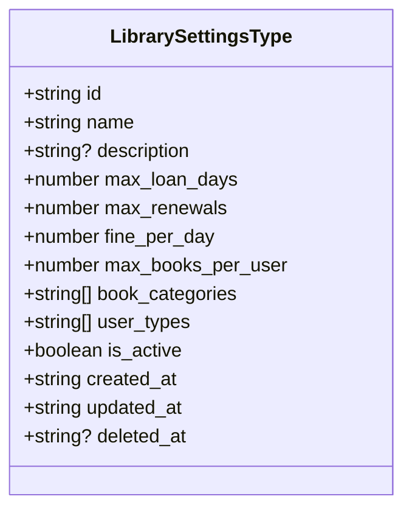
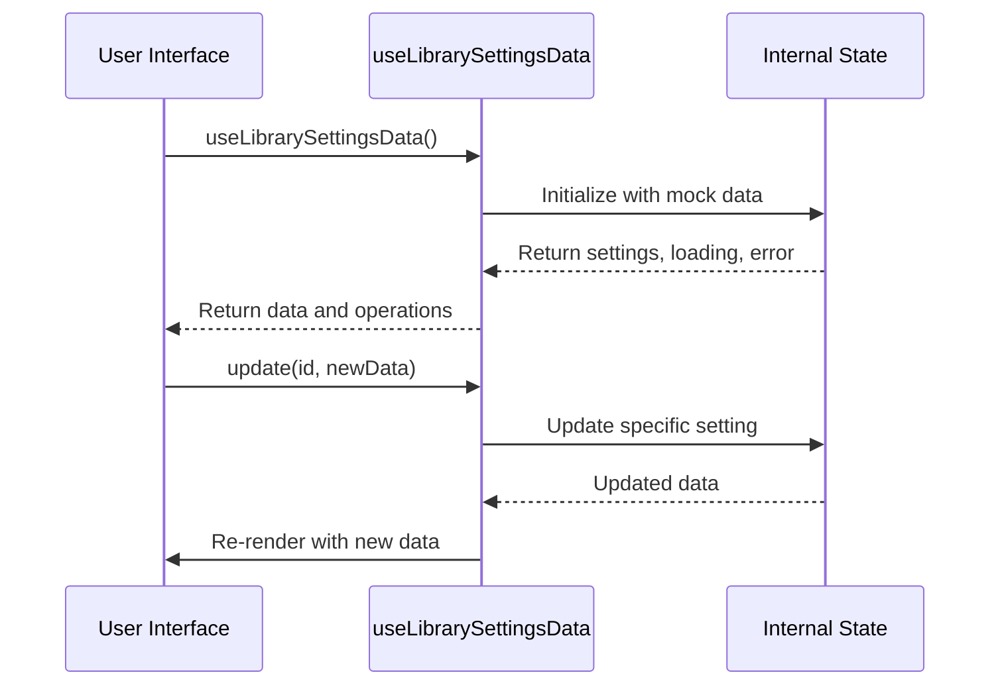
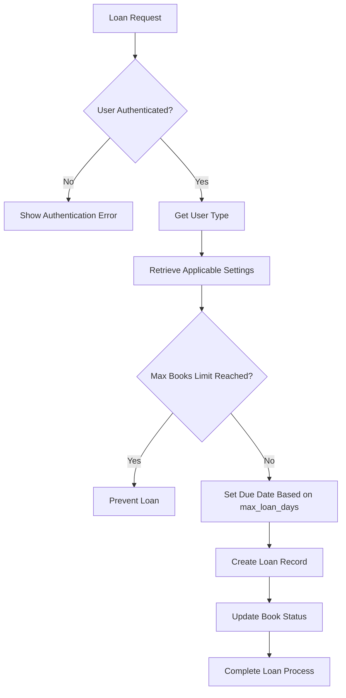
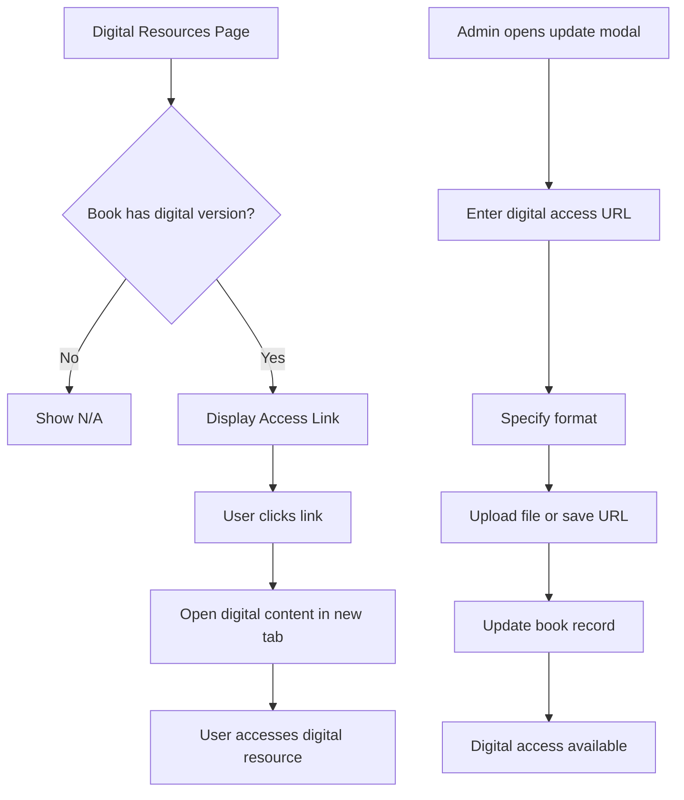

# Library Settings and Configuration

<cite>
**Referenced Files in This Document**   
- [schema.ts](file://src\modules\library\data\schema.ts)
- [types.ts](file://src\modules\library\data\types.ts)
- [useLibrarySettingsData.ts](file://src\modules\library\data\useLibrarySettingsData.ts)
- [LibrarySettingsPage.tsx](file://src\modules\library\pages\LibrarySettingsPage.tsx)
- [UserLibraryPortalPage.tsx](file://src\modules\library\pages\UserLibraryPortalPage.tsx)
- [DigitalResourcesPage.tsx](file://src\modules\library\pages\DigitalResourcesPage.tsx)
</cite>

## Table of Contents
1. [Library Settings and Configuration](#library-settings-and-configuration)
2. [LibrarySettings Entity Schema](#librarysettings-entity-schema)
3. [Policy Configuration and Business Logic](#policy-configuration-and-business-logic)
4. [Singleton Pattern Implementation](#singleton-pattern-implementation)
5. [Runtime Access with useLibrarySettingsData Hook](#runtime-access-with-uselibrarysettingsdata-hook)
6. [Operational Workflows Integration](#operational-workflows-integration)
7. [Digital Access Settings](#digital-access-settings)

## LibrarySettings Entity Schema

The LibrarySettings entity schema defines the configuration model for library borrowing rules and policies. This schema is implemented as a TypeScript interface and used to manage library-wide settings that govern loan policies, fine calculations, and user access rules.



**Diagram sources**
- [types.ts](file://src\modules\library\data\types.ts#L100-L111)

**Section sources**
- [types.ts](file://src\modules\library\data\types.ts#L100-L111)

## Policy Configuration and Business Logic

The LibrarySettings schema drives key business logic across the library system through its policy configuration fields. These settings determine how loans are processed, fines are calculated, and user access is managed.

### Loan Policy Configuration
The loan policy is governed by three primary fields:
- **max_loan_days**: Specifies the maximum number of days a book can be borrowed before becoming overdue
- **max_renewals**: Defines how many times a loan can be renewed
- **max_books_per_user**: Sets the maximum number of books a user can have on loan simultaneously

These policies are applied dynamically based on user type and book categories, allowing for differentiated rules for students, staff, and other user types.

### Fine Policy Implementation
The fine policy is implemented through the **fine_per_day** field, which specifies the daily overdue rate in Kenyan Shillings (KES). This value is used to calculate fines when books are returned past their due date. The system automatically calculates fines based on the number of days overdue multiplied by this daily rate.

### Example Policy Configurations
The system supports different policy configurations for various school levels:

**Primary School Configuration:**
- Max Loan Days: 7
- Max Renewals: 1
- Fine per Day: KES 2.00
- Max Books per User: 2
- Applies to: Student user type, Fiction and Educational categories

**Secondary School Configuration:**
- Max Loan Days: 14
- Max Renewals: 2
- Fine per Day: KES 5.00
- Max Books per User: 3
- Applies to: Student user type, All categories

**Staff Configuration:**
- Max Loan Days: 30
- Max Renewals: 5
- Fine per Day: KES 10.00
- Max Books per User: 10
- Applies to: Staff user type, All categories

**Section sources**
- [useLibrarySettingsData.ts](file://src\modules\library\data\useLibrarySettingsData.ts#L7-L25)

## Singleton Pattern Implementation

The library settings implementation follows a singleton pattern through the useLibrarySettingsData hook, ensuring that settings are centrally managed and consistently accessed throughout the application.

The singleton pattern is achieved through:
1. **Centralized State Management**: The hook maintains a single source of truth for library settings using React's useState
2. **Global Provider Flag**: The export of `isGlobalProvider = true` indicates this hook is designed for cross-module use
3. **Consistent Data Access**: All components access settings through the same hook instance, preventing data duplication

This implementation ensures that when settings are updated, all components consuming the hook receive the updated values, maintaining consistency across the application.



**Diagram sources**
- [useLibrarySettingsData.ts](file://src\modules\library\data\useLibrarySettingsData.ts)
- [LibrarySettingsPage.tsx](file://src\modules\library\pages\LibrarySettingsPage.tsx)

**Section sources**
- [useLibrarySettingsData.ts](file://src\modules\library\data\useLibrarySettingsData.ts)

## Runtime Access with useLibrarySettingsData Hook

The useLibrarySettingsData hook provides runtime access to library configurations, enabling components to retrieve and modify settings dynamically.

### Hook Interface
The hook exposes the following interface for settings management:

```typescript
interface UseLibrarySettingsData {
  data: LibrarySettingsType[];
  isLoading: boolean;
  error: string | null;
  create: (newItem: Partial<LibrarySettingsType>) => Promise<LibrarySettingsType>;
  update: (id: string, updatedData: Partial<LibrarySettingsType>) => Promise<void>;
  remove: (id: string) => Promise<void>;
  search: (query: string) => Promise<LibrarySettingsType[]>;
  getActiveSettings: () => Promise<LibrarySettingsType[]>;
  getSettingsByUserType: (userType: string) => Promise<LibrarySettingsType[]>;
  toggleActiveStatus: (id: string) => Promise<void>;
}
```

### Key Operations
- **create**: Adds a new library setting with auto-generated ID and timestamps
- **update**: Modifies an existing setting, automatically updating the timestamp
- **remove**: Deletes a setting by ID
- **search**: Filters settings based on name, description, user types, or categories
- **getActiveSettings**: Returns only active settings (is_active = true)
- **getSettingsByUserType**: Retrieves settings applicable to a specific user type
- **toggleActiveStatus**: Switches the active status of a setting

The hook uses mock data initialization with a 500ms delay to simulate API fetching, making it suitable for both development and production environments.

**Section sources**
- [useLibrarySettingsData.ts](file://src\modules\library\data\useLibrarySettingsData.ts)

## Operational Workflows Integration

Library settings are deeply integrated into operational workflows, particularly loan processing and fine calculation.

### Loan Processing Workflow
When a book is loaned, the system:
1. Identifies the user type (Student, Staff, etc.)
2. Retrieves applicable borrowing rules using getSettingsByUserType
3. Applies the max_loan_days to set the due date
4. Enforces the max_books_per_user limit before issuing the loan
5. Tracks renewal count against max_renewals



**Diagram sources**
- [UserLibraryPortalPage.tsx](file://src\modules\library\pages\UserLibraryPortalPage.tsx)
- [useLibrarySettingsData.ts](file://src\modules\library\data\useLibrarySettingsData.ts)

### Fine Calculation Process
When a book is returned overdue:
1. The system calculates days overdue by comparing return date with due date
2. Retrieves the fine_per_day rate from applicable settings
3. Multiplies days overdue by the daily rate to calculate total fine
4. Creates a fine record with the calculated amount

The UserLibraryPortalPage demonstrates this integration by checking renewal eligibility based on both overdue status and maximum renewal limits defined in the settings.

**Section sources**
- [UserLibraryPortalPage.tsx](file://src\modules\library\pages\UserLibraryPortalPage.tsx#L78-L125)

## Digital Access Settings

Digital access settings are managed through the DigitalResourcesPage component, which allows administrators to link digital files to physical books in the library catalog.

### Digital Resource Management
The system supports digital access through the following fields in the book schema:
- **is_digital**: Boolean flag indicating if the book has a digital version
- **digital_access_url**: URL or file path for accessing the digital content
- **digital_format**: Format of the digital content (PDF, EPUB, etc.)

The DigitalResourcesPage provides a user interface for:
1. Listing all books with digital resources
2. Uploading digital files or entering access URLs
3. Specifying the digital format
4. Managing digital access settings



**Diagram sources**
- [DigitalResourcesPage.tsx](file://src\modules\library\pages\DigitalResourcesPage.tsx)
- [schema.ts](file://src\modules\library\data\schema.ts#L45-L65)

**Section sources**
- [DigitalResourcesPage.tsx](file://src\modules\library\pages\DigitalResourcesPage.tsx)
- [schema.ts](file://src\modules\library\data\schema.ts#L45-L65)