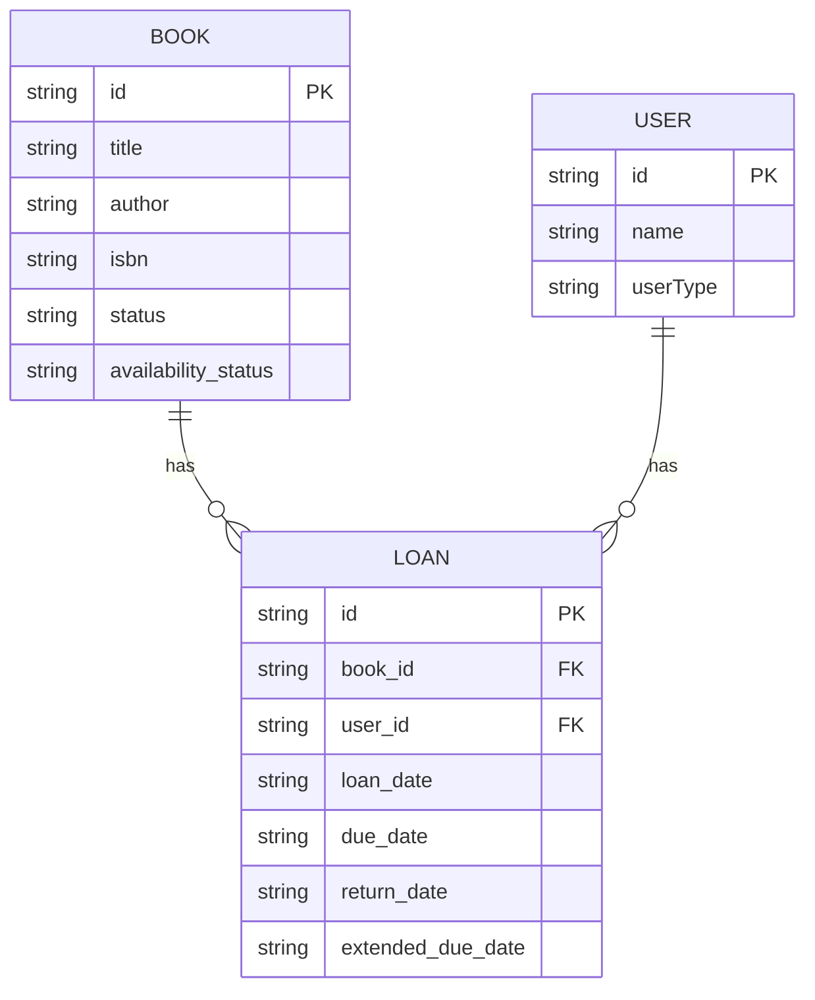
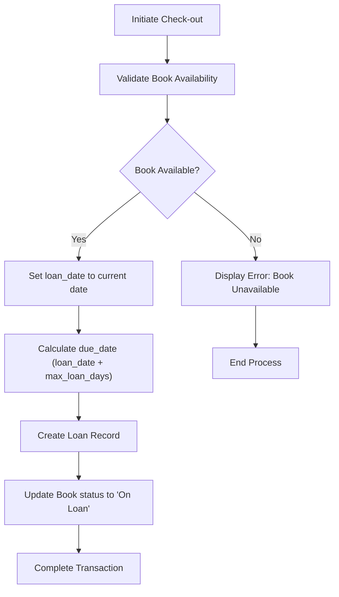
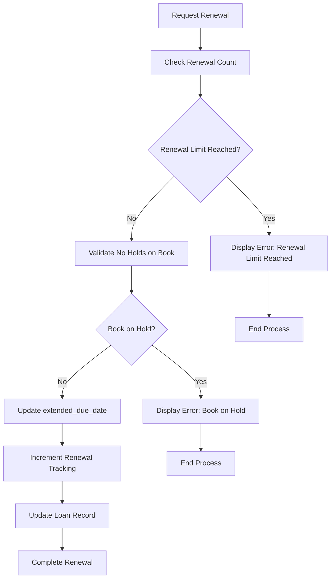
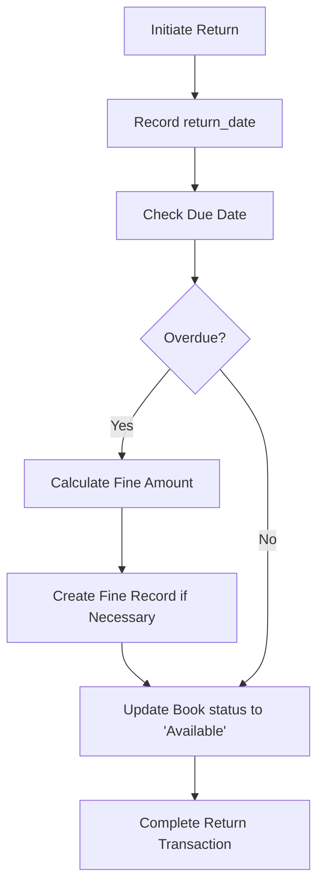
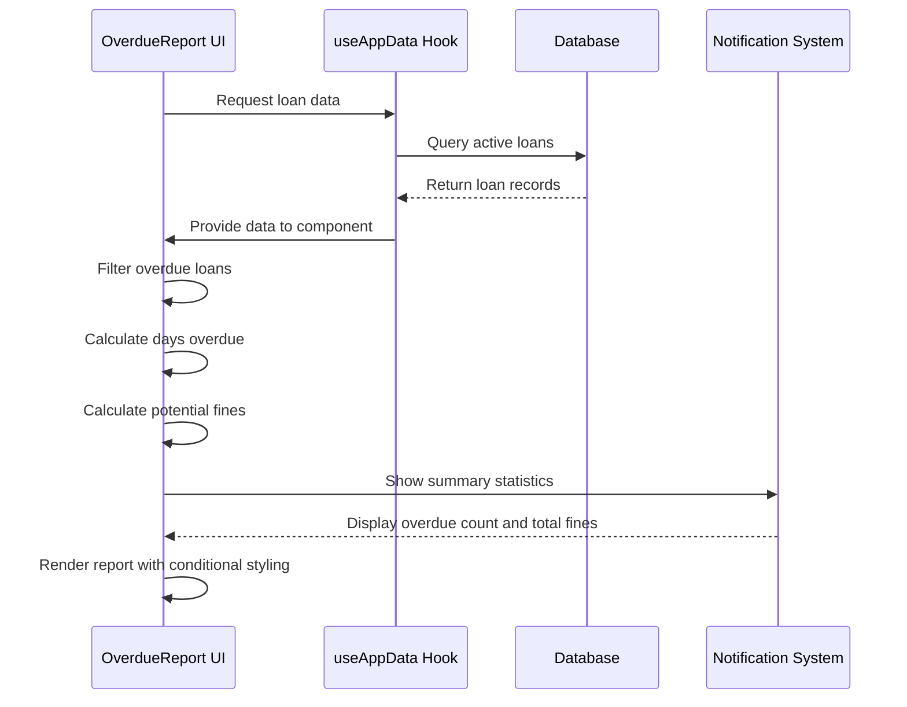

# Loan Management Data Model

<cite>
**Referenced Files in This Document**   
- [schema.ts](file://src/modules/library/data/schema.ts)
- [useLoanData.ts](file://src/modules/library/data/useLoanData.ts)
- [types.ts](file://src/modules/library/data/types.ts)
- [OverdueReport.tsx](file://src/modules/reports/library/OverdueReport.tsx)
</cite>

## Table of Contents
1. [Loan Entity Schema](#loan-entity-schema)
2. [Entity Relationships](#entity-relationships)
3. [Business Rules](#business-rules)
4. [Data Flow Processes](#data-flow-processes)
5. [Sample JSON Instances](#sample-json-instances)
6. [useLoanData Hook Functionality](#useloandata-hook-functionality)
7. [Notification System Integration](#notification-system-integration)

## Loan Entity Schema

The Loan entity schema defines the structure for tracking book loans within the library system. Based on the analysis of the schema.ts file, the Loan entity contains the following fields:

**Loan Schema Fields**
- **id**: Unique identifier for the loan (string)
- **book_id**: Reference to the book being loaned (string)
- **user_id**: Reference to the user borrowing the book (string)
- **userType**: Type of user (enum: Staff, Student, Parent, Supplier)
- **loan_date**: Date when the book was loaned (date)
- **due_date**: Date when the book is due for return (date)
- **return_date**: Date when the book was returned (optional date)
- **extended_due_date**: Extended due date if applicable (optional date)
- **branch_id**: Branch association (optional string)
- **created_at**: Record creation timestamp (timestamp)
- **updated_at**: Record last update timestamp (timestamp)
- **book_title**: Book title (denormalized for display) (optional string)
- **user_name**: User name (denormalized for display) (optional string)

The schema enforces required fields including id, book_id, user_id, loan_date, due_date, created_at, and updated_at. Indexes are created on book_id, user_id, due_date, return_date, and branch_id for optimized querying performance.

**Section sources**
- [schema.ts](file://src/modules/library/data/schema.ts#L45-L86)

## Entity Relationships

The Loan entity maintains relationships with both Book and User entities through reference fields. This creates a many-to-one relationship between loans and books, as well as between loans and users.



**Diagram sources**
- [schema.ts](file://src/modules/library/data/schema.ts#L45-L86)
- [types.ts](file://src/modules/library/data/types.ts#L58-L72)

**Section sources**
- [schema.ts](file://src/modules/library/data/schema.ts#L45-L86)
- [types.ts](file://src/modules/library/data/types.ts#L58-L72)

## Business Rules

The library system implements several business rules for loan management, which are configured through the LibrarySettingsType interface. These rules ensure consistent loan policies across the system.

**Loan Policy Rules**
- **Maximum Loan Period**: 14 days (configurable via max_loan_days in LibrarySettingsType)
- **Renewal Limits**: 2 renewals maximum (configurable via max_renewals in LibrarySettingsType)
- **Overdue Status**: Automatically updated when due_date is past the current date and no return_date is recorded
- **Fine Calculation**: Based on days overdue multiplied by fine_per_day setting
- **User Type Restrictions**: Different rules can be applied based on user type (Student, Staff, Parent, Supplier)

The system also includes validation rules to prevent invalid states, such as returning a book before it was loaned or setting a due date before the loan date.

**Section sources**
- [types.ts](file://src/modules/library/data/types.ts#L96-L110)

## Data Flow Processes

The loan management system implements three primary processes: check-out, renewal, and return. Each process follows a specific data flow pattern to ensure data consistency and integrity.

### Check-out Process


**Diagram sources**
- [useLoanData.ts](file://src/modules/library/data/useLoanData.ts#L36-L40)
- [schema.ts](file://src/modules/library/data/schema.ts#L65-L86)

### Renewal Process


**Diagram sources**
- [useLoanData.ts](file://src/modules/library/data/useLoanData.ts#L122-L125)
- [types.ts](file://src/modules/library/data/types.ts#L96-L110)

### Return Process


**Diagram sources**
- [useLoanData.ts](file://src/modules/library/data/useLoanData.ts#L165-L169)
- [schema.ts](file://src/modules/library/data/schema.ts#L65-L86)

**Section sources**
- [useLoanData.ts](file://src/modules/library/data/useLoanData.ts#L36-L169)

## Sample JSON Instances

The following JSON instances demonstrate the loan lifecycle transitions from creation through return.

**Loan Creation (Check-out)**
```json
{
  "id": "loan-001",
  "book_id": "book-123",
  "user_id": "user-456",
  "userType": "Student",
  "loan_date": "2023-12-01",
  "due_date": "2023-12-15",
  "return_date": null,
  "extended_due_date": null,
  "branch_id": "main",
  "created_at": "2023-12-01T10:30:00Z",
  "updated_at": "2023-12-01T10:30:00Z",
  "book_title": "Introduction to Computer Science",
  "user_name": "John Doe"
}
```

**Loan Renewal**
```json
{
  "id": "loan-001",
  "book_id": "book-123",
  "user_id": "user-456",
  "userType": "Student",
  "loan_date": "2023-12-01",
  "due_date": "2023-12-15",
  "return_date": null,
  "extended_due_date": "2023-12-29",
  "branch_id": "main",
  "created_at": "2023-12-01T10:30:00Z",
  "updated_at": "2023-12-14T14:20:00Z",
  "book_title": "Introduction to Computer Science",
  "user_name": "John Doe"
}
```

**Loan Return (Overdue)**
```json
{
  "id": "loan-001",
  "book_id": "book-123",
  "user_id": "user-456",
  "userType": "Student",
  "loan_date": "2023-12-01",
  "due_date": "2023-12-15",
  "return_date": "2023-12-18",
  "extended_due_date": "2023-12-29",
  "branch_id": "main",
  "created_at": "2023-12-01T10:30:00Z",
  "updated_at": "2023-12-18T09:15:00Z",
  "book_title": "Introduction to Computer Science",
  "user_name": "John Doe"
}
```

**Section sources**
- [useLoanData.ts](file://src/modules/library/data/useLoanData.ts#L36-L169)
- [types.ts](file://src/modules/library/data/types.ts#L58-L72)

## useLoanData Hook Functionality

The useLoanData hook provides comprehensive functionality for managing loan records in the library system. It implements CRUD operations and specialized methods for loan-specific processes.

### Key Functions

**Loan Creation**
The create function initializes a new loan record with the current timestamp for creation and updates. It automatically generates an ID if not provided and validates required fields before insertion into the database.

```typescript
const create = async (newItem: Partial<LibLoanType>) => {
  try {
    const db = await getDatabase();
    const loan = await db.collections.loans.insert({
      ...newItem,
      id: newItem.id || Date.now().toString(),
      created_at: new Date().toISOString(),
      updated_at: new Date().toISOString(),
    } as LibLoanType);
    return loan;
  } catch (err) {
    throw err instanceof Error ? err : new Error('Failed to create loan');
  }
};
```

**Renewal Validation**
The extendLoan function handles renewal requests by updating the extended_due_date field. The system implicitly tracks renewal attempts through the presence of extended_due_date values, with business logic enforcing the maximum of two renewals.

```typescript
const extendLoan = async (id: string, newDueDate: string) => {
  return update(id, { extended_due_date: newDueDate });
};
```

**Return Processing**
The returnBook function processes book returns by setting the return_date to the current date. This triggers downstream processes to check for overdue status and potential fines.

```typescript
const returnBook = async (id: string) => {
  const returnDate = new Date().toISOString().split('T')[0];
  return update(id, { return_date: returnDate });
};
```

The hook also includes utility functions for searching loans by various criteria, retrieving overdue loans, and getting active loans (those without a return_date).

**Section sources**
- [useLoanData.ts](file://src/modules/library/data/useLoanData.ts#L36-L169)

## Notification System Integration

The loan management system integrates with the notification system to alert staff and users about overdue loans. This integration occurs at multiple levels within the application.

### Automated Overdue Alerts

The useLoanData hook includes a notifyOverdueLoans function that automatically displays toast notifications when overdue loans are detected during data initialization:

```typescript
const notifyOverdueLoans = (loans: LibLoanType[]) => {
  const today = new Date().toISOString().split('T')[0];
  loans.forEach(loan => {
    if (!loan.return_date && loan.due_date < today) {
      showToast({
        title: 'Overdue Alert',
        message: `Loan for '${loan.book_title}' is overdue!`,
        variant: 'warning',
      });
    }
  });
};
```

### Overdue Report Generation

The OverdueReport component provides a comprehensive view of all overdue loans, including borrower details and potential fines. This report serves as both a notification mechanism and a management tool for library staff.



**Diagram sources**
- [useLoanData.ts](file://src/modules/library/data/useLoanData.ts#L12-L20)
- [OverdueReport.tsx](file://src/modules/reports/library/OverdueReport.tsx#L27-L253)

The report uses conditional styling to highlight severity levels:
- Yellow: 1-14 days overdue
- Orange: 15-30 days overdue
- Red: Over 30 days overdue

This visual hierarchy helps staff quickly identify the most urgent cases requiring attention.

**Section sources**
- [useLoanData.ts](file://src/modules/library/data/useLoanData.ts#L12-L20)
- [OverdueReport.tsx](file://src/modules/reports/library/OverdueReport.tsx#L27-L253)